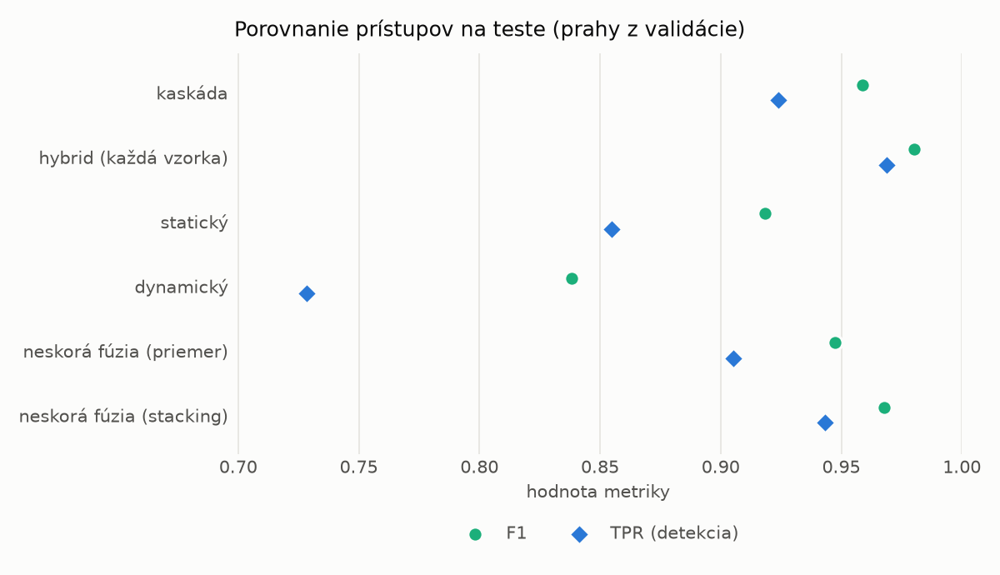
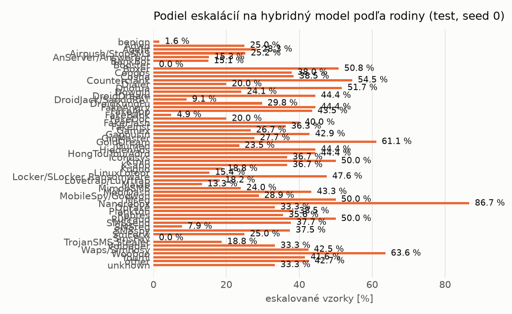

# Kaskáda `main` – beh `20261122-220751`

> Generované `src/cascade/evaluate.py` (2026-11-22T22:07:52+01:00). Seedy: [0, 1, 2]; hodnoty = priemer ± sm. odchýlka.
> Všetky prahy sú určené na validácii (FPR ≤ 1 %); test sa na nič nenastavuje.

| rola | beh |
|---|---|
| static | `runs_v4/real_full/lofo/Boxer/students_static/mlp_kd/20261122-220243` |
| dynamic | `runs_v4/real_full/lofo/Boxer/students_dynamic/mlp_kd/20261122-220408` |
| hybrid | `runs_v4/real_full/lofo/Boxer/hybrid/lightgbm/20261122-215508` |

## Test
| prístup | accuracy | balanced_accuracy | precision | recall_tpr | fpr | f1 | mcc |
|---|---|---|---|---|---|---|---|
| kaskáda | 0.9581 ± 0.0054 | 0.9602 ± 0.0051 | 0.9966 ± 0.0001 | 0.9241 ± 0.0101 | 0.0036 ± 0.0001 | 0.9589 ± 0.0055 | 0.9191 ± 0.0100 |
| hybrid (každá vzorka) | 0.9795 ± 0.0001 | 0.9802 ± 0.0001 | 0.9923 ± 0.0003 | 0.9687 ± 0.0005 | 0.0084 ± 0.0004 | 0.9804 ± 0.0001 | 0.9592 ± 0.0003 |
| statický | 0.9197 ± 0.0100 | 0.9237 ± 0.0094 | 0.9924 ± 0.0005 | 0.8549 ± 0.0191 | 0.0074 ± 0.0006 | 0.9184 ± 0.0111 | 0.8493 ± 0.0173 |
| dynamický | 0.8510 ± 0.0013 | 0.8587 ± 0.0011 | 0.9870 ± 0.0016 | 0.7283 ± 0.0036 | 0.0108 ± 0.0014 | 0.8381 ± 0.0018 | 0.7340 ± 0.0014 |
| neskorá fúzia (priemer) | 0.9469 ± 0.0045 | 0.9495 ± 0.0042 | 0.9941 ± 0.0005 | 0.9051 ± 0.0087 | 0.0061 ± 0.0005 | 0.9475 ± 0.0047 | 0.8981 ± 0.0080 |
| neskorá fúzia (stacking) | 0.9668 ± 0.0007 | 0.9683 ± 0.0007 | 0.9937 ± 0.0001 | 0.9434 ± 0.0013 | 0.0067 ± 0.0002 | 0.9679 ± 0.0007 | 0.9350 ± 0.0013 |

## Validácia
| prístup | accuracy | balanced_accuracy | precision | recall_tpr | fpr | f1 | mcc |
|---|---|---|---|---|---|---|---|
| kaskáda | 0.9665 ± 0.0013 | 0.9669 ± 0.0012 | 0.9949 ± 0.0006 | 0.9388 ± 0.0031 | 0.0050 ± 0.0006 | 0.9660 ± 0.0013 | 0.9346 ± 0.0023 |
| hybrid (každá vzorka) | 0.9810 ± 0.0001 | 0.9812 ± 0.0001 | 0.9906 ± 0.0005 | 0.9719 ± 0.0004 | 0.0095 ± 0.0005 | 0.9811 ± 0.0001 | 0.9623 ± 0.0002 |
| statický | 0.9309 ± 0.0011 | 0.9317 ± 0.0011 | 0.9892 ± 0.0000 | 0.8733 ± 0.0022 | 0.0098 ± 0.0000 | 0.9276 ± 0.0012 | 0.8682 ± 0.0020 |
| dynamický | 0.8774 ± 0.0055 | 0.8790 ± 0.0054 | 0.9877 ± 0.0002 | 0.7678 ± 0.0109 | 0.0098 ± 0.0000 | 0.8640 ± 0.0069 | 0.7755 ± 0.0093 |
| neskorá fúzia (priemer) | 0.9464 ± 0.0047 | 0.9470 ± 0.0047 | 0.9896 ± 0.0001 | 0.9039 ± 0.0093 | 0.0098 ± 0.0000 | 0.9448 ± 0.0052 | 0.8965 ± 0.0087 |
| neskorá fúzia (stacking) | 0.9691 ± 0.0016 | 0.9694 ± 0.0016 | 0.9901 ± 0.0000 | 0.9487 ± 0.0032 | 0.0098 ± 0.0000 | 0.9689 ± 0.0017 | 0.9392 ± 0.0031 |

## Správanie kaskády (test, seed 0)
- podiel eskalácií na hybrid: **15.73%** (2458 vzoriek)
- chyby pri zhode študentov (kaskáda ich nemôže opraviť): **657**
  (4.990% zo zhôd; FP 2, FN 655)
- úspešnosť na eskalovaných vzorkách: hybrid 0.967046379170057, statický 0.6842961757526445,
  dynamický 0.31570382424735555  → prínos hybridu pri nezhode

## Výpočtové nároky (odhad z benchmarkov komponentov)
_Chýba benchmark niektorého komponentu (`python -m src.evaluation.benchmark`)._

