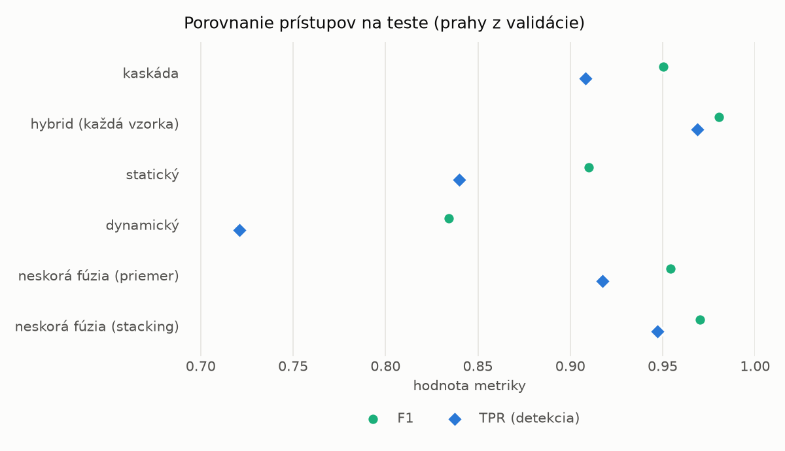
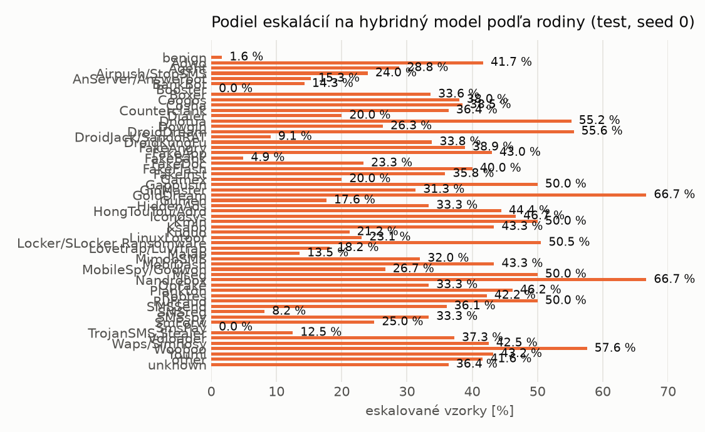

# Kaskáda `modal` – beh `20261122-220756`

> Generované `src/cascade/evaluate.py` (2026-11-22T22:07:56+01:00). Seedy: [0, 1, 2]; hodnoty = priemer ± sm. odchýlka.
> Všetky prahy sú určené na validácii (FPR ≤ 1 %); test sa na nič nenastavuje.

| rola | beh |
|---|---|
| static | `runs_v4/real_full/lofo/Boxer/students_static/mlp_kd_modal/20261122-220331` |
| dynamic | `runs_v4/real_full/lofo/Boxer/students_dynamic/mlp_kd_modal/20261122-220548` |
| hybrid | `runs_v4/real_full/lofo/Boxer/hybrid/lightgbm/20261122-215508` |

## Test
| prístup | accuracy | balanced_accuracy | precision | recall_tpr | fpr | f1 | mcc |
|---|---|---|---|---|---|---|---|
| kaskáda | 0.9499 ± 0.0103 | 0.9525 ± 0.0097 | 0.9969 ± 0.0006 | 0.9082 ± 0.0192 | 0.0032 ± 0.0006 | 0.9504 ± 0.0106 | 0.9041 ± 0.0188 |
| hybrid (každá vzorka) | 0.9795 ± 0.0001 | 0.9802 ± 0.0001 | 0.9923 ± 0.0003 | 0.9687 ± 0.0005 | 0.0084 ± 0.0004 | 0.9804 ± 0.0001 | 0.9592 ± 0.0003 |
| statický | 0.9123 ± 0.0151 | 0.9169 ± 0.0142 | 0.9935 ± 0.0020 | 0.8399 ± 0.0290 | 0.0062 ± 0.0019 | 0.9101 ± 0.0168 | 0.8371 ± 0.0259 |
| dynamický | 0.8483 ± 0.0062 | 0.8564 ± 0.0058 | 0.9900 ± 0.0011 | 0.7209 ± 0.0118 | 0.0082 ± 0.0009 | 0.8343 ± 0.0079 | 0.7309 ± 0.0098 |
| neskorá fúzia (priemer) | 0.9534 ± 0.0020 | 0.9556 ± 0.0018 | 0.9939 ± 0.0012 | 0.9176 ± 0.0047 | 0.0063 ± 0.0013 | 0.9542 ± 0.0021 | 0.9099 ± 0.0034 |
| neskorá fúzia (stacking) | 0.9693 ± 0.0013 | 0.9707 ± 0.0013 | 0.9946 ± 0.0013 | 0.9471 ± 0.0017 | 0.0058 ± 0.0014 | 0.9703 ± 0.0013 | 0.9397 ± 0.0027 |

## Validácia
| prístup | accuracy | balanced_accuracy | precision | recall_tpr | fpr | f1 | mcc |
|---|---|---|---|---|---|---|---|
| kaskáda | 0.9667 ± 0.0032 | 0.9671 ± 0.0032 | 0.9950 ± 0.0005 | 0.9391 ± 0.0059 | 0.0049 ± 0.0005 | 0.9662 ± 0.0034 | 0.9349 ± 0.0061 |
| hybrid (každá vzorka) | 0.9810 ± 0.0001 | 0.9812 ± 0.0001 | 0.9906 ± 0.0005 | 0.9719 ± 0.0004 | 0.0095 ± 0.0005 | 0.9811 ± 0.0001 | 0.9623 ± 0.0002 |
| statický | 0.9318 ± 0.0072 | 0.9326 ± 0.0071 | 0.9893 ± 0.0003 | 0.8749 ± 0.0141 | 0.0097 ± 0.0002 | 0.9285 ± 0.0081 | 0.8698 ± 0.0129 |
| dynamický | 0.8733 ± 0.0014 | 0.8749 ± 0.0014 | 0.9876 ± 0.0000 | 0.7596 ± 0.0029 | 0.0098 ± 0.0000 | 0.8587 ± 0.0018 | 0.7686 ± 0.0024 |
| neskorá fúzia (priemer) | 0.9525 ± 0.0044 | 0.9530 ± 0.0044 | 0.9897 ± 0.0001 | 0.9159 ± 0.0087 | 0.0098 ± 0.0000 | 0.9513 ± 0.0048 | 0.9077 ± 0.0082 |
| neskorá fúzia (stacking) | 0.9702 ± 0.0009 | 0.9705 ± 0.0009 | 0.9903 ± 0.0003 | 0.9506 ± 0.0017 | 0.0096 ± 0.0003 | 0.9700 ± 0.0010 | 0.9412 ± 0.0018 |

## Správanie kaskády (test, seed 0)
- podiel eskalácií na hybrid: **15.08%** (2356 vzoriek)
- chyby pri zhode študentov (kaskáda ich nemôže opraviť): **737**
  (5.554% zo zhôd; FP 3, FN 734)
- úspešnosť na eskalovaných vzorkách: hybrid 0.9630730050933786, statický 0.7062818336162988,
  dynamický 0.2937181663837012  → prínos hybridu pri nezhode

## Výpočtové nároky (odhad z benchmarkov komponentov)
_Chýba benchmark niektorého komponentu (`python -m src.evaluation.benchmark`)._

