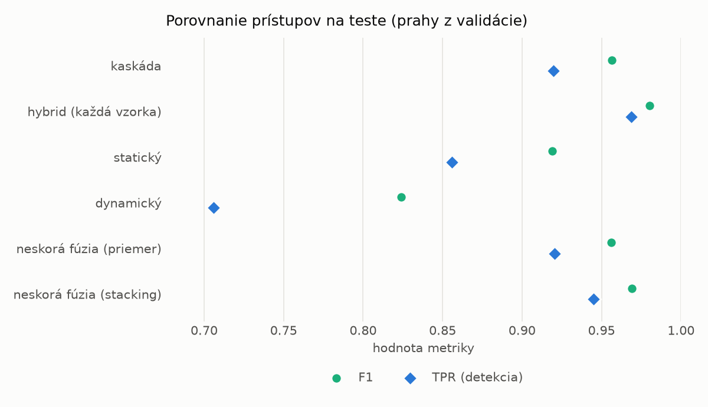
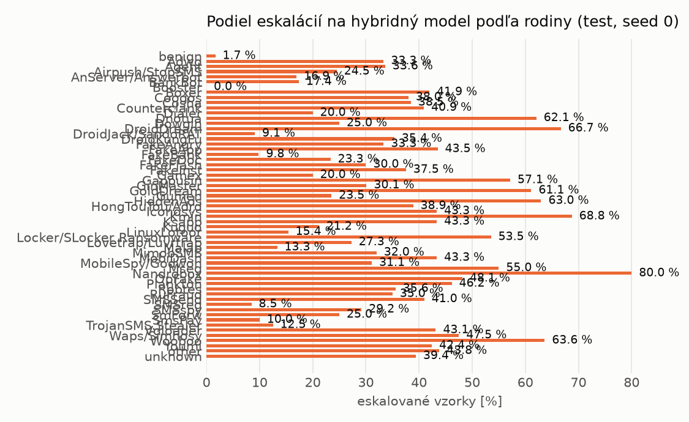

# Kaskáda `nokd` – beh `20261122-220753`

> Generované `src/cascade/evaluate.py` (2026-11-22T22:07:54+01:00). Seedy: [0, 1, 2]; hodnoty = priemer ± sm. odchýlka.
> Všetky prahy sú určené na validácii (FPR ≤ 1 %); test sa na nič nenastavuje.

| rola | beh |
|---|---|
| static | `runs_v4/real_full/lofo/Boxer/students_static/mlp_nokd/20261122-220302` |
| dynamic | `runs_v4/real_full/lofo/Boxer/students_dynamic/mlp_nokd/20261122-220458` |
| hybrid | `runs_v4/real_full/lofo/Boxer/hybrid/lightgbm/20261122-215508` |

## Test
| prístup | accuracy | balanced_accuracy | precision | recall_tpr | fpr | f1 | mcc |
|---|---|---|---|---|---|---|---|
| kaskáda | 0.9558 ± 0.0042 | 0.9581 ± 0.0040 | 0.9967 ± 0.0003 | 0.9196 ± 0.0083 | 0.0034 ± 0.0004 | 0.9566 ± 0.0044 | 0.9149 ± 0.0078 |
| hybrid (každá vzorka) | 0.9795 ± 0.0001 | 0.9802 ± 0.0001 | 0.9923 ± 0.0003 | 0.9687 ± 0.0005 | 0.0084 ± 0.0004 | 0.9804 ± 0.0001 | 0.9592 ± 0.0003 |
| statický | 0.9200 ± 0.0044 | 0.9240 ± 0.0042 | 0.9921 ± 0.0013 | 0.8558 ± 0.0079 | 0.0077 ± 0.0012 | 0.9189 ± 0.0048 | 0.8498 ± 0.0078 |
| dynamický | 0.8404 ± 0.0028 | 0.8488 ± 0.0026 | 0.9897 ± 0.0007 | 0.7059 ± 0.0059 | 0.0083 ± 0.0007 | 0.8240 ± 0.0038 | 0.7182 ± 0.0041 |
| neskorá fúzia (priemer) | 0.9552 ± 0.0020 | 0.9574 ± 0.0019 | 0.9944 ± 0.0009 | 0.9206 ± 0.0034 | 0.0059 ± 0.0009 | 0.9561 ± 0.0020 | 0.9134 ± 0.0038 |
| neskorá fúzia (stacking) | 0.9682 ± 0.0010 | 0.9696 ± 0.0009 | 0.9945 ± 0.0011 | 0.9451 ± 0.0019 | 0.0059 ± 0.0012 | 0.9692 ± 0.0010 | 0.9376 ± 0.0019 |

## Validácia
| prístup | accuracy | balanced_accuracy | precision | recall_tpr | fpr | f1 | mcc |
|---|---|---|---|---|---|---|---|
| kaskáda | 0.9668 ± 0.0032 | 0.9672 ± 0.0032 | 0.9950 ± 0.0005 | 0.9393 ± 0.0060 | 0.0049 ± 0.0005 | 0.9663 ± 0.0034 | 0.9352 ± 0.0062 |
| hybrid (každá vzorka) | 0.9810 ± 0.0001 | 0.9812 ± 0.0001 | 0.9906 ± 0.0005 | 0.9719 ± 0.0004 | 0.0095 ± 0.0005 | 0.9811 ± 0.0001 | 0.9623 ± 0.0002 |
| statický | 0.9323 ± 0.0081 | 0.9332 ± 0.0080 | 0.9893 ± 0.0003 | 0.8760 ± 0.0159 | 0.0097 ± 0.0002 | 0.9292 ± 0.0091 | 0.8708 ± 0.0146 |
| dynamický | 0.8697 ± 0.0047 | 0.8713 ± 0.0047 | 0.9876 ± 0.0003 | 0.7524 ± 0.0092 | 0.0097 ± 0.0002 | 0.8541 ± 0.0060 | 0.7626 ± 0.0079 |
| neskorá fúzia (priemer) | 0.9566 ± 0.0015 | 0.9571 ± 0.0015 | 0.9898 ± 0.0000 | 0.9239 ± 0.0030 | 0.0098 ± 0.0000 | 0.9557 ± 0.0016 | 0.9153 ± 0.0028 |
| neskorá fúzia (stacking) | 0.9695 ± 0.0010 | 0.9698 ± 0.0010 | 0.9901 ± 0.0000 | 0.9494 ± 0.0020 | 0.0098 ± 0.0000 | 0.9693 ± 0.0010 | 0.9399 ± 0.0019 |

## Správanie kaskády (test, seed 0)
- podiel eskalácií na hybrid: **16.11%** (2517 vzoriek)
- chyby pri zhode študentov (kaskáda ich nemôže opraviť): **585**
  (4.463% zo zhôd; FP 2, FN 583)
- úspešnosť na eskalovaných vzorkách: hybrid 0.9630512514898689, statický 0.7504966229638459,
  dynamický 0.24950337703615416  → prínos hybridu pri nezhode

## Výpočtové nároky (odhad z benchmarkov komponentov)
_Chýba benchmark niektorého komponentu (`python -m src.evaluation.benchmark`)._

