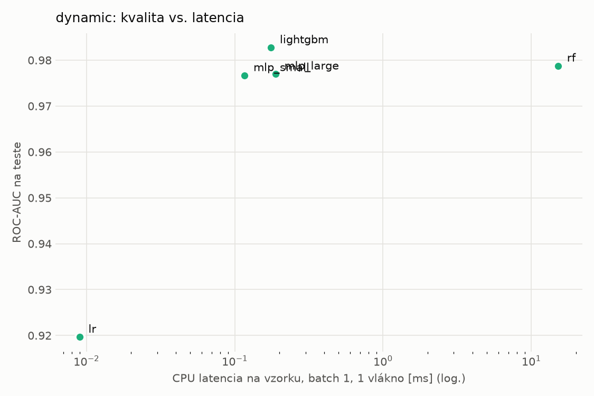
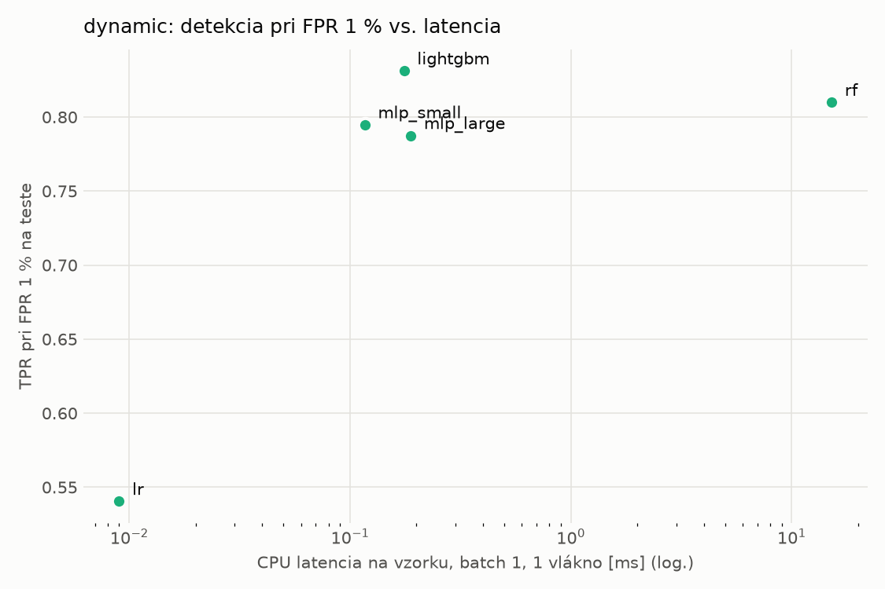
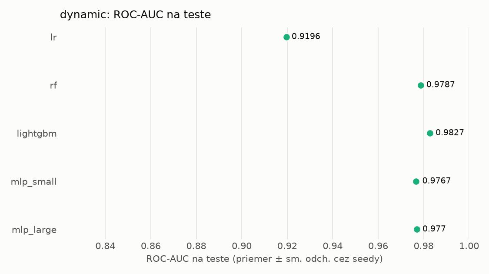
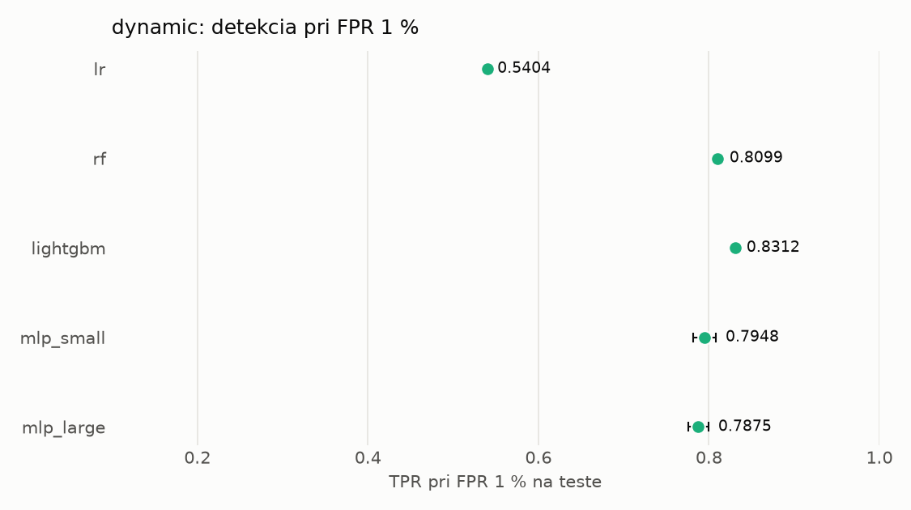

# Porovnanie modelov – dynamic

> Generované `src/evaluation/compare.py` (2026-11-22T21:54:54+01:00); použitý je posledný beh každého modelu.
> Metriky sú priemer cez seedy. \* = pri prahu určenom na validácii (FPR ≤ 1 %).
> CPU ms/vz. = medián latencie jednej vzorky na 1 vlákne vrátane transformácie vstupu (meranie hneď po tréningu,
> orientačné). Oficiálne merania spotreby sú v časti „Spotreba zdrojov pri inferencii“.

## Detekčná kvalita a orientačné časy
| model | ROC-AUC val | ROC-AUC test | TPR@FPR 1 % test | TPR@FPR 0,1 % test | F1 test* | FPR test* | gap train−val | CPU ms/vz. | CPU vz./s | GPU ms/vz. | parametre | MB | tréning s | ladenie min |
|---|---|---|---|---|---|---|---|---|---|---|---|---|---|---|
| [lr](../../dynamic/lr/20261122-215159/README.md) | 0.9198 | 0.9196 ± 0.0000 | 0.5404 | 0.4498 | 0.7031 | 0.0113 | 0.0036 | 0.009 | 3 929 335 | – | 132 | 0.01 | 0.4 | 0.0 |
| [rf](../../dynamic/rf/20261122-215202/README.md) | 0.9787 | 0.9787 ± 0.0001 | 0.8099 | 0.6978 | 0.8849 | 0.0072 | 0.0208 | 15.168 | 108 075 | – | 4 449 506 | 356.37 | 3.1 | 0.0 |
| [lightgbm](../../dynamic/lightgbm/20261122-215222/README.md) | 0.9839 | 0.9827 ± 0.0002 | 0.8312 | 0.7322 | 0.9010 | 0.0091 | 0.0154 | 0.176 | 74 585 | – | 465 429 | 25.57 | 16.5 | 0.0 |
| [mlp_small](../../dynamic/mlp_small/20261122-215326/README.md) | 0.9764 | 0.9767 ± 0.0005 | 0.7948 | 0.6269 | 0.8650 | 0.0073 | 0.0120 | 0.117 | 2 463 656 | 0.411 | 67 585 | 0.28 | 21.3 | 0.0 |
| [mlp_large](../../dynamic/mlp_large/20261122-215432/README.md) | 0.9780 | 0.9770 ± 0.0002 | 0.7875 | 0.6061 | 0.8668 | 0.0080 | 0.0133 | 0.188 | 547 621 | 0.559 | 596 481 | 2.41 | 6.5 | 0.0 |

## Nízka prevalencia malvéru (test, prah z validácie)
| model | TPR | FPR | precision @ 1 % | falošné na 1 skutočný poplach @ 1 % | precision @ 0.1 % | falošné na 1 skutočný poplach @ 0.1 % |
|---|---|---|---|---|---|---|
| lr | 0.5476 | 0.0113 | 0.329 | 2.04 | 0.046 | 20.60 |
| rf | 0.7987 | 0.0072 | 0.528 | 0.89 | 0.100 | 9.02 |
| lightgbm | 0.8265 | 0.0091 | 0.478 | 1.09 | 0.083 | 11.02 |
| mlp_small | 0.7671 | 0.0073 | 0.513 | 0.95 | 0.095 | 9.57 |
| mlp_large | 0.7706 | 0.0080 | 0.492 | 1.03 | 0.088 | 10.41 |

Prepočet: TPR a FPR nezávisia od podielu malvéru, preto sa dajú preniesť na nízku prevalenciu (v reálnej prevádzke je malvéru ~1 % alebo menej; v teste 54 %). „Falošné na 1 skutočný poplach“ = koľko neškodných súborov je označených na každý zachytený malvér.

## Spotreba zdrojov pri inferencii (benchmark, testovacia množina)
_Benchmark zatiaľ nebol spustený (`python -m src.evaluation.benchmark --approach dynamic`)._

## Grafy

