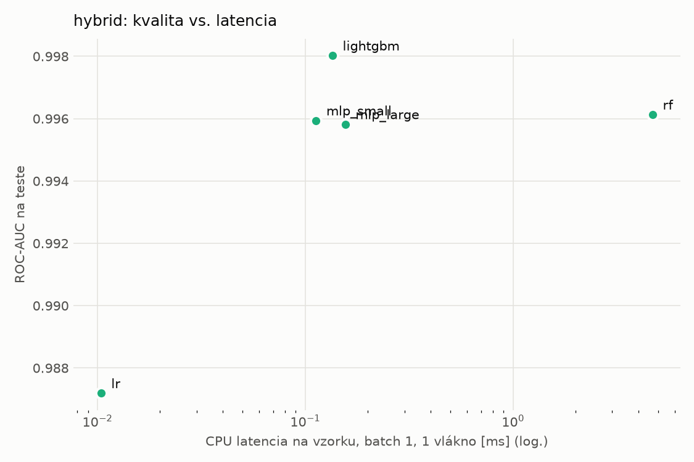
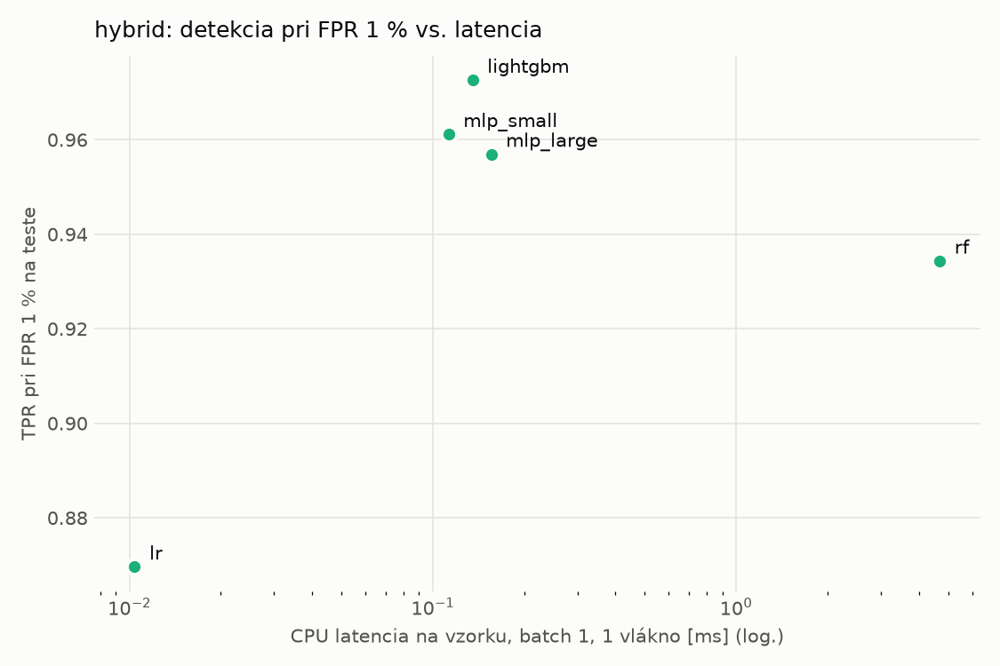
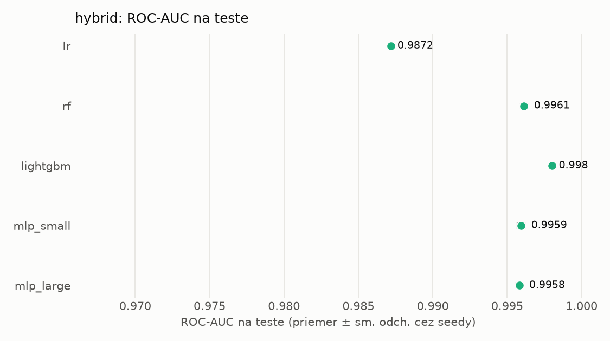
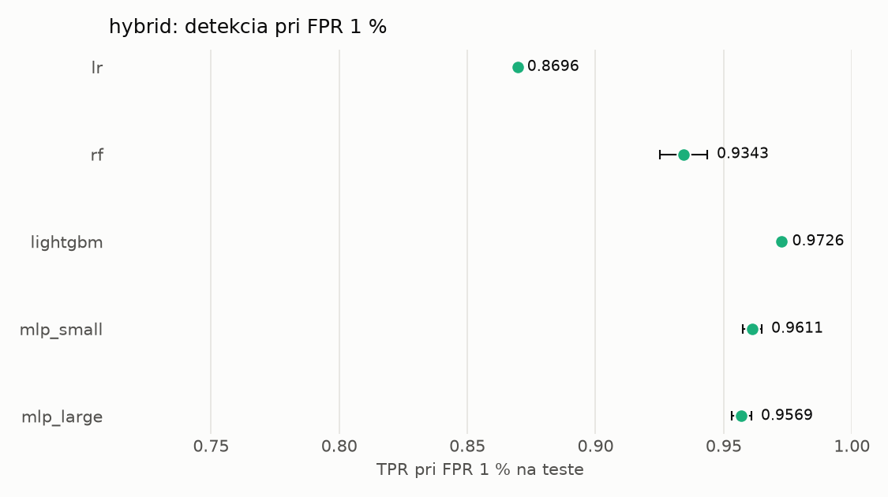

# Porovnanie modelov – hybrid

> Generované `src/evaluation/compare.py` (2026-11-22T21:57:22+01:00); použitý je posledný beh každého modelu.
> Metriky sú priemer cez seedy. \* = pri prahu určenom na validácii (FPR ≤ 1 %).
> CPU ms/vz. = medián latencie jednej vzorky na 1 vlákne vrátane transformácie vstupu (meranie hneď po tréningu,
> orientačné). Oficiálne merania spotreby sú v časti „Spotreba zdrojov pri inferencii“.

## Detekčná kvalita a orientačné časy
| model | ROC-AUC val | ROC-AUC test | TPR@FPR 1 % test | TPR@FPR 0,1 % test | F1 test* | FPR test* | gap train−val | CPU ms/vz. | CPU vz./s | GPU ms/vz. | parametre | MB | tréning s | ladenie min |
|---|---|---|---|---|---|---|---|---|---|---|---|---|---|---|
| [lr](../../hybrid/lr/20261122-215457/README.md) | 0.9864 | 0.9872 ± 0.0000 | 0.8696 | 0.6094 | 0.9150 | 0.0069 | 0.0015 | 0.010 | 2 100 501 | – | 296 | 0.01 | 0.3 | 0.0 |
| [rf](../../hybrid/rf/20261122-215500/README.md) | 0.9960 | 0.9961 ± 0.0002 | 0.9343 | 0.8490 | 0.9540 | 0.0076 | 0.0040 | 4.689 | 205 435 | – | 771 644 | 62.00 | 1.3 | 0.0 |
| [lightgbm](../../hybrid/lightgbm/20261122-215508/README.md) | 0.9973 | 0.9980 ± 0.0000 | 0.9726 | 0.9148 | 0.9804 | 0.0084 | 0.0027 | 0.135 | 111 697 | – | 371 070 | 20.67 | 18.3 | 0.0 |
| [mlp_small](../../hybrid/mlp_small/20261122-215615/README.md) | 0.9950 | 0.9959 ± 0.0002 | 0.9611 | 0.8331 | 0.9731 | 0.0070 | 0.0042 | 0.113 | 975 617 | 0.658 | 109 569 | 0.45 | 10.2 | 0.0 |
| [mlp_large](../../hybrid/mlp_large/20261122-215648/README.md) | 0.9950 | 0.9958 ± 0.0002 | 0.9569 | 0.8418 | 0.9716 | 0.0083 | 0.0036 | 0.156 | 638 986 | 0.452 | 317 697 | 1.29 | 10.4 | 0.0 |

## Nízka prevalencia malvéru (test, prah z validácie)
| model | TPR | FPR | precision @ 1 % | falošné na 1 skutočný poplach @ 1 % | precision @ 0.1 % | falošné na 1 skutočný poplach @ 0.1 % |
|---|---|---|---|---|---|---|
| lr | 0.8486 | 0.0069 | 0.553 | 0.81 | 0.109 | 8.17 |
| rf | 0.9182 | 0.0076 | 0.550 | 0.82 | 0.108 | 8.24 |
| lightgbm | 0.9687 | 0.0084 | 0.537 | 0.86 | 0.103 | 8.70 |
| mlp_small | 0.9536 | 0.0070 | 0.578 | 0.73 | 0.120 | 7.36 |
| mlp_large | 0.9517 | 0.0083 | 0.537 | 0.86 | 0.103 | 8.71 |

Prepočet: TPR a FPR nezávisia od podielu malvéru, preto sa dajú preniesť na nízku prevalenciu (v reálnej prevádzke je malvéru ~1 % alebo menej; v teste 54 %). „Falošné na 1 skutočný poplach“ = koľko neškodných súborov je označených na každý zachytený malvér.

## Spotreba zdrojov pri inferencii (benchmark, testovacia množina)
_Benchmark zatiaľ nebol spustený (`python -m src.evaluation.benchmark --approach hybrid`)._

## Grafy

