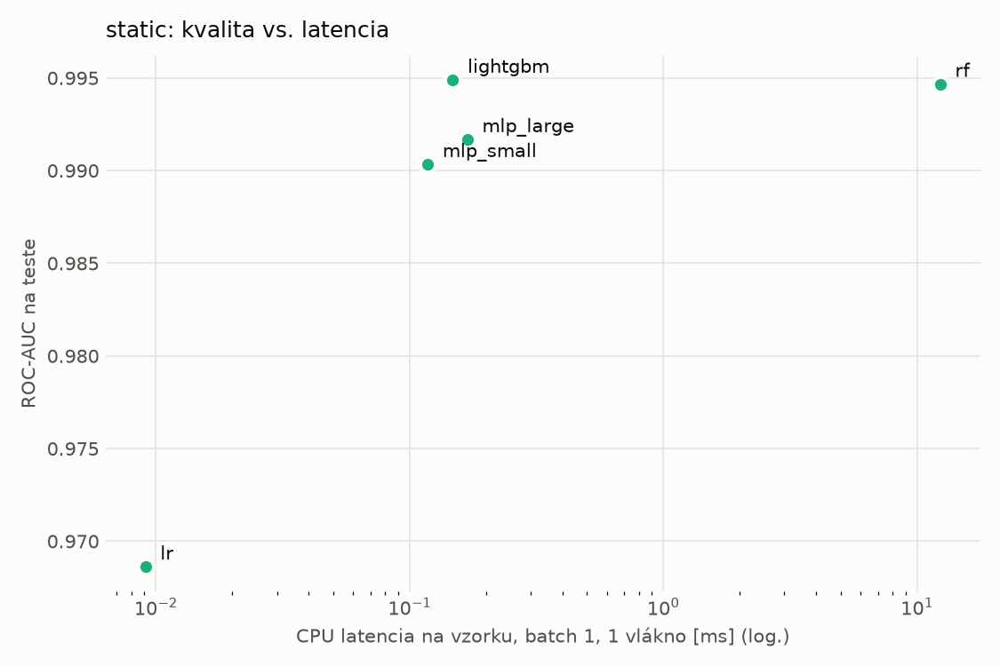
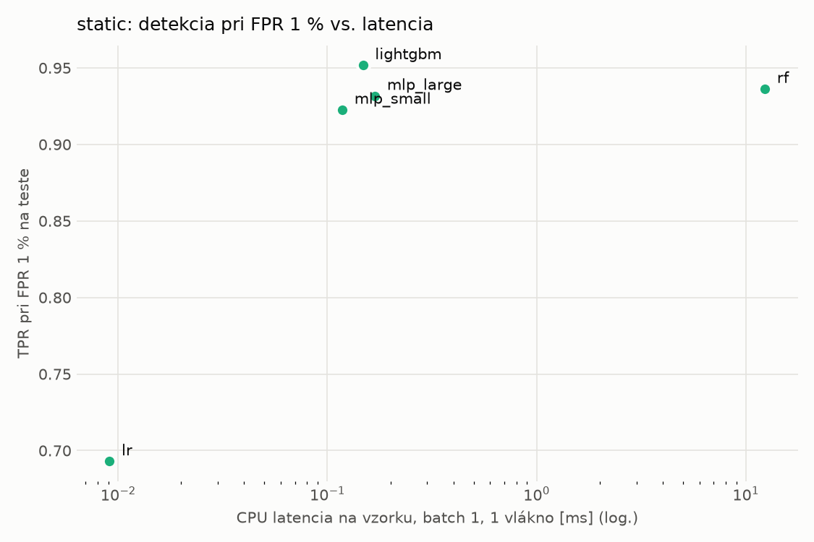
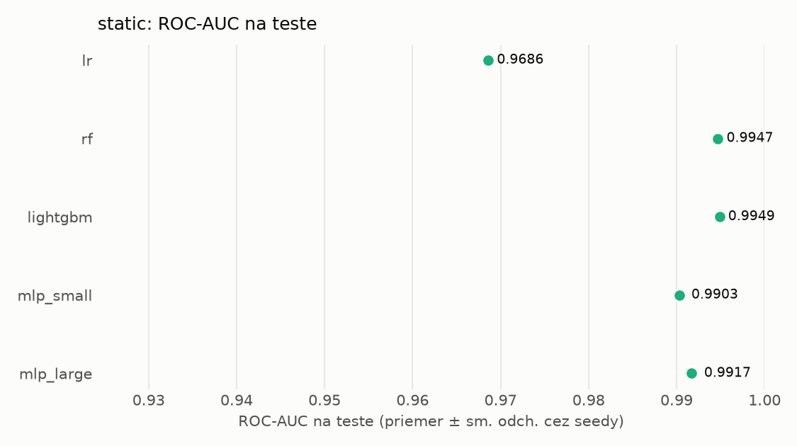
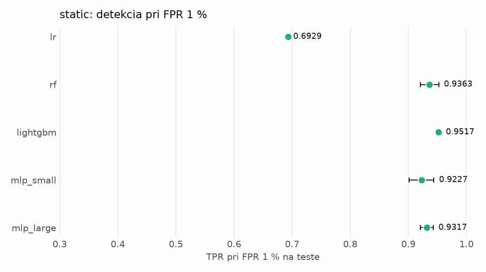

# Porovnanie modelov – static

> Generované `src/evaluation/compare.py` (2026-11-22T21:51:56+01:00); použitý je posledný beh každého modelu.
> Metriky sú priemer cez seedy. \* = pri prahu určenom na validácii (FPR ≤ 1 %).
> CPU ms/vz. = medián latencie jednej vzorky na 1 vlákne vrátane transformácie vstupu (meranie hneď po tréningu,
> orientačné). Oficiálne merania spotreby sú v časti „Spotreba zdrojov pri inferencii“.

## Detekčná kvalita a orientačné časy
| model | ROC-AUC val | ROC-AUC test | TPR@FPR 1 % test | TPR@FPR 0,1 % test | F1 test* | FPR test* | gap train−val | CPU ms/vz. | CPU vz./s | GPU ms/vz. | parametre | MB | tréning s | ladenie min |
|---|---|---|---|---|---|---|---|---|---|---|---|---|---|---|
| [lr](../../static/lr/20261122-214908/README.md) | 0.9670 | 0.9686 ± 0.0000 | 0.6929 | 0.2371 | 0.7688 | 0.0080 | 0.0042 | 0.009 | 3 904 005 | – | 165 | 0.01 | 0.2 | 0.0 |
| [rf](../../static/rf/20261122-214912/README.md) | 0.9942 | 0.9947 ± 0.0000 | 0.9363 | 0.8227 | 0.9461 | 0.0064 | 0.0058 | 12.339 | 148 571 | – | 2 626 302 | 210.47 | 1.9 | 0.0 |
| [lightgbm](../../static/lightgbm/20261122-214926/README.md) | 0.9946 | 0.9949 ± 0.0000 | 0.9517 | 0.8005 | 0.9582 | 0.0063 | 0.0054 | 0.148 | 113 438 | – | 514 156 | 28.49 | 12.6 | 0.0 |
| [mlp_small](../../static/mlp_small/20261122-215022/README.md) | 0.9909 | 0.9903 ± 0.0004 | 0.9227 | 0.5693 | 0.9281 | 0.0067 | 0.0070 | 0.118 | 1 539 955 | 0.386 | 76 033 | 0.32 | 15.7 | 0.0 |
| [mlp_large](../../static/mlp_large/20261122-215111/README.md) | 0.9916 | 0.9917 ± 0.0005 | 0.9317 | 0.6820 | 0.9348 | 0.0061 | 0.0065 | 0.169 | 971 468 | 0.515 | 250 625 | 1.02 | 14.2 | 0.0 |

## Nízka prevalencia malvéru (test, prah z validácie)
| model | TPR | FPR | precision @ 1 % | falošné na 1 skutočný poplach @ 1 % | precision @ 0.1 % | falošné na 1 skutočný poplach @ 0.1 % |
|---|---|---|---|---|---|---|
| lr | 0.6289 | 0.0080 | 0.442 | 1.26 | 0.073 | 12.75 |
| rf | 0.9028 | 0.0064 | 0.586 | 0.71 | 0.123 | 7.13 |
| lightgbm | 0.9250 | 0.0063 | 0.597 | 0.67 | 0.128 | 6.81 |
| mlp_small | 0.8710 | 0.0067 | 0.569 | 0.76 | 0.116 | 7.65 |
| mlp_large | 0.8826 | 0.0061 | 0.595 | 0.68 | 0.127 | 6.88 |

Prepočet: TPR a FPR nezávisia od podielu malvéru, preto sa dajú preniesť na nízku prevalenciu (v reálnej prevádzke je malvéru ~1 % alebo menej; v teste 54 %). „Falošné na 1 skutočný poplach“ = koľko neškodných súborov je označených na každý zachytený malvér.

## Spotreba zdrojov pri inferencii (benchmark, testovacia množina)
_Benchmark zatiaľ nebol spustený (`python -m src.evaluation.benchmark --approach static`)._

## Grafy

