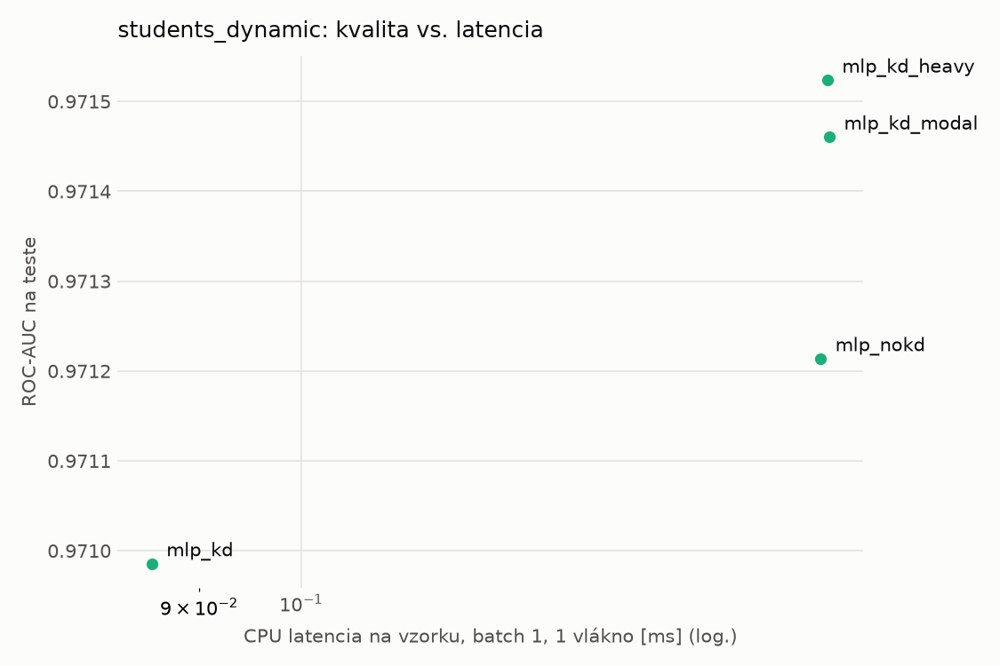
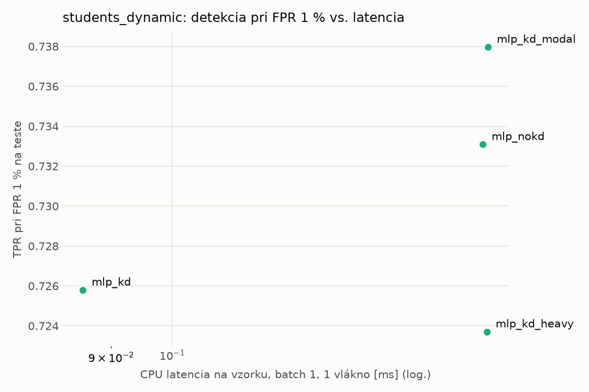
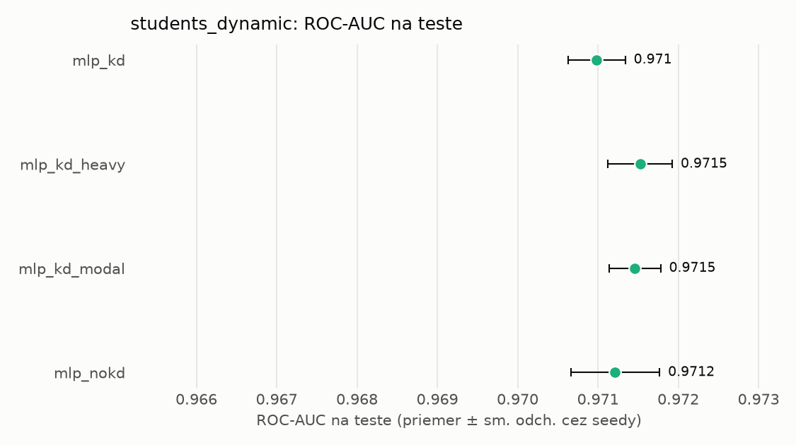
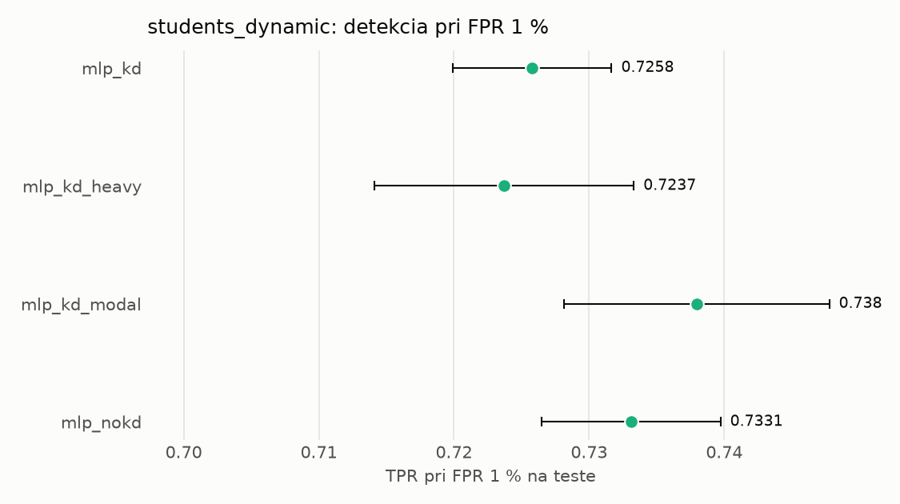

# Porovnanie modelov – students_dynamic

> Generované `src/evaluation/compare.py` (2026-11-22T22:07:49+01:00); použitý je posledný beh každého modelu.
> Metriky sú priemer cez seedy. \* = pri prahu určenom na validácii (FPR ≤ 1 %).
> CPU ms/vz. = medián latencie jednej vzorky na 1 vlákne vrátane transformácie vstupu (meranie hneď po tréningu,
> orientačné). Oficiálne merania spotreby sú v časti „Spotreba zdrojov pri inferencii“.

## Detekčná kvalita a orientačné časy
| model | ROC-AUC val | ROC-AUC test | TPR@FPR 1 % test | TPR@FPR 0,1 % test | F1 test* | FPR test* | gap train−val | CPU ms/vz. | CPU vz./s | GPU ms/vz. | parametre | MB | tréning s | ladenie min |
|---|---|---|---|---|---|---|---|---|---|---|---|---|---|---|
| [mlp_kd](../../students_dynamic/mlp_kd/20261122-220408/README.md) | 0.9706 | 0.9710 ± 0.0004 | 0.7258 | 0.5259 | 0.8381 | 0.0108 | 0.0084 | 0.086 | 5 497 695 | 0.266 | 8 641 | 0.04 | 16.4 | 0.0 |
| [mlp_kd_heavy](../../students_dynamic/mlp_kd_heavy/20261122-220636/README.md) | 0.9704 | 0.9715 ± 0.0004 | 0.7237 | 0.5472 | 0.8177 | 0.0074 | 0.0095 | 0.172 | 4 469 777 | 0.453 | 8 641 | 0.04 | 23.6 | 0.0 |
| [mlp_kd_modal](../../students_dynamic/mlp_kd_modal/20261122-220548/README.md) | 0.9707 | 0.9715 ± 0.0003 | 0.7380 | 0.5378 | 0.8343 | 0.0082 | 0.0074 | 0.173 | 4 345 106 | 0.450 | 8 641 | 0.04 | 15.2 | 0.0 |
| [mlp_nokd](../../students_dynamic/mlp_nokd/20261122-220458/README.md) | 0.9704 | 0.9712 ± 0.0006 | 0.7331 | 0.5413 | 0.8240 | 0.0083 | 0.0100 | 0.171 | 5 578 564 | 0.451 | 8 641 | 0.04 | 16.0 | 0.0 |

## Nízka prevalencia malvéru (test, prah z validácie)
| model | TPR | FPR | precision @ 1 % | falošné na 1 skutočný poplach @ 1 % | precision @ 0.1 % | falošné na 1 skutočný poplach @ 0.1 % |
|---|---|---|---|---|---|---|
| mlp_kd | 0.7283 | 0.0108 | 0.404 | 1.47 | 0.063 | 14.87 |
| mlp_kd_heavy | 0.6962 | 0.0074 | 0.486 | 1.06 | 0.086 | 10.67 |
| mlp_kd_modal | 0.7209 | 0.0082 | 0.471 | 1.12 | 0.081 | 11.31 |
| mlp_nokd | 0.7059 | 0.0083 | 0.463 | 1.16 | 0.079 | 11.68 |

Prepočet: TPR a FPR nezávisia od podielu malvéru, preto sa dajú preniesť na nízku prevalenciu (v reálnej prevádzke je malvéru ~1 % alebo menej; v teste 54 %). „Falošné na 1 skutočný poplach“ = koľko neškodných súborov je označených na každý zachytený malvér.

## Spotreba zdrojov pri inferencii (benchmark, testovacia množina)
_Benchmark zatiaľ nebol spustený (`python -m src.evaluation.benchmark --approach students_dynamic`)._

## Grafy

