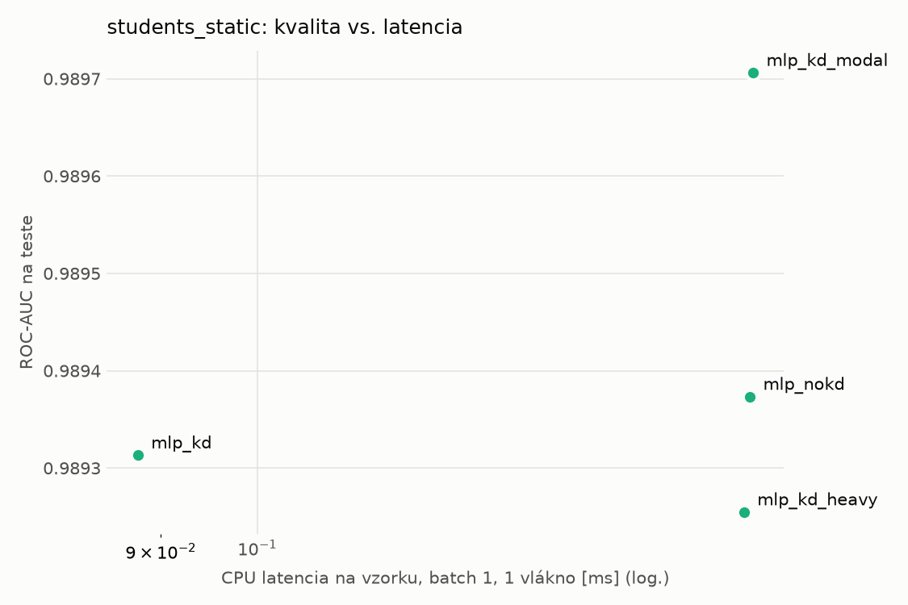
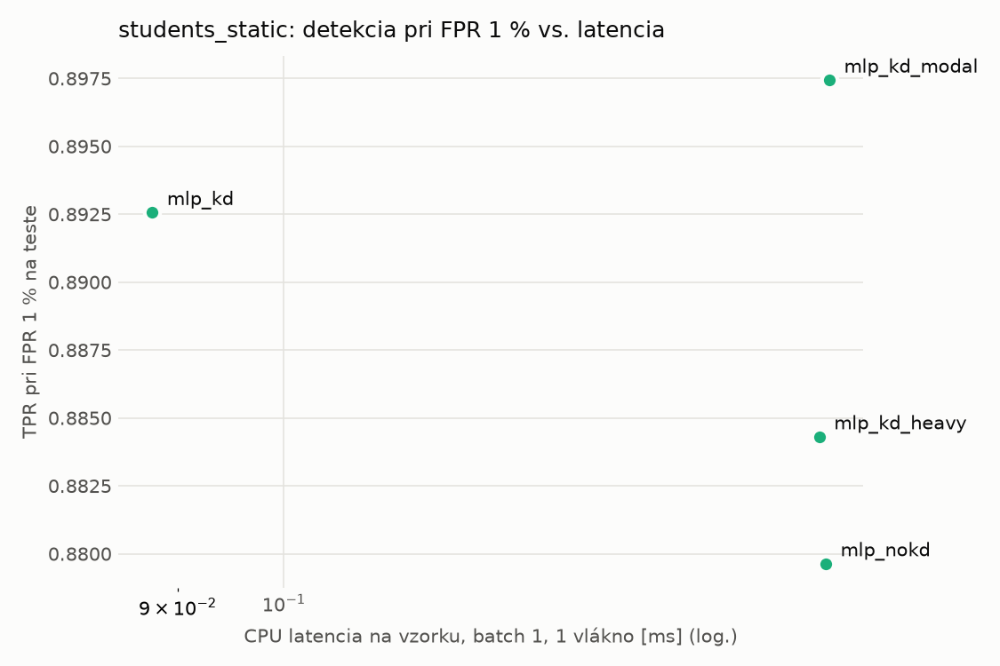
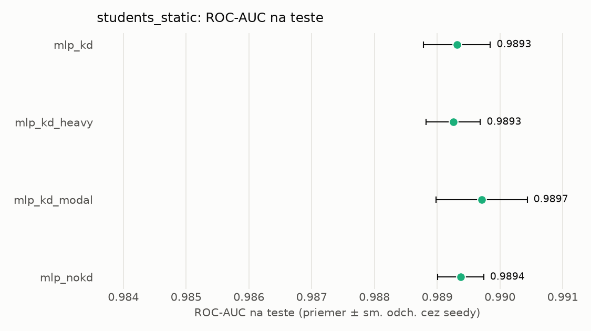
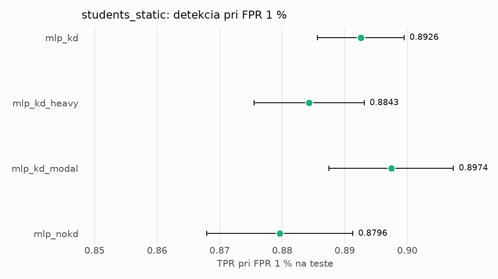

# Porovnanie modelov – students_static

> Generované `src/evaluation/compare.py` (2026-11-22T22:04:05+01:00); použitý je posledný beh každého modelu.
> Metriky sú priemer cez seedy. \* = pri prahu určenom na validácii (FPR ≤ 1 %).
> CPU ms/vz. = medián latencie jednej vzorky na 1 vlákne vrátane transformácie vstupu (meranie hneď po tréningu,
> orientačné). Oficiálne merania spotreby sú v časti „Spotreba zdrojov pri inferencii“.

## Detekčná kvalita a orientačné časy
| model | ROC-AUC val | ROC-AUC test | TPR@FPR 1 % test | TPR@FPR 0,1 % test | F1 test* | FPR test* | gap train−val | CPU ms/vz. | CPU vz./s | GPU ms/vz. | parametre | MB | tréning s | ladenie min |
|---|---|---|---|---|---|---|---|---|---|---|---|---|---|---|
| [mlp_kd](../../students_static/mlp_kd/20261122-220243/README.md) | 0.9890 | 0.9893 ± 0.0005 | 0.8926 | 0.6223 | 0.9184 | 0.0074 | 0.0044 | 0.088 | 2 506 296 | 0.449 | 10 753 | 0.05 | 5.6 | 0.0 |
| [mlp_kd_heavy](../../students_static/mlp_kd_heavy/20261122-220350/README.md) | 0.9882 | 0.9893 ± 0.0004 | 0.8843 | 0.6620 | 0.9142 | 0.0065 | 0.0047 | 0.170 | 2 811 971 | 0.274 | 10 753 | 0.05 | 4.1 | 0.0 |
| [mlp_kd_modal](../../students_static/mlp_kd_modal/20261122-220331/README.md) | 0.9891 | 0.9897 ± 0.0007 | 0.8974 | 0.6327 | 0.9101 | 0.0062 | 0.0040 | 0.172 | 3 019 966 | 0.453 | 10 753 | 0.05 | 5.8 | 0.0 |
| [mlp_nokd](../../students_static/mlp_nokd/20261122-220302/README.md) | 0.9887 | 0.9894 ± 0.0004 | 0.8796 | 0.6157 | 0.9189 | 0.0077 | 0.0054 | 0.171 | 3 492 166 | 0.281 | 10 753 | 0.05 | 9.0 | 0.0 |

## Nízka prevalencia malvéru (test, prah z validácie)
| model | TPR | FPR | precision @ 1 % | falošné na 1 skutočný poplach @ 1 % | precision @ 0.1 % | falošné na 1 skutočný poplach @ 0.1 % |
|---|---|---|---|---|---|---|
| mlp_kd | 0.8549 | 0.0074 | 0.539 | 0.86 | 0.104 | 8.64 |
| mlp_kd_heavy | 0.8468 | 0.0065 | 0.567 | 0.76 | 0.115 | 7.70 |
| mlp_kd_modal | 0.8399 | 0.0062 | 0.579 | 0.73 | 0.120 | 7.34 |
| mlp_nokd | 0.8558 | 0.0077 | 0.530 | 0.89 | 0.101 | 8.95 |

Prepočet: TPR a FPR nezávisia od podielu malvéru, preto sa dajú preniesť na nízku prevalenciu (v reálnej prevádzke je malvéru ~1 % alebo menej; v teste 54 %). „Falošné na 1 skutočný poplach“ = koľko neškodných súborov je označených na každý zachytený malvér.

## Spotreba zdrojov pri inferencii (benchmark, testovacia množina)
_Benchmark zatiaľ nebol spustený (`python -m src.evaluation.benchmark --approach students_static`)._

## Grafy

