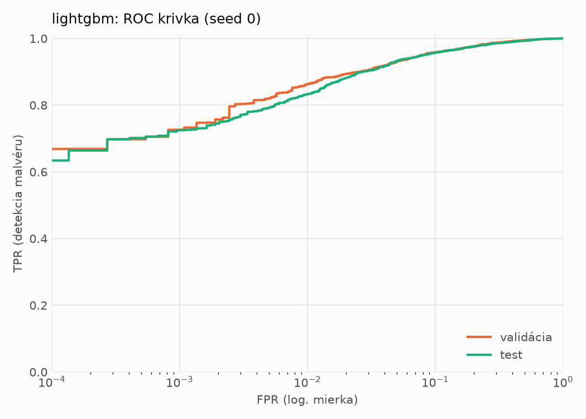
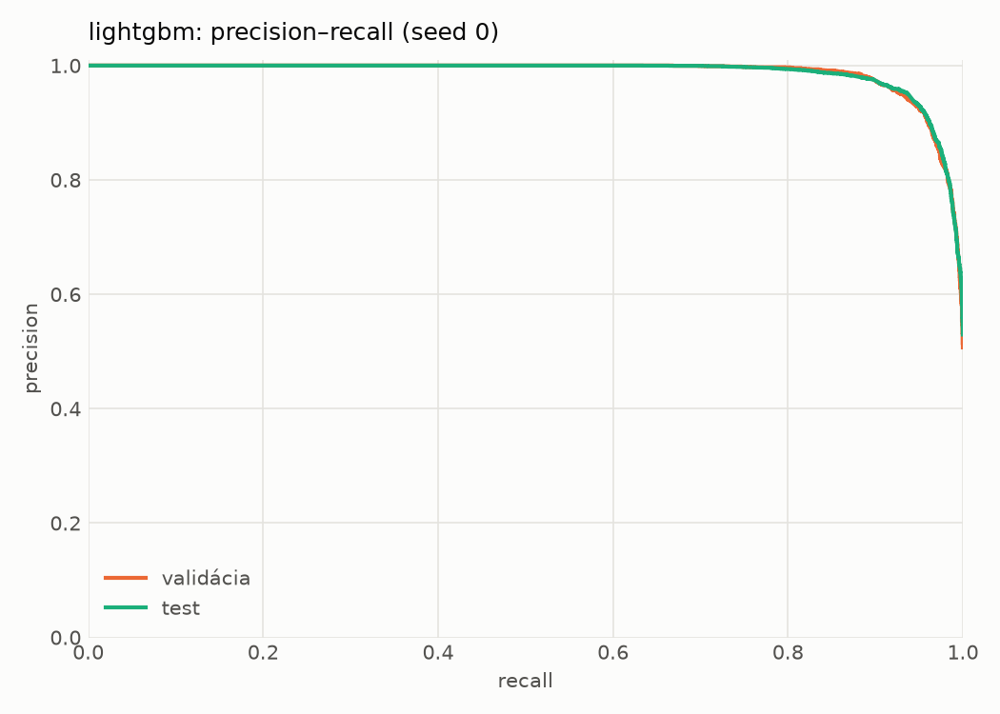
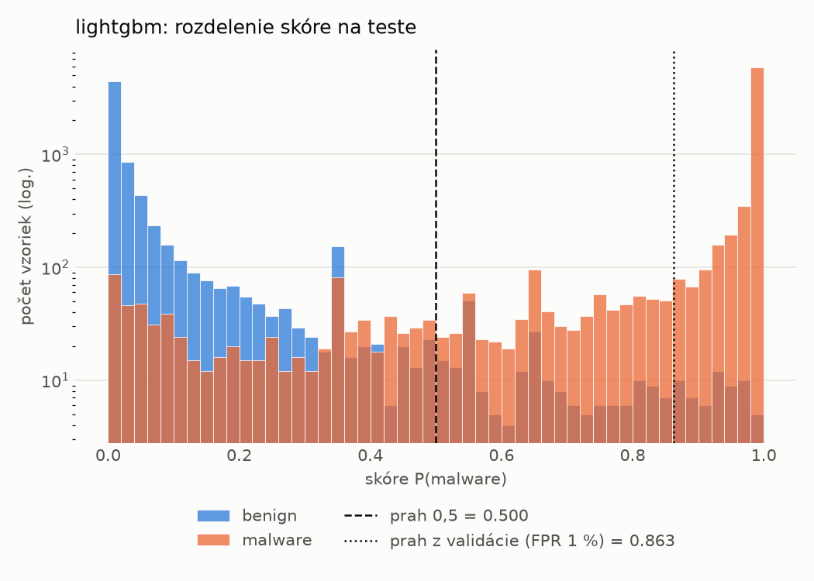
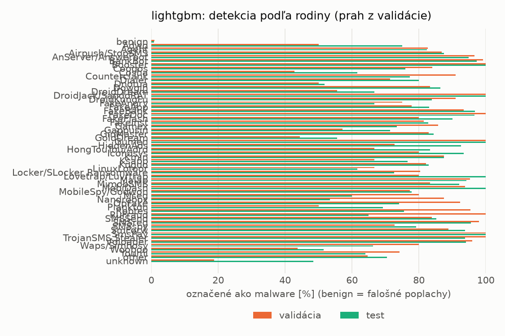
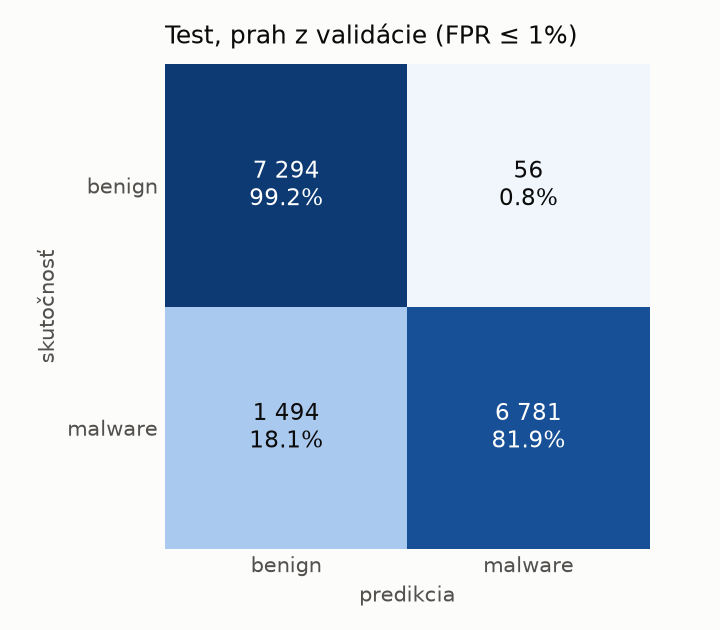
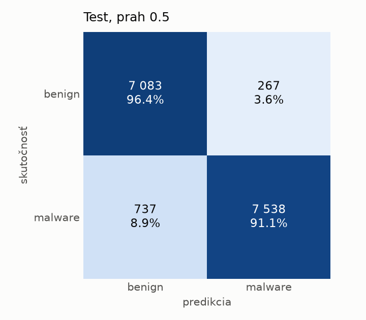
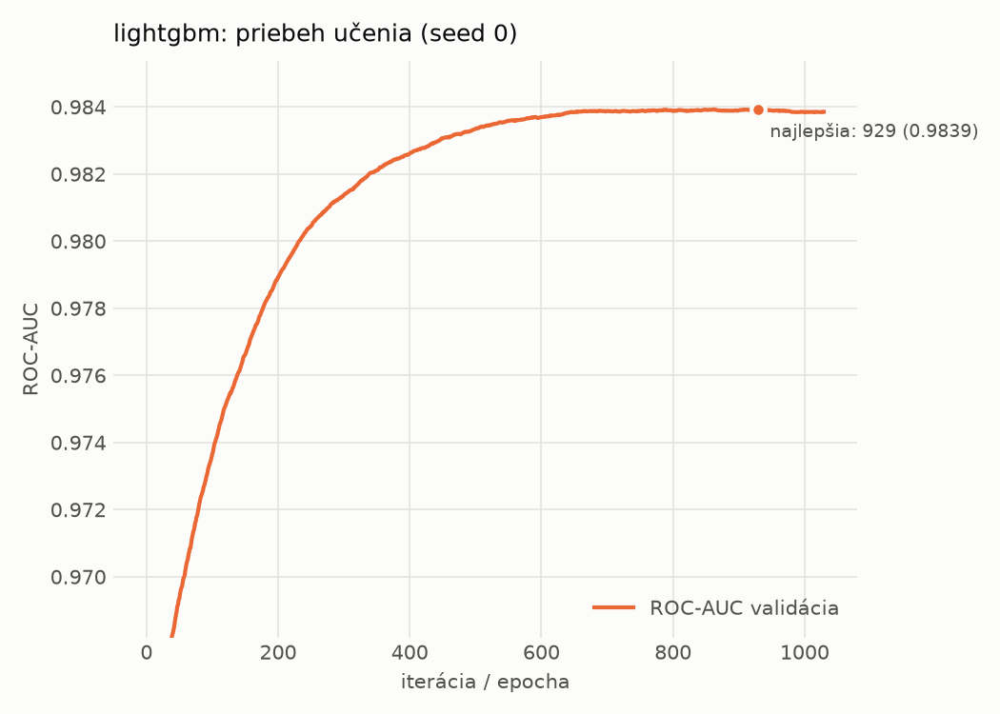

# dynamic/lightgbm – beh `20261122-215222`

> Automaticky generované (`src/training/run_tabular.py`). Konfigurácia: `config.yaml`, protokol: `protocol.yaml`.

- **Model:** `lightgbm` – LightGBM, gradient boosting stromov s early stopping na validácii (pôvodné hodnoty príznakov)
- **Ladenie:** bez ladenia – hyperparametre prevzaté z `runs_v4/real_full/full/dynamic/lightgbm/20261122-191914`
- **Finálne modely:** seedy [0, 1, 2]; hodnoty sú priemer ± smerodajná odchýlka cez seedy
- **Najlepšie hyperparametre:** `{"num_boost_round": 5000, "early_stopping_rounds": 100, "learning_rate": 0.017901592505193763, "num_leaves": 251, "min_child_samples": 52, "feature_fraction": 0.9358255991772038, "bagging_fraction": 0.8815171244905227, "lambda_l1": 0.02987319702672823, "lambda_l2": 0.017348460156736675}`

## Detekčná kvalita (bez prahu)
| metrika | train (podvzorka) | validácia | test |
|---|---|---|---|
| ROC-AUC | 0.9993 ± 0.0001 | 0.9839 ± 0.0001 | 0.9827 ± 0.0002 |
| PR-AUC | 0.9992 ± 0.0001 | 0.9870 ± 0.0001 | 0.9870 ± 0.0002 |
| TPR pri FPR 1 % | 0.9737 ± 0.0045 | 0.8660 ± 0.0032 | 0.8312 ± 0.0015 |
| TPR pri FPR 0,1 % | 0.9637 ± 0.0013 | 0.7332 ± 0.0081 | 0.7322 ± 0.0065 |
| log loss | 0.0460 ± 0.0034 | 0.1552 ± 0.0010 | 0.1664 ± 0.0020 |
| Brier skóre | 0.0113 ± 0.0008 | 0.0448 ± 0.0001 | 0.0478 ± 0.0006 |

Rozdiel ROC-AUC train − validácia: **0.0154** (veľký rozdiel = preučenie).

## Pri prahu z validácie (FPR ≤ 1% na validácii)
| metrika | train (podvzorka) | validácia | test |
|---|---|---|---|
| accuracy | 0.9730 ± 0.0012 | 0.9273 ± 0.0016 | 0.9038 ± 0.0028 |
| balanced accuracy | 0.9727 ± 0.0012 | 0.9281 ± 0.0016 | 0.9087 ± 0.0026 |
| precision | 0.9997 ± 0.0001 | 0.9891 ± 0.0000 | 0.9903 ± 0.0013 |
| recall (TPR) | 0.9457 ± 0.0024 | 0.8660 ± 0.0032 | 0.8265 ± 0.0064 |
| FPR | 0.0003 ± 0.0001 | 0.0098 ± 0.0000 | 0.0091 ± 0.0013 |
| F1 | 0.9720 ± 0.0013 | 0.9235 ± 0.0018 | 0.9010 ± 0.0033 |
| MCC | 0.9473 ± 0.0023 | 0.8616 ± 0.0029 | 0.8215 ± 0.0044 |

## Pri pevnom prahu 0.5
| metrika | train (podvzorka) | validácia | test |
|---|---|---|---|
| accuracy | 0.9841 ± 0.0005 | 0.9392 ± 0.0010 | 0.9361 ± 0.0014 |
| balanced accuracy | 0.9840 ± 0.0005 | 0.9395 ± 0.0010 | 0.9377 ± 0.0013 |
| precision | 0.9886 ± 0.0002 | 0.9557 ± 0.0003 | 0.9659 ± 0.0005 |
| recall (TPR) | 0.9791 ± 0.0008 | 0.9229 ± 0.0020 | 0.9115 ± 0.0022 |
| FPR | 0.0111 ± 0.0002 | 0.0440 ± 0.0003 | 0.0362 ± 0.0005 |
| F1 | 0.9838 ± 0.0005 | 0.9390 ± 0.0010 | 0.9379 ± 0.0014 |
| MCC | 0.9682 ± 0.0010 | 0.8790 ± 0.0019 | 0.8738 ± 0.0027 |

## Výpočtové nároky (seed 0, testovacia množina)
| meranie | hodnota |
|---|---|
| tréning finálneho modelu | 16.5 s (priemer cez seedy) |
| ladenie spolu | 0 s |
| počet parametrov / uzlov | 465 429 |
| veľkosť modelu na disku | 25.57 MB |
| CPU latencia modelu (batch 1, 1 vlákno) | 0.176 ms (p95 0.216) |
| CPU priepustnosť (24 vlákien) | 74 585 vzoriek/s |

## Grafy
| | |
|---|---|
|  |  |
|  |  |
|  |  |
|  |  |

## Súbory
`metrics.json` (všetky metriky po seedoch vrátane rodín), `timing.json`, `hpo_trials.csv`,
`predictions/<časť>_seed<N>.parquet` (sha256, family, label, score), `model/seed_<N>/`, `log.txt`.
