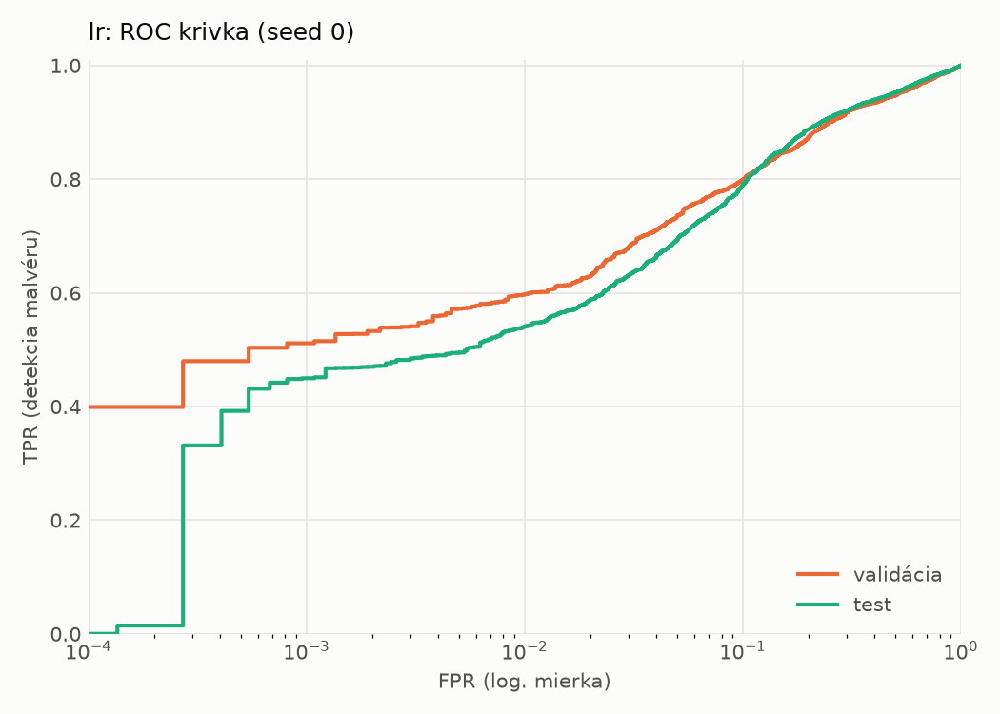
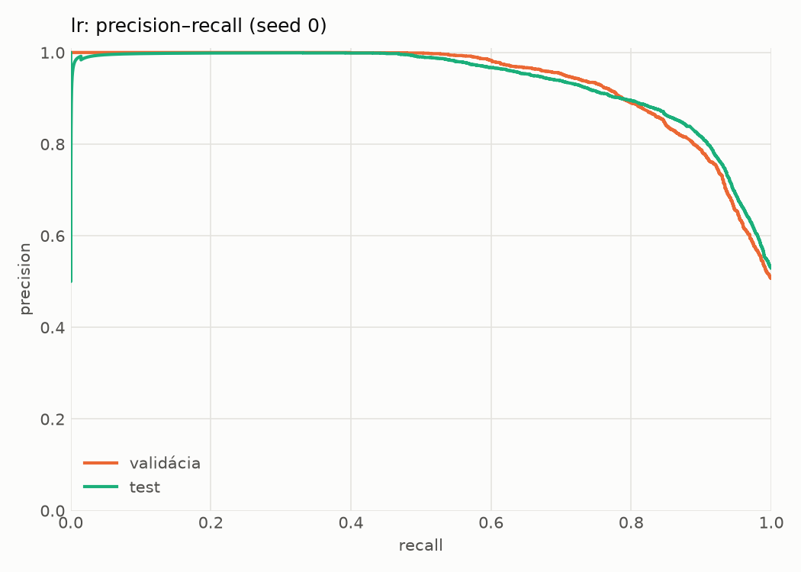
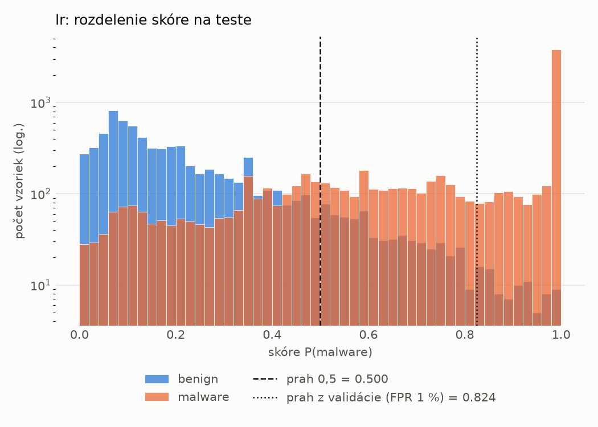
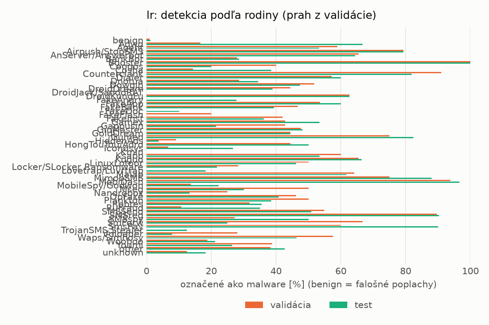
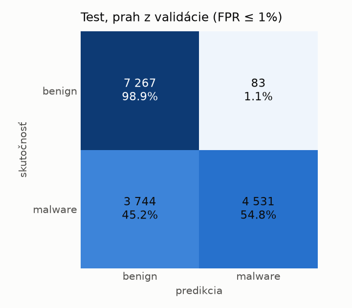
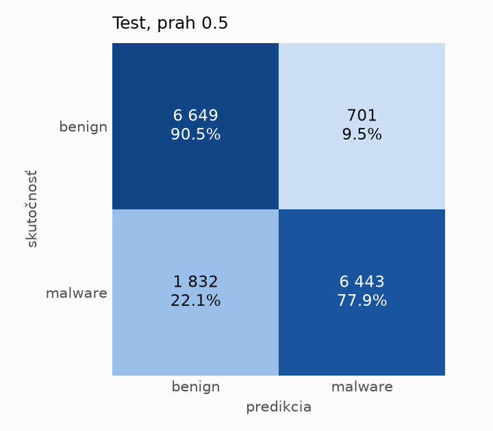

# dynamic/lr – beh `20261122-215159`

> Automaticky generované (`src/training/run_tabular.py`). Konfigurácia: `config.yaml`, protokol: `protocol.yaml`.

- **Model:** `logreg` – logistická regresia s L2 regularizáciou (vstup signed log1p + štandardizácia)
- **Ladenie:** bez ladenia – hyperparametre prevzaté z `runs_v4/real_full/full/dynamic/lr/20261122-191725`
- **Finálne modely:** seedy [0, 1, 2]; hodnoty sú priemer ± smerodajná odchýlka cez seedy
- **Najlepšie hyperparametre:** `{"max_iter": 2000, "C": 3.784688828069828}`

## Detekčná kvalita (bez prahu)
| metrika | train (podvzorka) | validácia | test |
|---|---|---|---|
| ROC-AUC | 0.9234 ± 0.0000 | 0.9198 ± 0.0000 | 0.9196 ± 0.0000 |
| PR-AUC | 0.9381 ± 0.0000 | 0.9384 ± 0.0000 | 0.9385 ± 0.0000 |
| TPR pri FPR 1 % | 0.5903 ± 0.0000 | 0.5968 ± 0.0000 | 0.5404 ± 0.0000 |
| TPR pri FPR 0,1 % | 0.5063 ± 0.0000 | 0.5114 ± 0.0000 | 0.4498 ± 0.0000 |
| log loss | 0.3384 ± 0.0000 | 0.3451 ± 0.0000 | 0.3609 ± 0.0000 |
| Brier skóre | 0.1055 ± 0.0000 | 0.1082 ± 0.0000 | 0.1134 ± 0.0000 |

Rozdiel ROC-AUC train − validácia: **0.0036** (veľký rozdiel = preučenie).

## Pri prahu z validácie (FPR ≤ 1% na validácii)
| metrika | train (podvzorka) | validácia | test |
|---|---|---|---|
| accuracy | 0.7996 ± 0.0000 | 0.7907 ± 0.0000 | 0.7551 ± 0.0000 |
| balanced accuracy | 0.7977 ± 0.0000 | 0.7935 ± 0.0000 | 0.7681 ± 0.0000 |
| precision | 0.9767 ± 0.0000 | 0.9843 ± 0.0000 | 0.9820 ± 0.0000 |
| recall (TPR) | 0.6097 ± 0.0000 | 0.5968 ± 0.0000 | 0.5476 ± 0.0000 |
| FPR | 0.0143 ± 0.0000 | 0.0098 ± 0.0000 | 0.0113 ± 0.0000 |
| F1 | 0.7507 ± 0.0000 | 0.7431 ± 0.0000 | 0.7031 ± 0.0000 |
| MCC | 0.6443 ± 0.0000 | 0.6360 ± 0.0000 | 0.5867 ± 0.0000 |

## Pri pevnom prahu 0.5
| metrika | train (podvzorka) | validácia | test |
|---|---|---|---|
| accuracy | 0.8554 ± 0.0000 | 0.8491 ± 0.0000 | 0.8379 ± 0.0000 |
| balanced accuracy | 0.8549 ± 0.0000 | 0.8498 ± 0.0000 | 0.8416 ± 0.0000 |
| precision | 0.8937 ± 0.0000 | 0.8890 ± 0.0000 | 0.9019 ± 0.0000 |
| recall (TPR) | 0.8034 ± 0.0000 | 0.8026 ± 0.0000 | 0.7786 ± 0.0000 |
| FPR | 0.0937 ± 0.0000 | 0.1031 ± 0.0000 | 0.0954 ± 0.0000 |
| F1 | 0.8462 ± 0.0000 | 0.8436 ± 0.0000 | 0.8357 ± 0.0000 |
| MCC | 0.7141 ± 0.0000 | 0.7019 ± 0.0000 | 0.6845 ± 0.0000 |

## Výpočtové nároky (seed 0, testovacia množina)
| meranie | hodnota |
|---|---|
| tréning finálneho modelu | 0.4 s (priemer cez seedy) |
| ladenie spolu | 0 s |
| počet parametrov / uzlov | 132 |
| veľkosť modelu na disku | 0.01 MB |
| transformácia vstupu – latencia (1 vlákno) | 0.005 ms |
| transformácia vstupu – priepustnosť | 1 326 615 vzoriek/s |
| CPU latencia modelu (batch 1, 1 vlákno) | 0.004 ms (p95 0.008) |
| CPU priepustnosť (24 vlákien) | 3 929 335 vzoriek/s |

## Grafy
| | |
|---|---|
|  |  |
|  |  |
|  |  |
|  |  |

## Súbory
`metrics.json` (všetky metriky po seedoch vrátane rodín), `timing.json`, `hpo_trials.csv`,
`predictions/<časť>_seed<N>.parquet` (sha256, family, label, score), `model/seed_<N>/`, `log.txt`.
