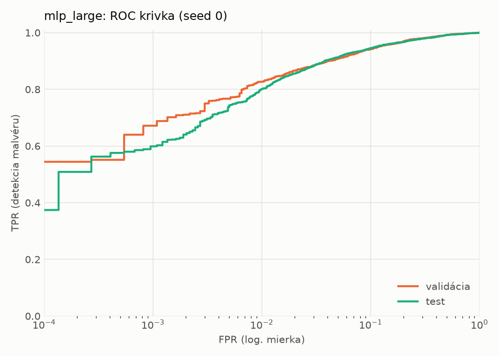
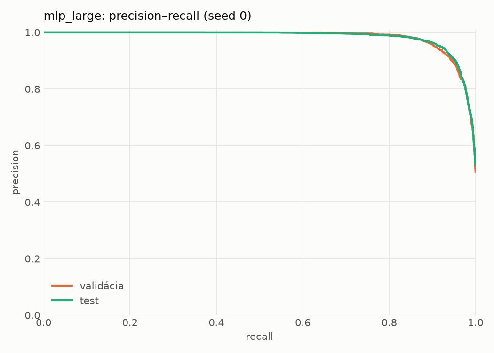
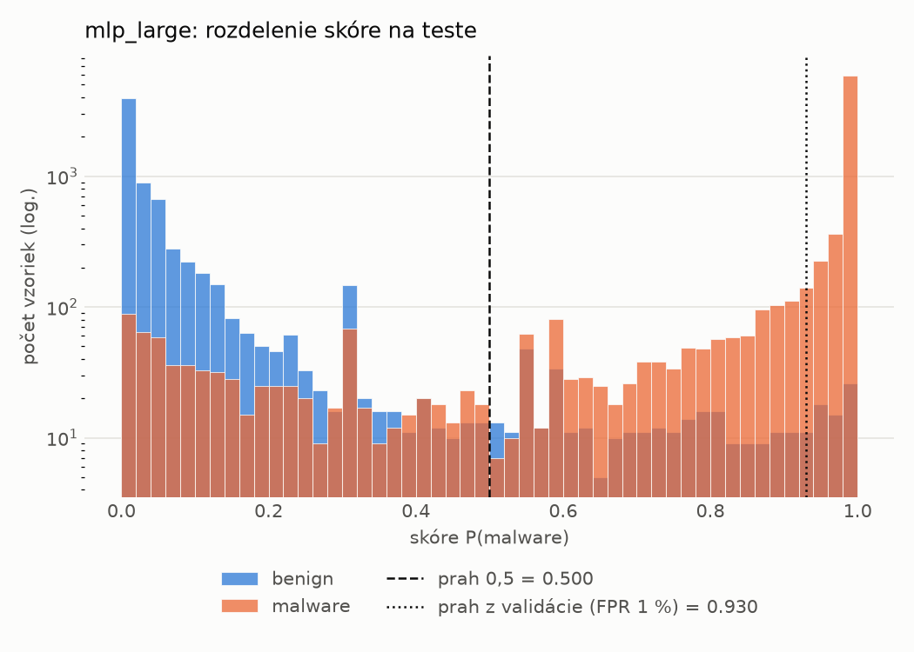
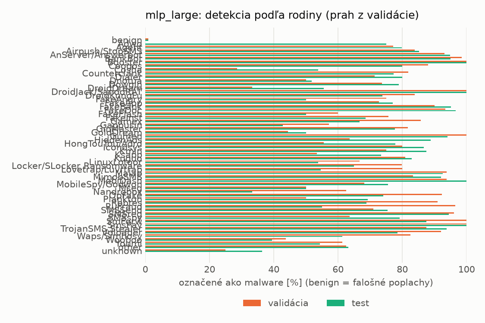
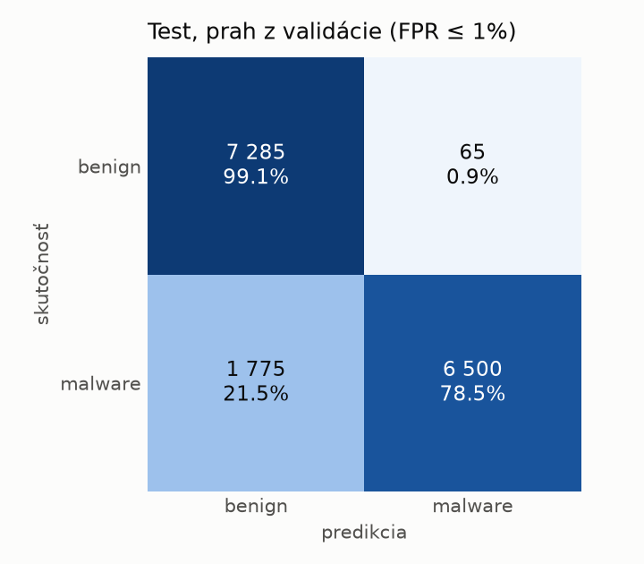
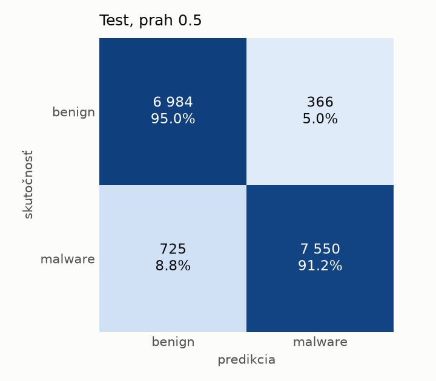
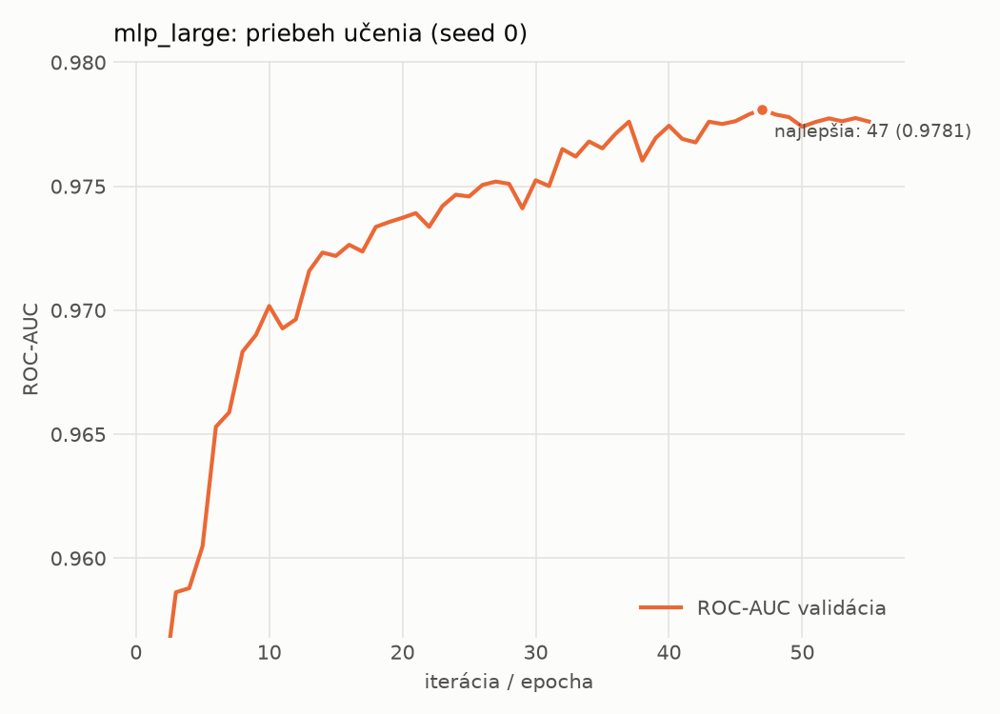

# dynamic/mlp_large – beh `20261122-215432`

> Automaticky generované (`src/training/run_tabular.py`). Konfigurácia: `config.yaml`, protokol: `protocol.yaml`.

- **Model:** `mlp` – veľká neurónová sieť (3–5 skrytých vrstiev, 512–2048 neurónov), kandidát na učiteľa
- **Ladenie:** bez ladenia – hyperparametre prevzaté z `runs_v4/real_full/full/dynamic/mlp_large/20261122-194320`
- **Finálne modely:** seedy [0, 1, 2]; hodnoty sú priemer ± smerodajná odchýlka cez seedy
- **Najlepšie hyperparametre:** `{"max_epochs": 100, "patience": 8, "hidden_layers": 3, "hidden_width": 512, "width_decay": 1.0, "dropout": 0.16077310300541978, "lr": 0.0005048635567863703, "weight_decay": 0.004783411439856203, "batch_size": 1024}`

## Detekčná kvalita (bez prahu)
| metrika | train (podvzorka) | validácia | test |
|---|---|---|---|
| ROC-AUC | 0.9914 ± 0.0011 | 0.9780 ± 0.0002 | 0.9770 ± 0.0002 |
| PR-AUC | 0.9926 ± 0.0010 | 0.9824 ± 0.0004 | 0.9827 ± 0.0003 |
| TPR pri FPR 1 % | 0.9079 ± 0.0110 | 0.8226 ± 0.0103 | 0.7875 ± 0.0120 |
| TPR pri FPR 0,1 % | 0.8428 ± 0.0193 | 0.6657 ± 0.0288 | 0.6061 ± 0.0225 |
| log loss | 0.1105 ± 0.0072 | 0.1901 ± 0.0011 | 0.1957 ± 0.0007 |
| Brier skóre | 0.0317 ± 0.0022 | 0.0541 ± 0.0006 | 0.0547 ± 0.0011 |

Rozdiel ROC-AUC train − validácia: **0.0133** (veľký rozdiel = preučenie).

## Pri prahu z validácie (FPR ≤ 1% na validácii)
| metrika | train (podvzorka) | validácia | test |
|---|---|---|---|
| accuracy | 0.9201 ± 0.0076 | 0.9052 ± 0.0052 | 0.8747 ± 0.0095 |
| balanced accuracy | 0.9193 ± 0.0077 | 0.9064 ± 0.0052 | 0.8813 ± 0.0089 |
| precision | 0.9990 ± 0.0004 | 0.9886 ± 0.0001 | 0.9909 ± 0.0015 |
| recall (TPR) | 0.8394 ± 0.0151 | 0.8226 ± 0.0103 | 0.7706 ± 0.0192 |
| FPR | 0.0008 ± 0.0003 | 0.0098 ± 0.0000 | 0.0080 ± 0.0015 |
| F1 | 0.9122 ± 0.0091 | 0.8979 ± 0.0062 | 0.8668 ± 0.0117 |
| MCC | 0.8507 ± 0.0135 | 0.8228 ± 0.0090 | 0.7734 ± 0.0149 |

## Pri pevnom prahu 0.5
| metrika | train (podvzorka) | validácia | test |
|---|---|---|---|
| accuracy | 0.9580 ± 0.0029 | 0.9271 ± 0.0015 | 0.9290 ± 0.0010 |
| balanced accuracy | 0.9579 ± 0.0029 | 0.9273 ± 0.0015 | 0.9302 ± 0.0009 |
| precision | 0.9697 ± 0.0024 | 0.9412 ± 0.0013 | 0.9538 ± 0.0011 |
| recall (TPR) | 0.9447 ± 0.0043 | 0.9132 ± 0.0021 | 0.9101 ± 0.0025 |
| FPR | 0.0289 ± 0.0022 | 0.0587 ± 0.0013 | 0.0496 ± 0.0014 |
| F1 | 0.9571 ± 0.0030 | 0.9270 ± 0.0015 | 0.9314 ± 0.0011 |
| MCC | 0.9163 ± 0.0058 | 0.8546 ± 0.0029 | 0.8590 ± 0.0019 |

## Výpočtové nároky (seed 0, testovacia množina)
| meranie | hodnota |
|---|---|
| tréning finálneho modelu | 6.5 s (priemer cez seedy) |
| ladenie spolu | 0 s |
| počet parametrov / uzlov | 596 481 |
| veľkosť modelu na disku | 2.41 MB |
| transformácia vstupu – latencia (1 vlákno) | 0.015 ms |
| transformácia vstupu – priepustnosť | 722 881 vzoriek/s |
| CPU latencia modelu (batch 1, 1 vlákno) | 0.174 ms (p95 0.358) |
| CPU priepustnosť (24 vlákien) | 547 621 vzoriek/s |
| GPU latencia (batch 1) | 0.559 ms (p95 0.603) |
| GPU priepustnosť | 2 564 713 vzoriek/s |
| GPU špičková pamäť | 126 MB |

## Grafy
| | |
|---|---|
|  |  |
|  |  |
|  |  |
|  |  |

## Súbory
`metrics.json` (všetky metriky po seedoch vrátane rodín), `timing.json`, `hpo_trials.csv`,
`predictions/<časť>_seed<N>.parquet` (sha256, family, label, score), `model/seed_<N>/`, `log.txt`.
