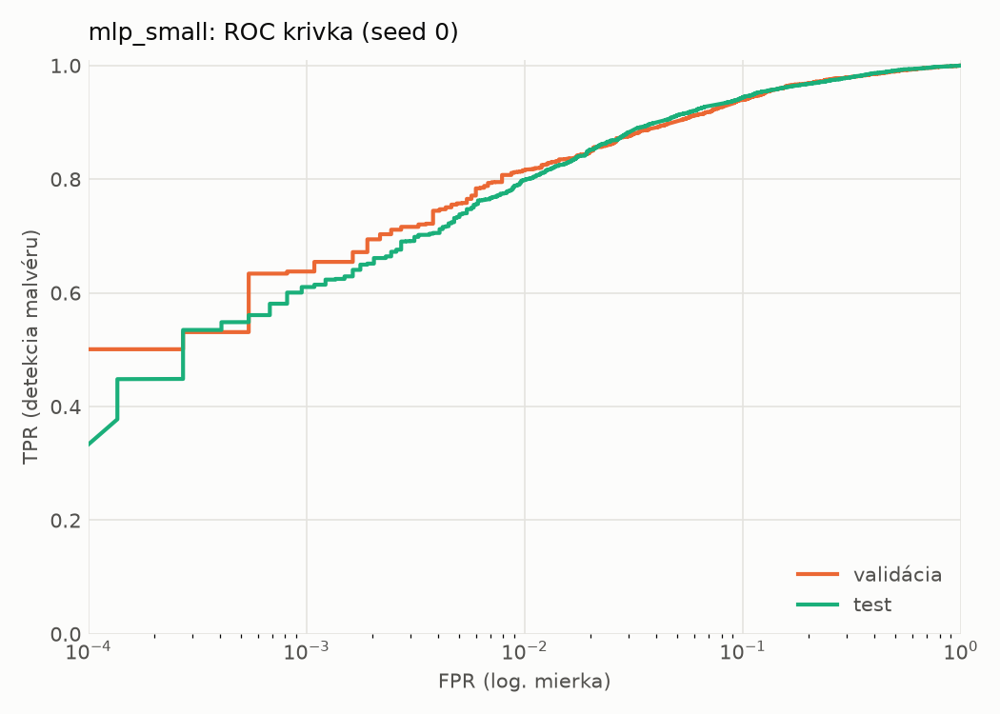
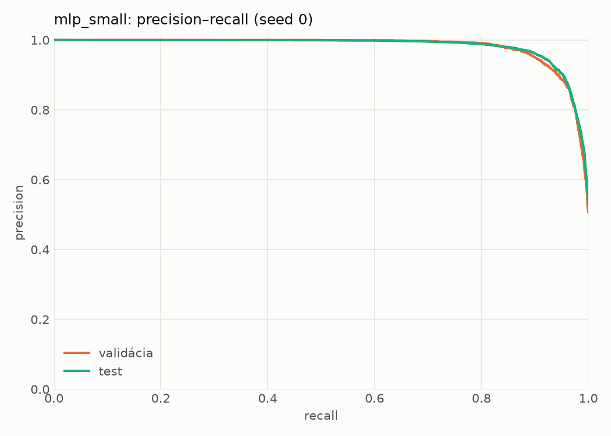
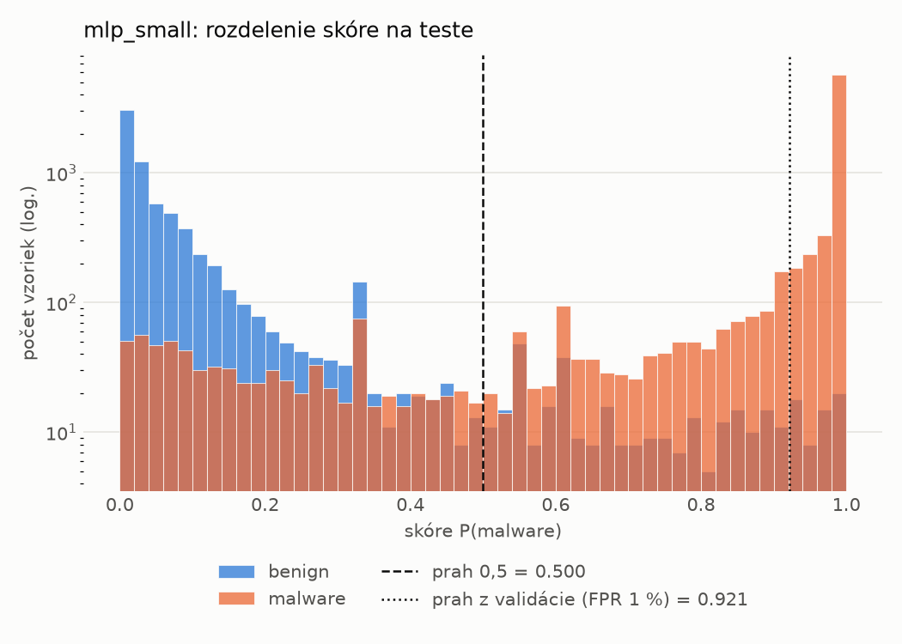
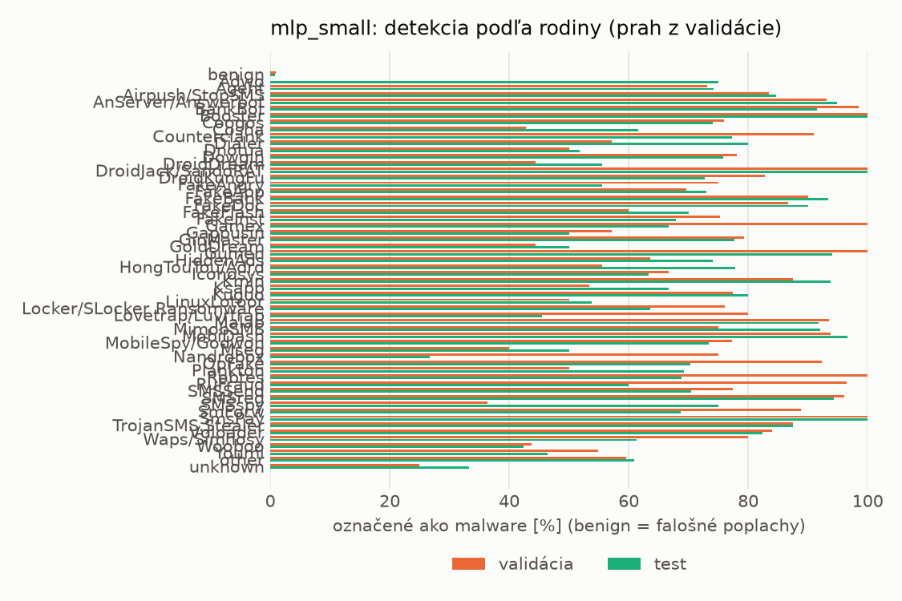
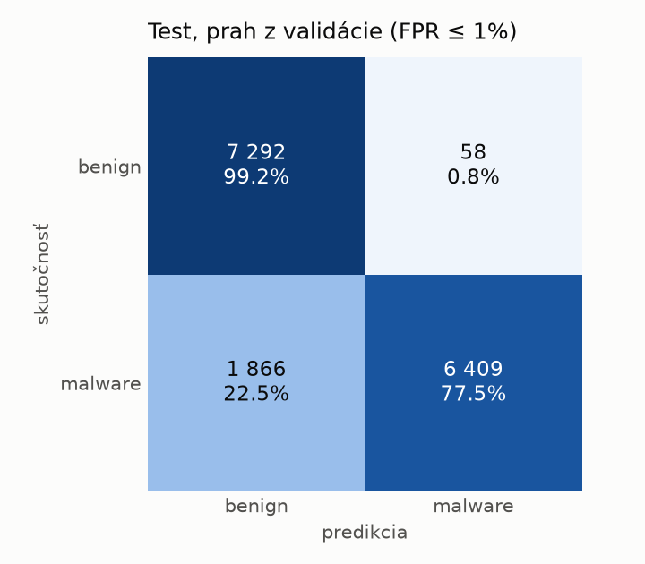
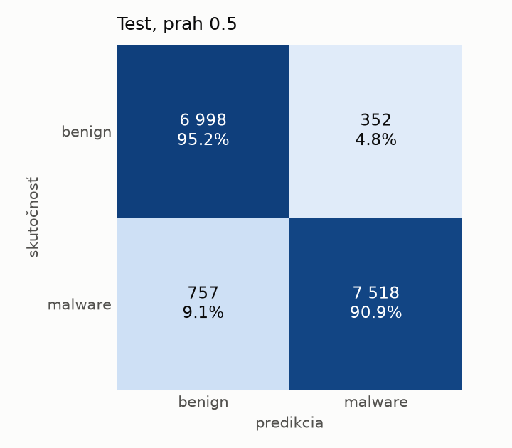
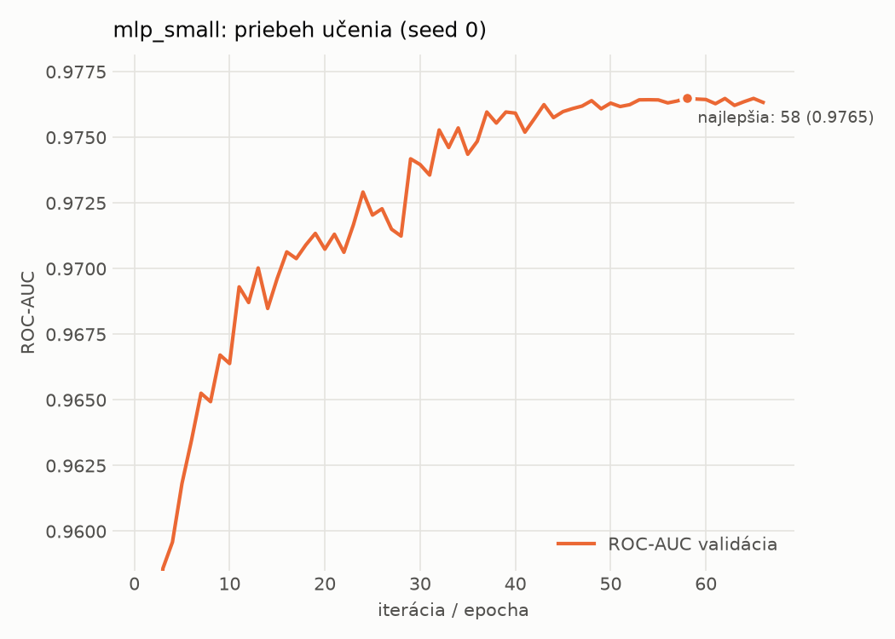

# dynamic/mlp_small – beh `20261122-215326`

> Automaticky generované (`src/training/run_tabular.py`). Konfigurácia: `config.yaml`, protokol: `protocol.yaml`.

- **Model:** `mlp` – malá neurónová sieť (1–2 skryté vrstvy), kandidát na ľahkého študenta
- **Ladenie:** bez ladenia – hyperparametre prevzaté z `runs_v4/real_full/full/dynamic/mlp_small/20261122-193213`
- **Finálne modely:** seedy [0, 1, 2]; hodnoty sú priemer ± smerodajná odchýlka cez seedy
- **Najlepšie hyperparametre:** `{"width_decay": 0.5, "max_epochs": 100, "patience": 8, "hidden_layers": 2, "hidden_width": 256, "dropout": 0.2449160262890371, "lr": 0.002872548733508973, "weight_decay": 4.509331245708397e-06, "batch_size": 256}`

## Detekčná kvalita (bez prahu)
| metrika | train (podvzorka) | validácia | test |
|---|---|---|---|
| ROC-AUC | 0.9884 ± 0.0010 | 0.9764 ± 0.0002 | 0.9767 ± 0.0005 |
| PR-AUC | 0.9902 ± 0.0008 | 0.9811 ± 0.0003 | 0.9825 ± 0.0004 |
| TPR pri FPR 1 % | 0.8908 ± 0.0075 | 0.8105 ± 0.0053 | 0.7948 ± 0.0133 |
| TPR pri FPR 0,1 % | 0.8182 ± 0.0118 | 0.6369 ± 0.0213 | 0.6269 ± 0.0145 |
| log loss | 0.1283 ± 0.0048 | 0.1948 ± 0.0023 | 0.1931 ± 0.0036 |
| Brier skóre | 0.0369 ± 0.0013 | 0.0556 ± 0.0008 | 0.0543 ± 0.0011 |

Rozdiel ROC-AUC train − validácia: **0.0120** (veľký rozdiel = preučenie).

## Pri prahu z validácie (FPR ≤ 1% na validácii)
| metrika | train (podvzorka) | validácia | test |
|---|---|---|---|
| accuracy | 0.9112 ± 0.0045 | 0.8991 ± 0.0027 | 0.8732 ± 0.0065 |
| balanced accuracy | 0.9103 ± 0.0045 | 0.9003 ± 0.0026 | 0.8799 ± 0.0061 |
| precision | 0.9987 ± 0.0003 | 0.9884 ± 0.0001 | 0.9916 ± 0.0006 |
| recall (TPR) | 0.8216 ± 0.0089 | 0.8105 ± 0.0053 | 0.7671 ± 0.0128 |
| FPR | 0.0011 ± 0.0002 | 0.0098 ± 0.0000 | 0.0073 ± 0.0006 |
| F1 | 0.9015 ± 0.0054 | 0.8906 ± 0.0032 | 0.8650 ± 0.0080 |
| MCC | 0.8350 ± 0.0077 | 0.8122 ± 0.0046 | 0.7712 ± 0.0103 |

## Pri pevnom prahu 0.5
| metrika | train (podvzorka) | validácia | test |
|---|---|---|---|
| accuracy | 0.9511 ± 0.0010 | 0.9246 ± 0.0016 | 0.9297 ± 0.0014 |
| balanced accuracy | 0.9510 ± 0.0010 | 0.9248 ± 0.0016 | 0.9310 ± 0.0014 |
| precision | 0.9643 ± 0.0018 | 0.9402 ± 0.0020 | 0.9560 ± 0.0007 |
| recall (TPR) | 0.9359 ± 0.0002 | 0.9091 ± 0.0019 | 0.9090 ± 0.0024 |
| FPR | 0.0339 ± 0.0017 | 0.0595 ± 0.0021 | 0.0471 ± 0.0007 |
| F1 | 0.9499 ± 0.0009 | 0.9244 ± 0.0016 | 0.9319 ± 0.0015 |
| MCC | 0.9026 ± 0.0020 | 0.8497 ± 0.0033 | 0.8605 ± 0.0028 |

## Výpočtové nároky (seed 0, testovacia množina)
| meranie | hodnota |
|---|---|
| tréning finálneho modelu | 21.3 s (priemer cez seedy) |
| ladenie spolu | 0 s |
| počet parametrov / uzlov | 67 585 |
| veľkosť modelu na disku | 0.28 MB |
| transformácia vstupu – latencia (1 vlákno) | 0.015 ms |
| transformácia vstupu – priepustnosť | 1 133 750 vzoriek/s |
| CPU latencia modelu (batch 1, 1 vlákno) | 0.102 ms (p95 0.112) |
| CPU priepustnosť (24 vlákien) | 2 463 656 vzoriek/s |
| GPU latencia (batch 1) | 0.411 ms (p95 0.441) |
| GPU priepustnosť | 2 599 704 vzoriek/s |
| GPU špičková pamäť | 74 MB |

## Grafy
| | |
|---|---|
|  |  |
|  |  |
|  |  |
|  |  |

## Súbory
`metrics.json` (všetky metriky po seedoch vrátane rodín), `timing.json`, `hpo_trials.csv`,
`predictions/<časť>_seed<N>.parquet` (sha256, family, label, score), `model/seed_<N>/`, `log.txt`.
