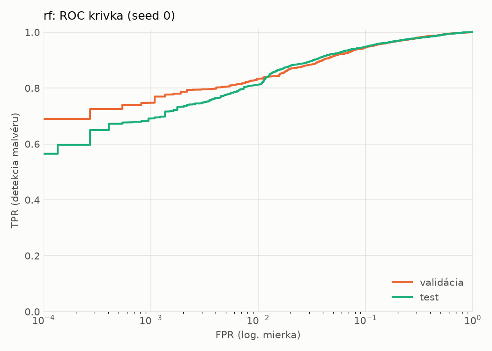
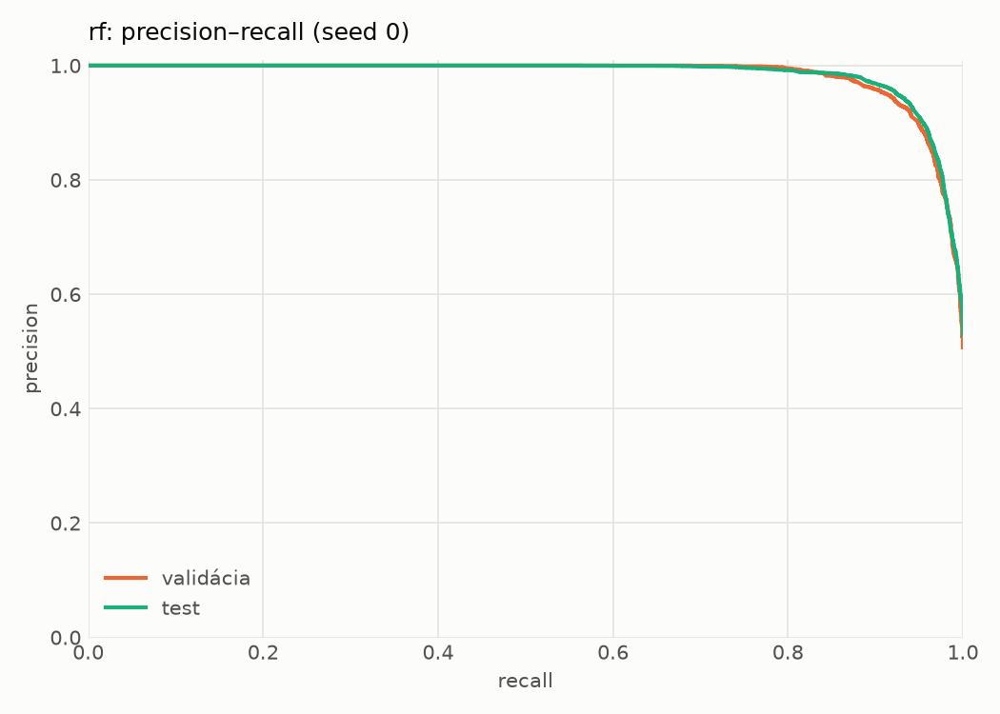
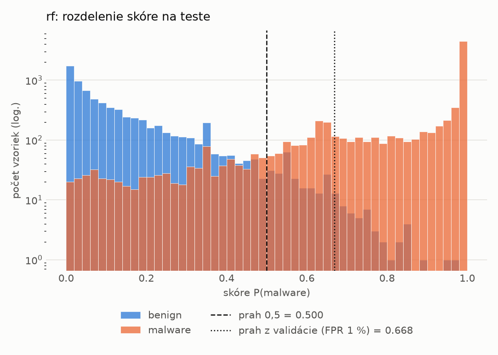
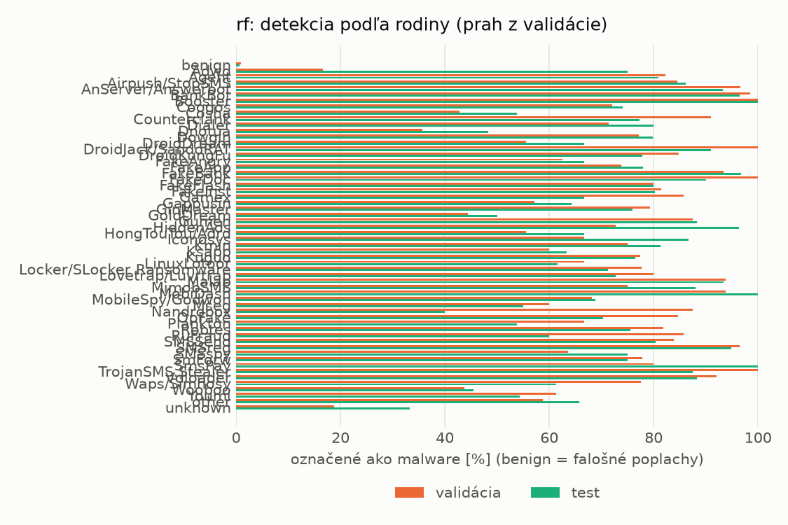
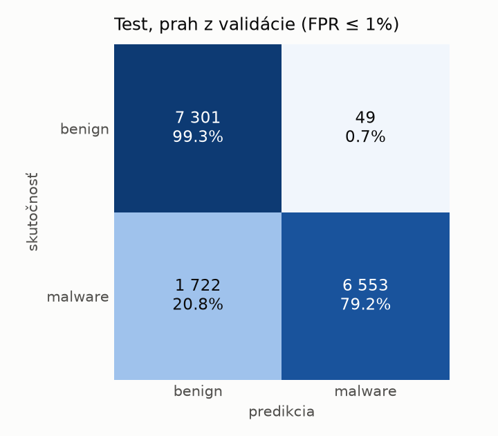
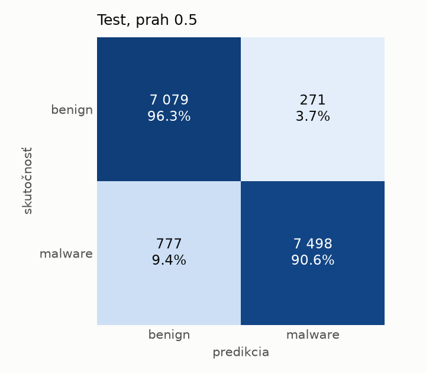

# dynamic/rf – beh `20261122-215202`

> Automaticky generované (`src/training/run_tabular.py`). Konfigurácia: `config.yaml`, protokol: `protocol.yaml`.

- **Model:** `random_forest` – Random Forest (pôvodné hodnoty príznakov)
- **Ladenie:** bez ladenia – hyperparametre prevzaté z `runs_v4/real_full/full/dynamic/rf/20261122-191738`
- **Finálne modely:** seedy [0, 1, 2]; hodnoty sú priemer ± smerodajná odchýlka cez seedy
- **Najlepšie hyperparametre:** `{"n_estimators": 500, "max_depth": 32, "min_samples_leaf": 1, "max_features": "sqrt"}`

## Detekčná kvalita (bez prahu)
| metrika | train (podvzorka) | validácia | test |
|---|---|---|---|
| ROC-AUC | 0.9995 ± 0.0000 | 0.9787 ± 0.0002 | 0.9787 ± 0.0001 |
| PR-AUC | 0.9995 ± 0.0000 | 0.9833 ± 0.0001 | 0.9845 ± 0.0001 |
| TPR pri FPR 1 % | 0.9896 ± 0.0005 | 0.8344 ± 0.0016 | 0.8099 ± 0.0028 |
| TPR pri FPR 0,1 % | 0.9603 ± 0.0006 | 0.7466 ± 0.0050 | 0.6978 ± 0.0060 |
| log loss | 0.0678 ± 0.0000 | 0.1893 ± 0.0001 | 0.2016 ± 0.0004 |
| Brier skóre | 0.0135 ± 0.0000 | 0.0549 ± 0.0000 | 0.0580 ± 0.0001 |

Rozdiel ROC-AUC train − validácia: **0.0208** (veľký rozdiel = preučenie).

## Pri prahu z validácie (FPR ≤ 1% na validácii)
| metrika | train (podvzorka) | validácia | test |
|---|---|---|---|
| accuracy | 0.9787 ± 0.0007 | 0.9112 ± 0.0009 | 0.8900 ± 0.0029 |
| balanced accuracy | 0.9785 ± 0.0007 | 0.9123 ± 0.0009 | 0.8958 ± 0.0027 |
| precision | 0.9998 ± 0.0000 | 0.9888 ± 0.0002 | 0.9920 ± 0.0007 |
| recall (TPR) | 0.9572 ± 0.0014 | 0.8344 ± 0.0016 | 0.7987 ± 0.0059 |
| FPR | 0.0002 ± 0.0000 | 0.0097 ± 0.0002 | 0.0072 ± 0.0007 |
| F1 | 0.9780 ± 0.0007 | 0.9051 ± 0.0010 | 0.8849 ± 0.0034 |
| MCC | 0.9582 ± 0.0013 | 0.8333 ± 0.0016 | 0.7988 ± 0.0047 |

## Pri pevnom prahu 0.5
| metrika | train (podvzorka) | validácia | test |
|---|---|---|---|
| accuracy | 0.9877 ± 0.0001 | 0.9298 ± 0.0001 | 0.9333 ± 0.0004 |
| balanced accuracy | 0.9877 ± 0.0001 | 0.9302 ± 0.0001 | 0.9350 ± 0.0004 |
| precision | 0.9906 ± 0.0002 | 0.9565 ± 0.0007 | 0.9657 ± 0.0007 |
| recall (TPR) | 0.9845 ± 0.0001 | 0.9026 ± 0.0005 | 0.9063 ± 0.0002 |
| FPR | 0.0091 ± 0.0002 | 0.0422 ± 0.0007 | 0.0363 ± 0.0008 |
| F1 | 0.9876 ± 0.0001 | 0.9288 ± 0.0001 | 0.9350 ± 0.0004 |
| MCC | 0.9755 ± 0.0002 | 0.8612 ± 0.0003 | 0.8685 ± 0.0009 |

## Výpočtové nároky (seed 0, testovacia množina)
| meranie | hodnota |
|---|---|
| tréning finálneho modelu | 3.1 s (priemer cez seedy) |
| ladenie spolu | 0 s |
| počet parametrov / uzlov | 4 449 506 |
| veľkosť modelu na disku | 356.37 MB |
| CPU latencia modelu (batch 1, 1 vlákno) | 15.168 ms (p95 15.581) |
| CPU priepustnosť (24 vlákien) | 108 075 vzoriek/s |

## Grafy
| | |
|---|---|
|  |  |
|  |  |
|  |  |
|  |  |

## Súbory
`metrics.json` (všetky metriky po seedoch vrátane rodín), `timing.json`, `hpo_trials.csv`,
`predictions/<časť>_seed<N>.parquet` (sha256, family, label, score), `model/seed_<N>/`, `log.txt`.
