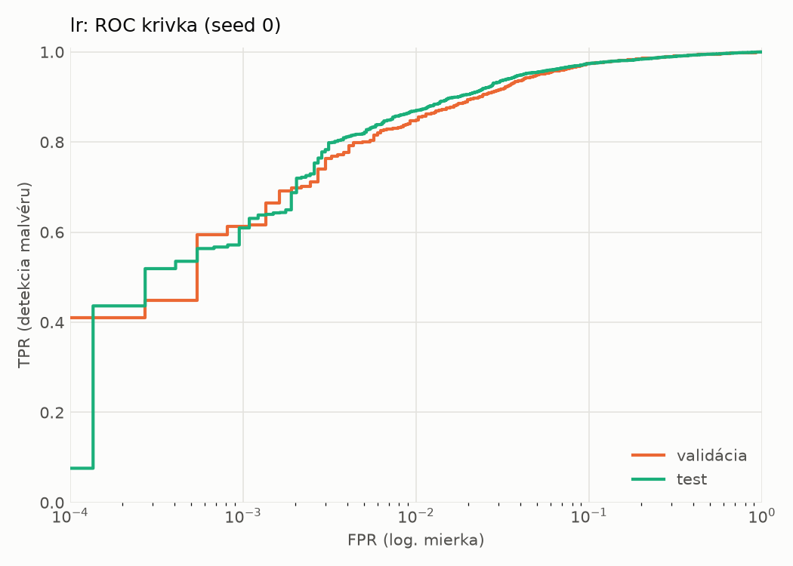
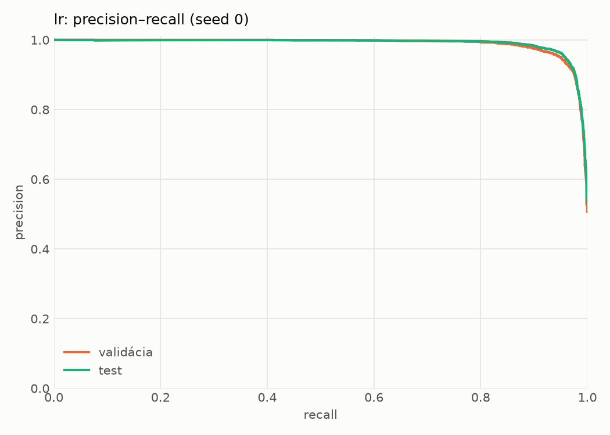
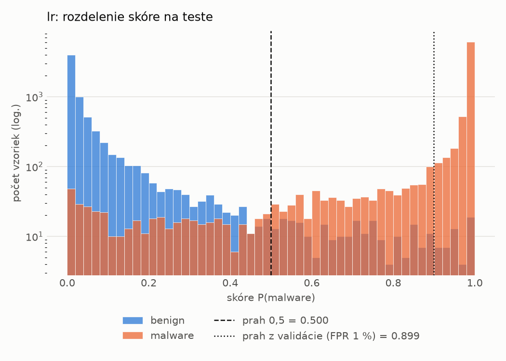
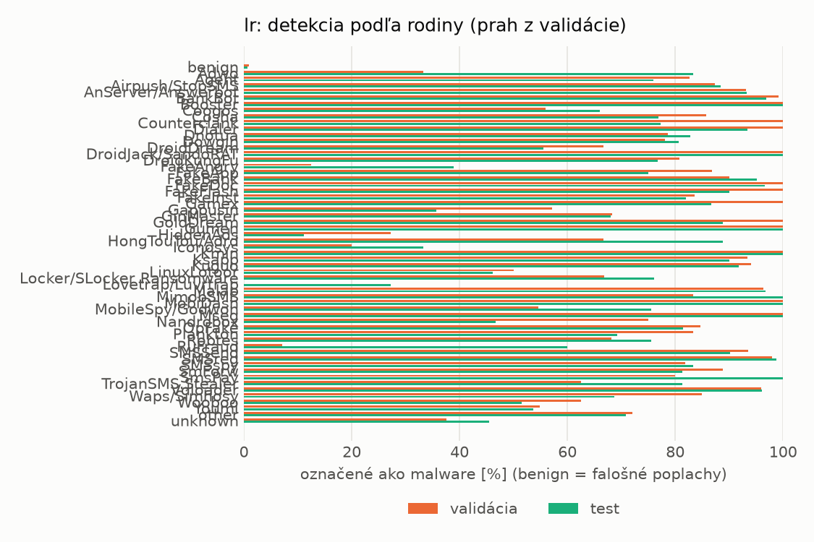
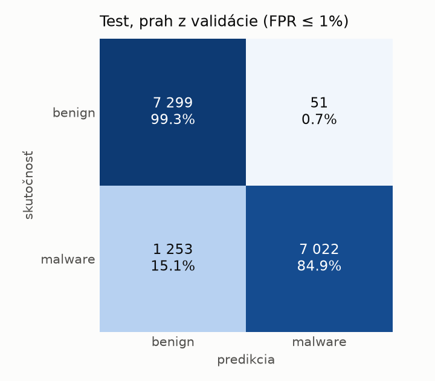
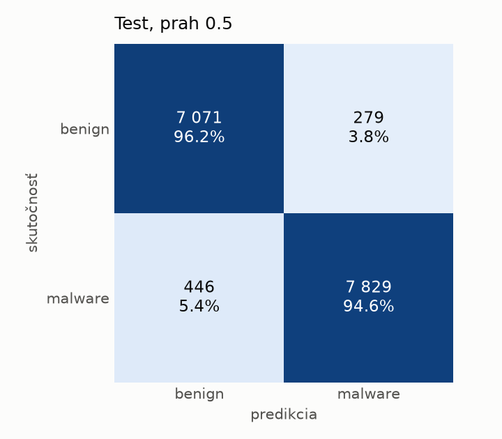

# hybrid/lr – beh `20261122-215457`

> Automaticky generované (`src/training/run_tabular.py`). Konfigurácia: `config.yaml`, protokol: `protocol.yaml`.

- **Model:** `logreg` – logistická regresia s L2 regularizáciou (vstup signed log1p + štandardizácia)
- **Ladenie:** bez ladenia – hyperparametre prevzaté z `runs_v4/real_full/full/hybrid/lr/20261122-195001`
- **Finálne modely:** seedy [0, 1, 2]; hodnoty sú priemer ± smerodajná odchýlka cez seedy
- **Najlepšie hyperparametre:** `{"max_iter": 2000, "C": 0.30240503427727145}`

## Detekčná kvalita (bez prahu)
| metrika | train (podvzorka) | validácia | test |
|---|---|---|---|
| ROC-AUC | 0.9878 ± 0.0000 | 0.9864 ± 0.0000 | 0.9872 ± 0.0000 |
| PR-AUC | 0.9899 ± 0.0000 | 0.9887 ± 0.0000 | 0.9901 ± 0.0000 |
| TPR pri FPR 1 % | 0.8772 ± 0.0000 | 0.8466 ± 0.0000 | 0.8696 ± 0.0000 |
| TPR pri FPR 0,1 % | 0.6865 ± 0.0000 | 0.6124 ± 0.0000 | 0.6094 ± 0.0000 |
| log loss | 0.1294 ± 0.0000 | 0.1439 ± 0.0000 | 0.1360 ± 0.0000 |
| Brier skóre | 0.0349 ± 0.0000 | 0.0396 ± 0.0000 | 0.0371 ± 0.0000 |

Rozdiel ROC-AUC train − validácia: **0.0015** (veľký rozdiel = preučenie).

## Pri prahu z validácie (FPR ≤ 1% na validácii)
| metrika | train (podvzorka) | validácia | test |
|---|---|---|---|
| accuracy | 0.9225 ± 0.0000 | 0.9176 ± 0.0000 | 0.9165 ± 0.0000 |
| balanced accuracy | 0.9218 ± 0.0000 | 0.9187 ± 0.0000 | 0.9208 ± 0.0000 |
| precision | 0.9925 ± 0.0000 | 0.9895 ± 0.0000 | 0.9928 ± 0.0000 |
| recall (TPR) | 0.8499 ± 0.0000 | 0.8466 ± 0.0000 | 0.8486 ± 0.0000 |
| FPR | 0.0063 ± 0.0000 | 0.0093 ± 0.0000 | 0.0069 ± 0.0000 |
| F1 | 0.9157 ± 0.0000 | 0.9125 ± 0.0000 | 0.9150 ± 0.0000 |
| MCC | 0.8535 ± 0.0000 | 0.8447 ± 0.0000 | 0.8440 ± 0.0000 |

## Pri pevnom prahu 0.5
| metrika | train (podvzorka) | validácia | test |
|---|---|---|---|
| accuracy | 0.9561 ± 0.0000 | 0.9478 ± 0.0000 | 0.9536 ± 0.0000 |
| balanced accuracy | 0.9560 ± 0.0000 | 0.9480 ± 0.0000 | 0.9541 ± 0.0000 |
| precision | 0.9655 ± 0.0000 | 0.9591 ± 0.0000 | 0.9656 ± 0.0000 |
| recall (TPR) | 0.9451 ± 0.0000 | 0.9370 ± 0.0000 | 0.9461 ± 0.0000 |
| FPR | 0.0331 ± 0.0000 | 0.0411 ± 0.0000 | 0.0380 ± 0.0000 |
| F1 | 0.9552 ± 0.0000 | 0.9479 ± 0.0000 | 0.9557 ± 0.0000 |
| MCC | 0.9124 ± 0.0000 | 0.8959 ± 0.0000 | 0.9072 ± 0.0000 |

## Výpočtové nároky (seed 0, testovacia množina)
| meranie | hodnota |
|---|---|
| tréning finálneho modelu | 0.3 s (priemer cez seedy) |
| ladenie spolu | 0 s |
| počet parametrov / uzlov | 296 |
| veľkosť modelu na disku | 0.01 MB |
| transformácia vstupu – latencia (1 vlákno) | 0.007 ms |
| transformácia vstupu – priepustnosť | 489 950 vzoriek/s |
| CPU latencia modelu (batch 1, 1 vlákno) | 0.004 ms (p95 0.004) |
| CPU priepustnosť (24 vlákien) | 2 100 501 vzoriek/s |

## Grafy
| | |
|---|---|
|  |  |
|  |  |
|  |  |
|  |  |

## Súbory
`metrics.json` (všetky metriky po seedoch vrátane rodín), `timing.json`, `hpo_trials.csv`,
`predictions/<časť>_seed<N>.parquet` (sha256, family, label, score), `model/seed_<N>/`, `log.txt`.
