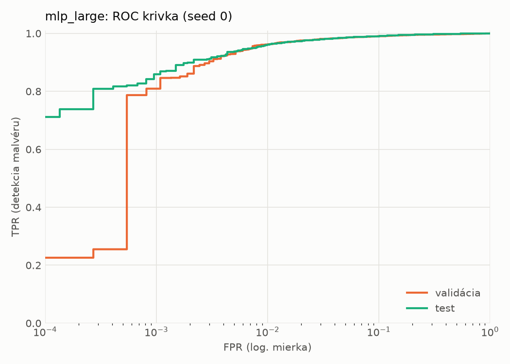
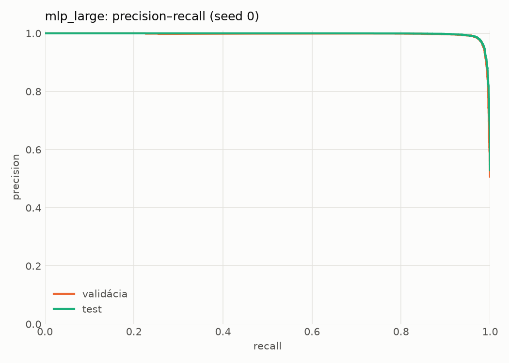
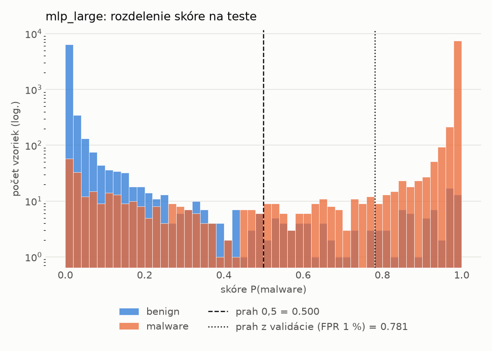
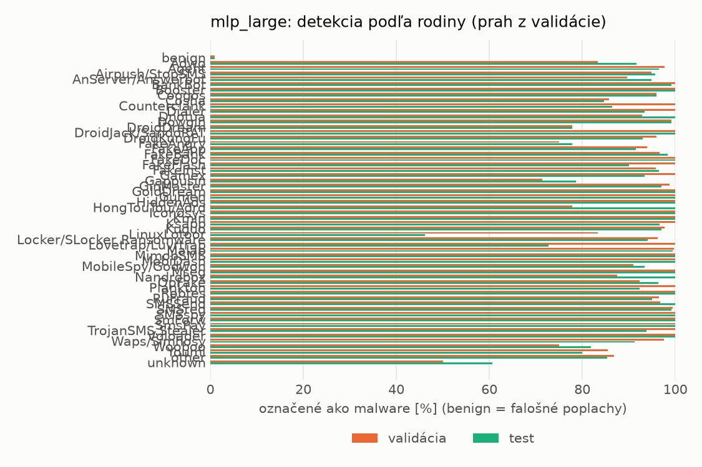
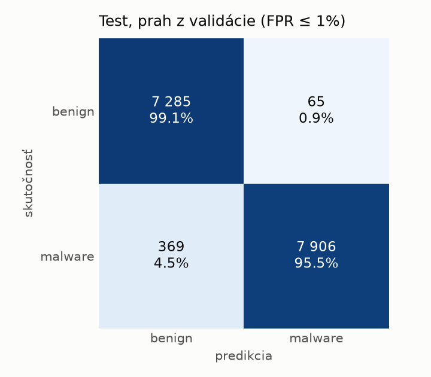
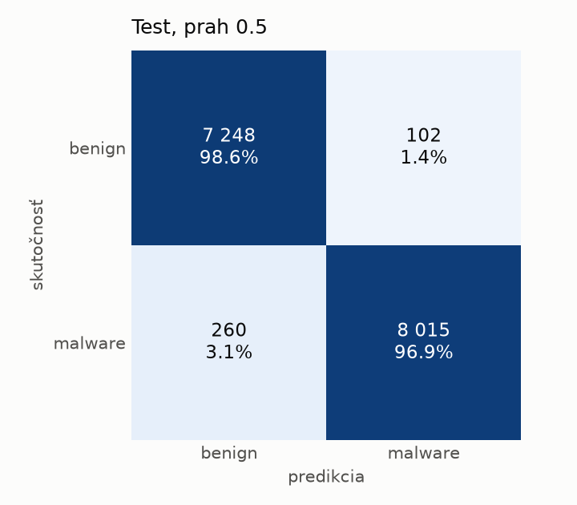
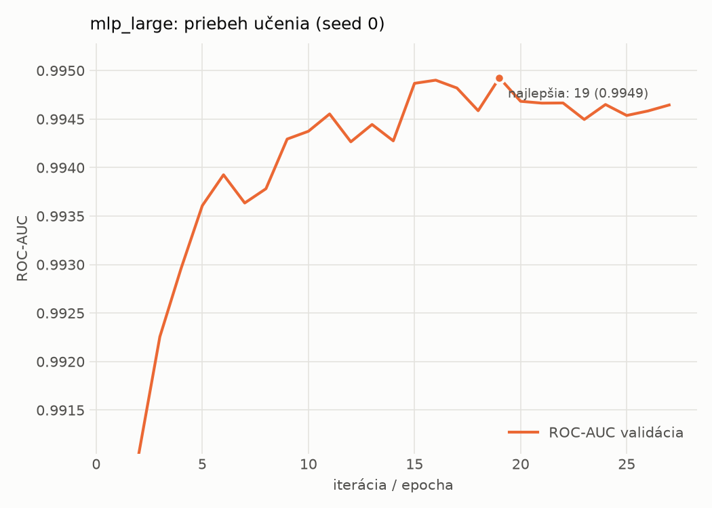

# hybrid/mlp_large – beh `20261122-215648`

> Automaticky generované (`src/training/run_tabular.py`). Konfigurácia: `config.yaml`, protokol: `protocol.yaml`.

- **Model:** `mlp` – veľká neurónová sieť (3–5 skrytých vrstiev, 512–2048 neurónov), kandidát na učiteľa
- **Ladenie:** bez ladenia – hyperparametre prevzaté z `runs_v4/real_full/full/hybrid/mlp_large/20261122-201300`
- **Finálne modely:** seedy [0, 1, 2]; hodnoty sú priemer ± smerodajná odchýlka cez seedy
- **Najlepšie hyperparametre:** `{"max_epochs": 100, "patience": 8, "hidden_layers": 3, "hidden_width": 512, "width_decay": 0.5, "dropout": 0.18171623767667733, "lr": 0.00010022812541545209, "weight_decay": 7.819097276436122e-06, "batch_size": 256}`

## Detekčná kvalita (bez prahu)
| metrika | train (podvzorka) | validácia | test |
|---|---|---|---|
| ROC-AUC | 0.9986 ± 0.0005 | 0.9950 ± 0.0001 | 0.9958 ± 0.0002 |
| PR-AUC | 0.9988 ± 0.0005 | 0.9957 ± 0.0004 | 0.9968 ± 0.0002 |
| TPR pri FPR 1 % | 0.9825 ± 0.0051 | 0.9561 ± 0.0050 | 0.9569 ± 0.0039 |
| TPR pri FPR 0,1 % | 0.9643 ± 0.0124 | 0.8233 ± 0.0157 | 0.8418 ± 0.0178 |
| log loss | 0.0408 ± 0.0082 | 0.0774 ± 0.0005 | 0.0751 ± 0.0023 |
| Brier skóre | 0.0107 ± 0.0022 | 0.0195 ± 0.0011 | 0.0198 ± 0.0009 |

Rozdiel ROC-AUC train − validácia: **0.0036** (veľký rozdiel = preučenie).

## Pri prahu z validácie (FPR ≤ 1% na validácii)
| metrika | train (podvzorka) | validácia | test |
|---|---|---|---|
| accuracy | 0.9826 ± 0.0040 | 0.9729 ± 0.0026 | 0.9705 ± 0.0017 |
| balanced accuracy | 0.9824 ± 0.0040 | 0.9732 ± 0.0026 | 0.9717 ± 0.0016 |
| precision | 0.9987 ± 0.0008 | 0.9902 ± 0.0002 | 0.9923 ± 0.0007 |
| recall (TPR) | 0.9660 ± 0.0074 | 0.9561 ± 0.0050 | 0.9517 ± 0.0034 |
| FPR | 0.0012 ± 0.0007 | 0.0097 ± 0.0002 | 0.0083 ± 0.0007 |
| F1 | 0.9821 ± 0.0042 | 0.9729 ± 0.0027 | 0.9716 ± 0.0017 |
| MCC | 0.9656 ± 0.0078 | 0.9465 ± 0.0051 | 0.9419 ± 0.0032 |

## Pri pevnom prahu 0.5
| metrika | train (podvzorka) | validácia | test |
|---|---|---|---|
| accuracy | 0.9865 ± 0.0027 | 0.9758 ± 0.0017 | 0.9751 ± 0.0017 |
| balanced accuracy | 0.9864 ± 0.0026 | 0.9759 ± 0.0017 | 0.9755 ± 0.0018 |
| precision | 0.9933 ± 0.0037 | 0.9805 ± 0.0030 | 0.9837 ± 0.0033 |
| recall (TPR) | 0.9793 ± 0.0029 | 0.9716 ± 0.0019 | 0.9691 ± 0.0012 |
| FPR | 0.0065 ± 0.0035 | 0.0199 ± 0.0031 | 0.0181 ± 0.0037 |
| F1 | 0.9862 ± 0.0027 | 0.9760 ± 0.0016 | 0.9763 ± 0.0016 |
| MCC | 0.9730 ± 0.0053 | 0.9517 ± 0.0034 | 0.9502 ± 0.0035 |

## Výpočtové nároky (seed 0, testovacia množina)
| meranie | hodnota |
|---|---|
| tréning finálneho modelu | 10.4 s (priemer cez seedy) |
| ladenie spolu | 0 s |
| počet parametrov / uzlov | 317 697 |
| veľkosť modelu na disku | 1.29 MB |
| transformácia vstupu – latencia (1 vlákno) | 0.017 ms |
| transformácia vstupu – priepustnosť | 280 855 vzoriek/s |
| CPU latencia modelu (batch 1, 1 vlákno) | 0.139 ms (p95 0.320) |
| CPU priepustnosť (24 vlákien) | 638 986 vzoriek/s |
| GPU latencia (batch 1) | 0.452 ms (p95 0.945) |
| GPU priepustnosť | 999 527 vzoriek/s |
| GPU špičková pamäť | 213 MB |

## Grafy
| | |
|---|---|
|  |  |
|  |  |
|  |  |
|  |  |

## Súbory
`metrics.json` (všetky metriky po seedoch vrátane rodín), `timing.json`, `hpo_trials.csv`,
`predictions/<časť>_seed<N>.parquet` (sha256, family, label, score), `model/seed_<N>/`, `log.txt`.
