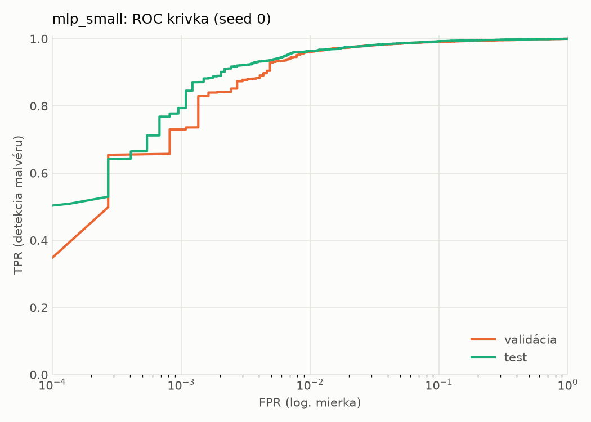
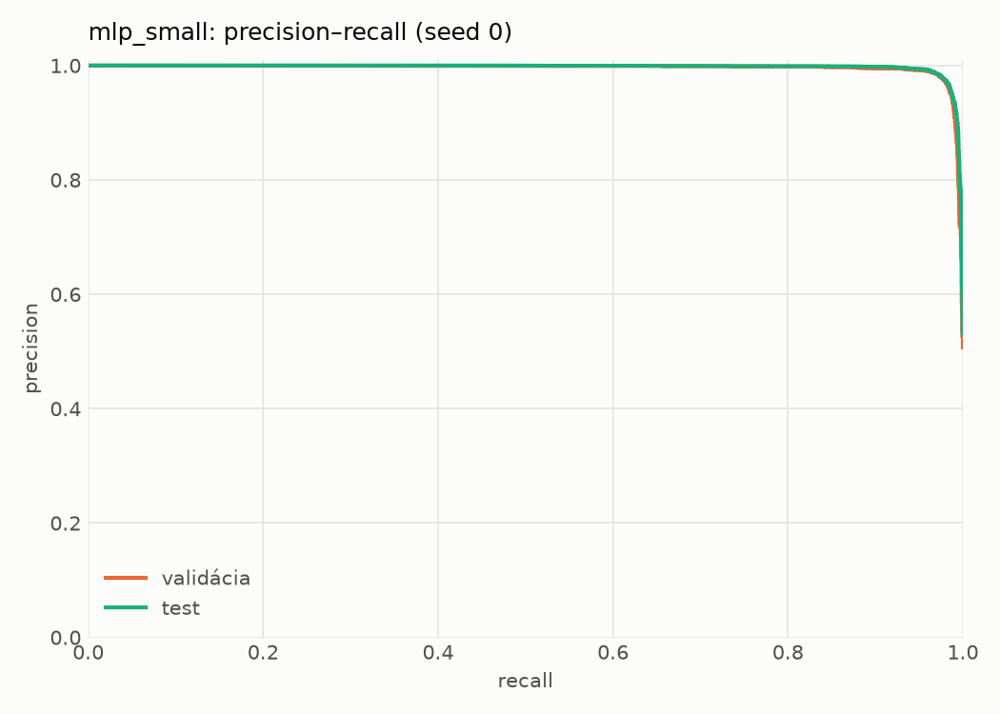
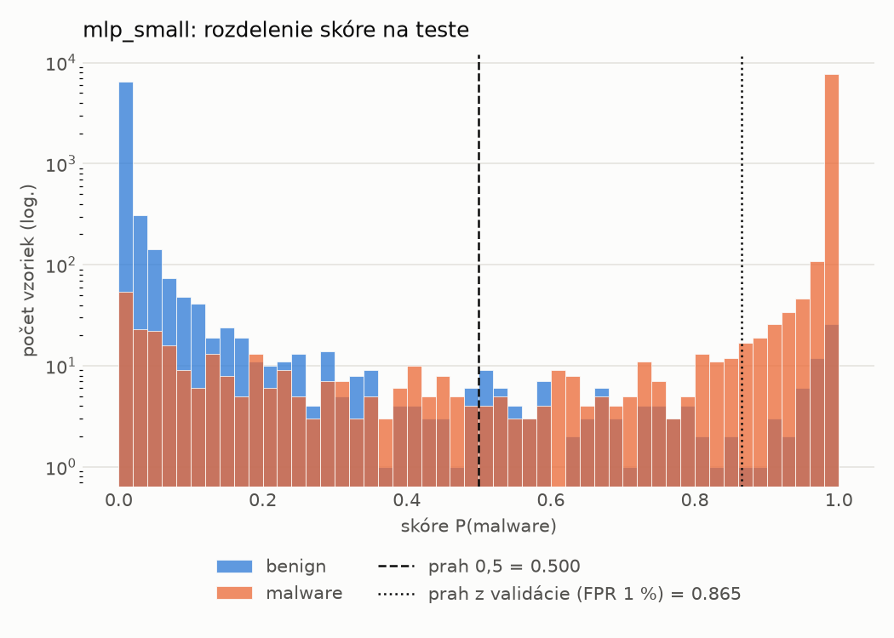
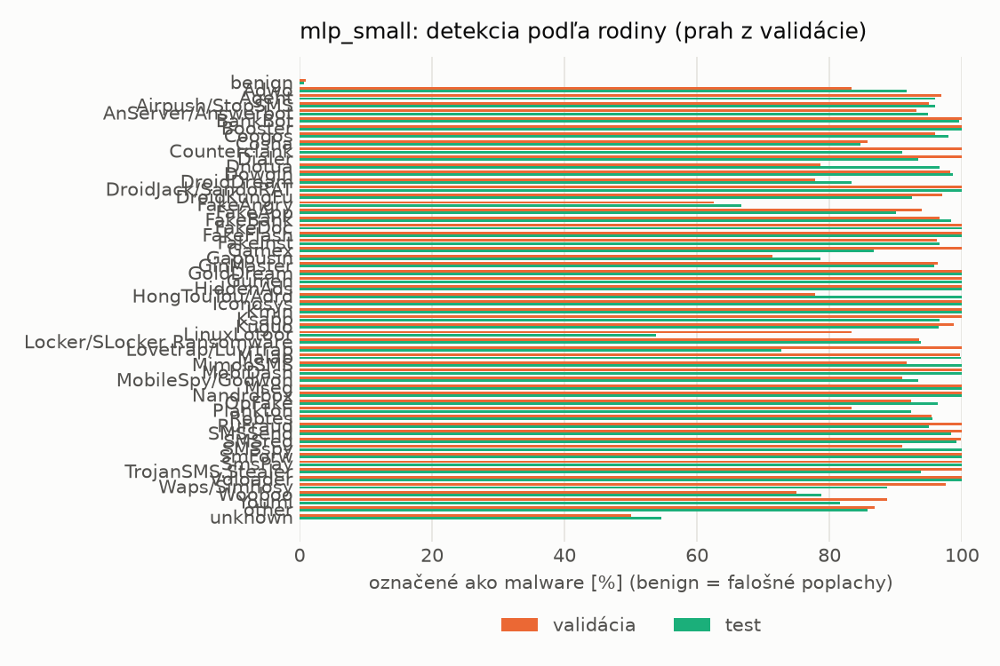
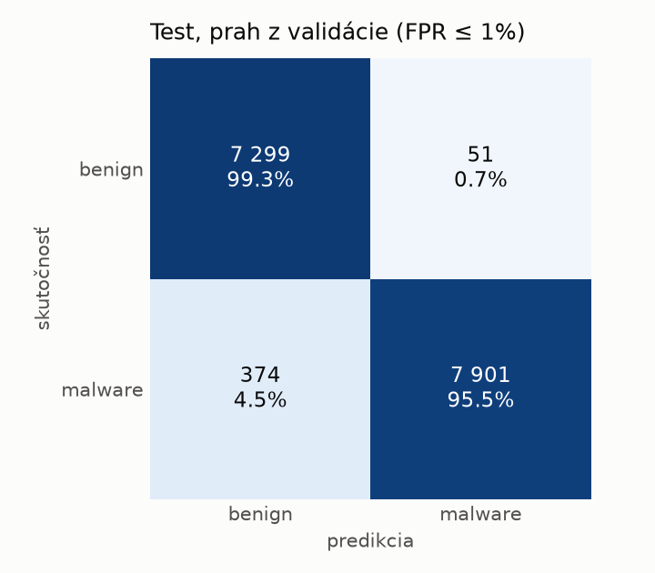
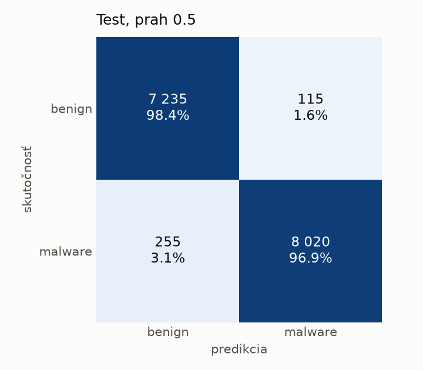
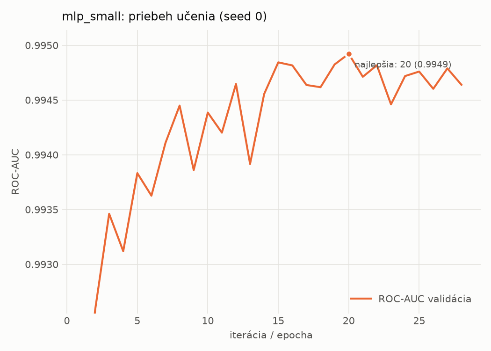

# hybrid/mlp_small – beh `20261122-215615`

> Automaticky generované (`src/training/run_tabular.py`). Konfigurácia: `config.yaml`, protokol: `protocol.yaml`.

- **Model:** `mlp` – malá neurónová sieť (1–2 skryté vrstvy), kandidát na ľahkého študenta
- **Ladenie:** bez ladenia – hyperparametre prevzaté z `runs_v4/real_full/full/hybrid/mlp_small/20261122-200826`
- **Finálne modely:** seedy [0, 1, 2]; hodnoty sú priemer ± smerodajná odchýlka cez seedy
- **Najlepšie hyperparametre:** `{"width_decay": 0.5, "max_epochs": 100, "patience": 8, "hidden_layers": 2, "hidden_width": 256, "dropout": 0.19625503285105284, "lr": 0.0008594281758471675, "weight_decay": 0.001025897876119634, "batch_size": 256}`

## Detekčná kvalita (bez prahu)
| metrika | train (podvzorka) | validácia | test |
|---|---|---|---|
| ROC-AUC | 0.9992 ± 0.0003 | 0.9950 ± 0.0001 | 0.9959 ± 0.0002 |
| PR-AUC | 0.9993 ± 0.0002 | 0.9958 ± 0.0000 | 0.9969 ± 0.0002 |
| TPR pri FPR 1 % | 0.9898 ± 0.0025 | 0.9571 ± 0.0029 | 0.9611 ± 0.0037 |
| TPR pri FPR 0,1 % | 0.9772 ± 0.0053 | 0.6927 ± 0.0347 | 0.8331 ± 0.0342 |
| log loss | 0.0289 ± 0.0049 | 0.0846 ± 0.0037 | 0.0760 ± 0.0025 |
| Brier skóre | 0.0075 ± 0.0011 | 0.0188 ± 0.0003 | 0.0187 ± 0.0008 |

Rozdiel ROC-AUC train − validácia: **0.0042** (veľký rozdiel = preučenie).

## Pri prahu z validácie (FPR ≤ 1% na validácii)
| metrika | train (podvzorka) | validácia | test |
|---|---|---|---|
| accuracy | 0.9848 ± 0.0013 | 0.9734 ± 0.0014 | 0.9721 ± 0.0010 |
| balanced accuracy | 0.9847 ± 0.0013 | 0.9736 ± 0.0014 | 0.9733 ± 0.0009 |
| precision | 0.9995 ± 0.0005 | 0.9901 ± 0.0000 | 0.9935 ± 0.0004 |
| recall (TPR) | 0.9698 ± 0.0023 | 0.9571 ± 0.0029 | 0.9536 ± 0.0015 |
| FPR | 0.0005 ± 0.0005 | 0.0098 ± 0.0000 | 0.0070 ± 0.0004 |
| F1 | 0.9844 ± 0.0014 | 0.9733 ± 0.0015 | 0.9731 ± 0.0010 |
| MCC | 0.9700 ± 0.0026 | 0.9474 ± 0.0028 | 0.9450 ± 0.0019 |

## Pri pevnom prahu 0.5
| metrika | train (podvzorka) | validácia | test |
|---|---|---|---|
| accuracy | 0.9905 ± 0.0010 | 0.9766 ± 0.0004 | 0.9763 ± 0.0006 |
| balanced accuracy | 0.9904 ± 0.0010 | 0.9767 ± 0.0004 | 0.9768 ± 0.0005 |
| precision | 0.9963 ± 0.0012 | 0.9805 ± 0.0024 | 0.9857 ± 0.0012 |
| recall (TPR) | 0.9844 ± 0.0019 | 0.9733 ± 0.0032 | 0.9694 ± 0.0024 |
| FPR | 0.0036 ± 0.0012 | 0.0200 ± 0.0026 | 0.0159 ± 0.0014 |
| F1 | 0.9903 ± 0.0010 | 0.9769 ± 0.0005 | 0.9775 ± 0.0006 |
| MCC | 0.9810 ± 0.0020 | 0.9533 ± 0.0008 | 0.9527 ± 0.0011 |

## Výpočtové nároky (seed 0, testovacia množina)
| meranie | hodnota |
|---|---|
| tréning finálneho modelu | 10.2 s (priemer cez seedy) |
| ladenie spolu | 0 s |
| počet parametrov / uzlov | 109 569 |
| veľkosť modelu na disku | 0.45 MB |
| transformácia vstupu – latencia (1 vlákno) | 0.007 ms |
| transformácia vstupu – priepustnosť | 439 050 vzoriek/s |
| CPU latencia modelu (batch 1, 1 vlákno) | 0.106 ms (p95 0.117) |
| CPU priepustnosť (24 vlákien) | 975 617 vzoriek/s |
| GPU latencia (batch 1) | 0.658 ms (p95 0.691) |
| GPU priepustnosť | 754 175 vzoriek/s |
| GPU špičková pamäť | 124 MB |

## Grafy
| | |
|---|---|
|  |  |
|  |  |
|  |  |
|  |  |

## Súbory
`metrics.json` (všetky metriky po seedoch vrátane rodín), `timing.json`, `hpo_trials.csv`,
`predictions/<časť>_seed<N>.parquet` (sha256, family, label, score), `model/seed_<N>/`, `log.txt`.
