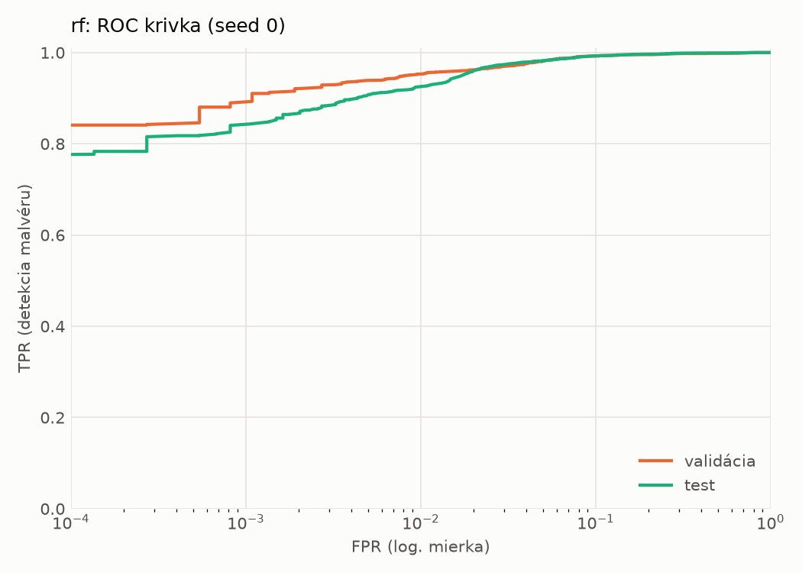
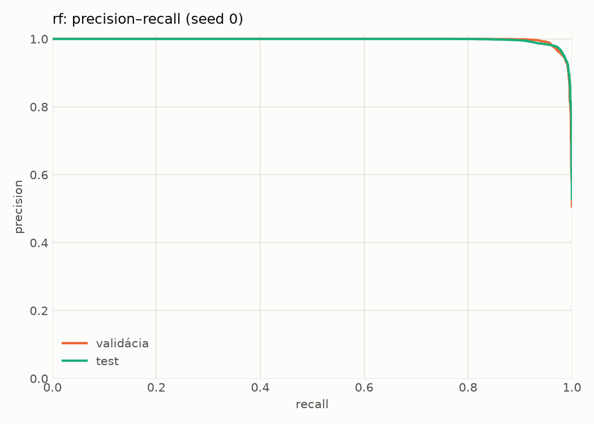
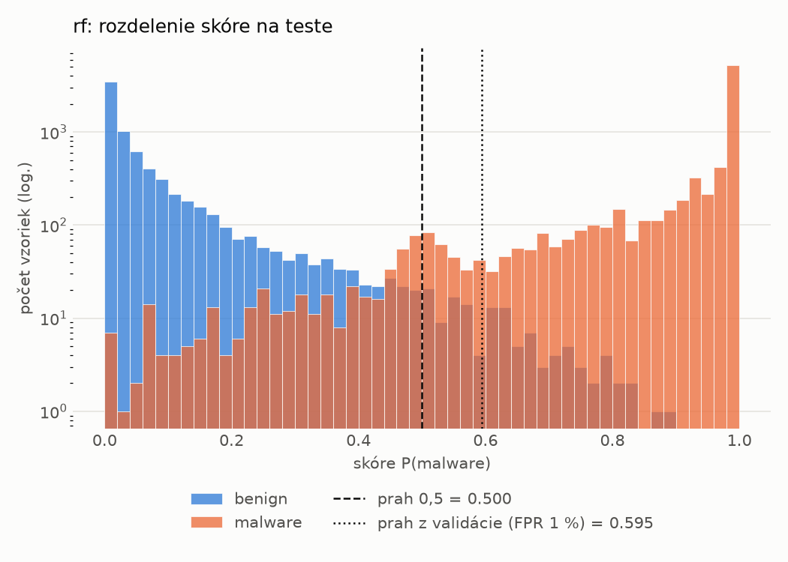
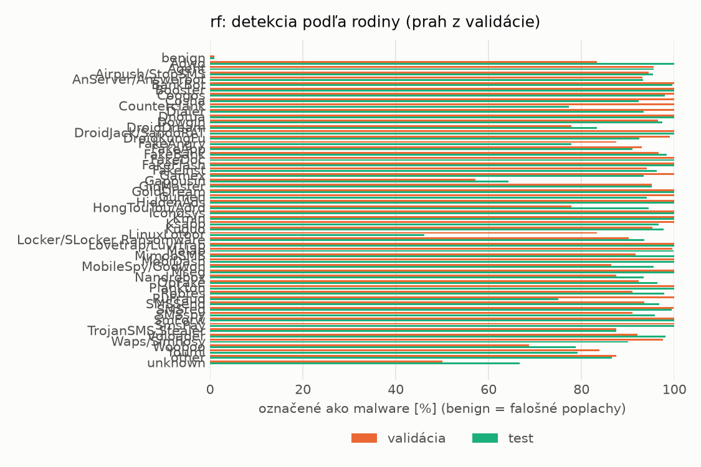
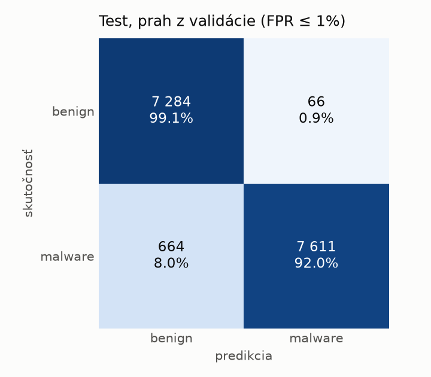
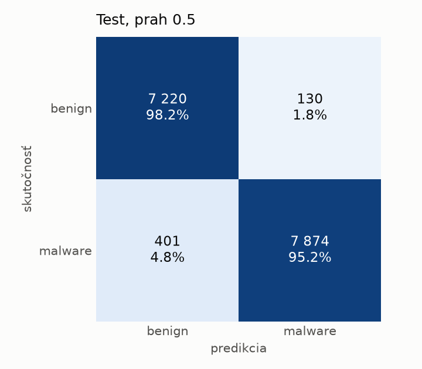

# hybrid/rf – beh `20261122-215500`

> Automaticky generované (`src/training/run_tabular.py`). Konfigurácia: `config.yaml`, protokol: `protocol.yaml`.

- **Model:** `random_forest` – Random Forest (pôvodné hodnoty príznakov)
- **Ladenie:** bez ladenia – hyperparametre prevzaté z `runs_v4/real_full/full/hybrid/rf/20261122-195013`
- **Finálne modely:** seedy [0, 1, 2]; hodnoty sú priemer ± smerodajná odchýlka cez seedy
- **Najlepšie hyperparametre:** `{"n_estimators": 150, "max_depth": 32, "min_samples_leaf": 1, "max_features": 0.05}`

## Detekčná kvalita (bez prahu)
| metrika | train (podvzorka) | validácia | test |
|---|---|---|---|
| ROC-AUC | 1.0000 ± 0.0000 | 0.9960 ± 0.0000 | 0.9961 ± 0.0002 |
| PR-AUC | 1.0000 ± 0.0000 | 0.9967 ± 0.0000 | 0.9969 ± 0.0002 |
| TPR pri FPR 1 % | 1.0000 ± 0.0000 | 0.9487 ± 0.0034 | 0.9343 ± 0.0092 |
| TPR pri FPR 0,1 % | 1.0000 ± 0.0000 | 0.8968 ± 0.0077 | 0.8490 ± 0.0096 |
| log loss | 0.0266 ± 0.0000 | 0.0919 ± 0.0007 | 0.1043 ± 0.0022 |
| Brier skóre | 0.0033 ± 0.0000 | 0.0235 ± 0.0002 | 0.0274 ± 0.0008 |

Rozdiel ROC-AUC train − validácia: **0.0040** (veľký rozdiel = preučenie).

## Pri prahu z validácie (FPR ≤ 1% na validácii)
| metrika | train (podvzorka) | validácia | test |
|---|---|---|---|
| accuracy | 0.9990 ± 0.0004 | 0.9693 ± 0.0018 | 0.9531 ± 0.0010 |
| balanced accuracy | 0.9990 ± 0.0004 | 0.9696 ± 0.0017 | 0.9553 ± 0.0009 |
| precision | 1.0000 ± 0.0000 | 0.9903 ± 0.0003 | 0.9927 ± 0.0011 |
| recall (TPR) | 0.9980 ± 0.0008 | 0.9487 ± 0.0034 | 0.9182 ± 0.0023 |
| FPR | 0.0000 ± 0.0000 | 0.0095 ± 0.0003 | 0.0076 ± 0.0012 |
| F1 | 0.9990 ± 0.0004 | 0.9691 ± 0.0018 | 0.9540 ± 0.0010 |
| MCC | 0.9981 ± 0.0008 | 0.9394 ± 0.0034 | 0.9092 ± 0.0018 |

## Pri pevnom prahu 0.5
| metrika | train (podvzorka) | validácia | test |
|---|---|---|---|
| accuracy | 0.9999 ± 0.0001 | 0.9705 ± 0.0006 | 0.9710 ± 0.0043 |
| balanced accuracy | 0.9999 ± 0.0001 | 0.9706 ± 0.0006 | 0.9717 ± 0.0041 |
| precision | 1.0000 ± 0.0000 | 0.9761 ± 0.0016 | 0.9843 ± 0.0005 |
| recall (TPR) | 0.9999 ± 0.0001 | 0.9655 ± 0.0006 | 0.9606 ± 0.0079 |
| FPR | 0.0000 ± 0.0000 | 0.0243 ± 0.0016 | 0.0173 ± 0.0004 |
| F1 | 0.9999 ± 0.0001 | 0.9708 ± 0.0005 | 0.9723 ± 0.0043 |
| MCC | 0.9999 ± 0.0001 | 0.9411 ± 0.0011 | 0.9422 ± 0.0084 |

## Výpočtové nároky (seed 0, testovacia množina)
| meranie | hodnota |
|---|---|
| tréning finálneho modelu | 1.3 s (priemer cez seedy) |
| ladenie spolu | 0 s |
| počet parametrov / uzlov | 771 644 |
| veľkosť modelu na disku | 62.00 MB |
| CPU latencia modelu (batch 1, 1 vlákno) | 4.689 ms (p95 4.991) |
| CPU priepustnosť (24 vlákien) | 205 435 vzoriek/s |

## Grafy
| | |
|---|---|
|  |  |
|  |  |
|  |  |
|  |  |

## Súbory
`metrics.json` (všetky metriky po seedoch vrátane rodín), `timing.json`, `hpo_trials.csv`,
`predictions/<časť>_seed<N>.parquet` (sha256, family, label, score), `model/seed_<N>/`, `log.txt`.
