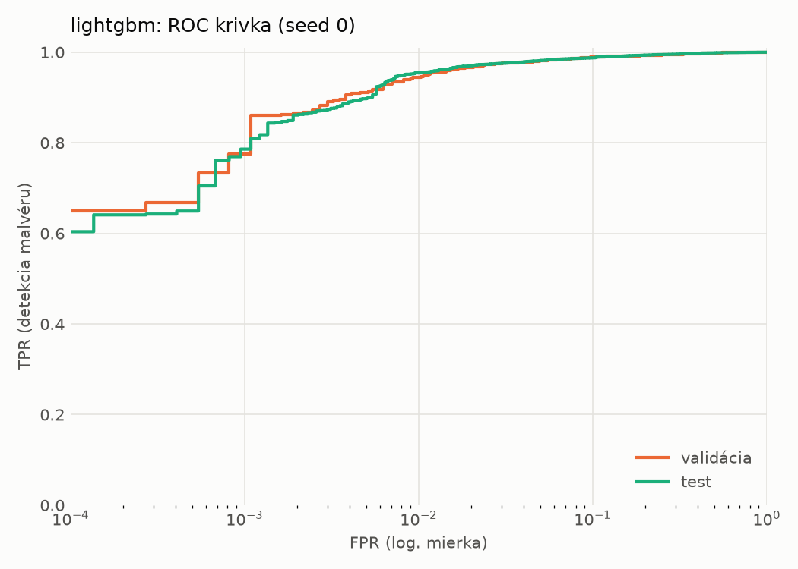
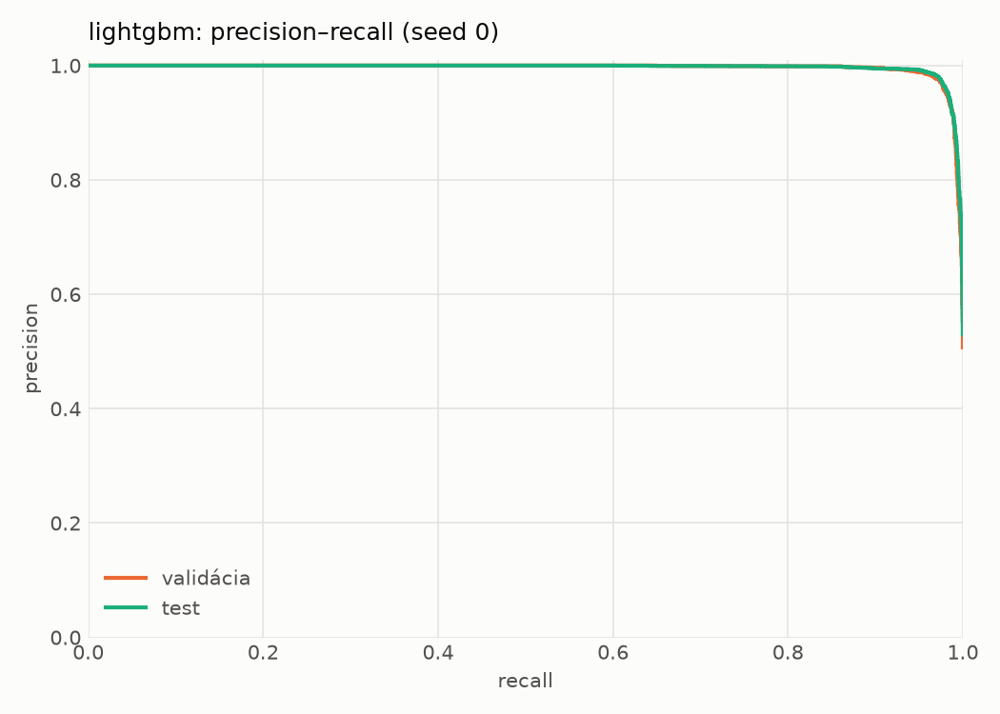
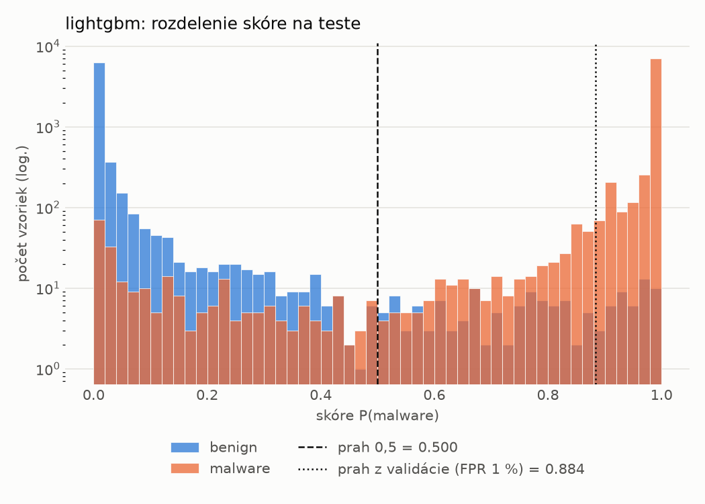
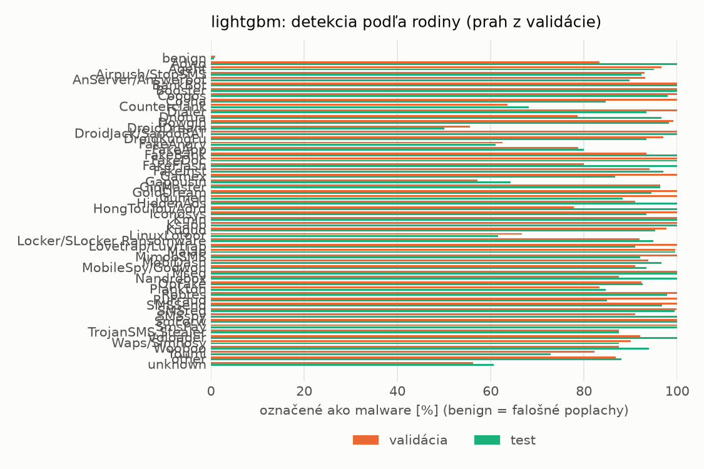
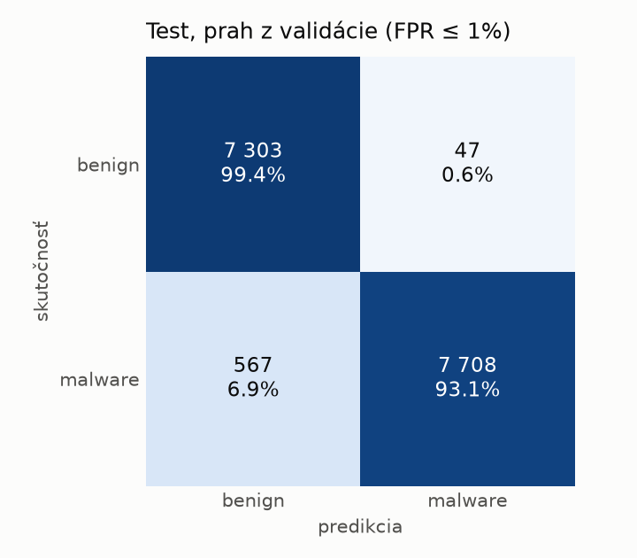
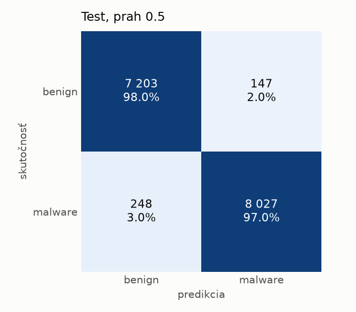
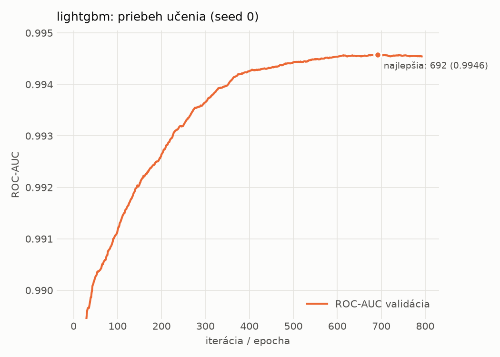

# static/lightgbm – beh `20261122-214926`

> Automaticky generované (`src/training/run_tabular.py`). Konfigurácia: `config.yaml`, protokol: `protocol.yaml`.

- **Model:** `lightgbm` – LightGBM, gradient boosting stromov s early stopping na validácii (pôvodné hodnoty príznakov)
- **Ladenie:** bez ladenia – hyperparametre prevzaté z `runs_v4/real_full/full/static/lightgbm/20261122-184829`
- **Finálne modely:** seedy [0, 1, 2]; hodnoty sú priemer ± smerodajná odchýlka cez seedy
- **Najlepšie hyperparametre:** `{"num_boost_round": 5000, "early_stopping_rounds": 100, "learning_rate": 0.015567978603457627, "num_leaves": 372, "min_child_samples": 12, "feature_fraction": 0.7551391358223217, "bagging_fraction": 0.6871892431836363, "lambda_l1": 1.3651906778474808e-06, "lambda_l2": 0.003382199534052785}`

## Detekčná kvalita (bez prahu)
| metrika | train (podvzorka) | validácia | test |
|---|---|---|---|
| ROC-AUC | 1.0000 ± 0.0000 | 0.9946 ± 0.0000 | 0.9949 ± 0.0000 |
| PR-AUC | 1.0000 ± 0.0000 | 0.9956 ± 0.0000 | 0.9961 ± 0.0000 |
| TPR pri FPR 1 % | 1.0000 ± 0.0000 | 0.9460 ± 0.0019 | 0.9517 ± 0.0039 |
| TPR pri FPR 0,1 % | 1.0000 ± 0.0000 | 0.7421 ± 0.0323 | 0.8005 ± 0.0135 |
| log loss | 0.0073 ± 0.0014 | 0.0877 ± 0.0012 | 0.0845 ± 0.0012 |
| Brier skóre | 0.0006 ± 0.0002 | 0.0216 ± 0.0002 | 0.0209 ± 0.0001 |

Rozdiel ROC-AUC train − validácia: **0.0054** (veľký rozdiel = preučenie).

## Pri prahu z validácie (FPR ≤ 1% na validácii)
| metrika | train (podvzorka) | validácia | test |
|---|---|---|---|
| accuracy | 0.9922 ± 0.0011 | 0.9678 ± 0.0009 | 0.9573 ± 0.0052 |
| balanced accuracy | 0.9921 ± 0.0011 | 0.9681 ± 0.0009 | 0.9593 ± 0.0049 |
| precision | 1.0000 ± 0.0000 | 0.9900 ± 0.0000 | 0.9940 ± 0.0002 |
| recall (TPR) | 0.9842 ± 0.0022 | 0.9460 ± 0.0019 | 0.9250 ± 0.0101 |
| FPR | 0.0000 ± 0.0000 | 0.0098 ± 0.0000 | 0.0063 ± 0.0003 |
| F1 | 0.9920 ± 0.0011 | 0.9675 ± 0.0010 | 0.9582 ± 0.0053 |
| MCC | 0.9845 ± 0.0022 | 0.9366 ± 0.0018 | 0.9172 ± 0.0096 |

## Pri pevnom prahu 0.5
| metrika | train (podvzorka) | validácia | test |
|---|---|---|---|
| accuracy | 0.9999 ± 0.0001 | 0.9740 ± 0.0006 | 0.9748 ± 0.0001 |
| balanced accuracy | 0.9999 ± 0.0001 | 0.9740 ± 0.0006 | 0.9751 ± 0.0001 |
| precision | 0.9999 ± 0.0001 | 0.9766 ± 0.0009 | 0.9820 ± 0.0000 |
| recall (TPR) | 1.0000 ± 0.0000 | 0.9720 ± 0.0012 | 0.9702 ± 0.0002 |
| FPR | 0.0001 ± 0.0001 | 0.0239 ± 0.0009 | 0.0200 ± 0.0000 |
| F1 | 0.9999 ± 0.0001 | 0.9743 ± 0.0006 | 0.9761 ± 0.0001 |
| MCC | 0.9999 ± 0.0001 | 0.9480 ± 0.0012 | 0.9495 ± 0.0002 |

## Výpočtové nároky (seed 0, testovacia množina)
| meranie | hodnota |
|---|---|
| tréning finálneho modelu | 12.6 s (priemer cez seedy) |
| ladenie spolu | 0 s |
| počet parametrov / uzlov | 514 156 |
| veľkosť modelu na disku | 28.49 MB |
| CPU latencia modelu (batch 1, 1 vlákno) | 0.148 ms (p95 0.186) |
| CPU priepustnosť (24 vlákien) | 113 438 vzoriek/s |

## Grafy
| | |
|---|---|
|  |  |
|  |  |
|  |  |
|  |  |

## Súbory
`metrics.json` (všetky metriky po seedoch vrátane rodín), `timing.json`, `hpo_trials.csv`,
`predictions/<časť>_seed<N>.parquet` (sha256, family, label, score), `model/seed_<N>/`, `log.txt`.
