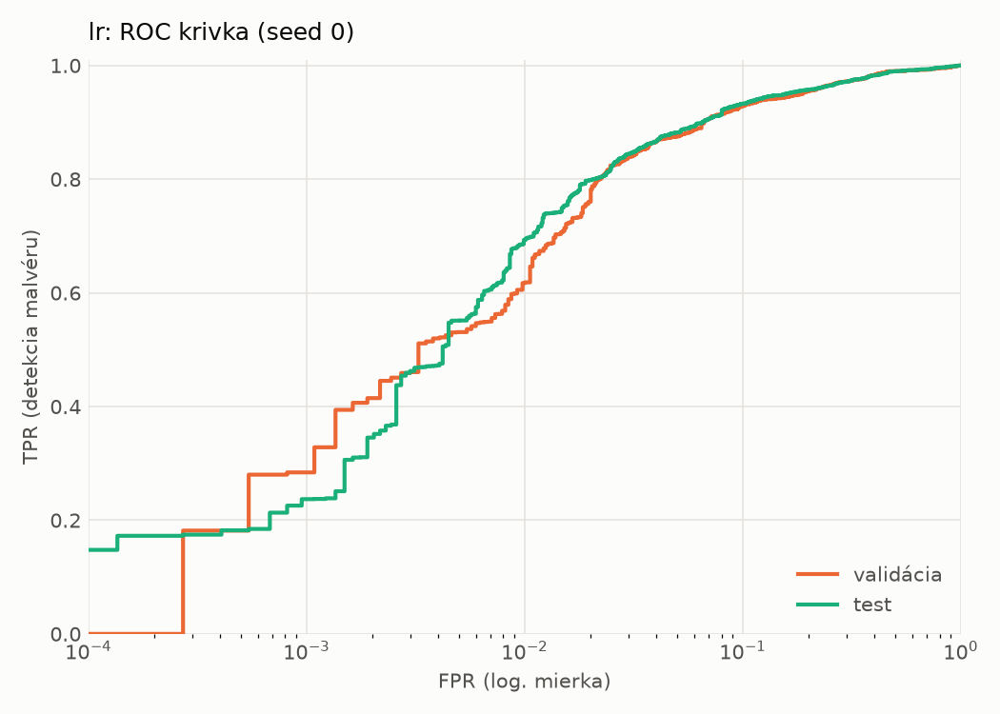
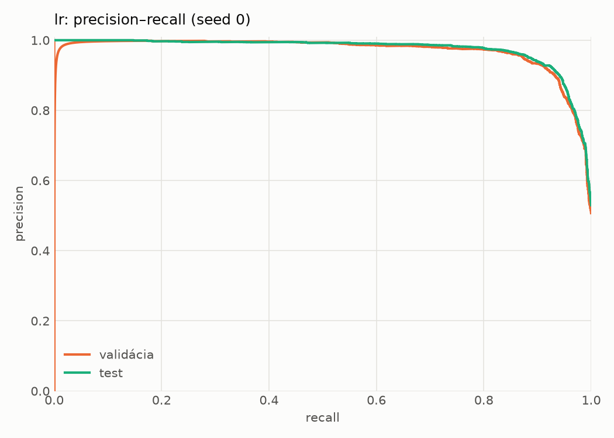
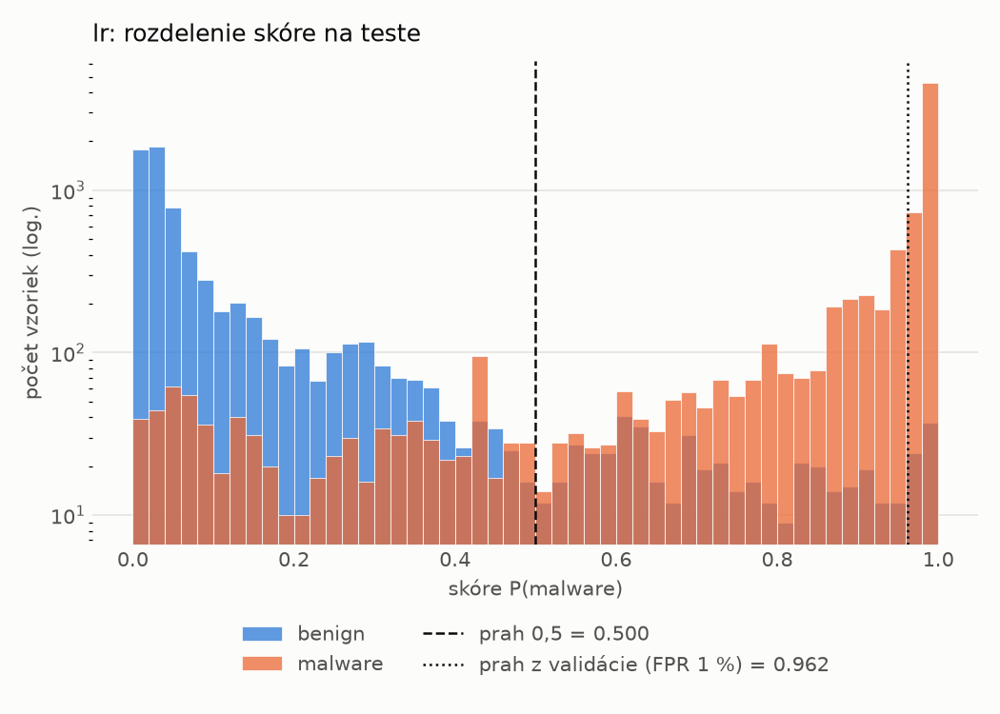
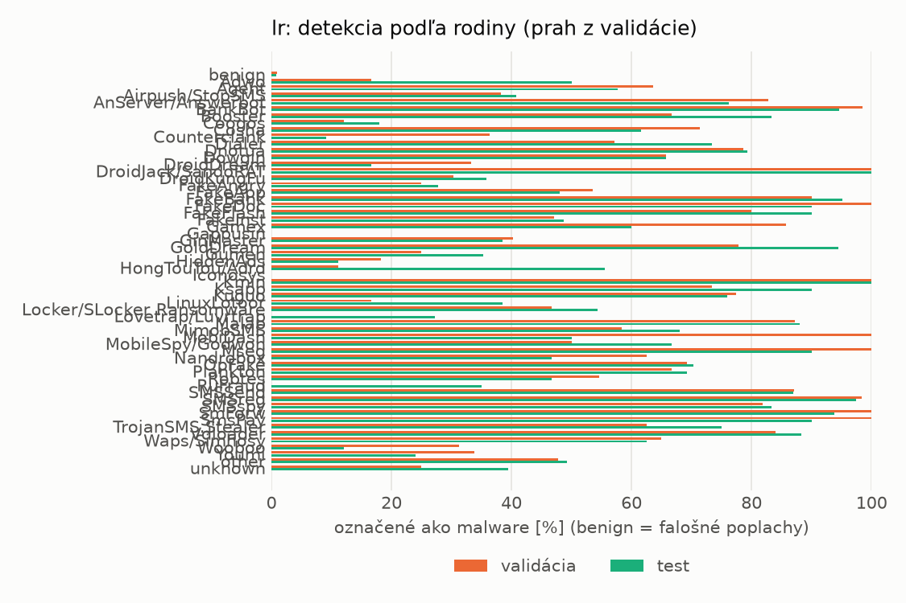
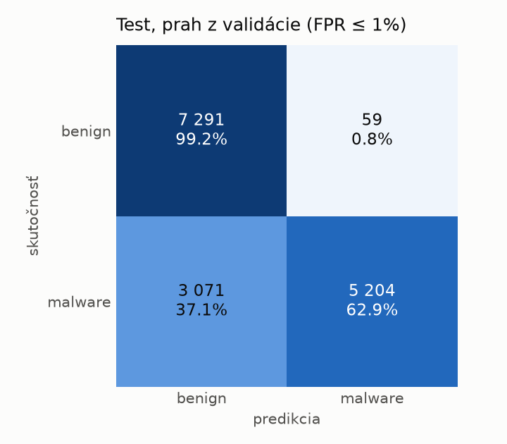
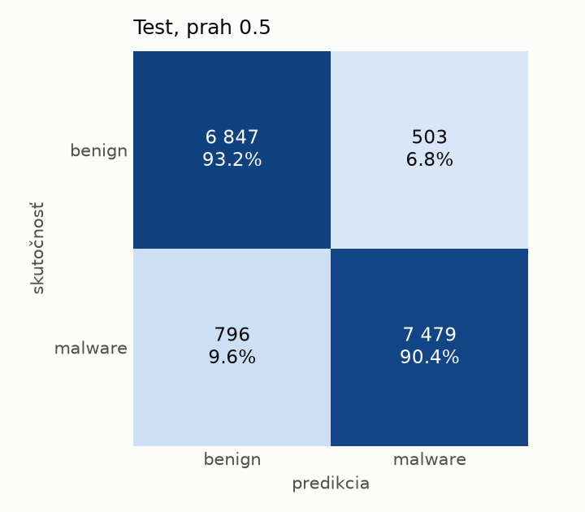

# static/lr – beh `20261122-214908`

> Automaticky generované (`src/training/run_tabular.py`). Konfigurácia: `config.yaml`, protokol: `protocol.yaml`.

- **Model:** `logreg` – logistická regresia s L2 regularizáciou (vstup signed log1p + štandardizácia)
- **Ladenie:** bez ladenia – hyperparametre prevzaté z `runs_v4/real_full/full/static/lr/20261122-184714`
- **Finálne modely:** seedy [0, 1, 2]; hodnoty sú priemer ± smerodajná odchýlka cez seedy
- **Najlepšie hyperparametre:** `{"max_iter": 2000, "C": 2.1423021757741068}`

## Detekčná kvalita (bez prahu)
| metrika | train (podvzorka) | validácia | test |
|---|---|---|---|
| ROC-AUC | 0.9712 ± 0.0000 | 0.9670 ± 0.0000 | 0.9686 ± 0.0000 |
| PR-AUC | 0.9742 ± 0.0000 | 0.9705 ± 0.0000 | 0.9745 ± 0.0000 |
| TPR pri FPR 1 % | 0.6976 ± 0.0000 | 0.6172 ± 0.0000 | 0.6929 ± 0.0000 |
| TPR pri FPR 0,1 % | 0.3863 ± 0.0000 | 0.2841 ± 0.0000 | 0.2371 ± 0.0000 |
| log loss | 0.2118 ± 0.0000 | 0.2311 ± 0.0000 | 0.2235 ± 0.0000 |
| Brier skóre | 0.0592 ± 0.0000 | 0.0643 ± 0.0000 | 0.0627 ± 0.0000 |

Rozdiel ROC-AUC train − validácia: **0.0042** (veľký rozdiel = preučenie).

## Pri prahu z validácie (FPR ≤ 1% na validácii)
| metrika | train (podvzorka) | validácia | test |
|---|---|---|---|
| accuracy | 0.8065 ± 0.0000 | 0.8011 ± 0.0000 | 0.7997 ± 0.0000 |
| balanced accuracy | 0.8046 ± 0.0000 | 0.8037 ± 0.0000 | 0.8104 ± 0.0000 |
| precision | 0.9899 ± 0.0000 | 0.9848 ± 0.0000 | 0.9888 ± 0.0000 |
| recall (TPR) | 0.6154 ± 0.0000 | 0.6172 ± 0.0000 | 0.6289 ± 0.0000 |
| FPR | 0.0061 ± 0.0000 | 0.0098 ± 0.0000 | 0.0080 ± 0.0000 |
| F1 | 0.7589 ± 0.0000 | 0.7588 ± 0.0000 | 0.7688 ± 0.0000 |
| MCC | 0.6599 ± 0.0000 | 0.6522 ± 0.0000 | 0.6557 ± 0.0000 |

## Pri pevnom prahu 0.5
| metrika | train (podvzorka) | validácia | test |
|---|---|---|---|
| accuracy | 0.9244 ± 0.0000 | 0.9179 ± 0.0000 | 0.9169 ± 0.0000 |
| balanced accuracy | 0.9242 ± 0.0000 | 0.9181 ± 0.0000 | 0.9177 ± 0.0000 |
| precision | 0.9382 ± 0.0000 | 0.9321 ± 0.0000 | 0.9370 ± 0.0000 |
| recall (TPR) | 0.9071 ± 0.0000 | 0.9040 ± 0.0000 | 0.9038 ± 0.0000 |
| FPR | 0.0586 ± 0.0000 | 0.0678 ± 0.0000 | 0.0684 ± 0.0000 |
| F1 | 0.9224 ± 0.0000 | 0.9178 ± 0.0000 | 0.9201 ± 0.0000 |
| MCC | 0.8492 ± 0.0000 | 0.8362 ± 0.0000 | 0.8341 ± 0.0000 |

## Výpočtové nároky (seed 0, testovacia množina)
| meranie | hodnota |
|---|---|
| tréning finálneho modelu | 0.2 s (priemer cez seedy) |
| ladenie spolu | 0 s |
| počet parametrov / uzlov | 165 |
| veľkosť modelu na disku | 0.01 MB |
| transformácia vstupu – latencia (1 vlákno) | 0.005 ms |
| transformácia vstupu – priepustnosť | 1 106 226 vzoriek/s |
| CPU latencia modelu (batch 1, 1 vlákno) | 0.004 ms (p95 0.005) |
| CPU priepustnosť (24 vlákien) | 3 904 005 vzoriek/s |

## Grafy
| | |
|---|---|
|  |  |
|  |  |
|  |  |
|  |  |

## Súbory
`metrics.json` (všetky metriky po seedoch vrátane rodín), `timing.json`, `hpo_trials.csv`,
`predictions/<časť>_seed<N>.parquet` (sha256, family, label, score), `model/seed_<N>/`, `log.txt`.
