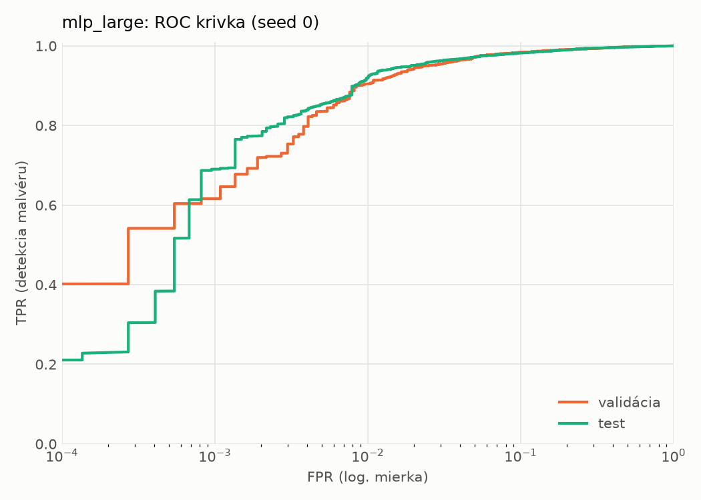
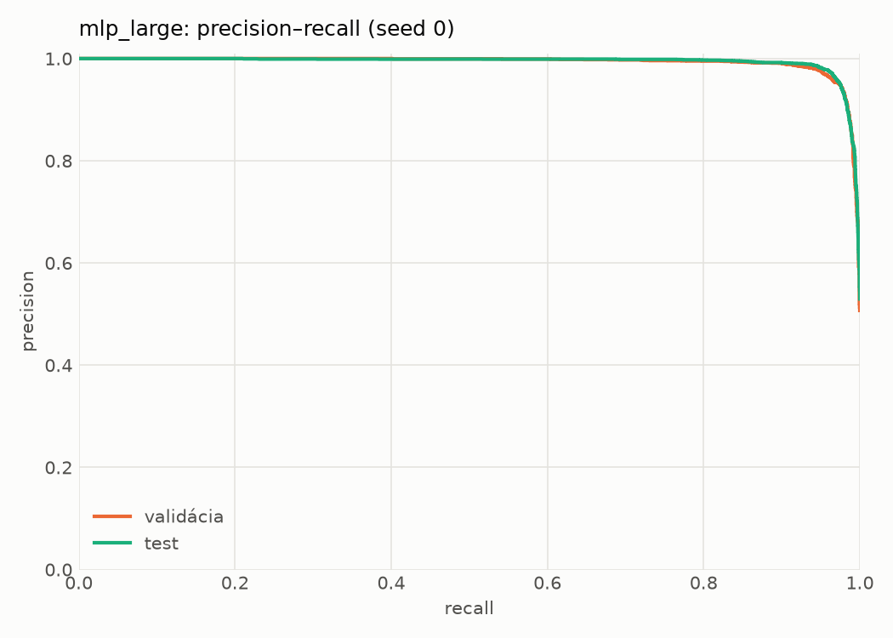
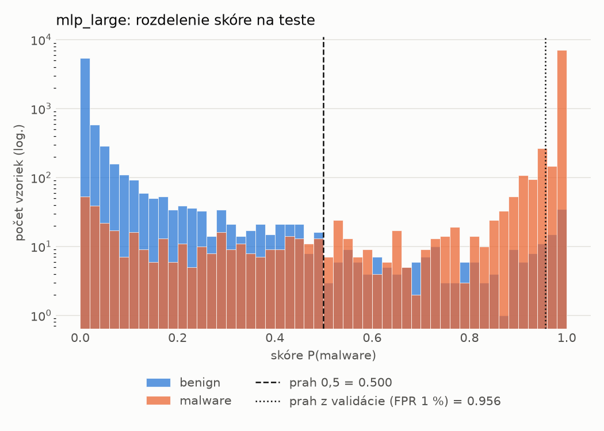
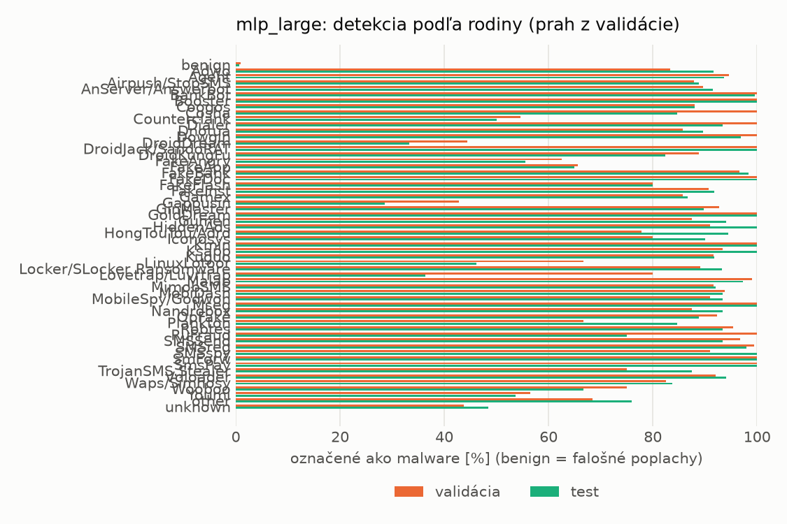
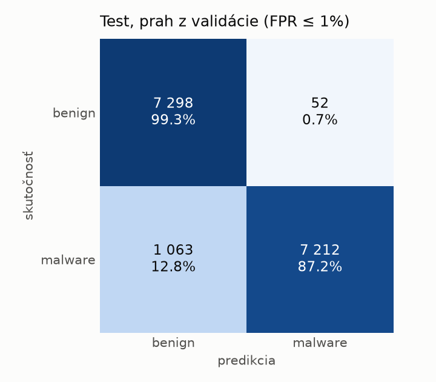
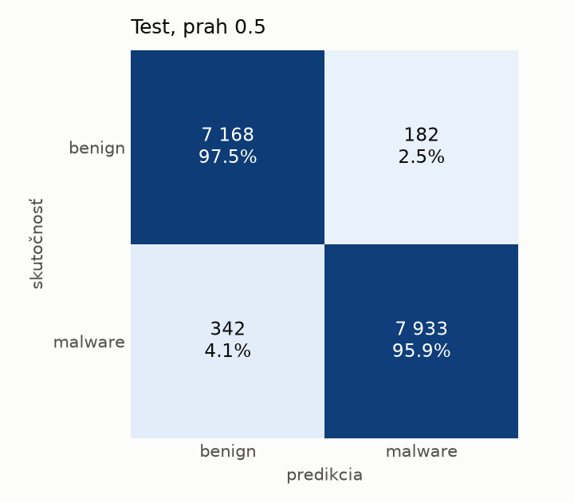
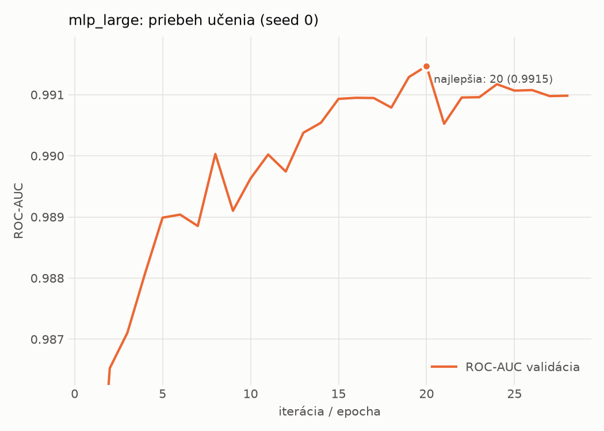

# static/mlp_large – beh `20261122-215111`

> Automaticky generované (`src/training/run_tabular.py`). Konfigurácia: `config.yaml`, protokol: `protocol.yaml`.

- **Model:** `mlp` – veľká neurónová sieť (3–5 skrytých vrstiev, 512–2048 neurónov), kandidát na učiteľa
- **Ladenie:** bez ladenia – hyperparametre prevzaté z `runs_v4/real_full/full/static/mlp_large/20261122-190815`
- **Finálne modely:** seedy [0, 1, 2]; hodnoty sú priemer ± smerodajná odchýlka cez seedy
- **Najlepšie hyperparametre:** `{"max_epochs": 100, "patience": 8, "hidden_layers": 3, "hidden_width": 512, "width_decay": 0.5, "dropout": 0.18301180344828658, "lr": 0.000378062291460712, "weight_decay": 1.421525321060219e-06, "batch_size": 256}`

## Detekčná kvalita (bez prahu)
| metrika | train (podvzorka) | validácia | test |
|---|---|---|---|
| ROC-AUC | 0.9981 ± 0.0005 | 0.9916 ± 0.0001 | 0.9917 ± 0.0005 |
| PR-AUC | 0.9983 ± 0.0004 | 0.9925 ± 0.0004 | 0.9935 ± 0.0001 |
| TPR pri FPR 1 % | 0.9747 ± 0.0049 | 0.9070 ± 0.0077 | 0.9317 ± 0.0111 |
| TPR pri FPR 0,1 % | 0.9279 ± 0.0234 | 0.6089 ± 0.0191 | 0.6820 ± 0.0077 |
| log loss | 0.0502 ± 0.0060 | 0.1176 ± 0.0022 | 0.1094 ± 0.0062 |
| Brier skóre | 0.0137 ± 0.0016 | 0.0283 ± 0.0008 | 0.0265 ± 0.0012 |

Rozdiel ROC-AUC train − validácia: **0.0065** (veľký rozdiel = preučenie).

## Pri prahu z validácie (FPR ≤ 1% na validácii)
| metrika | train (podvzorka) | validácia | test |
|---|---|---|---|
| accuracy | 0.9584 ± 0.0036 | 0.9480 ± 0.0039 | 0.9350 ± 0.0131 |
| balanced accuracy | 0.9580 ± 0.0036 | 0.9486 ± 0.0038 | 0.9383 ± 0.0124 |
| precision | 0.9989 ± 0.0002 | 0.9897 ± 0.0002 | 0.9939 ± 0.0012 |
| recall (TPR) | 0.9170 ± 0.0073 | 0.9070 ± 0.0077 | 0.8826 ± 0.0252 |
| FPR | 0.0010 ± 0.0002 | 0.0097 ± 0.0002 | 0.0061 ± 0.0012 |
| F1 | 0.9562 ± 0.0039 | 0.9465 ± 0.0042 | 0.9348 ± 0.0139 |
| MCC | 0.9198 ± 0.0066 | 0.8994 ± 0.0071 | 0.8767 ± 0.0235 |

## Pri pevnom prahu 0.5
| metrika | train (podvzorka) | validácia | test |
|---|---|---|---|
| accuracy | 0.9823 ± 0.0021 | 0.9632 ± 0.0020 | 0.9670 ± 0.0012 |
| balanced accuracy | 0.9822 ± 0.0021 | 0.9633 ± 0.0020 | 0.9677 ± 0.0013 |
| precision | 0.9926 ± 0.0026 | 0.9709 ± 0.0029 | 0.9806 ± 0.0027 |
| recall (TPR) | 0.9714 ± 0.0023 | 0.9562 ± 0.0033 | 0.9566 ± 0.0023 |
| FPR | 0.0071 ± 0.0025 | 0.0295 ± 0.0031 | 0.0213 ± 0.0031 |
| F1 | 0.9819 ± 0.0022 | 0.9635 ± 0.0020 | 0.9685 ± 0.0011 |
| MCC | 0.9647 ± 0.0042 | 0.9266 ± 0.0040 | 0.9342 ± 0.0025 |

## Výpočtové nároky (seed 0, testovacia množina)
| meranie | hodnota |
|---|---|
| tréning finálneho modelu | 14.2 s (priemer cez seedy) |
| ladenie spolu | 0 s |
| počet parametrov / uzlov | 250 625 |
| veľkosť modelu na disku | 1.02 MB |
| transformácia vstupu – latencia (1 vlákno) | 0.015 ms |
| transformácia vstupu – priepustnosť | 613 838 vzoriek/s |
| CPU latencia modelu (batch 1, 1 vlákno) | 0.154 ms (p95 0.325) |
| CPU priepustnosť (24 vlákien) | 971 468 vzoriek/s |
| GPU latencia (batch 1) | 0.515 ms (p95 0.581) |
| GPU priepustnosť | 848 092 vzoriek/s |
| GPU špičková pamäť | 141 MB |

## Grafy
| | |
|---|---|
|  |  |
|  |  |
|  |  |
|  |  |

## Súbory
`metrics.json` (všetky metriky po seedoch vrátane rodín), `timing.json`, `hpo_trials.csv`,
`predictions/<časť>_seed<N>.parquet` (sha256, family, label, score), `model/seed_<N>/`, `log.txt`.
