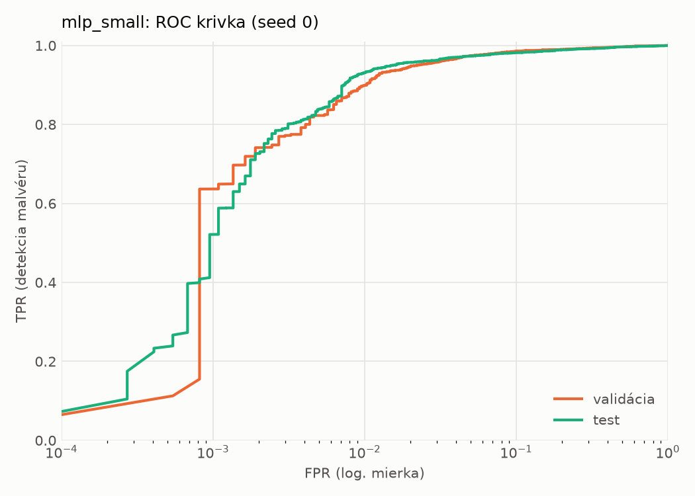
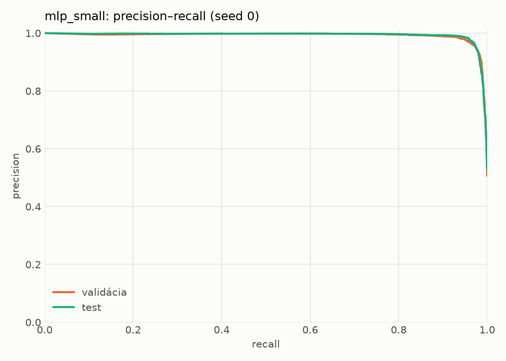
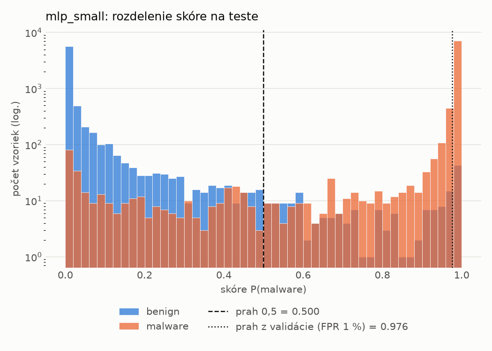
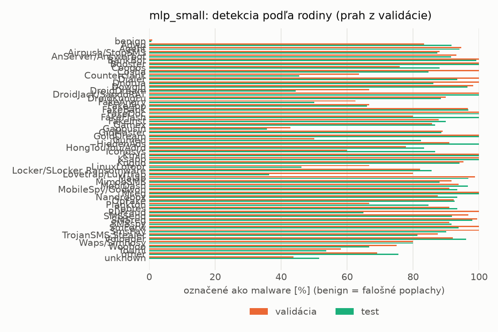
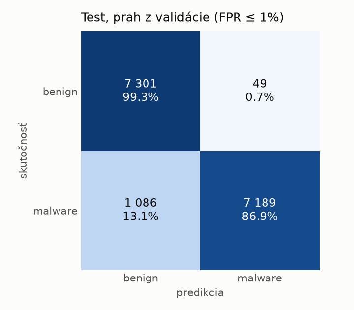
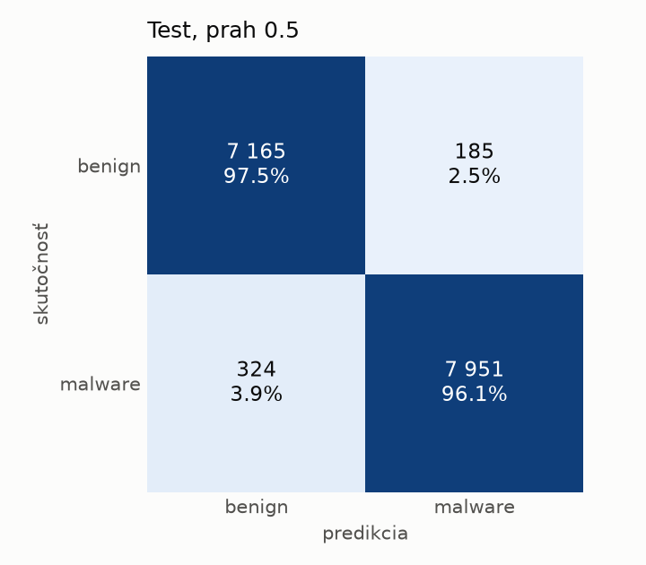
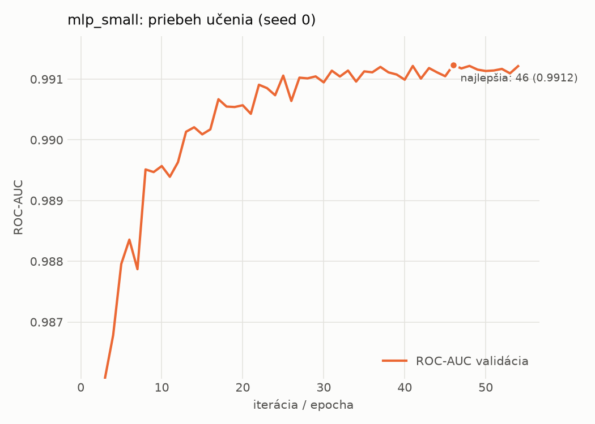

# static/mlp_small – beh `20261122-215022`

> Automaticky generované (`src/training/run_tabular.py`). Konfigurácia: `config.yaml`, protokol: `protocol.yaml`.

- **Model:** `mlp` – malá neurónová sieť (1–2 skryté vrstvy), kandidát na ľahkého študenta
- **Ladenie:** bez ladenia – hyperparametre prevzaté z `runs_v4/real_full/full/static/mlp_small/20261122-190134`
- **Finálne modely:** seedy [0, 1, 2]; hodnoty sú priemer ± smerodajná odchýlka cez seedy
- **Najlepšie hyperparametre:** `{"width_decay": 0.5, "max_epochs": 100, "patience": 8, "hidden_layers": 2, "hidden_width": 256, "dropout": 0.05428236214064427, "lr": 0.00041374253133077954, "weight_decay": 5.569517746104647e-06, "batch_size": 256}`

## Detekčná kvalita (bez prahu)
| metrika | train (podvzorka) | validácia | test |
|---|---|---|---|
| ROC-AUC | 0.9980 ± 0.0004 | 0.9909 ± 0.0002 | 0.9903 ± 0.0004 |
| PR-AUC | 0.9982 ± 0.0004 | 0.9911 ± 0.0002 | 0.9924 ± 0.0002 |
| TPR pri FPR 1 % | 0.9753 ± 0.0041 | 0.9044 ± 0.0060 | 0.9227 ± 0.0213 |
| TPR pri FPR 0,1 % | 0.9044 ± 0.0248 | 0.4876 ± 0.1521 | 0.5693 ± 0.0539 |
| log loss | 0.0514 ± 0.0064 | 0.1192 ± 0.0010 | 0.1183 ± 0.0020 |
| Brier skóre | 0.0136 ± 0.0018 | 0.0289 ± 0.0006 | 0.0268 ± 0.0005 |

Rozdiel ROC-AUC train − validácia: **0.0070** (veľký rozdiel = preučenie).

## Pri prahu z validácie (FPR ≤ 1% na validácii)
| metrika | train (podvzorka) | validácia | test |
|---|---|---|---|
| accuracy | 0.9564 ± 0.0015 | 0.9467 ± 0.0031 | 0.9285 ± 0.0010 |
| balanced accuracy | 0.9559 ± 0.0015 | 0.9474 ± 0.0031 | 0.9322 ± 0.0010 |
| precision | 0.9986 ± 0.0003 | 0.9897 ± 0.0002 | 0.9932 ± 0.0005 |
| recall (TPR) | 0.9131 ± 0.0033 | 0.9044 ± 0.0060 | 0.8710 ± 0.0021 |
| FPR | 0.0013 ± 0.0002 | 0.0097 ± 0.0002 | 0.0067 ± 0.0005 |
| F1 | 0.9540 ± 0.0017 | 0.9451 ± 0.0034 | 0.9281 ± 0.0011 |
| MCC | 0.9160 ± 0.0028 | 0.8970 ± 0.0057 | 0.8650 ± 0.0018 |

## Pri pevnom prahu 0.5
| metrika | train (podvzorka) | validácia | test |
|---|---|---|---|
| accuracy | 0.9827 ± 0.0022 | 0.9623 ± 0.0015 | 0.9674 ± 0.0009 |
| balanced accuracy | 0.9826 ± 0.0022 | 0.9624 ± 0.0015 | 0.9679 ± 0.0009 |
| precision | 0.9908 ± 0.0015 | 0.9665 ± 0.0014 | 0.9782 ± 0.0020 |
| recall (TPR) | 0.9740 ± 0.0038 | 0.9589 ± 0.0042 | 0.9599 ± 0.0008 |
| FPR | 0.0088 ± 0.0015 | 0.0342 ± 0.0016 | 0.0241 ± 0.0022 |
| F1 | 0.9823 ± 0.0022 | 0.9627 ± 0.0016 | 0.9690 ± 0.0008 |
| MCC | 0.9655 ± 0.0043 | 0.9246 ± 0.0030 | 0.9349 ± 0.0018 |

## Výpočtové nároky (seed 0, testovacia množina)
| meranie | hodnota |
|---|---|
| tréning finálneho modelu | 15.7 s (priemer cez seedy) |
| ladenie spolu | 0 s |
| počet parametrov / uzlov | 76 033 |
| veľkosť modelu na disku | 0.32 MB |
| transformácia vstupu – latencia (1 vlákno) | 0.006 ms |
| transformácia vstupu – priepustnosť | 757 513 vzoriek/s |
| CPU latencia modelu (batch 1, 1 vlákno) | 0.112 ms (p95 0.241) |
| CPU priepustnosť (24 vlákien) | 1 539 955 vzoriek/s |
| GPU latencia (batch 1) | 0.386 ms (p95 0.409) |
| GPU priepustnosť | 1 301 368 vzoriek/s |
| GPU špičková pamäť | 84 MB |

## Grafy
| | |
|---|---|
|  |  |
|  |  |
|  |  |
|  |  |

## Súbory
`metrics.json` (všetky metriky po seedoch vrátane rodín), `timing.json`, `hpo_trials.csv`,
`predictions/<časť>_seed<N>.parquet` (sha256, family, label, score), `model/seed_<N>/`, `log.txt`.
