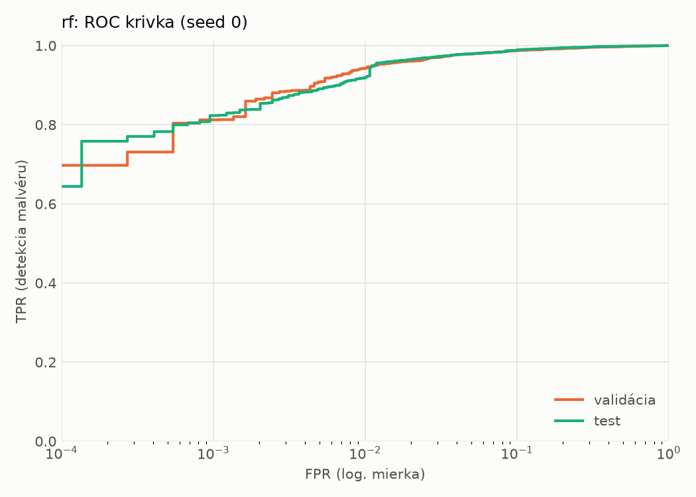
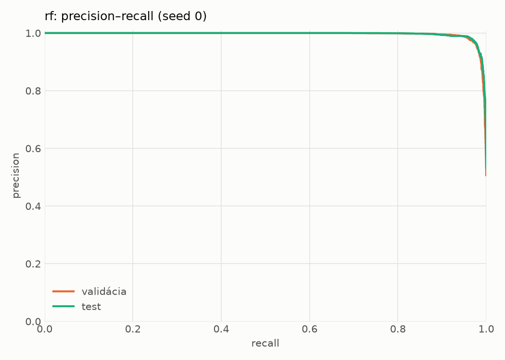
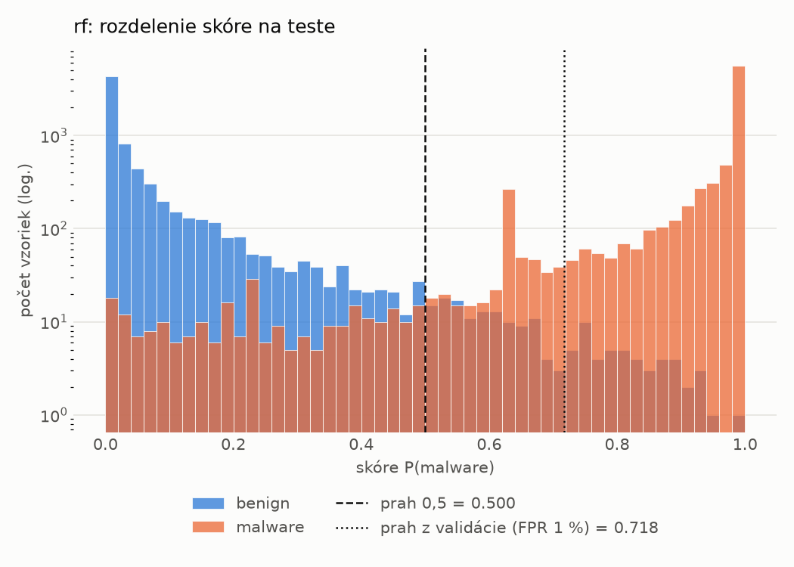
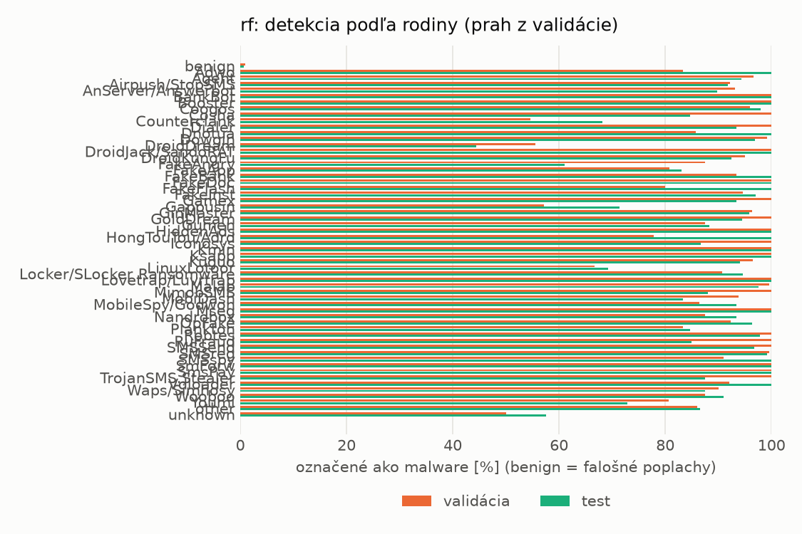
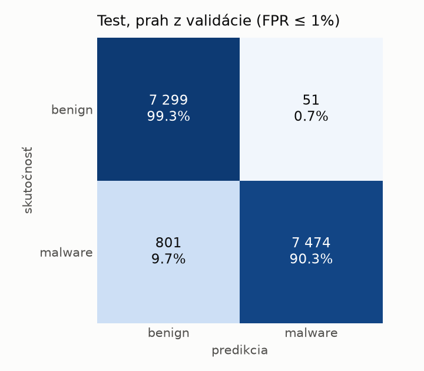
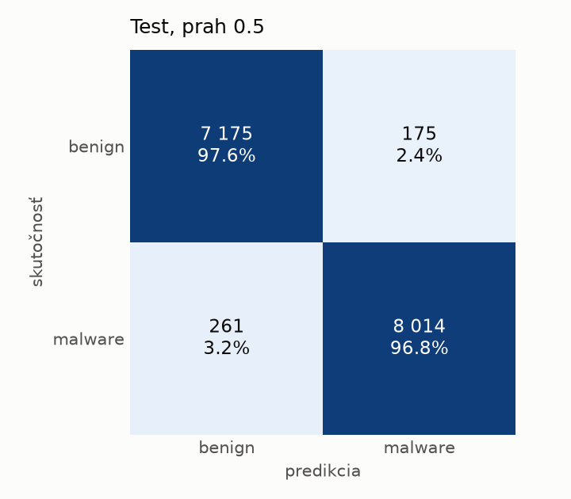

# static/rf – beh `20261122-214912`

> Automaticky generované (`src/training/run_tabular.py`). Konfigurácia: `config.yaml`, protokol: `protocol.yaml`.

- **Model:** `random_forest` – Random Forest (pôvodné hodnoty príznakov)
- **Ladenie:** bez ladenia – hyperparametre prevzaté z `runs_v4/real_full/full/static/rf/20261122-184723`
- **Finálne modely:** seedy [0, 1, 2]; hodnoty sú priemer ± smerodajná odchýlka cez seedy
- **Najlepšie hyperparametre:** `{"n_estimators": 400, "max_depth": 32, "min_samples_leaf": 1, "max_features": "sqrt"}`

## Detekčná kvalita (bez prahu)
| metrika | train (podvzorka) | validácia | test |
|---|---|---|---|
| ROC-AUC | 1.0000 ± 0.0000 | 0.9942 ± 0.0001 | 0.9947 ± 0.0000 |
| PR-AUC | 1.0000 ± 0.0000 | 0.9954 ± 0.0000 | 0.9960 ± 0.0000 |
| TPR pri FPR 1 % | 1.0000 ± 0.0000 | 0.9417 ± 0.0016 | 0.9363 ± 0.0160 |
| TPR pri FPR 0,1 % | 0.9996 ± 0.0000 | 0.8153 ± 0.0047 | 0.8227 ± 0.0032 |
| log loss | 0.0270 ± 0.0001 | 0.0933 ± 0.0004 | 0.0981 ± 0.0005 |
| Brier skóre | 0.0039 ± 0.0000 | 0.0244 ± 0.0000 | 0.0255 ± 0.0003 |

Rozdiel ROC-AUC train − validácia: **0.0058** (veľký rozdiel = preučenie).

## Pri prahu z validácie (FPR ≤ 1% na validácii)
| metrika | train (podvzorka) | validácia | test |
|---|---|---|---|
| accuracy | 0.9909 ± 0.0003 | 0.9656 ± 0.0008 | 0.9455 ± 0.0011 |
| balanced accuracy | 0.9908 ± 0.0003 | 0.9660 ± 0.0008 | 0.9482 ± 0.0011 |
| precision | 1.0000 ± 0.0000 | 0.9900 ± 0.0000 | 0.9937 ± 0.0004 |
| recall (TPR) | 0.9816 ± 0.0007 | 0.9417 ± 0.0016 | 0.9028 ± 0.0022 |
| FPR | 0.0000 ± 0.0000 | 0.0098 ± 0.0000 | 0.0064 ± 0.0004 |
| F1 | 0.9907 ± 0.0004 | 0.9652 ± 0.0008 | 0.9461 ± 0.0012 |
| MCC | 0.9820 ± 0.0007 | 0.9324 ± 0.0015 | 0.8954 ± 0.0020 |

## Pri pevnom prahu 0.5
| metrika | train (podvzorka) | validácia | test |
|---|---|---|---|
| accuracy | 0.9995 ± 0.0001 | 0.9695 ± 0.0003 | 0.9721 ± 0.0001 |
| balanced accuracy | 0.9995 ± 0.0001 | 0.9695 ± 0.0003 | 0.9723 ± 0.0002 |
| precision | 0.9997 ± 0.0001 | 0.9688 ± 0.0005 | 0.9785 ± 0.0004 |
| recall (TPR) | 0.9992 ± 0.0000 | 0.9712 ± 0.0005 | 0.9685 ± 0.0001 |
| FPR | 0.0003 ± 0.0001 | 0.0322 ± 0.0006 | 0.0240 ± 0.0004 |
| F1 | 0.9995 ± 0.0001 | 0.9700 ± 0.0003 | 0.9735 ± 0.0001 |
| MCC | 0.9989 ± 0.0001 | 0.9390 ± 0.0006 | 0.9440 ± 0.0003 |

## Výpočtové nároky (seed 0, testovacia množina)
| meranie | hodnota |
|---|---|
| tréning finálneho modelu | 1.9 s (priemer cez seedy) |
| ladenie spolu | 0 s |
| počet parametrov / uzlov | 2 626 302 |
| veľkosť modelu na disku | 210.47 MB |
| CPU latencia modelu (batch 1, 1 vlákno) | 12.339 ms (p95 12.683) |
| CPU priepustnosť (24 vlákien) | 148 571 vzoriek/s |

## Grafy
| | |
|---|---|
|  |  |
|  |  |
|  |  |
|  |  |

## Súbory
`metrics.json` (všetky metriky po seedoch vrátane rodín), `timing.json`, `hpo_trials.csv`,
`predictions/<časť>_seed<N>.parquet` (sha256, family, label, score), `model/seed_<N>/`, `log.txt`.
