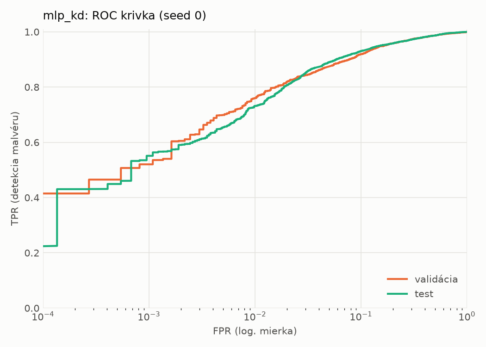
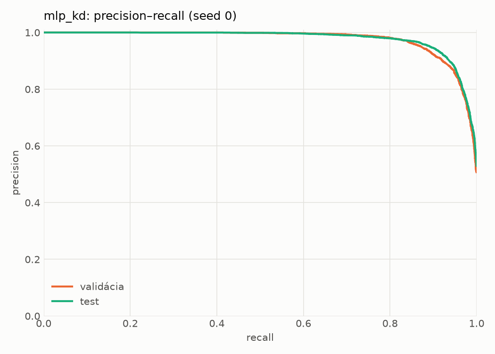
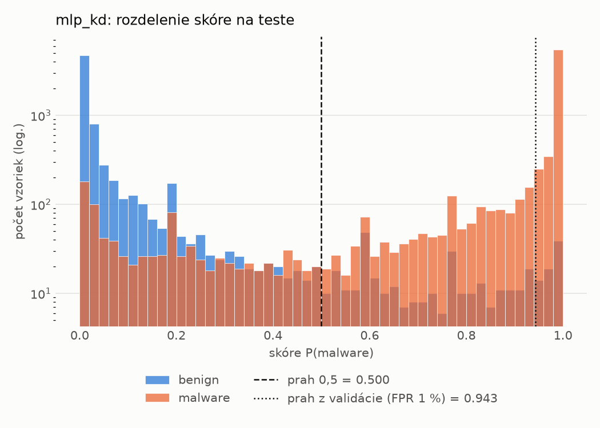
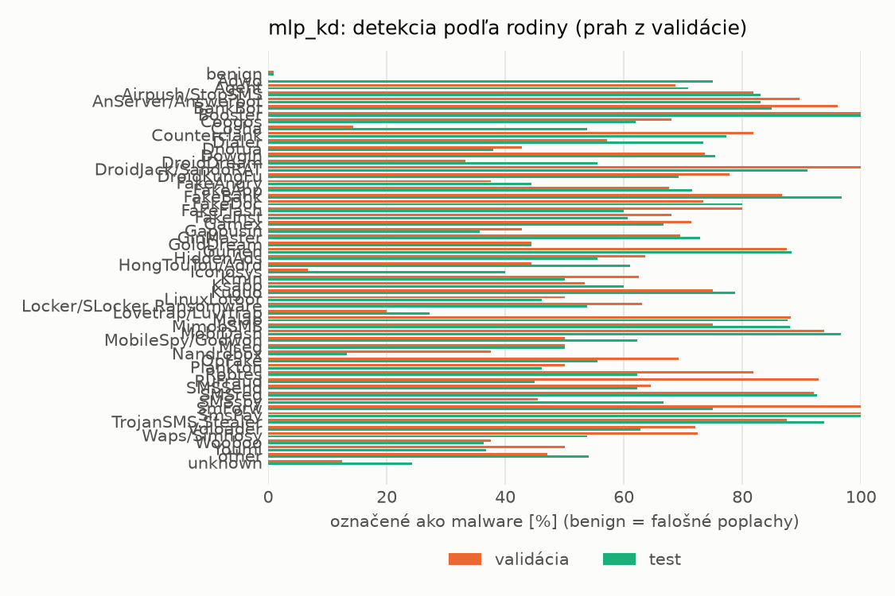
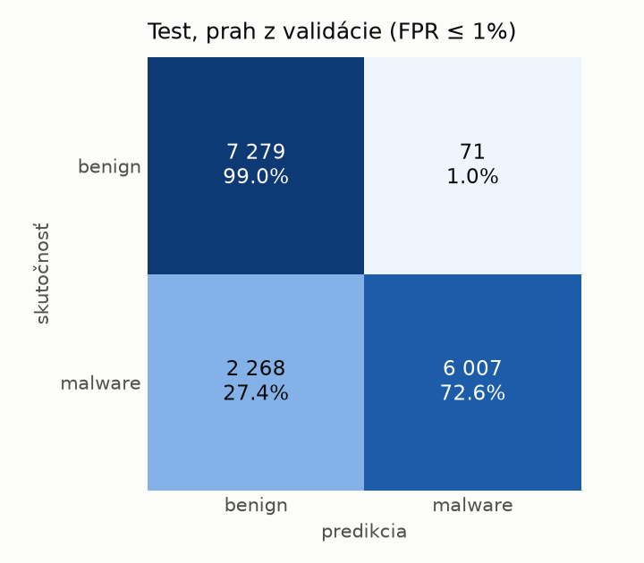
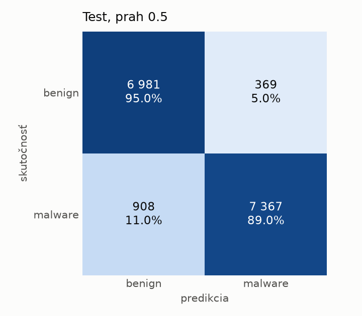
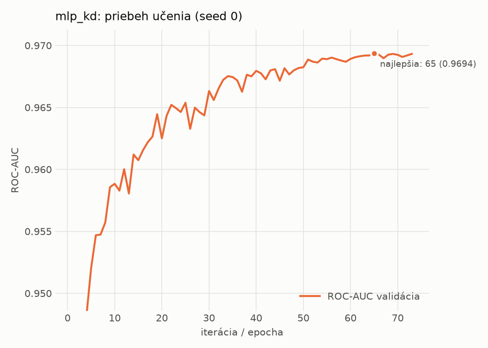

# dynamic/mlp_kd – beh `20261122-220408`

> Automaticky generované (`src/training/run_tabular.py`). Konfigurácia: `config.yaml`, protokol: `protocol.yaml`.

- **Model:** `mlp` – študent – malé MLP učené destiláciou z hybridného učiteľa
- **Ladenie:** bez ladenia – hyperparametre prevzaté z `runs_v4/real_full/full/students_dynamic/mlp_kd/20261122-205301`
- **Finálne modely:** seedy [0, 1, 2]; hodnoty sú priemer ± smerodajná odchýlka cez seedy
- **Najlepšie hyperparametre:** `{"hidden_layers": 1, "max_epochs": 100, "patience": 8, "hidden_width": 64, "dropout": 0.03643763137351852, "lr": 0.0028753520300020953, "weight_decay": 0.00022273244560059002, "batch_size": 512, "kd_alpha": 0.33129867518829337, "kd_temperature": 1.9602594769462303}`

## Detekčná kvalita (bez prahu)
| metrika | train (podvzorka) | validácia | test |
|---|---|---|---|
| ROC-AUC | 0.9790 ± 0.0005 | 0.9706 ± 0.0011 | 0.9710 ± 0.0004 |
| PR-AUC | 0.9827 ± 0.0005 | 0.9762 ± 0.0009 | 0.9775 ± 0.0003 |
| TPR pri FPR 1 % | 0.8279 ± 0.0054 | 0.7678 ± 0.0109 | 0.7258 ± 0.0059 |
| TPR pri FPR 0,1 % | 0.7224 ± 0.0038 | 0.5803 ± 0.0522 | 0.5259 ± 0.0474 |
| log loss | 0.1854 ± 0.0033 | 0.2441 ± 0.0059 | 0.2422 ± 0.0028 |
| Brier skóre | 0.0513 ± 0.0010 | 0.0655 ± 0.0012 | 0.0645 ± 0.0006 |

Rozdiel ROC-AUC train − validácia: **0.0084** (veľký rozdiel = preučenie).

## Pri prahu z validácie (FPR ≤ 1% na validácii)
| metrika | train (podvzorka) | validácia | test |
|---|---|---|---|
| accuracy | 0.8922 ± 0.0050 | 0.8774 ± 0.0055 | 0.8510 ± 0.0013 |
| balanced accuracy | 0.8912 ± 0.0051 | 0.8790 ± 0.0054 | 0.8587 ± 0.0011 |
| precision | 0.9944 ± 0.0002 | 0.9877 ± 0.0002 | 0.9870 ± 0.0016 |
| recall (TPR) | 0.7867 ± 0.0103 | 0.7678 ± 0.0109 | 0.7283 ± 0.0036 |
| FPR | 0.0044 ± 0.0002 | 0.0098 ± 0.0000 | 0.0108 ± 0.0014 |
| F1 | 0.8784 ± 0.0064 | 0.8640 ± 0.0069 | 0.8381 ± 0.0018 |
| MCC | 0.8013 ± 0.0086 | 0.7755 ± 0.0093 | 0.7340 ± 0.0014 |

## Pri pevnom prahu 0.5
| metrika | train (podvzorka) | validácia | test |
|---|---|---|---|
| accuracy | 0.9328 ± 0.0015 | 0.9136 ± 0.0006 | 0.9175 ± 0.0015 |
| balanced accuracy | 0.9326 ± 0.0015 | 0.9139 ± 0.0005 | 0.9193 ± 0.0014 |
| precision | 0.9528 ± 0.0013 | 0.9354 ± 0.0009 | 0.9519 ± 0.0008 |
| recall (TPR) | 0.9094 ± 0.0039 | 0.8911 ± 0.0018 | 0.8890 ± 0.0021 |
| FPR | 0.0442 ± 0.0014 | 0.0633 ± 0.0010 | 0.0505 ± 0.0008 |
| F1 | 0.9306 ± 0.0017 | 0.9127 ± 0.0007 | 0.9194 ± 0.0015 |
| MCC | 0.8665 ± 0.0027 | 0.8282 ± 0.0010 | 0.8371 ± 0.0028 |

## Výpočtové nároky (seed 0, testovacia množina)
| meranie | hodnota |
|---|---|
| tréning finálneho modelu | 16.4 s (priemer cez seedy) |
| ladenie spolu | 0 s |
| počet parametrov / uzlov | 8 641 |
| veľkosť modelu na disku | 0.04 MB |
| transformácia vstupu – latencia (1 vlákno) | 0.015 ms |
| transformácia vstupu – priepustnosť | 1 212 171 vzoriek/s |
| CPU latencia modelu (batch 1, 1 vlákno) | 0.071 ms (p95 0.077) |
| CPU priepustnosť (24 vlákien) | 5 497 695 vzoriek/s |
| GPU latencia (batch 1) | 0.266 ms (p95 0.298) |
| GPU priepustnosť | 2 289 948 vzoriek/s |
| GPU špičková pamäť | 61 MB |

## Grafy
| | |
|---|---|
|  |  |
|  |  |
|  |  |
|  |  |

## Súbory
`metrics.json` (všetky metriky po seedoch vrátane rodín), `timing.json`, `hpo_trials.csv`,
`predictions/<časť>_seed<N>.parquet` (sha256, family, label, score), `model/seed_<N>/`, `log.txt`.
