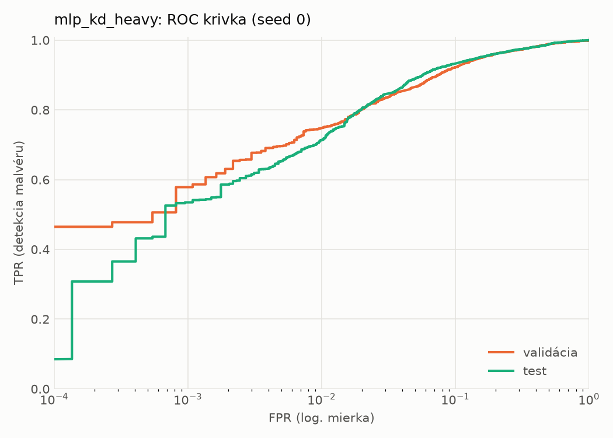
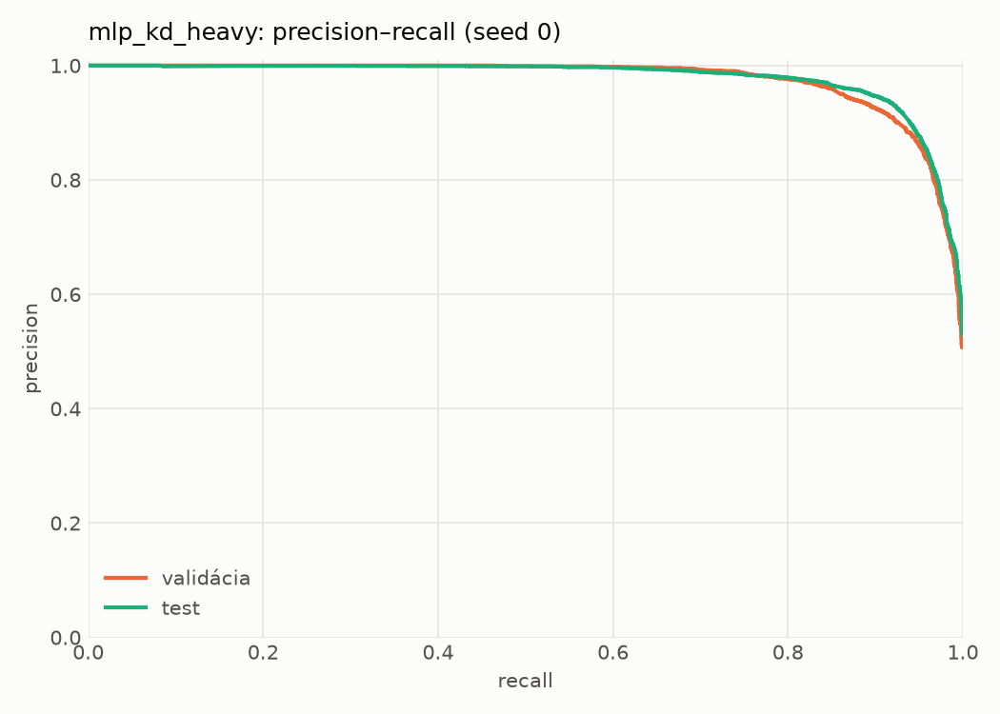
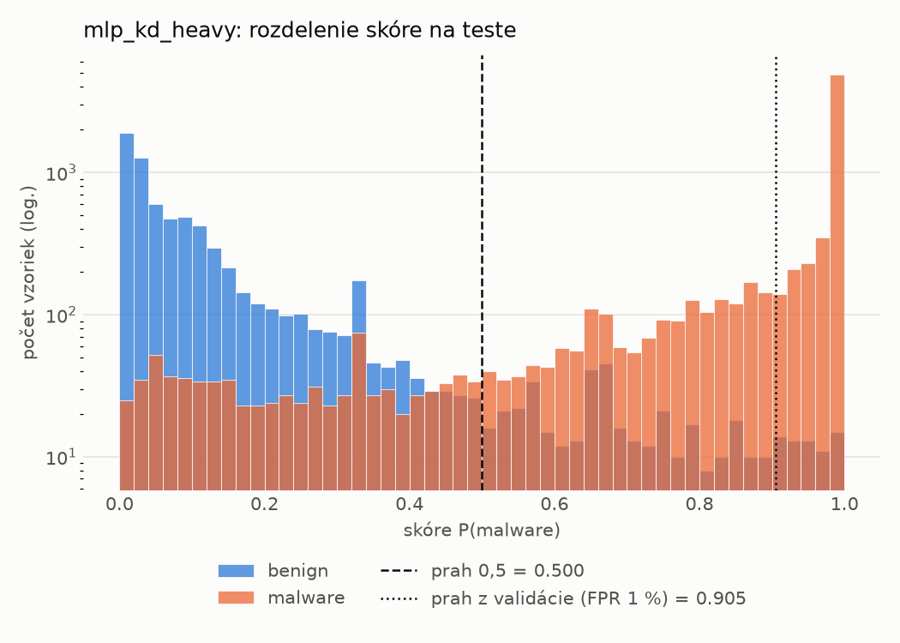
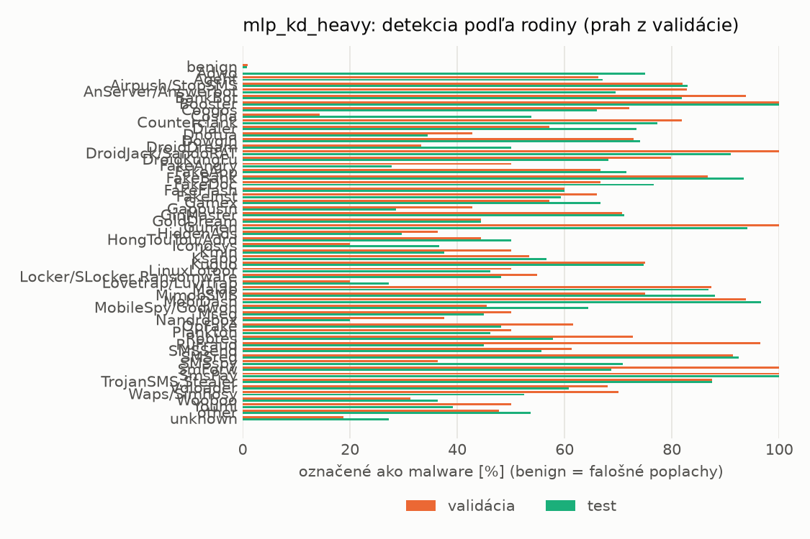
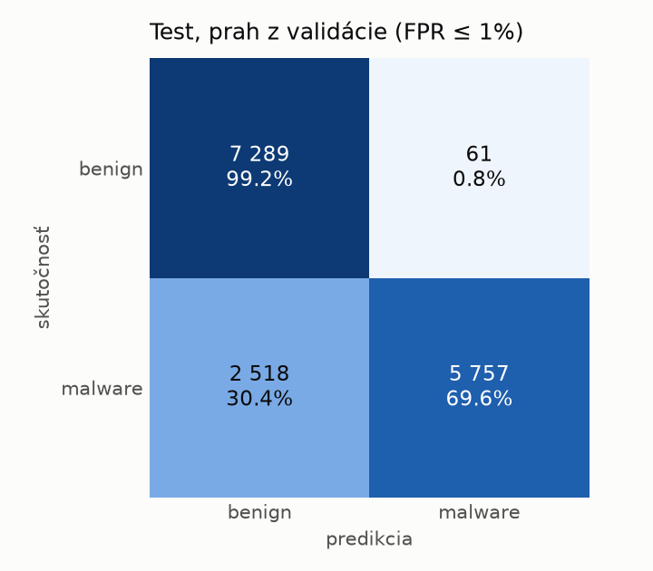
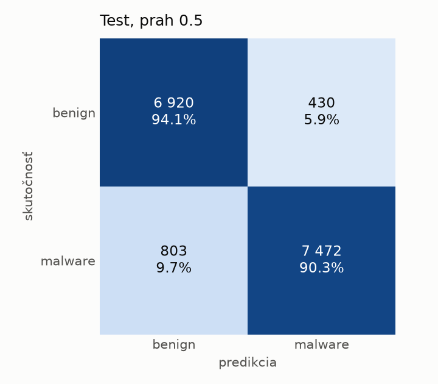
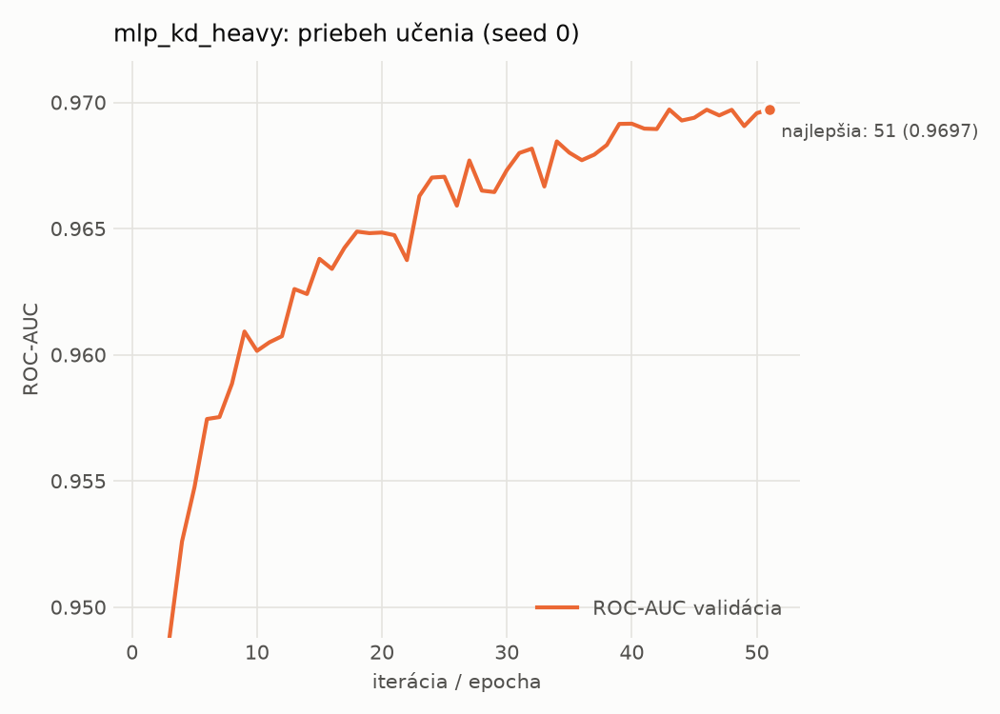

# dynamic/mlp_kd_heavy – beh `20261122-220636`

> Automaticky generované (`src/training/run_tabular.py`). Konfigurácia: `config.yaml`, protokol: `protocol.yaml`.

- **Model:** `mlp` – študent – malé MLP učené destiláciou z mlp_large hybridu (V4)
- **Ladenie:** bez ladenia – hyperparametre prevzaté z `runs_v4/real_full/full/students_dynamic/mlp_kd_heavy/20261122-211545`
- **Finálne modely:** seedy [0, 1, 2]; hodnoty sú priemer ± smerodajná odchýlka cez seedy
- **Najlepšie hyperparametre:** `{"hidden_layers": 1, "max_epochs": 100, "patience": 8, "hidden_width": 64, "dropout": 0.029123066185724737, "lr": 0.0017081972585601675, "weight_decay": 1.0334419171964511e-06, "batch_size": 256, "kd_alpha": 0.8514630095462001, "kd_temperature": 1.2684929468645387}`

## Detekčná kvalita (bez prahu)
| metrika | train (podvzorka) | validácia | test |
|---|---|---|---|
| ROC-AUC | 0.9799 ± 0.0009 | 0.9704 ± 0.0008 | 0.9715 ± 0.0004 |
| PR-AUC | 0.9834 ± 0.0007 | 0.9759 ± 0.0006 | 0.9780 ± 0.0004 |
| TPR pri FPR 1 % | 0.8341 ± 0.0106 | 0.7493 ± 0.0013 | 0.7237 ± 0.0096 |
| TPR pri FPR 0,1 % | 0.7038 ± 0.0211 | 0.5994 ± 0.0184 | 0.5472 ± 0.0163 |
| log loss | 0.1730 ± 0.0050 | 0.2168 ± 0.0029 | 0.2146 ± 0.0028 |
| Brier skóre | 0.0500 ± 0.0017 | 0.0634 ± 0.0008 | 0.0621 ± 0.0013 |

Rozdiel ROC-AUC train − validácia: **0.0095** (veľký rozdiel = preučenie).

## Pri prahu z validácie (FPR ≤ 1% na validácii)
| metrika | train (podvzorka) | validácia | test |
|---|---|---|---|
| accuracy | 0.8813 ± 0.0009 | 0.8681 ± 0.0007 | 0.8356 ± 0.0018 |
| balanced accuracy | 0.8801 ± 0.0009 | 0.8698 ± 0.0007 | 0.8444 ± 0.0016 |
| precision | 0.9963 ± 0.0004 | 0.9876 ± 0.0002 | 0.9906 ± 0.0017 |
| recall (TPR) | 0.7630 ± 0.0020 | 0.7493 ± 0.0013 | 0.6962 ± 0.0042 |
| FPR | 0.0028 ± 0.0003 | 0.0097 ± 0.0002 | 0.0074 ± 0.0014 |
| F1 | 0.8642 ± 0.0012 | 0.8521 ± 0.0009 | 0.8177 ± 0.0025 |
| MCC | 0.7835 ± 0.0013 | 0.7600 ± 0.0012 | 0.7111 ± 0.0024 |

## Pri pevnom prahu 0.5
| metrika | train (podvzorka) | validácia | test |
|---|---|---|---|
| accuracy | 0.9341 ± 0.0030 | 0.9134 ± 0.0009 | 0.9187 ± 0.0035 |
| balanced accuracy | 0.9340 ± 0.0030 | 0.9137 ± 0.0009 | 0.9202 ± 0.0032 |
| precision | 0.9490 ± 0.0038 | 0.9295 ± 0.0045 | 0.9482 ± 0.0022 |
| recall (TPR) | 0.9162 ± 0.0079 | 0.8974 ± 0.0050 | 0.8955 ± 0.0087 |
| FPR | 0.0483 ± 0.0040 | 0.0700 ± 0.0051 | 0.0551 ± 0.0030 |
| F1 | 0.9323 ± 0.0033 | 0.9131 ± 0.0010 | 0.9211 ± 0.0038 |
| MCC | 0.8688 ± 0.0057 | 0.8275 ± 0.0018 | 0.8390 ± 0.0063 |

## Výpočtové nároky (seed 0, testovacia množina)
| meranie | hodnota |
|---|---|
| tréning finálneho modelu | 23.6 s (priemer cez seedy) |
| ladenie spolu | 0 s |
| počet parametrov / uzlov | 8 641 |
| veľkosť modelu na disku | 0.04 MB |
| transformácia vstupu – latencia (1 vlákno) | 0.014 ms |
| transformácia vstupu – priepustnosť | 732 863 vzoriek/s |
| CPU latencia modelu (batch 1, 1 vlákno) | 0.158 ms (p95 0.168) |
| CPU priepustnosť (24 vlákien) | 4 469 777 vzoriek/s |
| GPU latencia (batch 1) | 0.453 ms (p95 0.483) |
| GPU priepustnosť | 3 116 212 vzoriek/s |
| GPU špičková pamäť | 92 MB |

## Grafy
| | |
|---|---|
|  |  |
|  |  |
|  |  |
|  |  |

## Súbory
`metrics.json` (všetky metriky po seedoch vrátane rodín), `timing.json`, `hpo_trials.csv`,
`predictions/<časť>_seed<N>.parquet` (sha256, family, label, score), `model/seed_<N>/`, `log.txt`.
