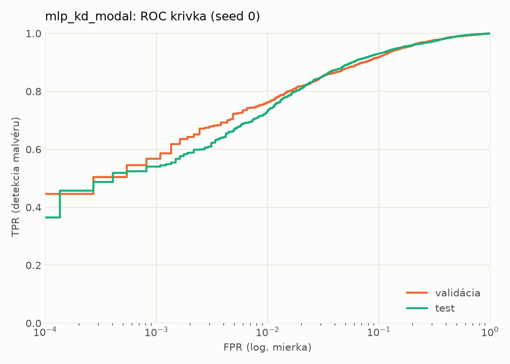
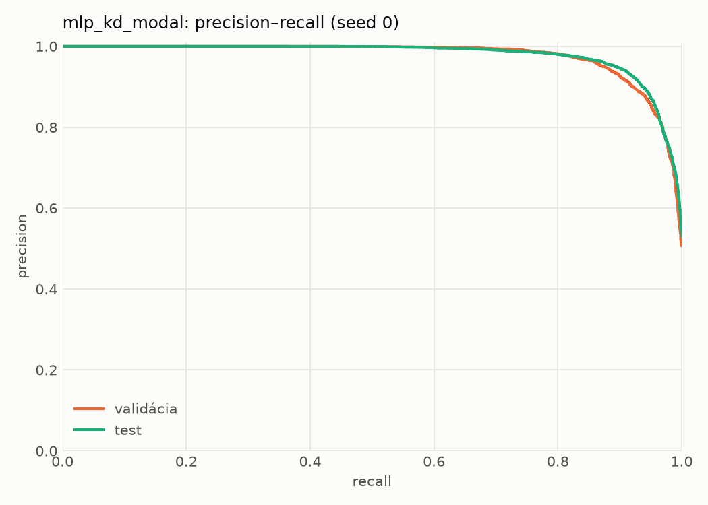
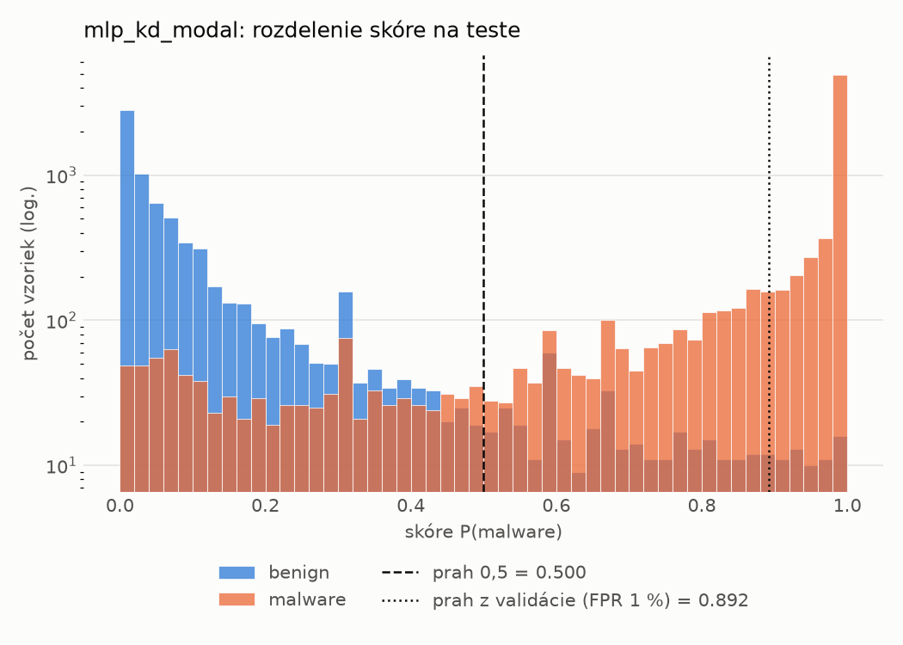
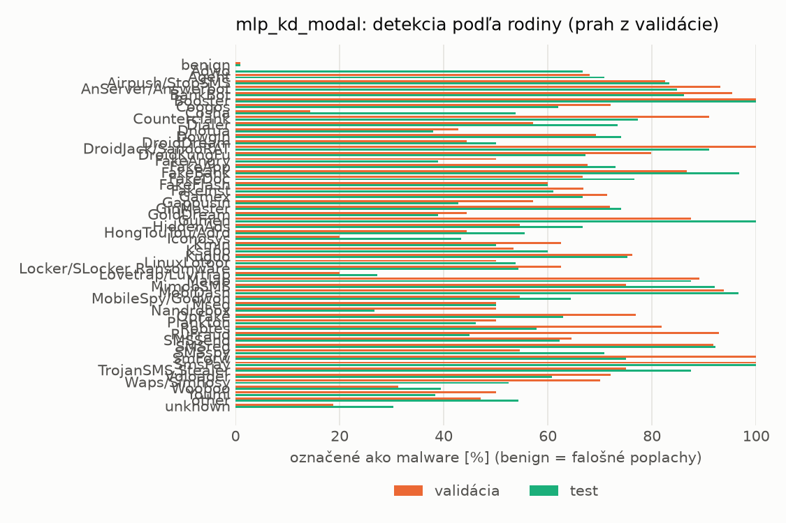
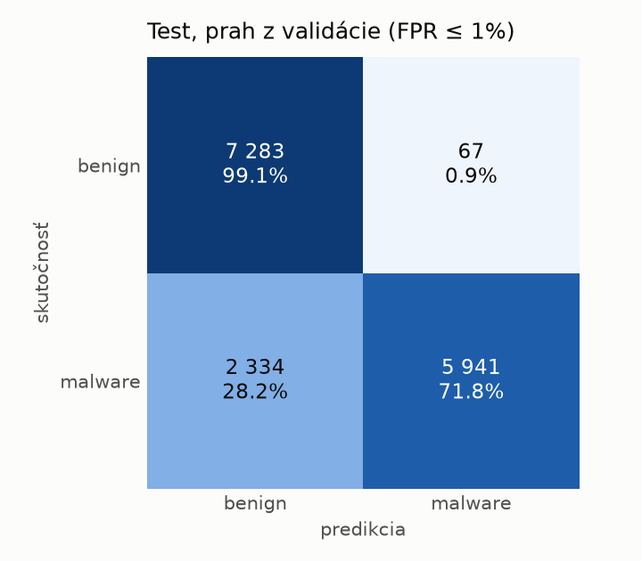
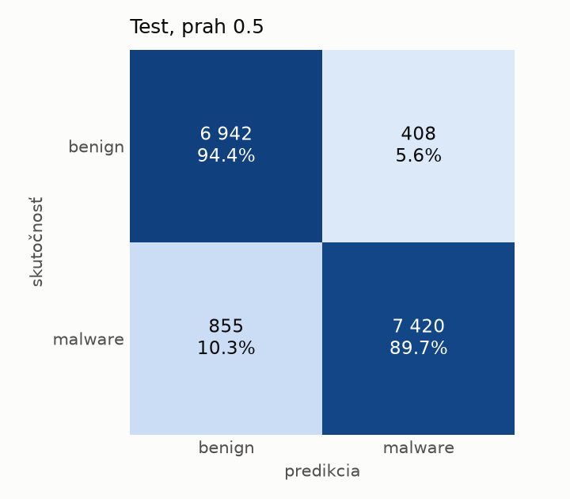
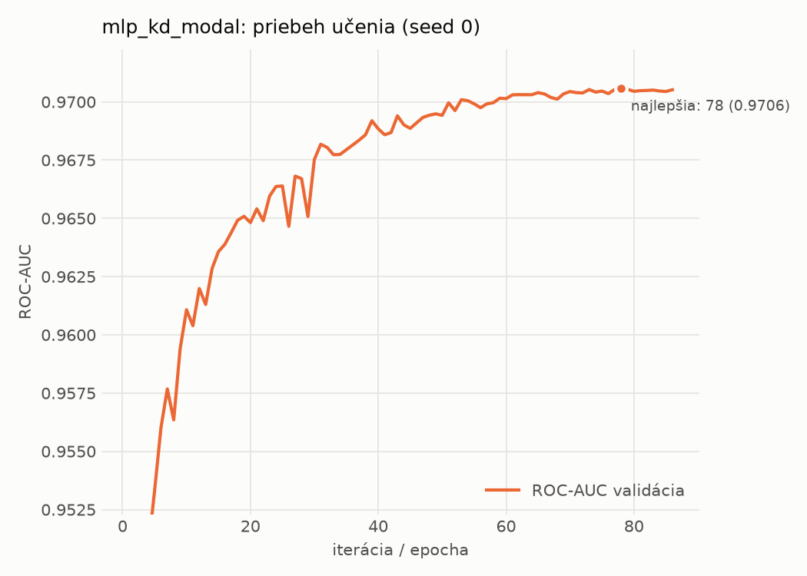

# dynamic/mlp_kd_modal – beh `20261122-220548`

> Automaticky generované (`src/training/run_tabular.py`). Konfigurácia: `config.yaml`, protokol: `protocol.yaml`.

- **Model:** `mlp` – študent – malé MLP učené destiláciou z učiteľa rovnakej modality (variant A)
- **Ladenie:** bez ladenia – hyperparametre prevzaté z `runs_v4/real_full/full/students_dynamic/mlp_kd_modal/20261122-210858`
- **Finálne modely:** seedy [0, 1, 2]; hodnoty sú priemer ± smerodajná odchýlka cez seedy
- **Najlepšie hyperparametre:** `{"hidden_layers": 1, "max_epochs": 100, "patience": 8, "hidden_width": 64, "dropout": 0.014842517384265013, "lr": 0.0018389280483922955, "weight_decay": 7.464279126466132e-05, "batch_size": 512, "kd_alpha": 0.45301900884301544, "kd_temperature": 1.2914074151312493}`

## Detekčná kvalita (bez prahu)
| metrika | train (podvzorka) | validácia | test |
|---|---|---|---|
| ROC-AUC | 0.9781 ± 0.0004 | 0.9707 ± 0.0001 | 0.9715 ± 0.0003 |
| PR-AUC | 0.9817 ± 0.0004 | 0.9762 ± 0.0001 | 0.9781 ± 0.0001 |
| TPR pri FPR 1 % | 0.8230 ± 0.0057 | 0.7596 ± 0.0029 | 0.7380 ± 0.0098 |
| TPR pri FPR 0,1 % | 0.7046 ± 0.0179 | 0.5944 ± 0.0238 | 0.5378 ± 0.0031 |
| log loss | 0.1788 ± 0.0020 | 0.2153 ± 0.0003 | 0.2131 ± 0.0004 |
| Brier skóre | 0.0521 ± 0.0007 | 0.0636 ± 0.0002 | 0.0621 ± 0.0001 |

Rozdiel ROC-AUC train − validácia: **0.0074** (veľký rozdiel = preučenie).

## Pri prahu z validácie (FPR ≤ 1% na validácii)
| metrika | train (podvzorka) | validácia | test |
|---|---|---|---|
| accuracy | 0.8867 ± 0.0010 | 0.8733 ± 0.0014 | 0.8483 ± 0.0062 |
| balanced accuracy | 0.8856 ± 0.0010 | 0.8749 ± 0.0014 | 0.8564 ± 0.0058 |
| precision | 0.9946 ± 0.0010 | 0.9876 ± 0.0000 | 0.9900 ± 0.0011 |
| recall (TPR) | 0.7753 ± 0.0024 | 0.7596 ± 0.0029 | 0.7209 ± 0.0118 |
| FPR | 0.0041 ± 0.0007 | 0.0098 ± 0.0000 | 0.0082 ± 0.0009 |
| F1 | 0.8714 ± 0.0013 | 0.8587 ± 0.0018 | 0.8343 ± 0.0079 |
| MCC | 0.7921 ± 0.0016 | 0.7686 ± 0.0024 | 0.7309 ± 0.0098 |

## Pri pevnom prahu 0.5
| metrika | train (podvzorka) | validácia | test |
|---|---|---|---|
| accuracy | 0.9310 ± 0.0015 | 0.9129 ± 0.0011 | 0.9194 ± 0.0002 |
| balanced accuracy | 0.9308 ± 0.0015 | 0.9132 ± 0.0011 | 0.9209 ± 0.0003 |
| precision | 0.9484 ± 0.0021 | 0.9311 ± 0.0008 | 0.9495 ± 0.0015 |
| recall (TPR) | 0.9101 ± 0.0010 | 0.8944 ± 0.0015 | 0.8953 ± 0.0012 |
| FPR | 0.0485 ± 0.0020 | 0.0680 ± 0.0008 | 0.0536 ± 0.0017 |
| F1 | 0.9289 ± 0.0015 | 0.9124 ± 0.0011 | 0.9216 ± 0.0001 |
| MCC | 0.8626 ± 0.0031 | 0.8265 ± 0.0021 | 0.8403 ± 0.0005 |

## Výpočtové nároky (seed 0, testovacia množina)
| meranie | hodnota |
|---|---|
| tréning finálneho modelu | 15.2 s (priemer cez seedy) |
| ladenie spolu | 0 s |
| počet parametrov / uzlov | 8 641 |
| veľkosť modelu na disku | 0.04 MB |
| transformácia vstupu – latencia (1 vlákno) | 0.014 ms |
| transformácia vstupu – priepustnosť | 741 002 vzoriek/s |
| CPU latencia modelu (batch 1, 1 vlákno) | 0.158 ms (p95 0.169) |
| CPU priepustnosť (24 vlákien) | 4 345 106 vzoriek/s |
| GPU latencia (batch 1) | 0.450 ms (p95 0.475) |
| GPU priepustnosť | 2 583 926 vzoriek/s |
| GPU špičková pamäť | 61 MB |

## Grafy
| | |
|---|---|
|  |  |
|  |  |
|  |  |
|  |  |

## Súbory
`metrics.json` (všetky metriky po seedoch vrátane rodín), `timing.json`, `hpo_trials.csv`,
`predictions/<časť>_seed<N>.parquet` (sha256, family, label, score), `model/seed_<N>/`, `log.txt`.
