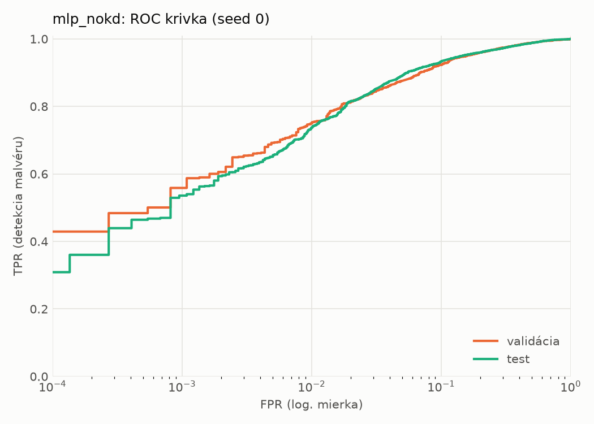
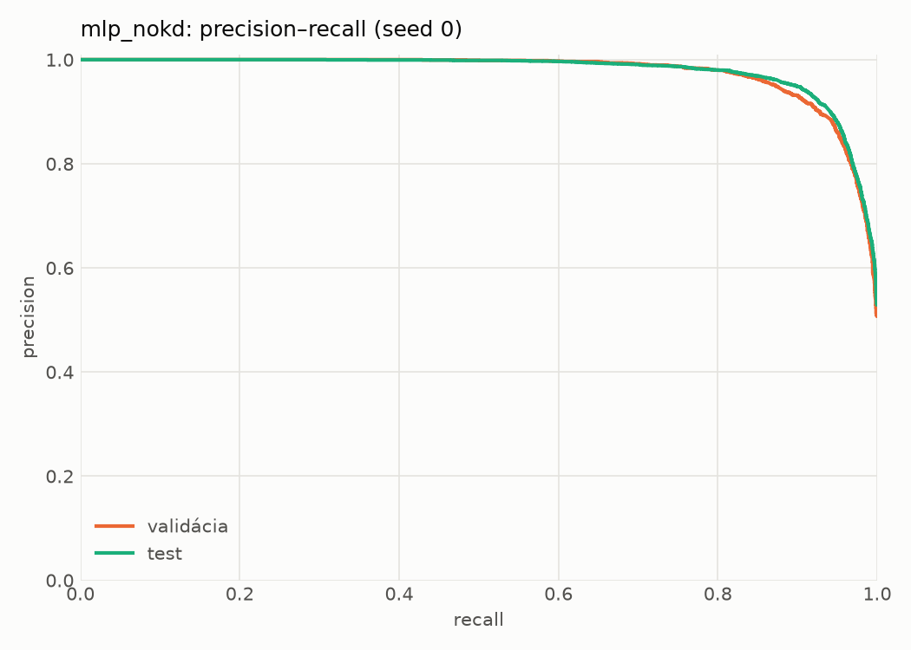
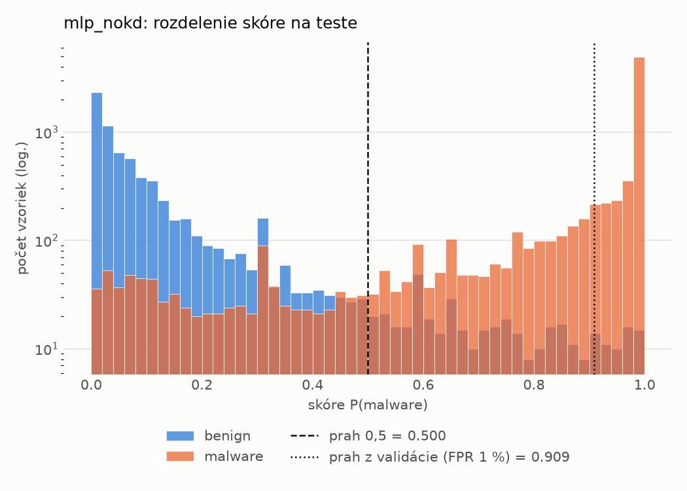
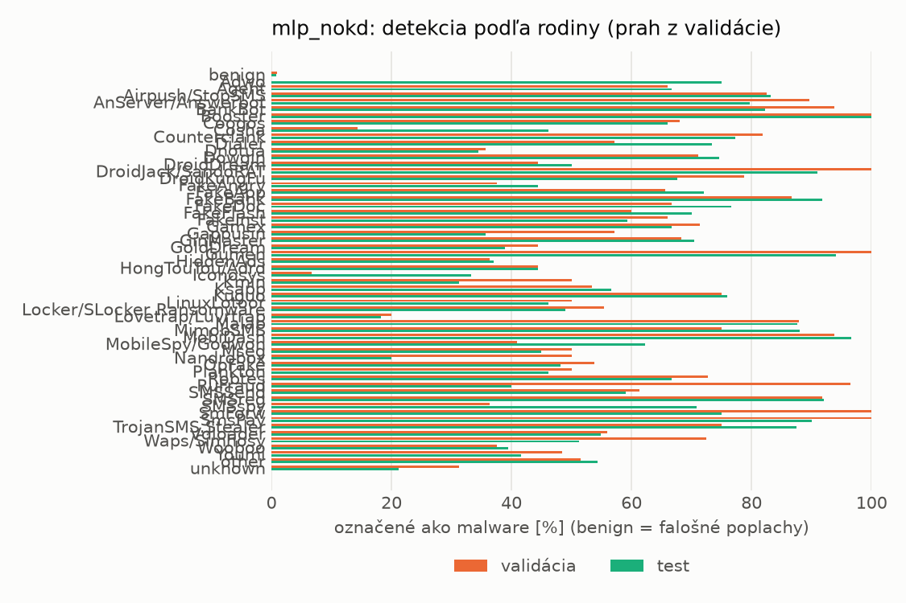
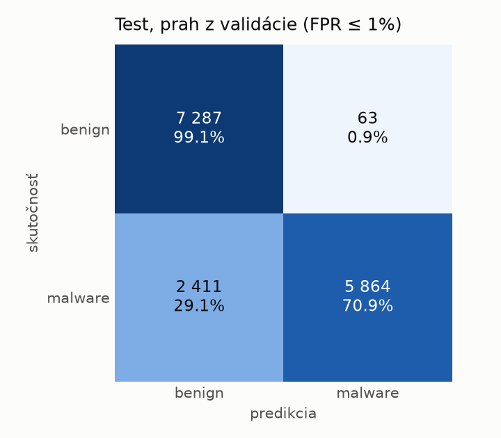
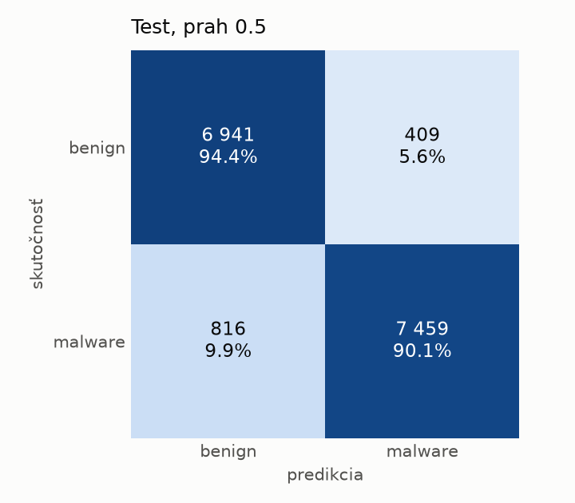
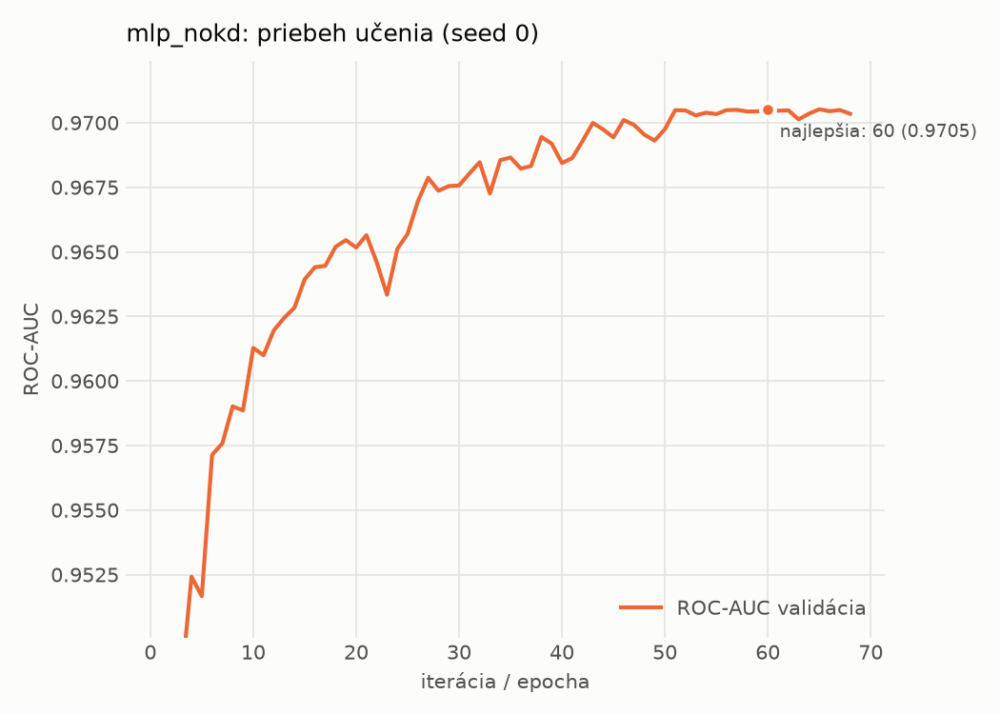

# dynamic/mlp_nokd – beh `20261122-220458`

> Automaticky generované (`src/training/run_tabular.py`). Konfigurácia: `config.yaml`, protokol: `protocol.yaml`.

- **Model:** `mlp` – kontrola – rovnaké malé MLP bez destilácie (iba skutočné označenia)
- **Ladenie:** bez ladenia – hyperparametre prevzaté z `runs_v4/real_full/full/students_dynamic/mlp_nokd/20261122-205917`
- **Finálne modely:** seedy [0, 1, 2]; hodnoty sú priemer ± smerodajná odchýlka cez seedy
- **Najlepšie hyperparametre:** `{"hidden_layers": 1, "max_epochs": 100, "patience": 8, "hidden_width": 64, "dropout": 0.014622282919838341, "lr": 0.0013105433289036465, "weight_decay": 1.7870054646247664e-05, "batch_size": 256}`

## Detekčná kvalita (bez prahu)
| metrika | train (podvzorka) | validácia | test |
|---|---|---|---|
| ROC-AUC | 0.9804 ± 0.0002 | 0.9704 ± 0.0003 | 0.9712 ± 0.0006 |
| PR-AUC | 0.9838 ± 0.0002 | 0.9759 ± 0.0004 | 0.9779 ± 0.0003 |
| TPR pri FPR 1 % | 0.8362 ± 0.0057 | 0.7524 ± 0.0092 | 0.7331 ± 0.0066 |
| TPR pri FPR 0,1 % | 0.7217 ± 0.0078 | 0.5579 ± 0.0323 | 0.5413 ± 0.0092 |
| log loss | 0.1717 ± 0.0025 | 0.2167 ± 0.0010 | 0.2172 ± 0.0029 |
| Brier skóre | 0.0496 ± 0.0006 | 0.0632 ± 0.0008 | 0.0628 ± 0.0012 |

Rozdiel ROC-AUC train − validácia: **0.0100** (veľký rozdiel = preučenie).

## Pri prahu z validácie (FPR ≤ 1% na validácii)
| metrika | train (podvzorka) | validácia | test |
|---|---|---|---|
| accuracy | 0.8846 ± 0.0047 | 0.8697 ± 0.0047 | 0.8404 ± 0.0028 |
| balanced accuracy | 0.8834 ± 0.0048 | 0.8713 ± 0.0047 | 0.8488 ± 0.0026 |
| precision | 0.9964 ± 0.0004 | 0.9876 ± 0.0003 | 0.9897 ± 0.0007 |
| recall (TPR) | 0.7696 ± 0.0098 | 0.7524 ± 0.0092 | 0.7059 ± 0.0059 |
| FPR | 0.0027 ± 0.0003 | 0.0097 ± 0.0002 | 0.0083 ± 0.0007 |
| F1 | 0.8684 ± 0.0061 | 0.8541 ± 0.0060 | 0.8240 ± 0.0038 |
| MCC | 0.7890 ± 0.0079 | 0.7626 ± 0.0079 | 0.7182 ± 0.0041 |

## Pri pevnom prahu 0.5
| metrika | train (podvzorka) | validácia | test |
|---|---|---|---|
| accuracy | 0.9345 ± 0.0010 | 0.9142 ± 0.0013 | 0.9189 ± 0.0027 |
| balanced accuracy | 0.9343 ± 0.0011 | 0.9145 ± 0.0013 | 0.9205 ± 0.0024 |
| precision | 0.9516 ± 0.0033 | 0.9326 ± 0.0022 | 0.9506 ± 0.0022 |
| recall (TPR) | 0.9142 ± 0.0056 | 0.8956 ± 0.0048 | 0.8934 ± 0.0074 |
| FPR | 0.0456 ± 0.0035 | 0.0666 ± 0.0027 | 0.0523 ± 0.0029 |
| F1 | 0.9325 ± 0.0014 | 0.9137 ± 0.0016 | 0.9211 ± 0.0030 |
| MCC | 0.8696 ± 0.0018 | 0.8292 ± 0.0024 | 0.8396 ± 0.0047 |

## Výpočtové nároky (seed 0, testovacia množina)
| meranie | hodnota |
|---|---|
| tréning finálneho modelu | 16.0 s (priemer cez seedy) |
| ladenie spolu | 0 s |
| počet parametrov / uzlov | 8 641 |
| veľkosť modelu na disku | 0.04 MB |
| transformácia vstupu – latencia (1 vlákno) | 0.015 ms |
| transformácia vstupu – priepustnosť | 711 735 vzoriek/s |
| CPU latencia modelu (batch 1, 1 vlákno) | 0.156 ms (p95 0.165) |
| CPU priepustnosť (24 vlákien) | 5 578 564 vzoriek/s |
| GPU latencia (batch 1) | 0.451 ms (p95 0.482) |
| GPU priepustnosť | 3 187 605 vzoriek/s |
| GPU špičková pamäť | 92 MB |

## Grafy
| | |
|---|---|
|  |  |
|  |  |
|  |  |
|  |  |

## Súbory
`metrics.json` (všetky metriky po seedoch vrátane rodín), `timing.json`, `hpo_trials.csv`,
`predictions/<časť>_seed<N>.parquet` (sha256, family, label, score), `model/seed_<N>/`, `log.txt`.
