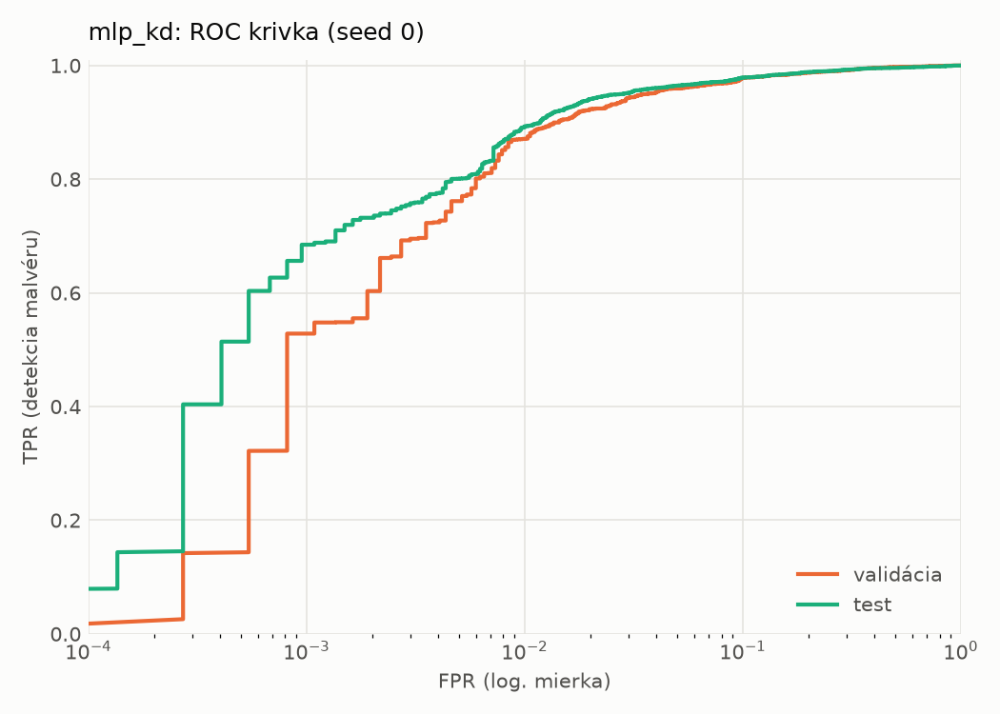
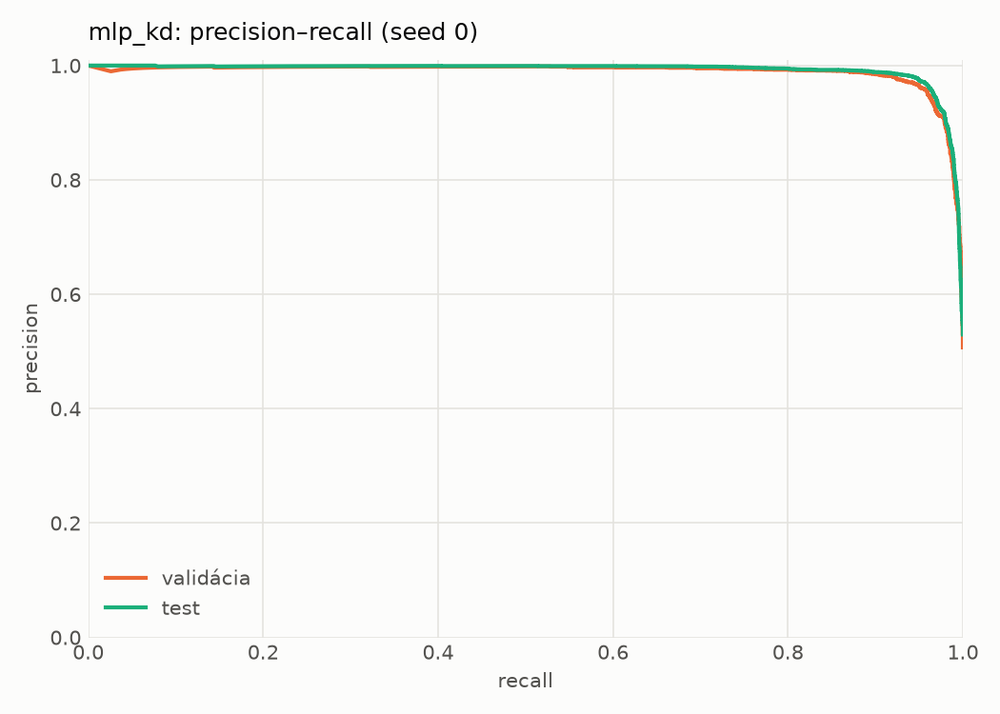
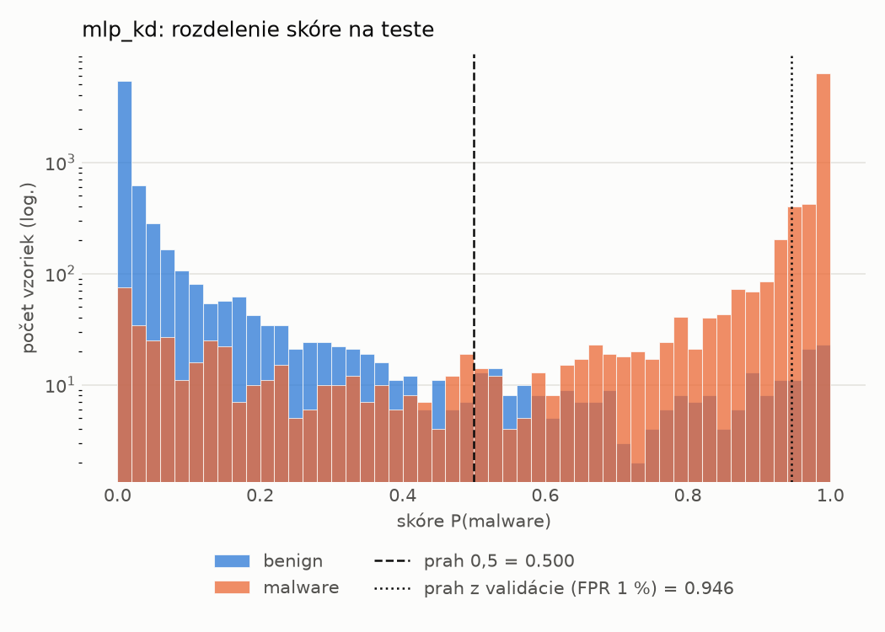
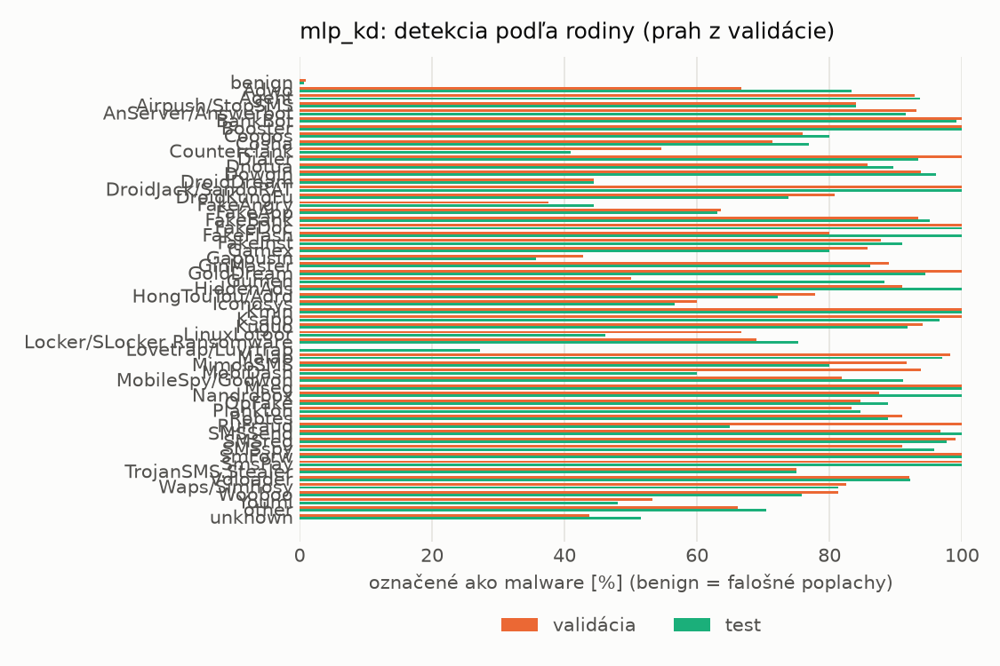
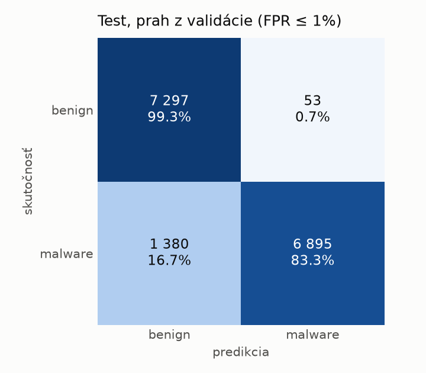
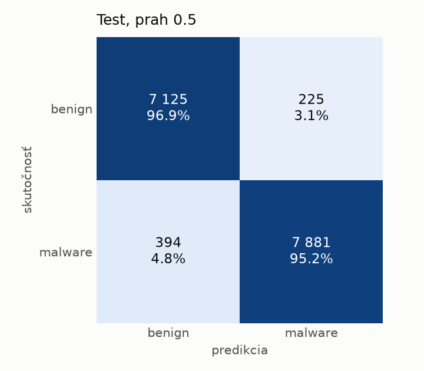
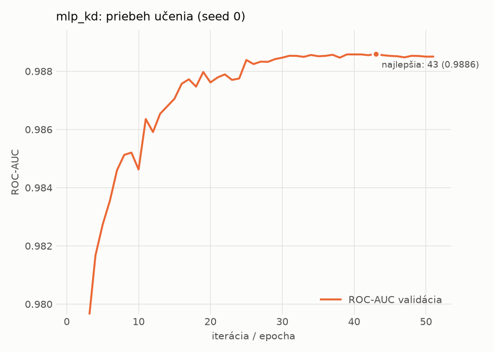

# static/mlp_kd – beh `20261122-220243`

> Automaticky generované (`src/training/run_tabular.py`). Konfigurácia: `config.yaml`, protokol: `protocol.yaml`.

- **Model:** `mlp` – študent – malé MLP učené destiláciou z hybridného učiteľa
- **Ladenie:** bez ladenia – hyperparametre prevzaté z `runs_v4/real_full/full/students_static/mlp_kd/20261122-203423`
- **Finálne modely:** seedy [0, 1, 2]; hodnoty sú priemer ± smerodajná odchýlka cez seedy
- **Najlepšie hyperparametre:** `{"hidden_layers": 1, "max_epochs": 100, "patience": 8, "hidden_width": 64, "dropout": 0.018096880153353218, "lr": 0.002445898909575082, "weight_decay": 6.315937377471515e-05, "batch_size": 1024, "kd_alpha": 0.6461462865023861, "kd_temperature": 1.5048732616232385}`

## Detekčná kvalita (bez prahu)
| metrika | train (podvzorka) | validácia | test |
|---|---|---|---|
| ROC-AUC | 0.9933 ± 0.0002 | 0.9890 ± 0.0004 | 0.9893 ± 0.0005 |
| PR-AUC | 0.9945 ± 0.0002 | 0.9900 ± 0.0010 | 0.9917 ± 0.0001 |
| TPR pri FPR 1 % | 0.9385 ± 0.0031 | 0.8733 ± 0.0022 | 0.8926 ± 0.0069 |
| TPR pri FPR 0,1 % | 0.8085 ± 0.0106 | 0.5625 ± 0.0301 | 0.6223 ± 0.0687 |
| log loss | 0.0923 ± 0.0014 | 0.1340 ± 0.0023 | 0.1267 ± 0.0045 |
| Brier skóre | 0.0239 ± 0.0003 | 0.0345 ± 0.0003 | 0.0315 ± 0.0003 |

Rozdiel ROC-AUC train − validácia: **0.0044** (veľký rozdiel = preučenie).

## Pri prahu z validácie (FPR ≤ 1% na validácii)
| metrika | train (podvzorka) | validácia | test |
|---|---|---|---|
| accuracy | 0.9405 ± 0.0014 | 0.9309 ± 0.0011 | 0.9197 ± 0.0100 |
| balanced accuracy | 0.9400 ± 0.0014 | 0.9317 ± 0.0011 | 0.9237 ± 0.0094 |
| precision | 0.9972 ± 0.0007 | 0.9892 ± 0.0000 | 0.9924 ± 0.0005 |
| recall (TPR) | 0.8824 ± 0.0024 | 0.8733 ± 0.0022 | 0.8549 ± 0.0191 |
| FPR | 0.0024 ± 0.0006 | 0.0098 ± 0.0000 | 0.0074 ± 0.0006 |
| F1 | 0.9363 ± 0.0015 | 0.9276 ± 0.0012 | 0.9184 ± 0.0111 |
| MCC | 0.8867 ± 0.0026 | 0.8682 ± 0.0020 | 0.8493 ± 0.0173 |

## Pri pevnom prahu 0.5
| metrika | train (podvzorka) | validácia | test |
|---|---|---|---|
| accuracy | 0.9710 ± 0.0006 | 0.9564 ± 0.0003 | 0.9604 ± 0.0010 |
| balanced accuracy | 0.9708 ± 0.0006 | 0.9565 ± 0.0003 | 0.9609 ± 0.0009 |
| precision | 0.9822 ± 0.0004 | 0.9609 ± 0.0009 | 0.9717 ± 0.0007 |
| recall (TPR) | 0.9587 ± 0.0010 | 0.9529 ± 0.0012 | 0.9530 ± 0.0014 |
| FPR | 0.0170 ± 0.0003 | 0.0399 ± 0.0010 | 0.0312 ± 0.0008 |
| F1 | 0.9703 ± 0.0006 | 0.9569 ± 0.0003 | 0.9623 ± 0.0009 |
| MCC | 0.9422 ± 0.0011 | 0.9129 ± 0.0006 | 0.9209 ± 0.0019 |

## Výpočtové nároky (seed 0, testovacia množina)
| meranie | hodnota |
|---|---|
| tréning finálneho modelu | 5.6 s (priemer cez seedy) |
| ladenie spolu | 0 s |
| počet parametrov / uzlov | 10 753 |
| veľkosť modelu na disku | 0.05 MB |
| transformácia vstupu – latencia (1 vlákno) | 0.015 ms |
| transformácia vstupu – priepustnosť | 919 285 vzoriek/s |
| CPU latencia modelu (batch 1, 1 vlákno) | 0.073 ms (p95 0.163) |
| CPU priepustnosť (24 vlákien) | 2 506 296 vzoriek/s |
| GPU latencia (batch 1) | 0.449 ms (p95 0.468) |
| GPU priepustnosť | 1 783 248 vzoriek/s |
| GPU špičková pamäť | 71 MB |

## Grafy
| | |
|---|---|
|  |  |
|  |  |
|  |  |
|  |  |

## Súbory
`metrics.json` (všetky metriky po seedoch vrátane rodín), `timing.json`, `hpo_trials.csv`,
`predictions/<časť>_seed<N>.parquet` (sha256, family, label, score), `model/seed_<N>/`, `log.txt`.
