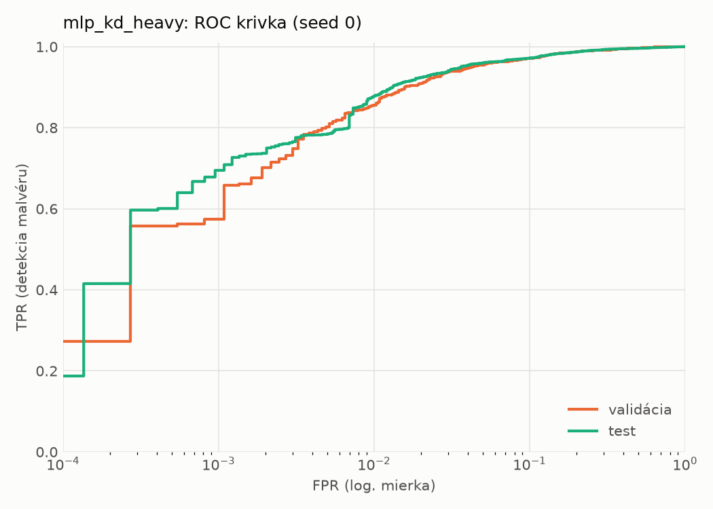
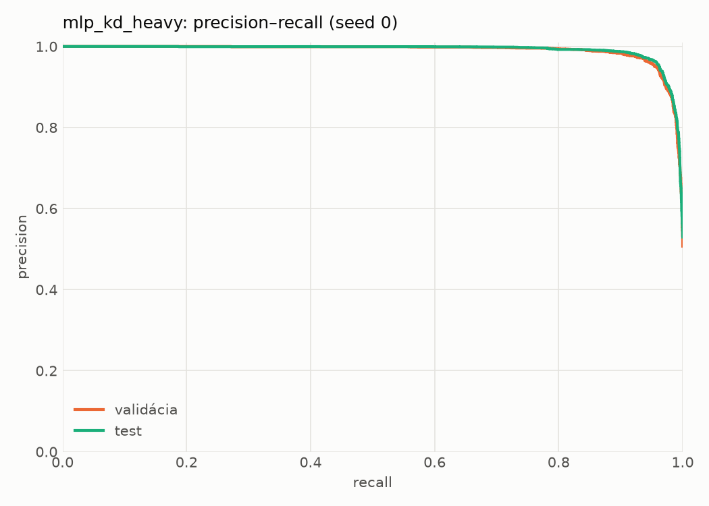
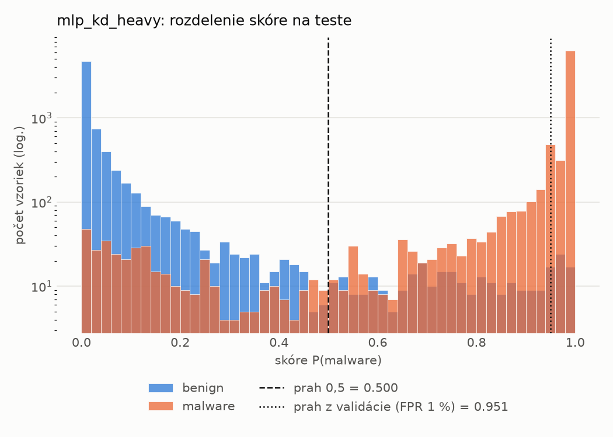
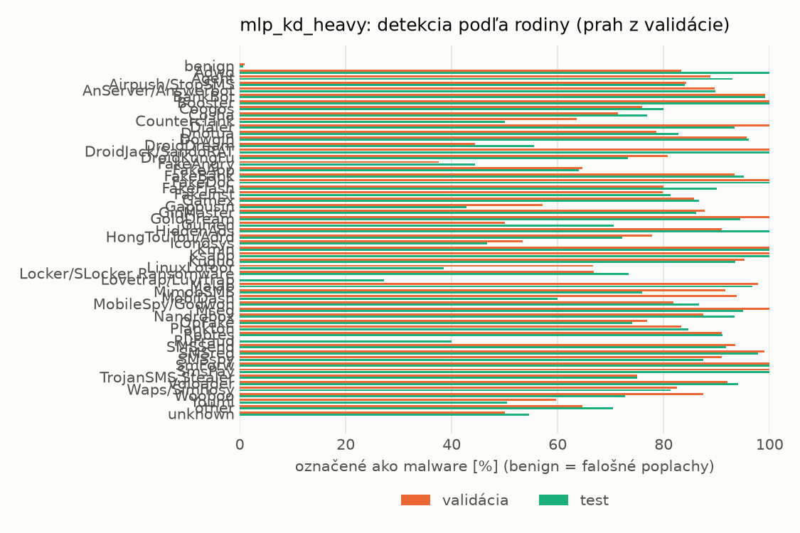
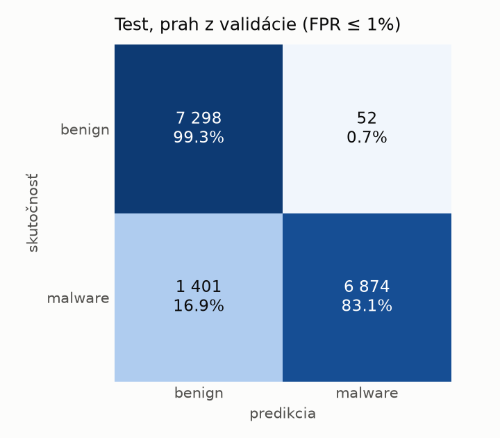
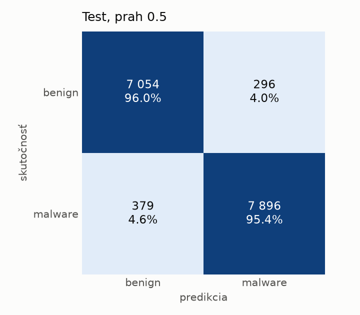
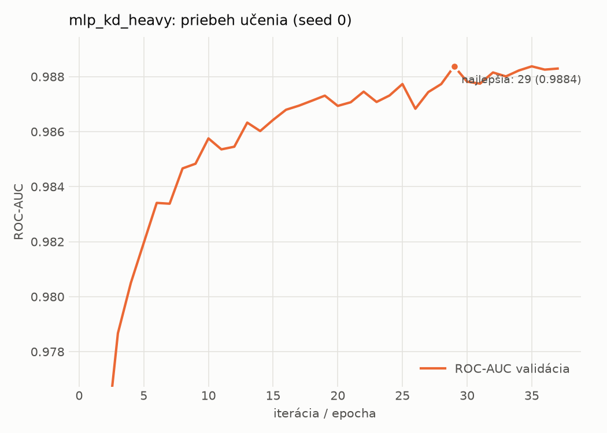

# static/mlp_kd_heavy – beh `20261122-220350`

> Automaticky generované (`src/training/run_tabular.py`). Konfigurácia: `config.yaml`, protokol: `protocol.yaml`.

- **Model:** `mlp` – študent – malé MLP učené destiláciou z mlp_large hybridu (V4)
- **Ladenie:** bez ladenia – hyperparametre prevzaté z `runs_v4/real_full/full/students_static/mlp_kd_heavy/20261122-204855`
- **Finálne modely:** seedy [0, 1, 2]; hodnoty sú priemer ± smerodajná odchýlka cez seedy
- **Najlepšie hyperparametre:** `{"hidden_layers": 1, "max_epochs": 100, "patience": 8, "hidden_width": 64, "dropout": 0.04239795529418809, "lr": 0.0021920597062990285, "weight_decay": 0.0001469802566586536, "batch_size": 1024, "kd_alpha": 0.8931311185241001, "kd_temperature": 5.447798930063548}`

## Detekčná kvalita (bez prahu)
| metrika | train (podvzorka) | validácia | test |
|---|---|---|---|
| ROC-AUC | 0.9930 ± 0.0003 | 0.9882 ± 0.0003 | 0.9893 ± 0.0004 |
| PR-AUC | 0.9940 ± 0.0003 | 0.9890 ± 0.0018 | 0.9917 ± 0.0004 |
| TPR pri FPR 1 % | 0.9316 ± 0.0031 | 0.8571 ± 0.0064 | 0.8843 ± 0.0088 |
| TPR pri FPR 0,1 % | 0.8007 ± 0.0069 | 0.5467 ± 0.1026 | 0.6620 ± 0.0449 |
| log loss | 0.0967 ± 0.0024 | 0.1356 ± 0.0010 | 0.1238 ± 0.0037 |
| Brier skóre | 0.0263 ± 0.0006 | 0.0366 ± 0.0006 | 0.0334 ± 0.0011 |

Rozdiel ROC-AUC train − validácia: **0.0047** (veľký rozdiel = preučenie).

## Pri prahu z validácie (FPR ≤ 1% na validácii)
| metrika | train (podvzorka) | validácia | test |
|---|---|---|---|
| accuracy | 0.9326 ± 0.0013 | 0.9227 ± 0.0033 | 0.9158 ± 0.0077 |
| balanced accuracy | 0.9320 ± 0.0013 | 0.9237 ± 0.0032 | 0.9202 ± 0.0073 |
| precision | 0.9963 ± 0.0008 | 0.9890 ± 0.0001 | 0.9932 ± 0.0009 |
| recall (TPR) | 0.8671 ± 0.0024 | 0.8571 ± 0.0064 | 0.8468 ± 0.0143 |
| FPR | 0.0032 ± 0.0007 | 0.0098 ± 0.0000 | 0.0065 ± 0.0008 |
| F1 | 0.9272 ± 0.0015 | 0.9184 ± 0.0037 | 0.9142 ± 0.0085 |
| MCC | 0.8723 ± 0.0024 | 0.8536 ± 0.0058 | 0.8429 ± 0.0134 |

## Pri pevnom prahu 0.5
| metrika | train (podvzorka) | validácia | test |
|---|---|---|---|
| accuracy | 0.9677 ± 0.0006 | 0.9538 ± 0.0004 | 0.9585 ± 0.0015 |
| balanced accuracy | 0.9676 ± 0.0006 | 0.9538 ± 0.0004 | 0.9587 ± 0.0016 |
| precision | 0.9761 ± 0.0032 | 0.9553 ± 0.0029 | 0.9658 ± 0.0031 |
| recall (TPR) | 0.9582 ± 0.0020 | 0.9534 ± 0.0033 | 0.9554 ± 0.0022 |
| FPR | 0.0230 ± 0.0032 | 0.0459 ± 0.0033 | 0.0381 ± 0.0036 |
| F1 | 0.9671 ± 0.0006 | 0.9544 ± 0.0004 | 0.9606 ± 0.0014 |
| MCC | 0.9355 ± 0.0013 | 0.9075 ± 0.0008 | 0.9168 ± 0.0031 |

## Výpočtové nároky (seed 0, testovacia množina)
| meranie | hodnota |
|---|---|
| tréning finálneho modelu | 4.1 s (priemer cez seedy) |
| ladenie spolu | 0 s |
| počet parametrov / uzlov | 10 753 |
| veľkosť modelu na disku | 0.05 MB |
| transformácia vstupu – latencia (1 vlákno) | 0.014 ms |
| transformácia vstupu – priepustnosť | 627 959 vzoriek/s |
| CPU latencia modelu (batch 1, 1 vlákno) | 0.156 ms (p95 0.165) |
| CPU priepustnosť (24 vlákien) | 2 811 971 vzoriek/s |
| GPU latencia (batch 1) | 0.274 ms (p95 0.300) |
| GPU priepustnosť | 1 671 105 vzoriek/s |
| GPU špičková pamäť | 110 MB |

## Grafy
| | |
|---|---|
|  |  |
|  |  |
|  |  |
|  |  |

## Súbory
`metrics.json` (všetky metriky po seedoch vrátane rodín), `timing.json`, `hpo_trials.csv`,
`predictions/<časť>_seed<N>.parquet` (sha256, family, label, score), `model/seed_<N>/`, `log.txt`.
