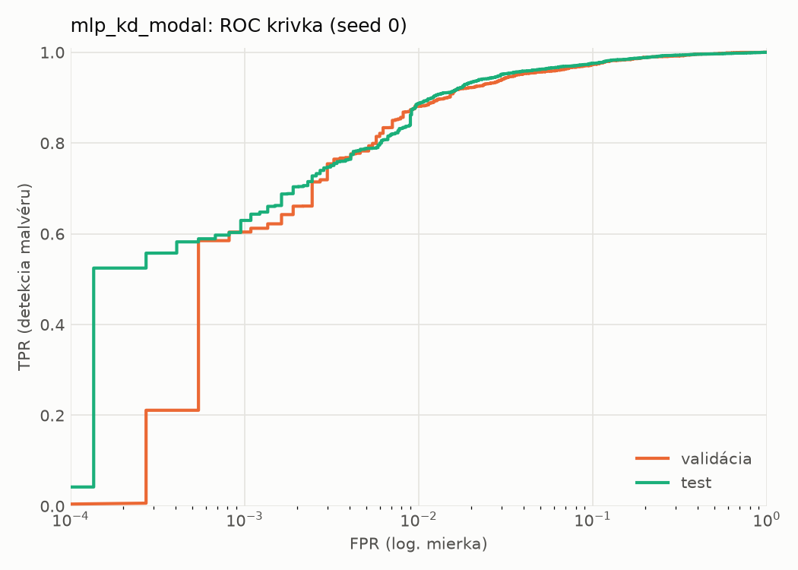
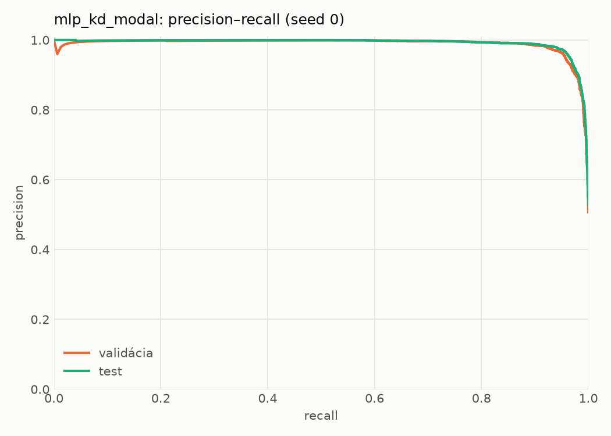
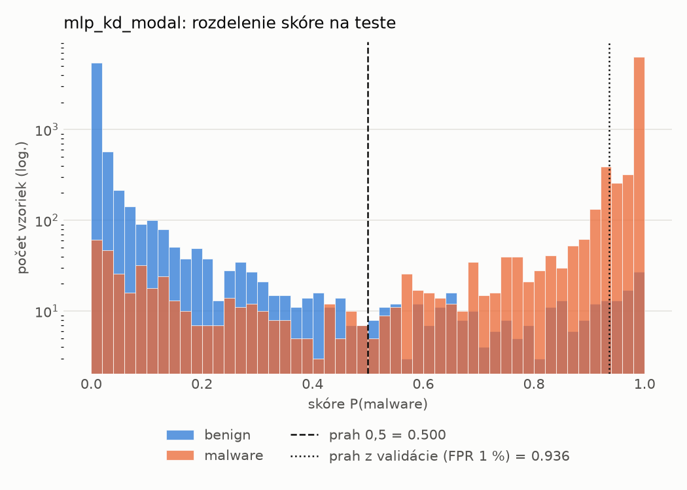
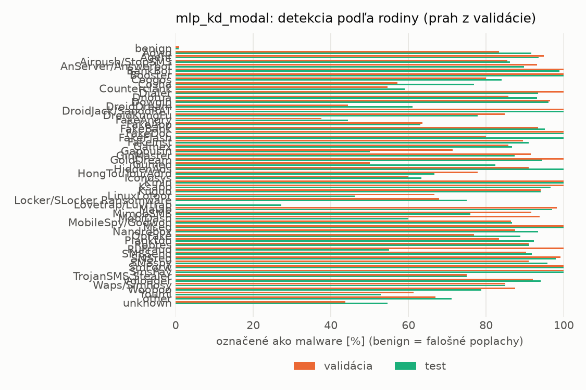
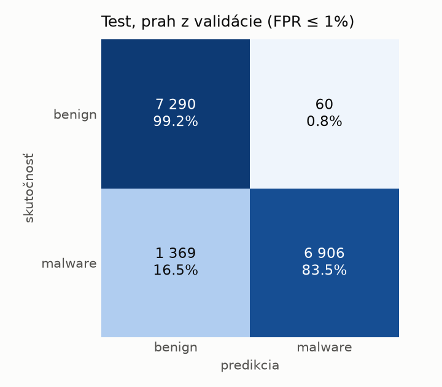
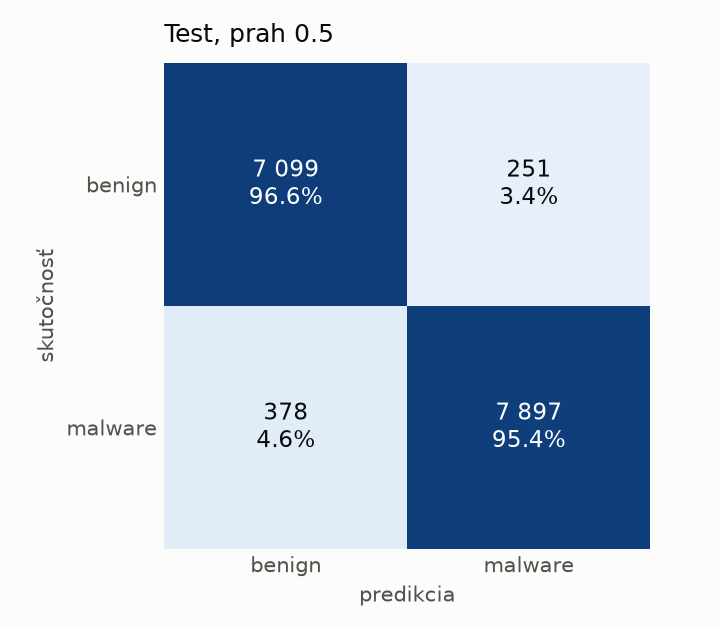
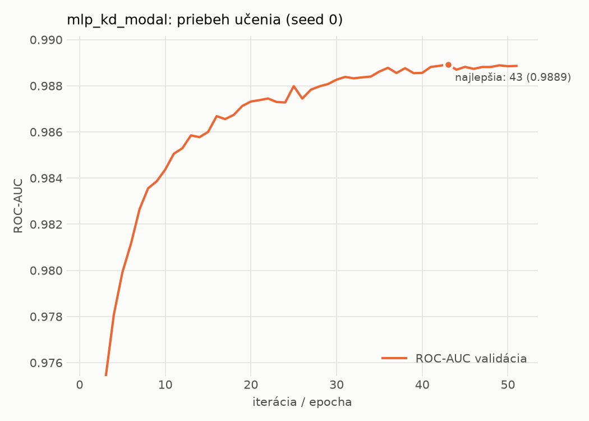

# static/mlp_kd_modal – beh `20261122-220331`

> Automaticky generované (`src/training/run_tabular.py`). Konfigurácia: `config.yaml`, protokol: `protocol.yaml`.

- **Model:** `mlp` – študent – malé MLP učené destiláciou z učiteľa rovnakej modality (variant A)
- **Ladenie:** bez ladenia – hyperparametre prevzaté z `runs_v4/real_full/full/students_static/mlp_kd_modal/20261122-204432`
- **Finálne modely:** seedy [0, 1, 2]; hodnoty sú priemer ± smerodajná odchýlka cez seedy
- **Najlepšie hyperparametre:** `{"hidden_layers": 1, "max_epochs": 100, "patience": 8, "hidden_width": 64, "dropout": 0.005196375734621726, "lr": 0.0014172842807441423, "weight_decay": 1.1835949733056038e-05, "batch_size": 1024, "kd_alpha": 0.5211229932470658, "kd_temperature": 1.6263320735090332}`

## Detekčná kvalita (bez prahu)
| metrika | train (podvzorka) | validácia | test |
|---|---|---|---|
| ROC-AUC | 0.9931 ± 0.0006 | 0.9891 ± 0.0003 | 0.9897 ± 0.0007 |
| PR-AUC | 0.9942 ± 0.0005 | 0.9898 ± 0.0006 | 0.9920 ± 0.0006 |
| TPR pri FPR 1 % | 0.9358 ± 0.0044 | 0.8749 ± 0.0141 | 0.8974 ± 0.0100 |
| TPR pri FPR 0,1 % | 0.7975 ± 0.0281 | 0.5898 ± 0.0162 | 0.6327 ± 0.0189 |
| log loss | 0.0958 ± 0.0043 | 0.1339 ± 0.0020 | 0.1240 ± 0.0044 |
| Brier skóre | 0.0252 ± 0.0009 | 0.0350 ± 0.0007 | 0.0320 ± 0.0009 |

Rozdiel ROC-AUC train − validácia: **0.0040** (veľký rozdiel = preučenie).

## Pri prahu z validácie (FPR ≤ 1% na validácii)
| metrika | train (podvzorka) | validácia | test |
|---|---|---|---|
| accuracy | 0.9409 ± 0.0054 | 0.9318 ± 0.0072 | 0.9123 ± 0.0151 |
| balanced accuracy | 0.9404 ± 0.0055 | 0.9326 ± 0.0071 | 0.9169 ± 0.0142 |
| precision | 0.9967 ± 0.0015 | 0.9893 ± 0.0003 | 0.9935 ± 0.0020 |
| recall (TPR) | 0.8836 ± 0.0119 | 0.8749 ± 0.0141 | 0.8399 ± 0.0290 |
| FPR | 0.0029 ± 0.0013 | 0.0097 ± 0.0002 | 0.0062 ± 0.0019 |
| F1 | 0.9367 ± 0.0063 | 0.9285 ± 0.0081 | 0.9101 ± 0.0168 |
| MCC | 0.8874 ± 0.0097 | 0.8698 ± 0.0129 | 0.8371 ± 0.0259 |

## Pri pevnom prahu 0.5
| metrika | train (podvzorka) | validácia | test |
|---|---|---|---|
| accuracy | 0.9682 ± 0.0009 | 0.9564 ± 0.0007 | 0.9608 ± 0.0010 |
| balanced accuracy | 0.9681 ± 0.0009 | 0.9565 ± 0.0007 | 0.9612 ± 0.0010 |
| precision | 0.9786 ± 0.0020 | 0.9609 ± 0.0002 | 0.9705 ± 0.0012 |
| recall (TPR) | 0.9566 ± 0.0008 | 0.9528 ± 0.0012 | 0.9550 ± 0.0015 |
| FPR | 0.0205 ± 0.0020 | 0.0399 ± 0.0002 | 0.0327 ± 0.0014 |
| F1 | 0.9675 ± 0.0009 | 0.9568 ± 0.0007 | 0.9627 ± 0.0010 |
| MCC | 0.9366 ± 0.0019 | 0.9128 ± 0.0014 | 0.9215 ± 0.0020 |

## Výpočtové nároky (seed 0, testovacia množina)
| meranie | hodnota |
|---|---|
| tréning finálneho modelu | 5.8 s (priemer cez seedy) |
| ladenie spolu | 0 s |
| počet parametrov / uzlov | 10 753 |
| veľkosť modelu na disku | 0.05 MB |
| transformácia vstupu – latencia (1 vlákno) | 0.014 ms |
| transformácia vstupu – priepustnosť | 615 271 vzoriek/s |
| CPU latencia modelu (batch 1, 1 vlákno) | 0.157 ms (p95 0.169) |
| CPU priepustnosť (24 vlákien) | 3 019 966 vzoriek/s |
| GPU latencia (batch 1) | 0.453 ms (p95 0.477) |
| GPU priepustnosť | 1 833 103 vzoriek/s |
| GPU špičková pamäť | 71 MB |

## Grafy
| | |
|---|---|
|  |  |
|  |  |
|  |  |
|  |  |

## Súbory
`metrics.json` (všetky metriky po seedoch vrátane rodín), `timing.json`, `hpo_trials.csv`,
`predictions/<časť>_seed<N>.parquet` (sha256, family, label, score), `model/seed_<N>/`, `log.txt`.
