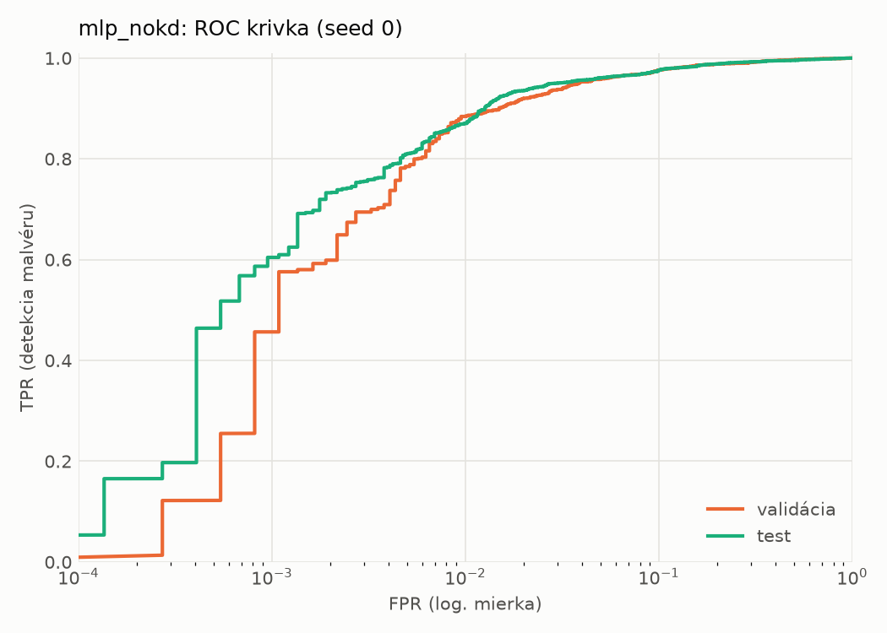
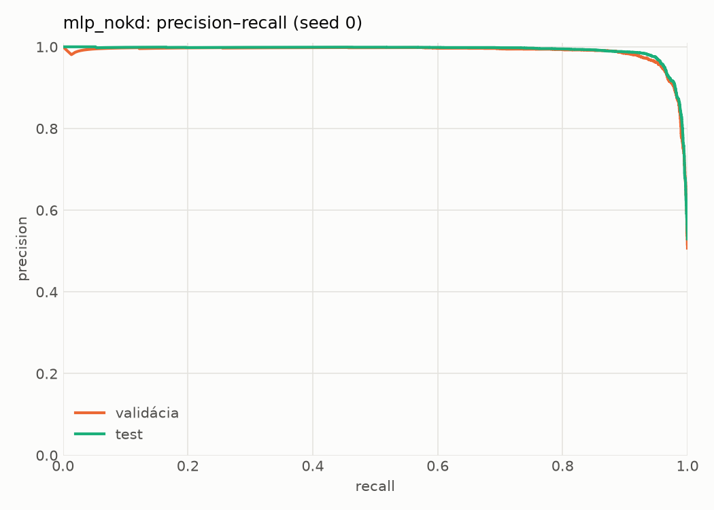
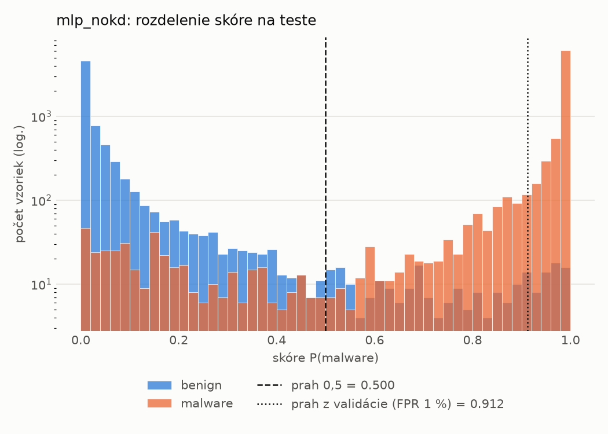
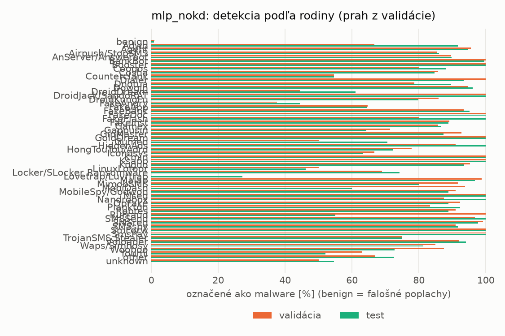
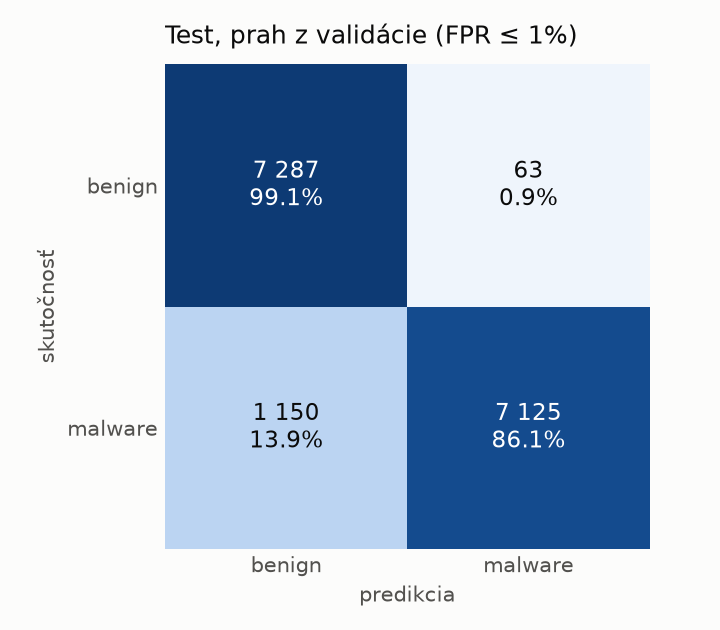
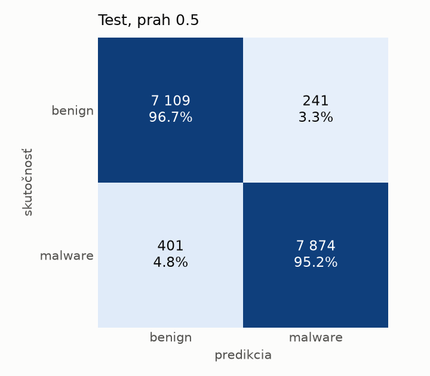
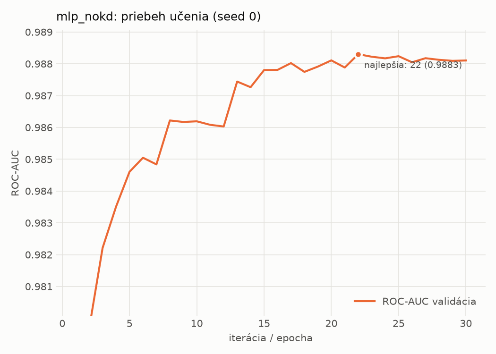

# static/mlp_nokd – beh `20261122-220302`

> Automaticky generované (`src/training/run_tabular.py`). Konfigurácia: `config.yaml`, protokol: `protocol.yaml`.

- **Model:** `mlp` – kontrola – rovnaké malé MLP bez destilácie (iba skutočné označenia)
- **Ladenie:** bez ladenia – hyperparametre prevzaté z `runs_v4/real_full/full/students_static/mlp_nokd/20261122-203844`
- **Finálne modely:** seedy [0, 1, 2]; hodnoty sú priemer ± smerodajná odchýlka cez seedy
- **Najlepšie hyperparametre:** `{"hidden_layers": 1, "max_epochs": 100, "patience": 8, "hidden_width": 64, "dropout": 0.011630579234704915, "lr": 0.0010706598847019353, "weight_decay": 3.845140400781195e-05, "batch_size": 256}`

## Detekčná kvalita (bez prahu)
| metrika | train (podvzorka) | validácia | test |
|---|---|---|---|
| ROC-AUC | 0.9940 ± 0.0007 | 0.9887 ± 0.0005 | 0.9894 ± 0.0004 |
| PR-AUC | 0.9949 ± 0.0006 | 0.9894 ± 0.0007 | 0.9916 ± 0.0004 |
| TPR pri FPR 1 % | 0.9434 ± 0.0086 | 0.8760 ± 0.0159 | 0.8796 ± 0.0117 |
| TPR pri FPR 0,1 % | 0.8116 ± 0.0355 | 0.5059 ± 0.0557 | 0.6157 ± 0.0435 |
| log loss | 0.0881 ± 0.0058 | 0.1296 ± 0.0038 | 0.1218 ± 0.0022 |
| Brier skóre | 0.0235 ± 0.0017 | 0.0344 ± 0.0016 | 0.0320 ± 0.0011 |

Rozdiel ROC-AUC train − validácia: **0.0054** (veľký rozdiel = preučenie).

## Pri prahu z validácie (FPR ≤ 1% na validácii)
| metrika | train (podvzorka) | validácia | test |
|---|---|---|---|
| accuracy | 0.9426 ± 0.0070 | 0.9323 ± 0.0081 | 0.9200 ± 0.0044 |
| balanced accuracy | 0.9421 ± 0.0070 | 0.9332 ± 0.0080 | 0.9240 ± 0.0042 |
| precision | 0.9966 ± 0.0011 | 0.9893 ± 0.0003 | 0.9921 ± 0.0013 |
| recall (TPR) | 0.8871 ± 0.0144 | 0.8760 ± 0.0159 | 0.8558 ± 0.0079 |
| FPR | 0.0030 ± 0.0010 | 0.0097 ± 0.0002 | 0.0077 ± 0.0012 |
| F1 | 0.9386 ± 0.0079 | 0.9292 ± 0.0091 | 0.9189 ± 0.0048 |
| MCC | 0.8904 ± 0.0125 | 0.8708 ± 0.0146 | 0.8498 ± 0.0078 |

## Pri pevnom prahu 0.5
| metrika | train (podvzorka) | validácia | test |
|---|---|---|---|
| accuracy | 0.9714 ± 0.0020 | 0.9566 ± 0.0017 | 0.9606 ± 0.0019 |
| balanced accuracy | 0.9713 ± 0.0020 | 0.9567 ± 0.0017 | 0.9610 ± 0.0018 |
| precision | 0.9827 ± 0.0019 | 0.9617 ± 0.0015 | 0.9721 ± 0.0016 |
| recall (TPR) | 0.9592 ± 0.0024 | 0.9524 ± 0.0020 | 0.9529 ± 0.0028 |
| FPR | 0.0166 ± 0.0018 | 0.0390 ± 0.0015 | 0.0308 ± 0.0018 |
| F1 | 0.9708 ± 0.0020 | 0.9570 ± 0.0017 | 0.9624 ± 0.0018 |
| MCC | 0.9431 ± 0.0039 | 0.9133 ± 0.0035 | 0.9211 ± 0.0037 |

## Výpočtové nároky (seed 0, testovacia množina)
| meranie | hodnota |
|---|---|
| tréning finálneho modelu | 9.0 s (priemer cez seedy) |
| ladenie spolu | 0 s |
| počet parametrov / uzlov | 10 753 |
| veľkosť modelu na disku | 0.05 MB |
| transformácia vstupu – latencia (1 vlákno) | 0.015 ms |
| transformácia vstupu – priepustnosť | 622 141 vzoriek/s |
| CPU latencia modelu (batch 1, 1 vlákno) | 0.157 ms (p95 0.166) |
| CPU priepustnosť (24 vlákien) | 3 492 166 vzoriek/s |
| GPU latencia (batch 1) | 0.281 ms (p95 0.335) |
| GPU priepustnosť | 1 643 993 vzoriek/s |
| GPU špičková pamäť | 110 MB |

## Grafy
| | |
|---|---|
|  |  |
|  |  |
|  |  |
|  |  |

## Súbory
`metrics.json` (všetky metriky po seedoch vrátane rodín), `timing.json`, `hpo_trials.csv`,
`predictions/<časť>_seed<N>.parquet` (sha256, family, label, score), `model/seed_<N>/`, `log.txt`.
