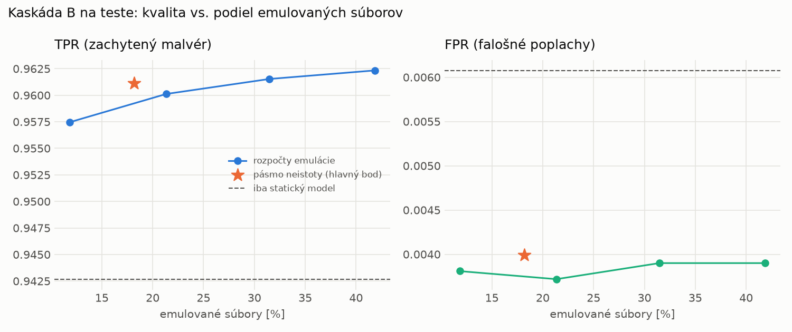

# Kaskáda B `b_baselines` – beh `20261122-222818`

> Generované `src/cascade/evaluate_b.py` (2026-11-22T22:28:18+01:00). Seedy: [0, 1, 2]; hodnoty = priemer ± sm. odchýlka.
> Všetky prahy a pásmo neistoty sú z validácie; test sa na nič nenastavuje. Postup: `docs/09_plan_v2.md`.

| rola | beh |
|---|---|
| static | `runs_v4/real_full/lofo/FakeInst/static/lightgbm/20261122-220910` |
| dynamic | `runs_v4/real_full/lofo/FakeInst/dynamic/lightgbm/20261122-221211` |
| hybrid | `runs_v4/real_full/lofo/FakeInst/hybrid/lightgbm/20261122-221513` |

Druhý stupeň: **dynamic**. Pásmo neistoty statického modelu: FPR ≤ 0.1% nad `hi`,
najviac 1% malvéru validácie pod `lo` (seed 0: lo = 0.0254, hi = 0.9985, seed 1: lo = 0.0353, hi = 0.9970, seed 2: lo = 0.0201, hi = 0.9982).

## Test
| prístup | accuracy | balanced_accuracy | precision | recall_tpr | fpr | f1 | mcc |
|---|---|---|---|---|---|---|---|
| kaskáda B | 0.9775 ± 0.0008 | 0.9786 ± 0.0007 | 0.9963 ± 0.0001 | 0.9611 ± 0.0016 | 0.0040 ± 0.0002 | 0.9784 ± 0.0008 | 0.9557 ± 0.0015 |
| statický | 0.9668 ± 0.0002 | 0.9683 ± 0.0002 | 0.9943 ± 0.0002 | 0.9427 ± 0.0003 | 0.0061 ± 0.0002 | 0.9678 ± 0.0002 | 0.9350 ± 0.0004 |
| dynamický | 0.9190 ± 0.0015 | 0.9230 ± 0.0014 | 0.9909 ± 0.0007 | 0.8548 ± 0.0027 | 0.0088 ± 0.0007 | 0.9178 ± 0.0016 | 0.8477 ± 0.0026 |
| hybrid (každá vzorka) | 0.9805 ± 0.0007 | 0.9812 ± 0.0006 | 0.9932 ± 0.0002 | 0.9699 ± 0.0011 | 0.0075 ± 0.0002 | 0.9814 ± 0.0007 | 0.9613 ± 0.0013 |

- **emulované súbory: 18.17%** (ostatné rozhodne iba statický model); na hybrid ide 4.84% súborov
- chyby pri istom rozhodnutí statického modelu (seed 0): 83
- validácia: emulované 16.02%, na hybrid 3.82%

## Validácia
| prístup | accuracy | balanced_accuracy | precision | recall_tpr | fpr | f1 | mcc |
|---|---|---|---|---|---|---|---|
| kaskáda B | 0.9809 ± 0.0000 | 0.9813 ± 0.0000 | 0.9951 ± 0.0004 | 0.9676 ± 0.0004 | 0.0051 ± 0.0004 | 0.9812 ± 0.0000 | 0.9621 ± 0.0000 |
| statický | 0.9701 ± 0.0005 | 0.9707 ± 0.0005 | 0.9904 ± 0.0000 | 0.9512 ± 0.0010 | 0.0098 ± 0.0000 | 0.9704 ± 0.0005 | 0.9411 ± 0.0010 |
| dynamický | 0.9307 ± 0.0010 | 0.9324 ± 0.0010 | 0.9896 ± 0.0000 | 0.8746 ± 0.0020 | 0.0098 ± 0.0000 | 0.9286 ± 0.0011 | 0.8680 ± 0.0018 |
| hybrid (každá vzorka) | 0.9811 ± 0.0002 | 0.9814 ± 0.0002 | 0.9909 ± 0.0003 | 0.9722 ± 0.0003 | 0.0095 ± 0.0003 | 0.9815 ± 0.0002 | 0.9623 ± 0.0004 |

## Januárové vzorky vynechanej rodiny (iba malvér → TPR)
| prístup | TPR |
|---|---|
| kaskáda B | 0.8787 ± 0.0034 |
| statický | 0.8172 ± 0.0012 |
| dynamický | 0.5770 ± 0.0053 |
| hybrid (každá vzorka) | 0.9198 ± 0.0033 |

Podiel emulovaných: 63.92%

## Krivka rozpočtu emulácie (test, priemer cez seedy)
| budget_val | emulation_rate | hybrid_rate | recall_tpr | fpr | f1 |
|---|---|---|---|---|---|
| 0.1000 | 0.1185 | 0.0395 | 0.9575 | 0.0038 | 0.9766 |
| 0.2000 | 0.2134 | 0.0556 | 0.9601 | 0.0037 | 0.9780 |
| 0.3000 | 0.3147 | 0.0653 | 0.9615 | 0.0039 | 0.9787 |
| 0.4000 | 0.4184 | 0.0751 | 0.9623 | 0.0039 | 0.9791 |

## Výpočtové nároky
Čas dynamickej analýzy (beh v emulátore alebo na zariadení) dataset neuvádza, preto sa neodhaduje. Úspora kaskády B = podiel súborov s dynamickou analýzou: **18.17%** (ostatné prístupy 100 %).

_Chýba benchmark niektorého komponentu (v zero-day behoch sa nemeria)._

