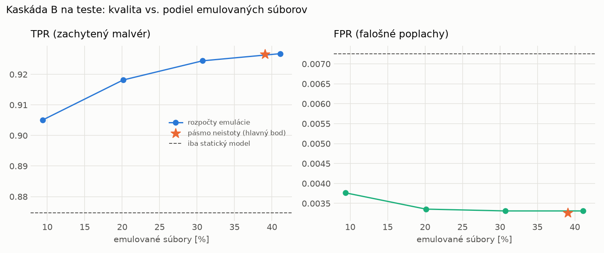

# Kaskáda B `b_heavy` – beh `20261122-222816`

> Generované `src/cascade/evaluate_b.py` (2026-11-22T22:28:16+01:00). Seedy: [0, 1, 2]; hodnoty = priemer ± sm. odchýlka.
> Všetky prahy a pásmo neistoty sú z validácie; test sa na nič nenastavuje. Postup: `docs/09_plan_v2.md`.

| rola | beh |
|---|---|
| static | `runs_v4/real_full/lofo/FakeInst/students_static/mlp_kd/20261122-222255` |
| dynamic | `runs_v4/real_full/lofo/FakeInst/students_dynamic/mlp_kd/20261122-222429` |
| hybrid | `runs_v4/real_full/lofo/FakeInst/hybrid/mlp_large/20261122-221659` |

Druhý stupeň: **dynamic**. Pásmo neistoty statického modelu: FPR ≤ 0.1% nad `hi`,
najviac 1% malvéru validácie pod `lo` (seed 0: lo = 0.0279, hi = 0.9999, seed 1: lo = 0.0275, hi = 1.0000, seed 2: lo = 0.0243, hi = 0.9996).

## Test
| prístup | accuracy | balanced_accuracy | precision | recall_tpr | fpr | f1 | mcc |
|---|---|---|---|---|---|---|---|
| kaskáda B | 0.9596 ± 0.0020 | 0.9617 ± 0.0018 | 0.9969 ± 0.0007 | 0.9266 ± 0.0044 | 0.0033 ± 0.0008 | 0.9605 ± 0.0020 | 0.9219 ± 0.0036 |
| statický | 0.9302 ± 0.0054 | 0.9337 ± 0.0051 | 0.9927 ± 0.0007 | 0.8747 ± 0.0107 | 0.0073 ± 0.0008 | 0.9300 ± 0.0059 | 0.8679 ± 0.0095 |
| dynamický | 0.8604 ± 0.0047 | 0.8676 ± 0.0044 | 0.9886 ± 0.0011 | 0.7449 ± 0.0092 | 0.0097 ± 0.0010 | 0.8496 ± 0.0059 | 0.7494 ± 0.0075 |
| hybrid (každá vzorka) | 0.9742 ± 0.0014 | 0.9752 ± 0.0013 | 0.9923 ± 0.0004 | 0.9588 ± 0.0030 | 0.0084 ± 0.0005 | 0.9753 ± 0.0014 | 0.9490 ± 0.0027 |

- **emulované súbory: 39.07%** (ostatné rozhodne iba statický model); na hybrid ide 10.21% súborov
- chyby pri istom rozhodnutí statického modelu (seed 0): 95
- validácia: emulované 38.09%, na hybrid 9.83%

## Validácia
| prístup | accuracy | balanced_accuracy | precision | recall_tpr | fpr | f1 | mcc |
|---|---|---|---|---|---|---|---|
| kaskáda B | 0.9649 ± 0.0018 | 0.9658 ± 0.0017 | 0.9946 ± 0.0007 | 0.9369 ± 0.0033 | 0.0054 ± 0.0007 | 0.9649 ± 0.0018 | 0.9315 ± 0.0034 |
| statický | 0.9356 ± 0.0086 | 0.9372 ± 0.0084 | 0.9897 ± 0.0002 | 0.8842 ± 0.0167 | 0.0098 ± 0.0000 | 0.9339 ± 0.0095 | 0.8769 ± 0.0155 |
| dynamický | 0.8764 ± 0.0043 | 0.8797 ± 0.0042 | 0.9881 ± 0.0001 | 0.7691 ± 0.0084 | 0.0098 ± 0.0000 | 0.8650 ± 0.0054 | 0.7744 ± 0.0072 |
| hybrid (každá vzorka) | 0.9766 ± 0.0014 | 0.9770 ± 0.0014 | 0.9905 ± 0.0000 | 0.9639 ± 0.0027 | 0.0098 ± 0.0000 | 0.9770 ± 0.0014 | 0.9536 ± 0.0027 |

## Januárové vzorky vynechanej rodiny (iba malvér → TPR)
| prístup | TPR |
|---|---|
| kaskáda B | 0.8086 ± 0.0097 |
| statický | 0.7838 ± 0.0139 |
| dynamický | 0.3679 ± 0.0106 |
| hybrid (každá vzorka) | 0.9212 ± 0.0072 |

Podiel emulovaných: 70.79%

## Krivka rozpočtu emulácie (test, priemer cez seedy)
| budget_val | emulation_rate | hybrid_rate | recall_tpr | fpr | f1 |
|---|---|---|---|---|---|
| 0.1000 | 0.0937 | 0.0394 | 0.9051 | 0.0038 | 0.9485 |
| 0.2000 | 0.2012 | 0.0714 | 0.9181 | 0.0034 | 0.9558 |
| 0.3000 | 0.3073 | 0.0899 | 0.9244 | 0.0033 | 0.9593 |
| 0.4000 | 0.4109 | 0.1023 | 0.9268 | 0.0033 | 0.9605 |

## Výpočtové nároky
Čas dynamickej analýzy (beh v emulátore alebo na zariadení) dataset neuvádza, preto sa neodhaduje. Úspora kaskády B = podiel súborov s dynamickou analýzou: **39.07%** (ostatné prístupy 100 %).

_Chýba benchmark niektorého komponentu (v zero-day behoch sa nemeria)._

