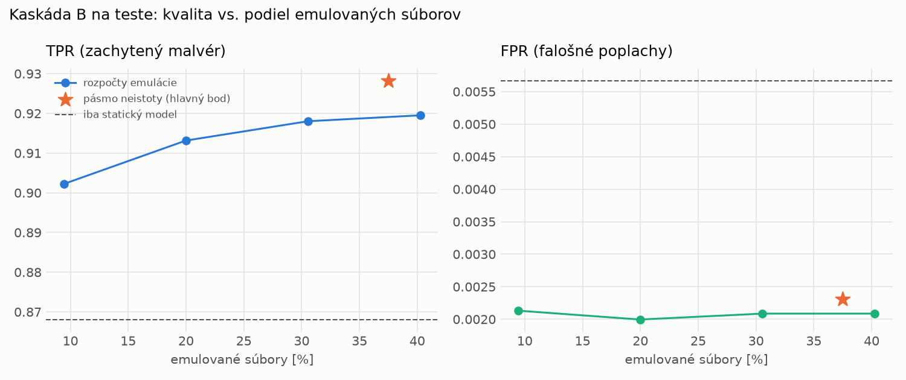

# Kaskáda B `b_heavyteacher` – beh `20261122-222822`

> Generované `src/cascade/evaluate_b.py` (2026-11-22T22:28:22+01:00). Seedy: [0, 1, 2]; hodnoty = priemer ± sm. odchýlka.
> Všetky prahy a pásmo neistoty sú z validácie; test sa na nič nenastavuje. Postup: `docs/09_plan_v2.md`.

| rola | beh |
|---|---|
| static | `runs_v4/real_full/lofo/FakeInst/students_static/mlp_kd_heavy/20261122-222409` |
| dynamic | `runs_v4/real_full/lofo/FakeInst/students_dynamic/mlp_kd_heavy/20261122-222652` |
| hybrid | `runs_v4/real_full/lofo/FakeInst/hybrid/lightgbm/20261122-221513` |

Druhý stupeň: **dynamic**. Pásmo neistoty statického modelu: FPR ≤ 0.1% nad `hi`,
najviac 1% malvéru validácie pod `lo` (seed 0: lo = 0.0347, hi = 0.9976, seed 1: lo = 0.0323, hi = 0.9995, seed 2: lo = 0.0282, hi = 0.9980).

## Test
| prístup | accuracy | balanced_accuracy | precision | recall_tpr | fpr | f1 | mcc |
|---|---|---|---|---|---|---|---|
| kaskáda B | 0.9609 ± 0.0009 | 0.9630 ± 0.0008 | 0.9978 ± 0.0002 | 0.9283 ± 0.0018 | 0.0023 ± 0.0002 | 0.9618 ± 0.0009 | 0.9244 ± 0.0016 |
| statický | 0.9275 ± 0.0017 | 0.9312 ± 0.0016 | 0.9942 ± 0.0006 | 0.8681 ± 0.0038 | 0.0057 ± 0.0006 | 0.9269 ± 0.0019 | 0.8633 ± 0.0028 |
| dynamický | 0.8567 ± 0.0045 | 0.8642 ± 0.0042 | 0.9889 ± 0.0013 | 0.7377 ± 0.0096 | 0.0093 ± 0.0012 | 0.8450 ± 0.0059 | 0.7437 ± 0.0068 |
| hybrid (každá vzorka) | 0.9805 ± 0.0007 | 0.9812 ± 0.0006 | 0.9932 ± 0.0002 | 0.9699 ± 0.0011 | 0.0075 ± 0.0002 | 0.9814 ± 0.0007 | 0.9613 ± 0.0013 |

- **emulované súbory: 37.49%** (ostatné rozhodne iba statický model); na hybrid ide 9.02% súborov
- chyby pri istom rozhodnutí statického modelu (seed 0): 74
- validácia: emulované 37.05%, na hybrid 9.16%

## Validácia
| prístup | accuracy | balanced_accuracy | precision | recall_tpr | fpr | f1 | mcc |
|---|---|---|---|---|---|---|---|
| kaskáda B | 0.9648 ± 0.0012 | 0.9657 ± 0.0012 | 0.9952 ± 0.0006 | 0.9363 ± 0.0019 | 0.0048 ± 0.0006 | 0.9648 ± 0.0013 | 0.9315 ± 0.0024 |
| statický | 0.9267 ± 0.0007 | 0.9285 ± 0.0007 | 0.9895 ± 0.0000 | 0.8668 ± 0.0014 | 0.0098 ± 0.0000 | 0.9241 ± 0.0008 | 0.8607 ± 0.0013 |
| dynamický | 0.8732 ± 0.0045 | 0.8765 ± 0.0043 | 0.9880 ± 0.0001 | 0.7629 ± 0.0087 | 0.0098 ± 0.0000 | 0.8610 ± 0.0056 | 0.7691 ± 0.0074 |
| hybrid (každá vzorka) | 0.9811 ± 0.0002 | 0.9814 ± 0.0002 | 0.9909 ± 0.0003 | 0.9722 ± 0.0003 | 0.0095 ± 0.0003 | 0.9815 ± 0.0002 | 0.9623 ± 0.0004 |

## Januárové vzorky vynechanej rodiny (iba malvér → TPR)
| prístup | TPR |
|---|---|
| kaskáda B | 0.8049 ± 0.0019 |
| statický | 0.7733 ± 0.0049 |
| dynamický | 0.3805 ± 0.0169 |
| hybrid (každá vzorka) | 0.9198 ± 0.0033 |

Podiel emulovaných: 47.00%

## Krivka rozpočtu emulácie (test, priemer cez seedy)
| budget_val | emulation_rate | hybrid_rate | recall_tpr | fpr | f1 |
|---|---|---|---|---|---|
| 0.1000 | 0.0944 | 0.0412 | 0.9022 | 0.0021 | 0.9477 |
| 0.2000 | 0.1998 | 0.0723 | 0.9132 | 0.0020 | 0.9537 |
| 0.3000 | 0.3055 | 0.0914 | 0.9180 | 0.0021 | 0.9563 |
| 0.4000 | 0.4026 | 0.1027 | 0.9195 | 0.0021 | 0.9571 |

## Výpočtové nároky
Čas dynamickej analýzy (beh v emulátore alebo na zariadení) dataset neuvádza, preto sa neodhaduje. Úspora kaskády B = podiel súborov s dynamickou analýzou: **37.49%** (ostatné prístupy 100 %).

_Chýba benchmark niektorého komponentu (v zero-day behoch sa nemeria)._

