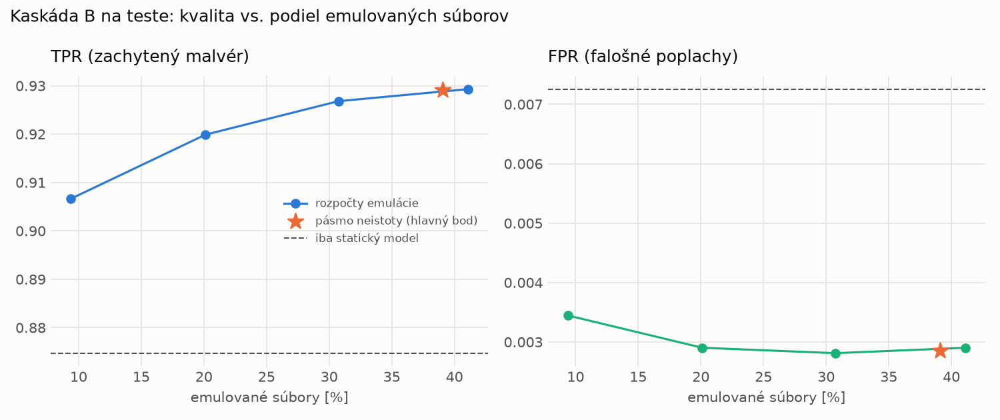

# Kaskáda B `b_main` – beh `20261122-222812`

> Generované `src/cascade/evaluate_b.py` (2026-11-22T22:28:13+01:00). Seedy: [0, 1, 2]; hodnoty = priemer ± sm. odchýlka.
> Všetky prahy a pásmo neistoty sú z validácie; test sa na nič nenastavuje. Postup: `docs/09_plan_v2.md`.

| rola | beh |
|---|---|
| static | `runs_v4/real_full/lofo/FakeInst/students_static/mlp_kd/20261122-222255` |
| dynamic | `runs_v4/real_full/lofo/FakeInst/students_dynamic/mlp_kd/20261122-222429` |
| hybrid | `runs_v4/real_full/lofo/FakeInst/hybrid/lightgbm/20261122-221513` |

Druhý stupeň: **dynamic**. Pásmo neistoty statického modelu: FPR ≤ 0.1% nad `hi`,
najviac 1% malvéru validácie pod `lo` (seed 0: lo = 0.0279, hi = 0.9999, seed 1: lo = 0.0275, hi = 1.0000, seed 2: lo = 0.0243, hi = 0.9996).

## Test
| prístup | accuracy | balanced_accuracy | precision | recall_tpr | fpr | f1 | mcc |
|---|---|---|---|---|---|---|---|
| kaskáda B | 0.9612 ± 0.0023 | 0.9632 ± 0.0022 | 0.9973 ± 0.0001 | 0.9292 ± 0.0045 | 0.0029 ± 0.0001 | 0.9620 ± 0.0024 | 0.9248 ± 0.0043 |
| statický | 0.9302 ± 0.0054 | 0.9337 ± 0.0051 | 0.9927 ± 0.0007 | 0.8747 ± 0.0107 | 0.0073 ± 0.0008 | 0.9300 ± 0.0059 | 0.8679 ± 0.0095 |
| dynamický | 0.8604 ± 0.0047 | 0.8676 ± 0.0044 | 0.9886 ± 0.0011 | 0.7449 ± 0.0092 | 0.0097 ± 0.0010 | 0.8496 ± 0.0059 | 0.7494 ± 0.0075 |
| hybrid (každá vzorka) | 0.9805 ± 0.0007 | 0.9812 ± 0.0006 | 0.9932 ± 0.0002 | 0.9699 ± 0.0011 | 0.0075 ± 0.0002 | 0.9814 ± 0.0007 | 0.9613 ± 0.0013 |

- **emulované súbory: 39.07%** (ostatné rozhodne iba statický model); na hybrid ide 10.21% súborov
- chyby pri istom rozhodnutí statického modelu (seed 0): 95
- validácia: emulované 38.09%, na hybrid 9.83%

## Validácia
| prístup | accuracy | balanced_accuracy | precision | recall_tpr | fpr | f1 | mcc |
|---|---|---|---|---|---|---|---|
| kaskáda B | 0.9671 ± 0.0023 | 0.9680 ± 0.0022 | 0.9954 ± 0.0003 | 0.9405 ± 0.0042 | 0.0046 ± 0.0003 | 0.9672 ± 0.0023 | 0.9358 ± 0.0043 |
| statický | 0.9356 ± 0.0086 | 0.9372 ± 0.0084 | 0.9897 ± 0.0002 | 0.8842 ± 0.0167 | 0.0098 ± 0.0000 | 0.9339 ± 0.0095 | 0.8769 ± 0.0155 |
| dynamický | 0.8764 ± 0.0043 | 0.8797 ± 0.0042 | 0.9881 ± 0.0001 | 0.7691 ± 0.0084 | 0.0098 ± 0.0000 | 0.8650 ± 0.0054 | 0.7744 ± 0.0072 |
| hybrid (každá vzorka) | 0.9811 ± 0.0002 | 0.9814 ± 0.0002 | 0.9909 ± 0.0003 | 0.9722 ± 0.0003 | 0.0095 ± 0.0003 | 0.9815 ± 0.0002 | 0.9623 ± 0.0004 |

## Januárové vzorky vynechanej rodiny (iba malvér → TPR)
| prístup | TPR |
|---|---|
| kaskáda B | 0.8042 ± 0.0150 |
| statický | 0.7838 ± 0.0139 |
| dynamický | 0.3679 ± 0.0106 |
| hybrid (každá vzorka) | 0.9198 ± 0.0033 |

Podiel emulovaných: 70.79%

## Krivka rozpočtu emulácie (test, priemer cez seedy)
| budget_val | emulation_rate | hybrid_rate | recall_tpr | fpr | f1 |
|---|---|---|---|---|---|
| 0.1000 | 0.0937 | 0.0394 | 0.9066 | 0.0034 | 0.9495 |
| 0.2000 | 0.2012 | 0.0714 | 0.9199 | 0.0029 | 0.9570 |
| 0.3000 | 0.3073 | 0.0899 | 0.9268 | 0.0028 | 0.9608 |
| 0.4000 | 0.4109 | 0.1023 | 0.9293 | 0.0029 | 0.9621 |

## Výpočtové nároky
Čas dynamickej analýzy (beh v emulátore alebo na zariadení) dataset neuvádza, preto sa neodhaduje. Úspora kaskády B = podiel súborov s dynamickou analýzou: **39.07%** (ostatné prístupy 100 %).

_Chýba benchmark niektorého komponentu (v zero-day behoch sa nemeria)._

