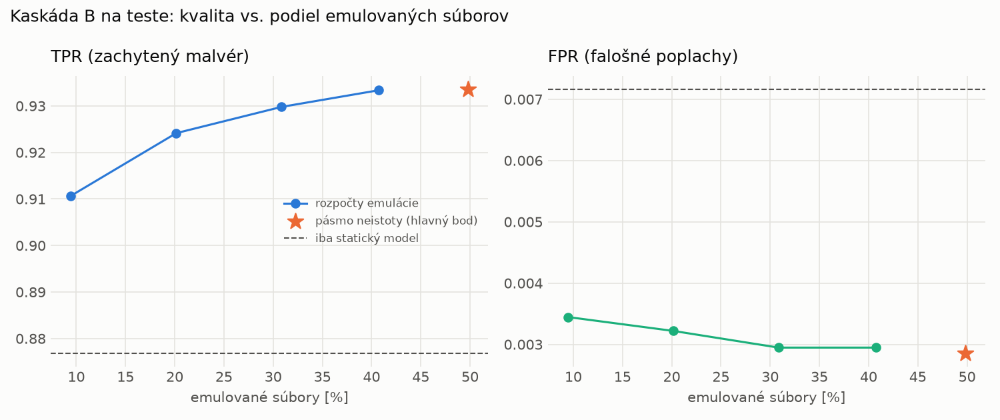

# Kaskáda B `b_nokd` – beh `20261122-222820`

> Generované `src/cascade/evaluate_b.py` (2026-11-22T22:28:20+01:00). Seedy: [0, 1, 2]; hodnoty = priemer ± sm. odchýlka.
> Všetky prahy a pásmo neistoty sú z validácie; test sa na nič nenastavuje. Postup: `docs/09_plan_v2.md`.

| rola | beh |
|---|---|
| static | `runs_v4/real_full/lofo/FakeInst/students_static/mlp_nokd/20261122-222316` |
| dynamic | `runs_v4/real_full/lofo/FakeInst/students_dynamic/mlp_nokd/20261122-222518` |
| hybrid | `runs_v4/real_full/lofo/FakeInst/hybrid/lightgbm/20261122-221513` |

Druhý stupeň: **dynamic**. Pásmo neistoty statického modelu: FPR ≤ 0.1% nad `hi`,
najviac 1% malvéru validácie pod `lo` (seed 0: lo = 0.0370, hi = 0.9999, seed 1: lo = 0.0354, hi = 0.9999, seed 2: lo = 0.0407, hi = 1.0000).

## Test
| prístup | accuracy | balanced_accuracy | precision | recall_tpr | fpr | f1 | mcc |
|---|---|---|---|---|---|---|---|
| kaskáda B | 0.9635 ± 0.0028 | 0.9654 ± 0.0026 | 0.9973 ± 0.0003 | 0.9336 ± 0.0053 | 0.0029 ± 0.0003 | 0.9644 ± 0.0028 | 0.9292 ± 0.0052 |
| statický | 0.9314 ± 0.0083 | 0.9348 ± 0.0078 | 0.9928 ± 0.0003 | 0.8769 ± 0.0157 | 0.0072 ± 0.0003 | 0.9312 ± 0.0089 | 0.8700 ± 0.0148 |
| dynamický | 0.8606 ± 0.0038 | 0.8678 ± 0.0035 | 0.9883 ± 0.0016 | 0.7456 ± 0.0083 | 0.0099 ± 0.0015 | 0.8500 ± 0.0049 | 0.7497 ± 0.0057 |
| hybrid (každá vzorka) | 0.9805 ± 0.0007 | 0.9812 ± 0.0006 | 0.9932 ± 0.0002 | 0.9699 ± 0.0011 | 0.0075 ± 0.0002 | 0.9814 ± 0.0007 | 0.9613 ± 0.0013 |

- **emulované súbory: 49.80%** (ostatné rozhodne iba statický model); na hybrid ide 11.51% súborov
- chyby pri istom rozhodnutí statického modelu (seed 0): 70
- validácia: emulované 48.95%, na hybrid 10.78%

## Validácia
| prístup | accuracy | balanced_accuracy | precision | recall_tpr | fpr | f1 | mcc |
|---|---|---|---|---|---|---|---|
| kaskáda B | 0.9681 ± 0.0039 | 0.9688 ± 0.0038 | 0.9954 ± 0.0003 | 0.9423 ± 0.0073 | 0.0046 ± 0.0003 | 0.9681 ± 0.0040 | 0.9376 ± 0.0074 |
| statický | 0.9350 ± 0.0101 | 0.9366 ± 0.0098 | 0.9897 ± 0.0002 | 0.8829 ± 0.0197 | 0.0098 ± 0.0000 | 0.9332 ± 0.0110 | 0.8757 ± 0.0184 |
| dynamický | 0.8776 ± 0.0033 | 0.8809 ± 0.0032 | 0.9883 ± 0.0001 | 0.7715 ± 0.0066 | 0.0097 ± 0.0002 | 0.8665 ± 0.0041 | 0.7765 ± 0.0055 |
| hybrid (každá vzorka) | 0.9811 ± 0.0002 | 0.9814 ± 0.0002 | 0.9909 ± 0.0003 | 0.9722 ± 0.0003 | 0.0095 ± 0.0003 | 0.9815 ± 0.0002 | 0.9623 ± 0.0004 |

## Januárové vzorky vynechanej rodiny (iba malvér → TPR)
| prístup | TPR |
|---|---|
| kaskáda B | 0.8095 ± 0.0087 |
| statický | 0.7909 ± 0.0076 |
| dynamický | 0.3852 ± 0.0171 |
| hybrid (každá vzorka) | 0.9198 ± 0.0033 |

Podiel emulovaných: 71.60%

## Krivka rozpočtu emulácie (test, priemer cez seedy)
| budget_val | emulation_rate | hybrid_rate | recall_tpr | fpr | f1 |
|---|---|---|---|---|---|
| 0.1000 | 0.0944 | 0.0401 | 0.9107 | 0.0034 | 0.9517 |
| 0.2000 | 0.2016 | 0.0722 | 0.9241 | 0.0032 | 0.9591 |
| 0.3000 | 0.3085 | 0.0870 | 0.9298 | 0.0029 | 0.9623 |
| 0.4000 | 0.4074 | 0.1005 | 0.9334 | 0.0029 | 0.9642 |

## Výpočtové nároky
Čas dynamickej analýzy (beh v emulátore alebo na zariadení) dataset neuvádza, preto sa neodhaduje. Úspora kaskády B = podiel súborov s dynamickou analýzou: **49.80%** (ostatné prístupy 100 %).

_Chýba benchmark niektorého komponentu (v zero-day behoch sa nemeria)._

