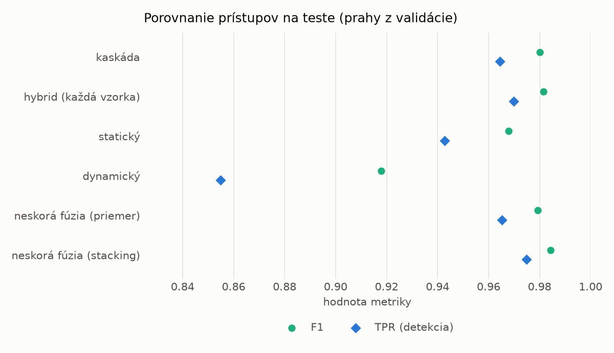
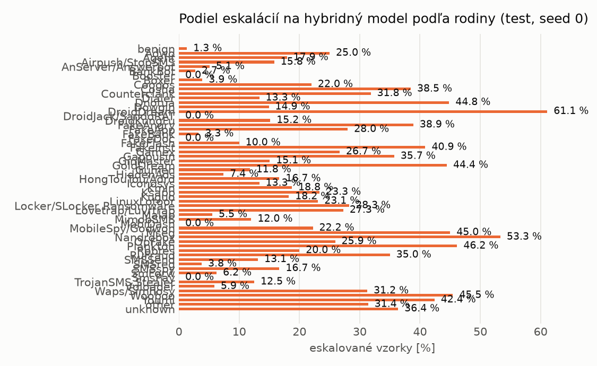

# Kaskáda `baselines` – beh `20261122-222808`

> Generované `src/cascade/evaluate.py` (2026-11-22T22:28:08+01:00). Seedy: [0, 1, 2]; hodnoty = priemer ± sm. odchýlka.
> Všetky prahy sú určené na validácii (FPR ≤ 1 %); test sa na nič nenastavuje.

| rola | beh |
|---|---|
| static | `runs_v4/real_full/lofo/FakeInst/static/lightgbm/20261122-220910` |
| dynamic | `runs_v4/real_full/lofo/FakeInst/dynamic/lightgbm/20261122-221211` |
| hybrid | `runs_v4/real_full/lofo/FakeInst/hybrid/lightgbm/20261122-221513` |

## Test
| prístup | accuracy | balanced_accuracy | precision | recall_tpr | fpr | f1 | mcc |
|---|---|---|---|---|---|---|---|
| kaskáda | 0.9793 ± 0.0007 | 0.9803 ± 0.0007 | 0.9964 ± 0.0001 | 0.9645 ± 0.0015 | 0.0039 ± 0.0001 | 0.9802 ± 0.0007 | 0.9591 ± 0.0014 |
| hybrid (každá vzorka) | 0.9805 ± 0.0007 | 0.9812 ± 0.0006 | 0.9932 ± 0.0002 | 0.9699 ± 0.0011 | 0.0075 ± 0.0002 | 0.9814 ± 0.0007 | 0.9613 ± 0.0013 |
| statický | 0.9668 ± 0.0002 | 0.9683 ± 0.0002 | 0.9943 ± 0.0002 | 0.9427 ± 0.0003 | 0.0061 ± 0.0002 | 0.9678 ± 0.0002 | 0.9350 ± 0.0004 |
| dynamický | 0.9190 ± 0.0015 | 0.9230 ± 0.0014 | 0.9909 ± 0.0007 | 0.8548 ± 0.0027 | 0.0088 ± 0.0007 | 0.9178 ± 0.0016 | 0.8477 ± 0.0026 |
| neskorá fúzia (priemer) | 0.9785 ± 0.0011 | 0.9793 ± 0.0011 | 0.9939 ± 0.0002 | 0.9653 ± 0.0020 | 0.0067 ± 0.0002 | 0.9794 ± 0.0011 | 0.9573 ± 0.0022 |
| neskorá fúzia (stacking) | 0.9836 ± 0.0001 | 0.9841 ± 0.0001 | 0.9941 ± 0.0005 | 0.9748 ± 0.0006 | 0.0065 ± 0.0005 | 0.9843 ± 0.0001 | 0.9673 ± 0.0002 |

## Validácia
| prístup | accuracy | balanced_accuracy | precision | recall_tpr | fpr | f1 | mcc |
|---|---|---|---|---|---|---|---|
| kaskáda | 0.9824 ± 0.0001 | 0.9828 ± 0.0001 | 0.9950 ± 0.0005 | 0.9707 ± 0.0004 | 0.0052 ± 0.0005 | 0.9827 ± 0.0001 | 0.9651 ± 0.0002 |
| hybrid (každá vzorka) | 0.9811 ± 0.0002 | 0.9814 ± 0.0002 | 0.9909 ± 0.0003 | 0.9722 ± 0.0003 | 0.0095 ± 0.0003 | 0.9815 ± 0.0002 | 0.9623 ± 0.0004 |
| statický | 0.9701 ± 0.0005 | 0.9707 ± 0.0005 | 0.9904 ± 0.0000 | 0.9512 ± 0.0010 | 0.0098 ± 0.0000 | 0.9704 ± 0.0005 | 0.9411 ± 0.0010 |
| dynamický | 0.9307 ± 0.0010 | 0.9324 ± 0.0010 | 0.9896 ± 0.0000 | 0.8746 ± 0.0020 | 0.0098 ± 0.0000 | 0.9286 ± 0.0011 | 0.8680 ± 0.0018 |
| neskorá fúzia (priemer) | 0.9805 ± 0.0010 | 0.9807 ± 0.0009 | 0.9907 ± 0.0002 | 0.9712 ± 0.0018 | 0.0097 ± 0.0002 | 0.9808 ± 0.0010 | 0.9611 ± 0.0019 |
| neskorá fúzia (stacking) | 0.9853 ± 0.0003 | 0.9855 ± 0.0003 | 0.9908 ± 0.0002 | 0.9807 ± 0.0006 | 0.0097 ± 0.0002 | 0.9857 ± 0.0003 | 0.9707 ± 0.0007 |

## Správanie kaskády (test, seed 0)
- podiel eskalácií na hybrid: **9.08%** (1419 vzoriek)
- chyby pri zhode študentov (kaskáda ich nemôže opraviť): **180**
  (1.267% zo zhôd; FP 2, FN 178)
- úspešnosť na eskalovaných vzorkách: hybrid 0.8907681465821, statický 0.7610993657505285,
  dynamický 0.23890063424947147  → prínos hybridu pri nezhode

## Výpočtové nároky (odhad z benchmarkov komponentov)
_Chýba benchmark niektorého komponentu (`python -m src.evaluation.benchmark`)._

