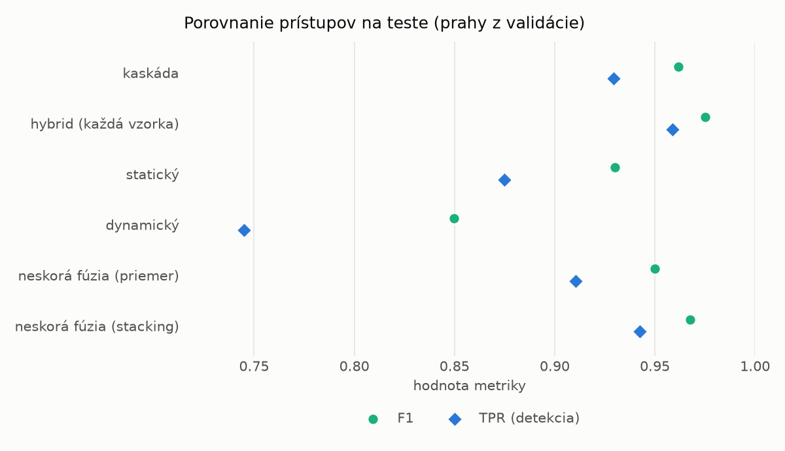
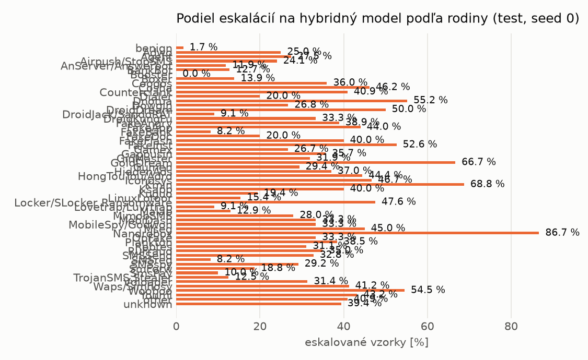

# Kaskáda `heavy` – beh `20261122-222806`

> Generované `src/cascade/evaluate.py` (2026-11-22T22:28:06+01:00). Seedy: [0, 1, 2]; hodnoty = priemer ± sm. odchýlka.
> Všetky prahy sú určené na validácii (FPR ≤ 1 %); test sa na nič nenastavuje.

| rola | beh |
|---|---|
| static | `runs_v4/real_full/lofo/FakeInst/students_static/mlp_kd/20261122-222255` |
| dynamic | `runs_v4/real_full/lofo/FakeInst/students_dynamic/mlp_kd/20261122-222429` |
| hybrid | `runs_v4/real_full/lofo/FakeInst/hybrid/mlp_large/20261122-221659` |

## Test
| prístup | accuracy | balanced_accuracy | precision | recall_tpr | fpr | f1 | mcc |
|---|---|---|---|---|---|---|---|
| kaskáda | 0.9609 ± 0.0014 | 0.9629 ± 0.0013 | 0.9967 ± 0.0008 | 0.9293 ± 0.0033 | 0.0035 ± 0.0008 | 0.9618 ± 0.0014 | 0.9243 ± 0.0025 |
| hybrid (každá vzorka) | 0.9742 ± 0.0014 | 0.9752 ± 0.0013 | 0.9923 ± 0.0004 | 0.9588 ± 0.0030 | 0.0084 ± 0.0005 | 0.9753 ± 0.0014 | 0.9490 ± 0.0027 |
| statický | 0.9302 ± 0.0054 | 0.9337 ± 0.0051 | 0.9927 ± 0.0007 | 0.8747 ± 0.0107 | 0.0073 ± 0.0008 | 0.9300 ± 0.0059 | 0.8679 ± 0.0095 |
| dynamický | 0.8604 ± 0.0047 | 0.8676 ± 0.0044 | 0.9886 ± 0.0011 | 0.7449 ± 0.0092 | 0.0097 ± 0.0010 | 0.8496 ± 0.0059 | 0.7494 ± 0.0075 |
| neskorá fúzia (priemer) | 0.9494 ± 0.0021 | 0.9518 ± 0.0020 | 0.9933 ± 0.0003 | 0.9105 ± 0.0043 | 0.0069 ± 0.0004 | 0.9501 ± 0.0022 | 0.9024 ± 0.0038 |
| neskorá fúzia (stacking) | 0.9666 ± 0.0021 | 0.9681 ± 0.0020 | 0.9941 ± 0.0008 | 0.9426 ± 0.0044 | 0.0063 ± 0.0009 | 0.9677 ± 0.0021 | 0.9347 ± 0.0040 |

## Validácia
| prístup | accuracy | balanced_accuracy | precision | recall_tpr | fpr | f1 | mcc |
|---|---|---|---|---|---|---|---|
| kaskáda | 0.9659 ± 0.0018 | 0.9668 ± 0.0018 | 0.9949 ± 0.0008 | 0.9386 ± 0.0035 | 0.0051 ± 0.0008 | 0.9660 ± 0.0019 | 0.9335 ± 0.0034 |
| hybrid (každá vzorka) | 0.9766 ± 0.0014 | 0.9770 ± 0.0014 | 0.9905 ± 0.0000 | 0.9639 ± 0.0027 | 0.0098 ± 0.0000 | 0.9770 ± 0.0014 | 0.9536 ± 0.0027 |
| statický | 0.9356 ± 0.0086 | 0.9372 ± 0.0084 | 0.9897 ± 0.0002 | 0.8842 ± 0.0167 | 0.0098 ± 0.0000 | 0.9339 ± 0.0095 | 0.8769 ± 0.0155 |
| dynamický | 0.8764 ± 0.0043 | 0.8797 ± 0.0042 | 0.9881 ± 0.0001 | 0.7691 ± 0.0084 | 0.0098 ± 0.0000 | 0.8650 ± 0.0054 | 0.7744 ± 0.0072 |
| neskorá fúzia (priemer) | 0.9527 ± 0.0037 | 0.9538 ± 0.0036 | 0.9900 ± 0.0001 | 0.9174 ± 0.0073 | 0.0098 ± 0.0000 | 0.9523 ± 0.0040 | 0.9081 ± 0.0069 |
| neskorá fúzia (stacking) | 0.9696 ± 0.0016 | 0.9702 ± 0.0015 | 0.9905 ± 0.0002 | 0.9500 ± 0.0030 | 0.0097 ± 0.0002 | 0.9698 ± 0.0016 | 0.9400 ± 0.0031 |

## Správanie kaskády (test, seed 0)
- podiel eskalácií na hybrid: **14.41%** (2252 vzoriek)
- chyby pri zhode študentov (kaskáda ich nemôže opraviť): **471**
  (3.522% zo zhôd; FP 2, FN 469)
- úspešnosť na eskalovaných vzorkách: hybrid 0.9382770870337478, statický 0.7384547069271759,
  dynamický 0.26154529307282415  → prínos hybridu pri nezhode

## Výpočtové nároky (odhad z benchmarkov komponentov)
_Chýba benchmark niektorého komponentu (`python -m src.evaluation.benchmark`)._

