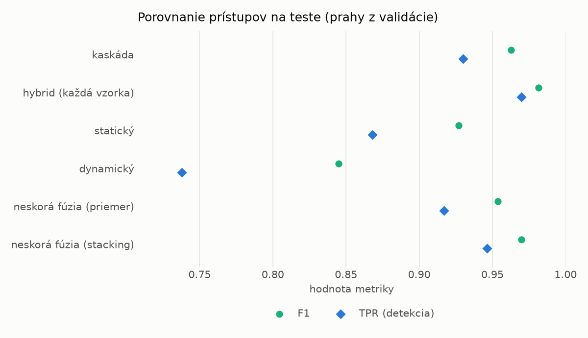
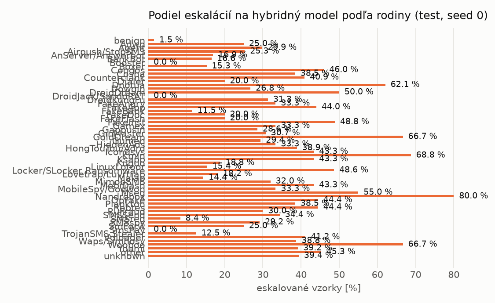

# Kaskáda `heavyteacher` – beh `20261122-222810`

> Generované `src/cascade/evaluate.py` (2026-11-22T22:28:11+01:00). Seedy: [0, 1, 2]; hodnoty = priemer ± sm. odchýlka.
> Všetky prahy sú určené na validácii (FPR ≤ 1 %); test sa na nič nenastavuje.

| rola | beh |
|---|---|
| static | `runs_v4/real_full/lofo/FakeInst/students_static/mlp_kd_heavy/20261122-222409` |
| dynamic | `runs_v4/real_full/lofo/FakeInst/students_dynamic/mlp_kd_heavy/20261122-222652` |
| hybrid | `runs_v4/real_full/lofo/FakeInst/hybrid/lightgbm/20261122-221513` |

## Test
| prístup | accuracy | balanced_accuracy | precision | recall_tpr | fpr | f1 | mcc |
|---|---|---|---|---|---|---|---|
| kaskáda | 0.9618 ± 0.0011 | 0.9638 ± 0.0011 | 0.9978 ± 0.0001 | 0.9299 ± 0.0022 | 0.0023 ± 0.0001 | 0.9627 ± 0.0011 | 0.9261 ± 0.0021 |
| hybrid (každá vzorka) | 0.9805 ± 0.0007 | 0.9812 ± 0.0006 | 0.9932 ± 0.0002 | 0.9699 ± 0.0011 | 0.0075 ± 0.0002 | 0.9814 ± 0.0007 | 0.9613 ± 0.0013 |
| statický | 0.9275 ± 0.0017 | 0.9312 ± 0.0016 | 0.9942 ± 0.0006 | 0.8681 ± 0.0038 | 0.0057 ± 0.0006 | 0.9269 ± 0.0019 | 0.8633 ± 0.0028 |
| dynamický | 0.8567 ± 0.0045 | 0.8642 ± 0.0042 | 0.9889 ± 0.0013 | 0.7377 ± 0.0096 | 0.0093 ± 0.0012 | 0.8450 ± 0.0059 | 0.7437 ± 0.0068 |
| neskorá fúzia (priemer) | 0.9528 ± 0.0043 | 0.9551 ± 0.0040 | 0.9934 ± 0.0018 | 0.9170 ± 0.0099 | 0.0069 ± 0.0019 | 0.9536 ± 0.0045 | 0.9088 ± 0.0078 |
| neskorá fúzia (stacking) | 0.9687 ± 0.0010 | 0.9701 ± 0.0009 | 0.9943 ± 0.0007 | 0.9463 ± 0.0026 | 0.0061 ± 0.0007 | 0.9697 ± 0.0011 | 0.9386 ± 0.0019 |

## Validácia
| prístup | accuracy | balanced_accuracy | precision | recall_tpr | fpr | f1 | mcc |
|---|---|---|---|---|---|---|---|
| kaskáda | 0.9660 ± 0.0012 | 0.9669 ± 0.0012 | 0.9952 ± 0.0007 | 0.9386 ± 0.0019 | 0.0048 ± 0.0007 | 0.9661 ± 0.0012 | 0.9337 ± 0.0024 |
| hybrid (každá vzorka) | 0.9811 ± 0.0002 | 0.9814 ± 0.0002 | 0.9909 ± 0.0003 | 0.9722 ± 0.0003 | 0.0095 ± 0.0003 | 0.9815 ± 0.0002 | 0.9623 ± 0.0004 |
| statický | 0.9267 ± 0.0007 | 0.9285 ± 0.0007 | 0.9895 ± 0.0000 | 0.8668 ± 0.0014 | 0.0098 ± 0.0000 | 0.9241 ± 0.0008 | 0.8607 ± 0.0013 |
| dynamický | 0.8732 ± 0.0045 | 0.8765 ± 0.0043 | 0.9880 ± 0.0001 | 0.7629 ± 0.0087 | 0.0098 ± 0.0000 | 0.8610 ± 0.0056 | 0.7691 ± 0.0074 |
| neskorá fúzia (priemer) | 0.9561 ± 0.0054 | 0.9571 ± 0.0053 | 0.9902 ± 0.0002 | 0.9240 ± 0.0106 | 0.0097 ± 0.0002 | 0.9559 ± 0.0057 | 0.9146 ± 0.0102 |
| neskorá fúzia (stacking) | 0.9706 ± 0.0009 | 0.9712 ± 0.0009 | 0.9906 ± 0.0001 | 0.9520 ± 0.0018 | 0.0096 ± 0.0002 | 0.9709 ± 0.0009 | 0.9420 ± 0.0017 |

## Správanie kaskády (test, seed 0)
- podiel eskalácií na hybrid: **14.84%** (2318 vzoriek)
- chyby pri zhode študentov (kaskáda ich nemôže opraviť): **535**
  (4.020% zo zhôd; FP 0, FN 535)
- úspešnosť na eskalovaných vzorkách: hybrid 0.9672131147540983, statický 0.7299396031061259,
  dynamický 0.270060396893874  → prínos hybridu pri nezhode

## Výpočtové nároky (odhad z benchmarkov komponentov)
_Chýba benchmark niektorého komponentu (`python -m src.evaluation.benchmark`)._

