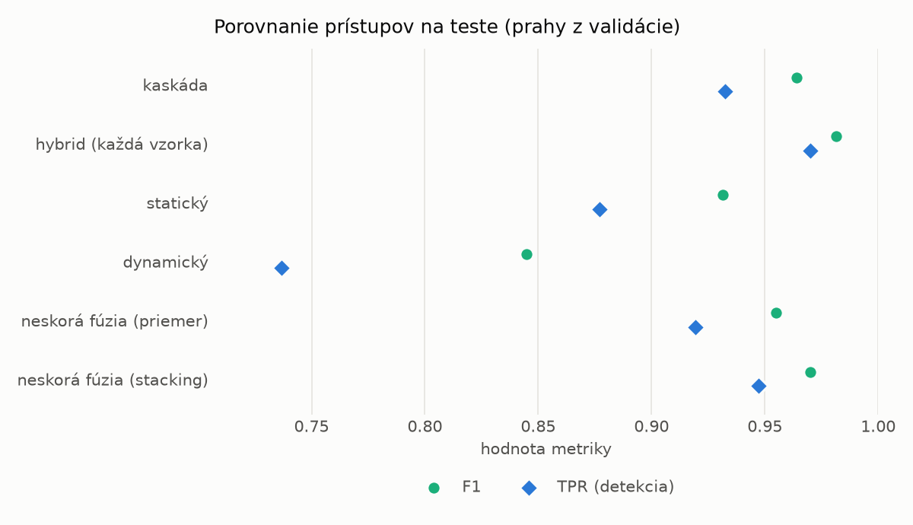
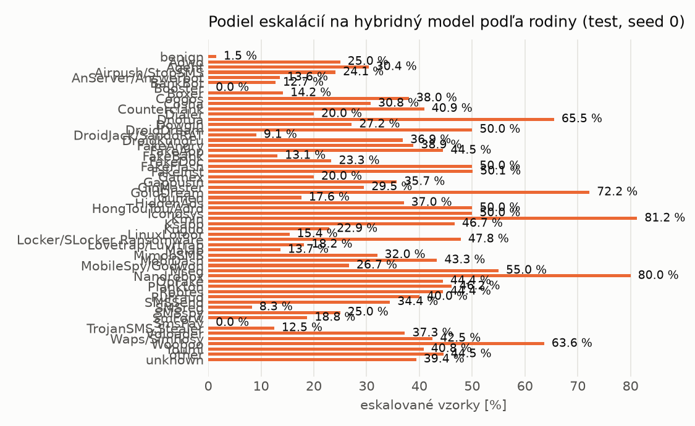

# Kaskáda `modal` – beh `20261122-222803`

> Generované `src/cascade/evaluate.py` (2026-11-22T22:28:04+01:00). Seedy: [0, 1, 2]; hodnoty = priemer ± sm. odchýlka.
> Všetky prahy sú určené na validácii (FPR ≤ 1 %); test sa na nič nenastavuje.

| rola | beh |
|---|---|
| static | `runs_v4/real_full/lofo/FakeInst/students_static/mlp_kd_modal/20261122-222345` |
| dynamic | `runs_v4/real_full/lofo/FakeInst/students_dynamic/mlp_kd_modal/20261122-222607` |
| hybrid | `runs_v4/real_full/lofo/FakeInst/hybrid/lightgbm/20261122-221513` |

## Test
| prístup | accuracy | balanced_accuracy | precision | recall_tpr | fpr | f1 | mcc |
|---|---|---|---|---|---|---|---|
| kaskáda | 0.9629 ± 0.0025 | 0.9649 ± 0.0023 | 0.9973 ± 0.0003 | 0.9326 ± 0.0044 | 0.0029 ± 0.0004 | 0.9638 ± 0.0025 | 0.9281 ± 0.0046 |
| hybrid (každá vzorka) | 0.9805 ± 0.0007 | 0.9812 ± 0.0006 | 0.9932 ± 0.0002 | 0.9699 ± 0.0011 | 0.0075 ± 0.0002 | 0.9814 ± 0.0007 | 0.9613 ± 0.0013 |
| statický | 0.9316 ± 0.0029 | 0.9351 ± 0.0027 | 0.9931 ± 0.0006 | 0.8770 ± 0.0054 | 0.0069 ± 0.0005 | 0.9314 ± 0.0031 | 0.8704 ± 0.0052 |
| dynamický | 0.8568 ± 0.0054 | 0.8643 ± 0.0050 | 0.9902 ± 0.0022 | 0.7369 ± 0.0119 | 0.0082 ± 0.0020 | 0.8449 ± 0.0071 | 0.7443 ± 0.0079 |
| neskorá fúzia (priemer) | 0.9539 ± 0.0021 | 0.9561 ± 0.0019 | 0.9930 ± 0.0004 | 0.9195 ± 0.0044 | 0.0073 ± 0.0005 | 0.9548 ± 0.0022 | 0.9107 ± 0.0038 |
| neskorá fúzia (stacking) | 0.9690 ± 0.0015 | 0.9703 ± 0.0014 | 0.9940 ± 0.0009 | 0.9471 ± 0.0035 | 0.0064 ± 0.0010 | 0.9700 ± 0.0015 | 0.9391 ± 0.0028 |

## Validácia
| prístup | accuracy | balanced_accuracy | precision | recall_tpr | fpr | f1 | mcc |
|---|---|---|---|---|---|---|---|
| kaskáda | 0.9673 ± 0.0015 | 0.9681 ± 0.0015 | 0.9957 ± 0.0007 | 0.9405 ± 0.0030 | 0.0043 ± 0.0007 | 0.9673 ± 0.0016 | 0.9362 ± 0.0029 |
| hybrid (každá vzorka) | 0.9811 ± 0.0002 | 0.9814 ± 0.0002 | 0.9909 ± 0.0003 | 0.9722 ± 0.0003 | 0.0095 ± 0.0003 | 0.9815 ± 0.0002 | 0.9623 ± 0.0004 |
| statický | 0.9361 ± 0.0026 | 0.9376 ± 0.0025 | 0.9897 ± 0.0001 | 0.8851 ± 0.0050 | 0.0098 ± 0.0000 | 0.9345 ± 0.0028 | 0.8776 ± 0.0047 |
| dynamický | 0.8697 ± 0.0069 | 0.8732 ± 0.0067 | 0.9882 ± 0.0002 | 0.7560 ± 0.0135 | 0.0096 ± 0.0002 | 0.8566 ± 0.0087 | 0.7635 ± 0.0113 |
| neskorá fúzia (priemer) | 0.9561 ± 0.0023 | 0.9571 ± 0.0022 | 0.9902 ± 0.0001 | 0.9239 ± 0.0045 | 0.0097 ± 0.0002 | 0.9559 ± 0.0024 | 0.9145 ± 0.0042 |
| neskorá fúzia (stacking) | 0.9701 ± 0.0013 | 0.9707 ± 0.0013 | 0.9904 ± 0.0000 | 0.9512 ± 0.0026 | 0.0098 ± 0.0000 | 0.9704 ± 0.0014 | 0.9411 ± 0.0026 |

## Správanie kaskády (test, seed 0)
- podiel eskalácií na hybrid: **14.75%** (2305 vzoriek)
- chyby pri zhode študentov (kaskáda ich nemôže opraviť): **479**
  (3.596% zo zhôd; FP 3, FN 476)
- úspešnosť na eskalovaných vzorkách: hybrid 0.9605206073752711, statický 0.7466377440347072,
  dynamický 0.2533622559652928  → prínos hybridu pri nezhode

## Výpočtové nároky (odhad z benchmarkov komponentov)
_Chýba benchmark niektorého komponentu (`python -m src.evaluation.benchmark`)._

