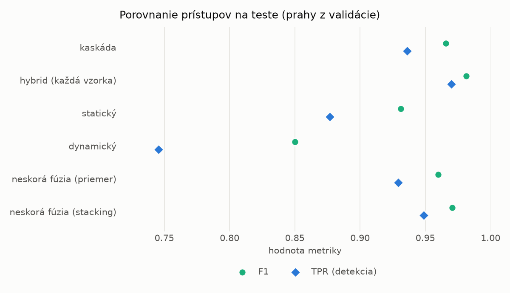
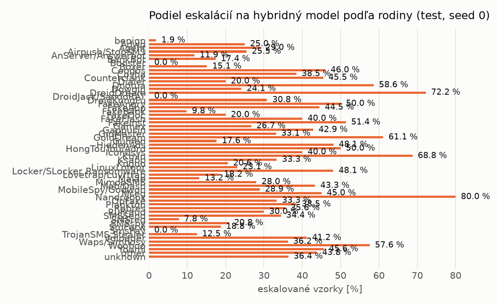

# Kaskáda `nokd` – beh `20261122-222801`

> Generované `src/cascade/evaluate.py` (2026-11-22T22:28:01+01:00). Seedy: [0, 1, 2]; hodnoty = priemer ± sm. odchýlka.
> Všetky prahy sú určené na validácii (FPR ≤ 1 %); test sa na nič nenastavuje.

| rola | beh |
|---|---|
| static | `runs_v4/real_full/lofo/FakeInst/students_static/mlp_nokd/20261122-222316` |
| dynamic | `runs_v4/real_full/lofo/FakeInst/students_dynamic/mlp_nokd/20261122-222518` |
| hybrid | `runs_v4/real_full/lofo/FakeInst/hybrid/lightgbm/20261122-221513` |

## Test
| prístup | accuracy | balanced_accuracy | precision | recall_tpr | fpr | f1 | mcc |
|---|---|---|---|---|---|---|---|
| kaskáda | 0.9647 ± 0.0029 | 0.9665 ± 0.0028 | 0.9971 ± 0.0003 | 0.9361 ± 0.0056 | 0.0031 ± 0.0003 | 0.9656 ± 0.0030 | 0.9314 ± 0.0055 |
| hybrid (každá vzorka) | 0.9805 ± 0.0007 | 0.9812 ± 0.0006 | 0.9932 ± 0.0002 | 0.9699 ± 0.0011 | 0.0075 ± 0.0002 | 0.9814 ± 0.0007 | 0.9613 ± 0.0013 |
| statický | 0.9314 ± 0.0083 | 0.9348 ± 0.0078 | 0.9928 ± 0.0003 | 0.8769 ± 0.0157 | 0.0072 ± 0.0003 | 0.9312 ± 0.0089 | 0.8700 ± 0.0148 |
| dynamický | 0.8606 ± 0.0038 | 0.8678 ± 0.0035 | 0.9883 ± 0.0016 | 0.7456 ± 0.0083 | 0.0099 ± 0.0015 | 0.8500 ± 0.0049 | 0.7497 ± 0.0057 |
| neskorá fúzia (priemer) | 0.9588 ± 0.0041 | 0.9607 ± 0.0038 | 0.9925 ± 0.0003 | 0.9293 ± 0.0079 | 0.0079 ± 0.0004 | 0.9598 ± 0.0041 | 0.9198 ± 0.0075 |
| neskorá fúzia (stacking) | 0.9697 ± 0.0003 | 0.9710 ± 0.0002 | 0.9935 ± 0.0004 | 0.9489 ± 0.0008 | 0.0069 ± 0.0004 | 0.9707 ± 0.0003 | 0.9404 ± 0.0005 |

## Validácia
| prístup | accuracy | balanced_accuracy | precision | recall_tpr | fpr | f1 | mcc |
|---|---|---|---|---|---|---|---|
| kaskáda | 0.9695 ± 0.0040 | 0.9702 ± 0.0039 | 0.9956 ± 0.0002 | 0.9449 ± 0.0076 | 0.0044 ± 0.0002 | 0.9696 ± 0.0041 | 0.9403 ± 0.0076 |
| hybrid (každá vzorka) | 0.9811 ± 0.0002 | 0.9814 ± 0.0002 | 0.9909 ± 0.0003 | 0.9722 ± 0.0003 | 0.0095 ± 0.0003 | 0.9815 ± 0.0002 | 0.9623 ± 0.0004 |
| statický | 0.9350 ± 0.0101 | 0.9366 ± 0.0098 | 0.9897 ± 0.0002 | 0.8829 ± 0.0197 | 0.0098 ± 0.0000 | 0.9332 ± 0.0110 | 0.8757 ± 0.0184 |
| dynamický | 0.8776 ± 0.0033 | 0.8809 ± 0.0032 | 0.9883 ± 0.0001 | 0.7715 ± 0.0066 | 0.0097 ± 0.0002 | 0.8665 ± 0.0041 | 0.7765 ± 0.0055 |
| neskorá fúzia (priemer) | 0.9634 ± 0.0057 | 0.9642 ± 0.0056 | 0.9903 ± 0.0001 | 0.9382 ± 0.0112 | 0.0098 ± 0.0000 | 0.9635 ± 0.0059 | 0.9283 ± 0.0109 |
| neskorá fúzia (stacking) | 0.9720 ± 0.0020 | 0.9725 ± 0.0019 | 0.9905 ± 0.0002 | 0.9548 ± 0.0038 | 0.0097 ± 0.0002 | 0.9723 ± 0.0020 | 0.9447 ± 0.0039 |

## Správanie kaskády (test, seed 0)
- podiel eskalácií na hybrid: **14.90%** (2328 vzoriek)
- chyby pri zhode študentov (kaskáda ich nemôže opraviť): **483**
  (3.632% zo zhôd; FP 1, FN 482)
- úspešnosť na eskalovaných vzorkách: hybrid 0.961340206185567, statický 0.7173539518900344,
  dynamický 0.28264604810996563  → prínos hybridu pri nezhode

## Výpočtové nároky (odhad z benchmarkov komponentov)
_Chýba benchmark niektorého komponentu (`python -m src.evaluation.benchmark`)._

