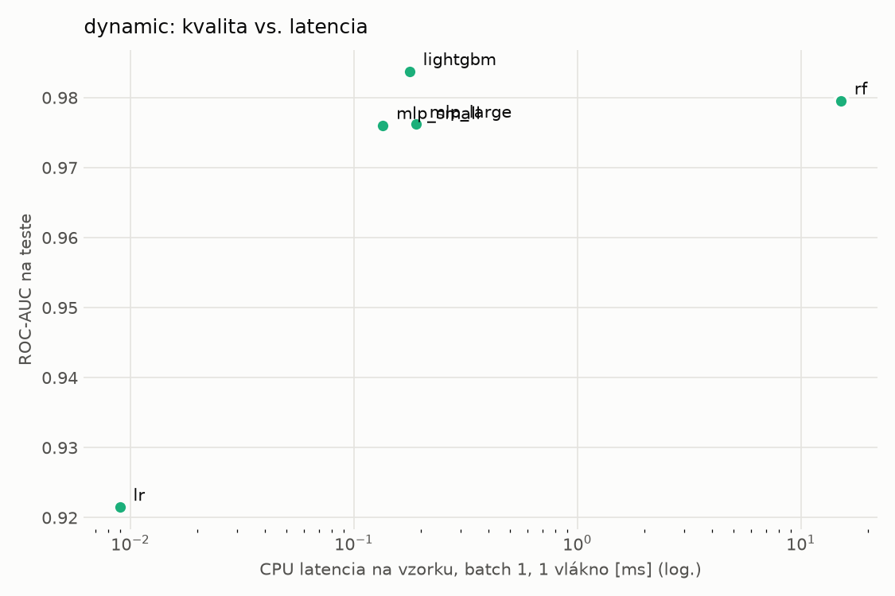
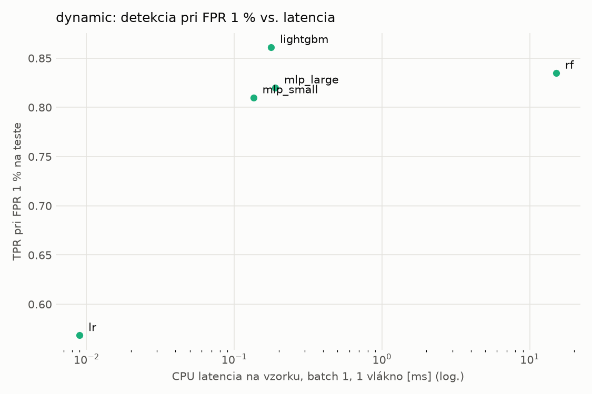
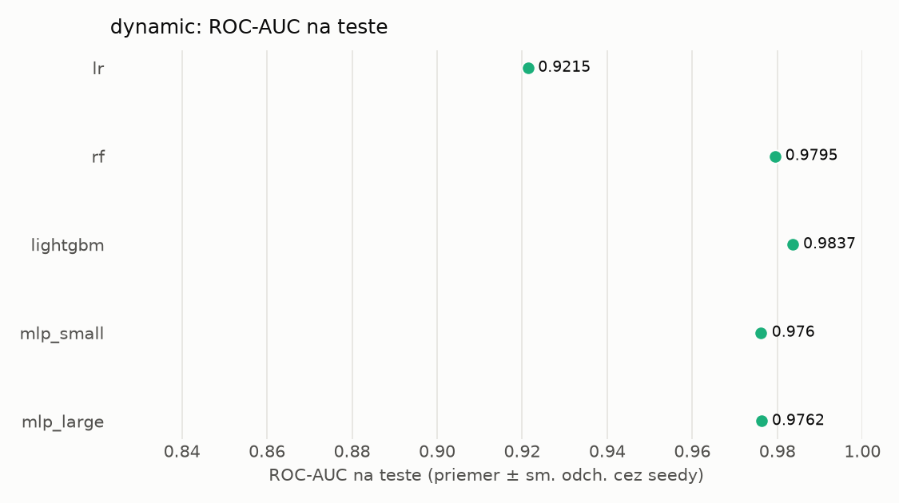
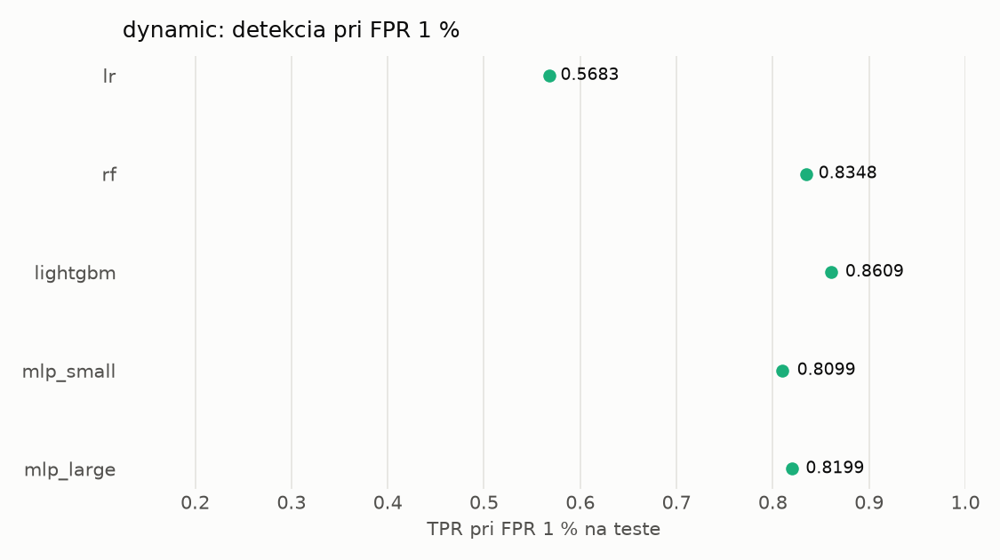

# Porovnanie modelov – dynamic

> Generované `src/evaluation/compare.py` (2026-11-22T22:14:58+01:00); použitý je posledný beh každého modelu.
> Metriky sú priemer cez seedy. \* = pri prahu určenom na validácii (FPR ≤ 1 %).
> CPU ms/vz. = medián latencie jednej vzorky na 1 vlákne vrátane transformácie vstupu (meranie hneď po tréningu,
> orientačné). Oficiálne merania spotreby sú v časti „Spotreba zdrojov pri inferencii“.

## Detekčná kvalita a orientačné časy
| model | ROC-AUC val | ROC-AUC test | TPR@FPR 1 % test | TPR@FPR 0,1 % test | F1 test* | FPR test* | gap train−val | CPU ms/vz. | CPU vz./s | GPU ms/vz. | parametre | MB | tréning s | ladenie min |
|---|---|---|---|---|---|---|---|---|---|---|---|---|---|---|
| [lr](../../dynamic/lr/20261122-221148/README.md) | 0.9230 | 0.9215 ± 0.0000 | 0.5683 | 0.4603 | 0.7288 | 0.0107 | 0.0104 | 0.009 | 4 251 122 | – | 132 | 0.01 | 0.3 | 0.0 |
| [rf](../../dynamic/rf/20261122-221151/README.md) | 0.9795 | 0.9795 ± 0.0001 | 0.8348 | 0.7314 | 0.9034 | 0.0076 | 0.0199 | 15.143 | 114 582 | – | 4 405 874 | 352.88 | 3.1 | 0.0 |
| [lightgbm](../../dynamic/lightgbm/20261122-221211/README.md) | 0.9845 | 0.9837 ± 0.0001 | 0.8609 | 0.7690 | 0.9178 | 0.0088 | 0.0150 | 0.178 | 73 682 | – | 477 954 | 26.27 | 19.1 | 0.0 |
| [mlp_small](../../dynamic/mlp_small/20261122-221324/README.md) | 0.9778 | 0.9760 ± 0.0004 | 0.8099 | 0.6343 | 0.8832 | 0.0079 | 0.0123 | 0.135 | 2 438 092 | 0.643 | 67 585 | 0.28 | 23.5 | 0.0 |
| [mlp_large](../../dynamic/mlp_large/20261122-221437/README.md) | 0.9789 | 0.9762 ± 0.0003 | 0.8199 | 0.6465 | 0.8832 | 0.0067 | 0.0144 | 0.190 | 618 249 | 0.441 | 596 481 | 2.41 | 6.3 | 0.0 |

## Nízka prevalencia malvéru (test, prah z validácie)
| model | TPR | FPR | precision @ 1 % | falošné na 1 skutočný poplach @ 1 % | precision @ 0.1 % | falošné na 1 skutočný poplach @ 0.1 % |
|---|---|---|---|---|---|---|
| lr | 0.5789 | 0.0107 | 0.352 | 1.84 | 0.051 | 18.55 |
| rf | 0.8293 | 0.0076 | 0.524 | 0.91 | 0.098 | 9.18 |
| lightgbm | 0.8548 | 0.0088 | 0.495 | 1.02 | 0.089 | 10.28 |
| mlp_small | 0.7964 | 0.0079 | 0.503 | 0.99 | 0.091 | 9.96 |
| mlp_large | 0.7956 | 0.0067 | 0.545 | 0.84 | 0.106 | 8.43 |

Prepočet: TPR a FPR nezávisia od podielu malvéru, preto sa dajú preniesť na nízku prevalenciu (v reálnej prevádzke je malvéru ~1 % alebo menej; v teste 54 %). „Falošné na 1 skutočný poplach“ = koľko neškodných súborov je označených na každý zachytený malvér.

## Spotreba zdrojov pri inferencii (benchmark, testovacia množina)
_Benchmark zatiaľ nebol spustený (`python -m src.evaluation.benchmark --approach dynamic`)._

## Grafy

