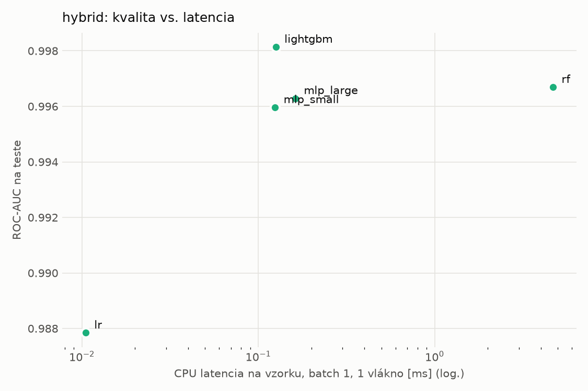
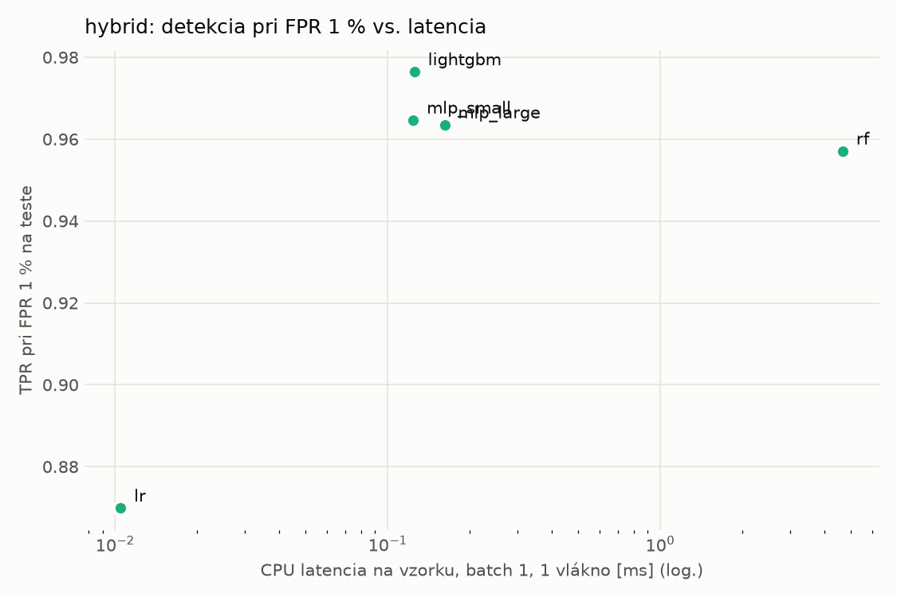
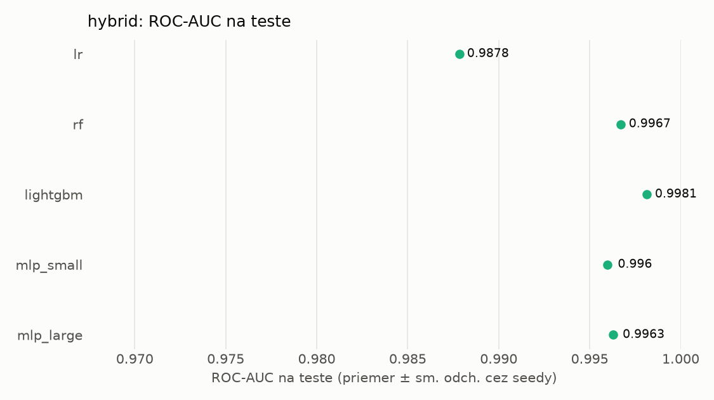
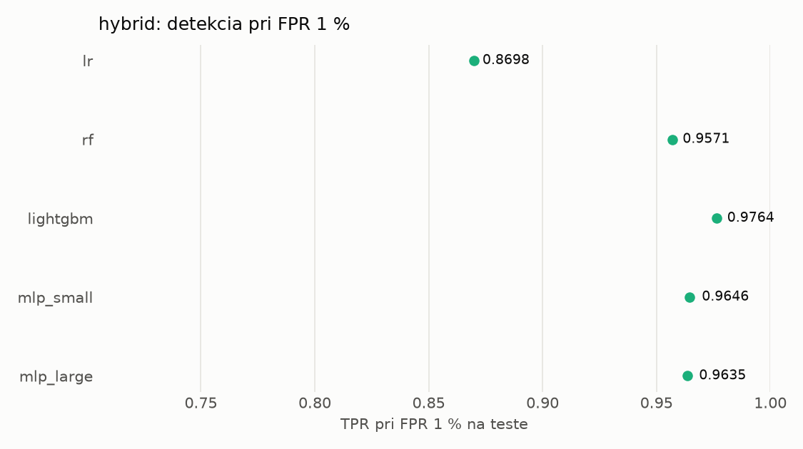

# Porovnanie modelov – hybrid

> Generované `src/evaluation/compare.py` (2026-11-22T22:17:37+01:00); použitý je posledný beh každého modelu.
> Metriky sú priemer cez seedy. \* = pri prahu určenom na validácii (FPR ≤ 1 %).
> CPU ms/vz. = medián latencie jednej vzorky na 1 vlákne vrátane transformácie vstupu (meranie hneď po tréningu,
> orientačné). Oficiálne merania spotreby sú v časti „Spotreba zdrojov pri inferencii“.

## Detekčná kvalita a orientačné časy
| model | ROC-AUC val | ROC-AUC test | TPR@FPR 1 % test | TPR@FPR 0,1 % test | F1 test* | FPR test* | gap train−val | CPU ms/vz. | CPU vz./s | GPU ms/vz. | parametre | MB | tréning s | ladenie min |
|---|---|---|---|---|---|---|---|---|---|---|---|---|---|---|
| [lr](../../hybrid/lr/20261122-221501/README.md) | 0.9866 | 0.9878 ± 0.0000 | 0.8698 | 0.6167 | 0.9210 | 0.0090 | 0.0032 | 0.010 | 2 206 952 | – | 296 | 0.01 | 0.4 | 0.0 |
| [rf](../../hybrid/rf/20261122-221504/README.md) | 0.9961 | 0.9967 ± 0.0000 | 0.9571 | 0.8891 | 0.9702 | 0.0076 | 0.0039 | 4.682 | 239 828 | – | 755 642 | 60.73 | 1.3 | 0.0 |
| [lightgbm](../../hybrid/lightgbm/20261122-221513/README.md) | 0.9974 | 0.9981 ± 0.0000 | 0.9764 | 0.9227 | 0.9814 | 0.0075 | 0.0026 | 0.126 | 114 756 | – | 346 890 | 19.31 | 19.7 | 0.0 |
| [mlp_small](../../hybrid/mlp_small/20261122-221625/README.md) | 0.9951 | 0.9960 ± 0.0002 | 0.9646 | 0.8777 | 0.9741 | 0.0067 | 0.0042 | 0.124 | 973 490 | 0.659 | 109 569 | 0.45 | 10.5 | 0.0 |
| [mlp_large](../../hybrid/mlp_large/20261122-221659/README.md) | 0.9953 | 0.9963 ± 0.0001 | 0.9635 | 0.8931 | 0.9753 | 0.0084 | 0.0039 | 0.162 | 644 319 | 0.430 | 317 697 | 1.29 | 11.9 | 0.0 |

## Nízka prevalencia malvéru (test, prah z validácie)
| model | TPR | FPR | precision @ 1 % | falošné na 1 skutočný poplach @ 1 % | precision @ 0.1 % | falošné na 1 skutočný poplach @ 0.1 % |
|---|---|---|---|---|---|---|
| lr | 0.8604 | 0.0090 | 0.492 | 1.03 | 0.088 | 10.43 |
| rf | 0.9486 | 0.0076 | 0.557 | 0.80 | 0.111 | 8.02 |
| lightgbm | 0.9699 | 0.0075 | 0.567 | 0.76 | 0.115 | 7.71 |
| mlp_small | 0.9552 | 0.0067 | 0.591 | 0.69 | 0.125 | 6.97 |
| mlp_large | 0.9588 | 0.0084 | 0.536 | 0.87 | 0.103 | 8.74 |

Prepočet: TPR a FPR nezávisia od podielu malvéru, preto sa dajú preniesť na nízku prevalenciu (v reálnej prevádzke je malvéru ~1 % alebo menej; v teste 54 %). „Falošné na 1 skutočný poplach“ = koľko neškodných súborov je označených na každý zachytený malvér.

## Spotreba zdrojov pri inferencii (benchmark, testovacia množina)
_Benchmark zatiaľ nebol spustený (`python -m src.evaluation.benchmark --approach hybrid`)._

## Grafy

