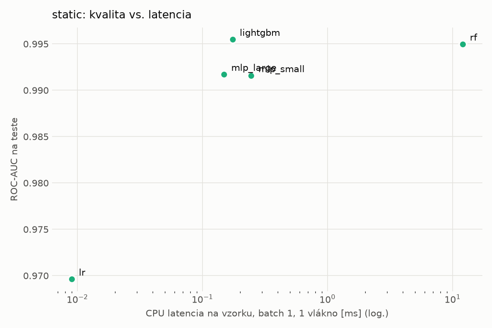
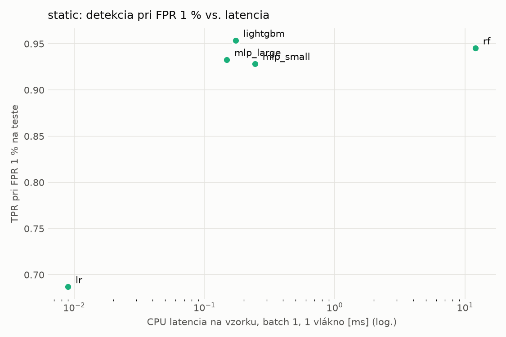
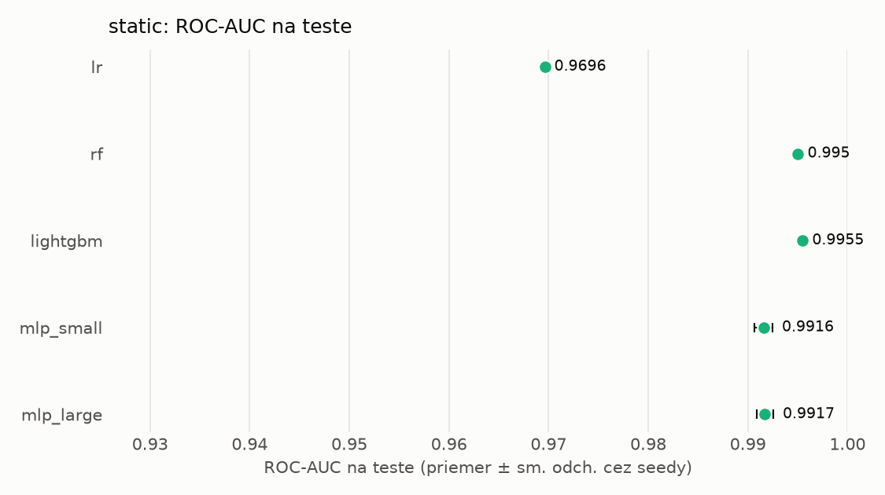
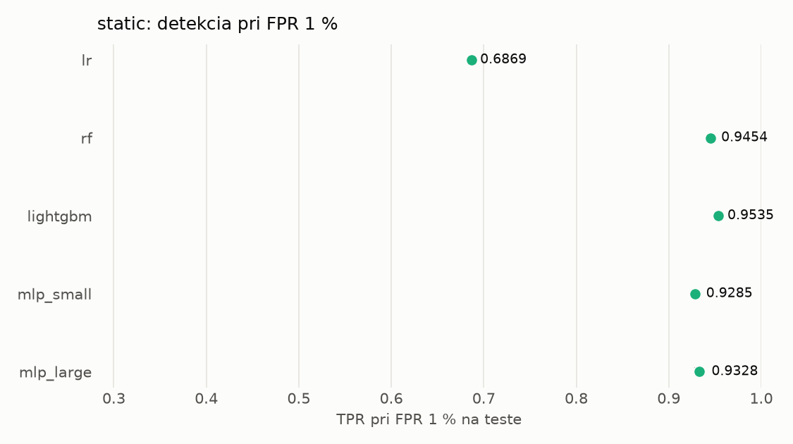

# Porovnanie modelov – static

> Generované `src/evaluation/compare.py` (2026-11-22T22:11:45+01:00); použitý je posledný beh každého modelu.
> Metriky sú priemer cez seedy. \* = pri prahu určenom na validácii (FPR ≤ 1 %).
> CPU ms/vz. = medián latencie jednej vzorky na 1 vlákne vrátane transformácie vstupu (meranie hneď po tréningu,
> orientačné). Oficiálne merania spotreby sú v časti „Spotreba zdrojov pri inferencii“.

## Detekčná kvalita a orientačné časy
| model | ROC-AUC val | ROC-AUC test | TPR@FPR 1 % test | TPR@FPR 0,1 % test | F1 test* | FPR test* | gap train−val | CPU ms/vz. | CPU vz./s | GPU ms/vz. | parametre | MB | tréning s | ladenie min |
|---|---|---|---|---|---|---|---|---|---|---|---|---|---|---|
| [lr](../../static/lr/20261122-220852/README.md) | 0.9681 | 0.9696 ± 0.0000 | 0.6869 | 0.2509 | 0.7681 | 0.0082 | 0.0023 | 0.009 | 3 996 368 | – | 165 | 0.01 | 0.2 | 0.0 |
| [rf](../../static/rf/20261122-220856/README.md) | 0.9943 | 0.9950 ± 0.0001 | 0.9454 | 0.8539 | 0.9606 | 0.0065 | 0.0057 | 12.041 | 148 901 | – | 2 567 808 | 205.80 | 1.9 | 0.0 |
| [lightgbm](../../static/lightgbm/20261122-220910/README.md) | 0.9949 | 0.9955 ± 0.0000 | 0.9535 | 0.8432 | 0.9678 | 0.0061 | 0.0051 | 0.174 | 80 288 | – | 608 517 | 33.80 | 12.5 | 0.0 |
| [mlp_small](../../static/mlp_small/20261122-221006/README.md) | 0.9918 | 0.9916 ± 0.0009 | 0.9285 | 0.6785 | 0.9470 | 0.0072 | 0.0064 | 0.245 | 1 417 825 | 0.646 | 76 033 | 0.32 | 16.8 | 0.0 |
| [mlp_large](../../static/mlp_large/20261122-221059/README.md) | 0.9916 | 0.9917 ± 0.0008 | 0.9328 | 0.7789 | 0.9457 | 0.0053 | 0.0063 | 0.149 | 896 273 | 0.443 | 250 625 | 1.02 | 14.6 | 0.0 |

## Nízka prevalencia malvéru (test, prah z validácie)
| model | TPR | FPR | precision @ 1 % | falošné na 1 skutočný poplach @ 1 % | precision @ 0.1 % | falošné na 1 skutočný poplach @ 0.1 % |
|---|---|---|---|---|---|---|
| lr | 0.6280 | 0.0082 | 0.437 | 1.29 | 0.072 | 12.99 |
| rf | 0.9296 | 0.0065 | 0.591 | 0.69 | 0.125 | 6.97 |
| lightgbm | 0.9427 | 0.0061 | 0.610 | 0.64 | 0.134 | 6.44 |
| mlp_small | 0.9052 | 0.0072 | 0.559 | 0.79 | 0.112 | 7.96 |
| mlp_large | 0.9012 | 0.0053 | 0.632 | 0.58 | 0.145 | 5.88 |

Prepočet: TPR a FPR nezávisia od podielu malvéru, preto sa dajú preniesť na nízku prevalenciu (v reálnej prevádzke je malvéru ~1 % alebo menej; v teste 54 %). „Falošné na 1 skutočný poplach“ = koľko neškodných súborov je označených na každý zachytený malvér.

## Spotreba zdrojov pri inferencii (benchmark, testovacia množina)
_Benchmark zatiaľ nebol spustený (`python -m src.evaluation.benchmark --approach static`)._

## Grafy

