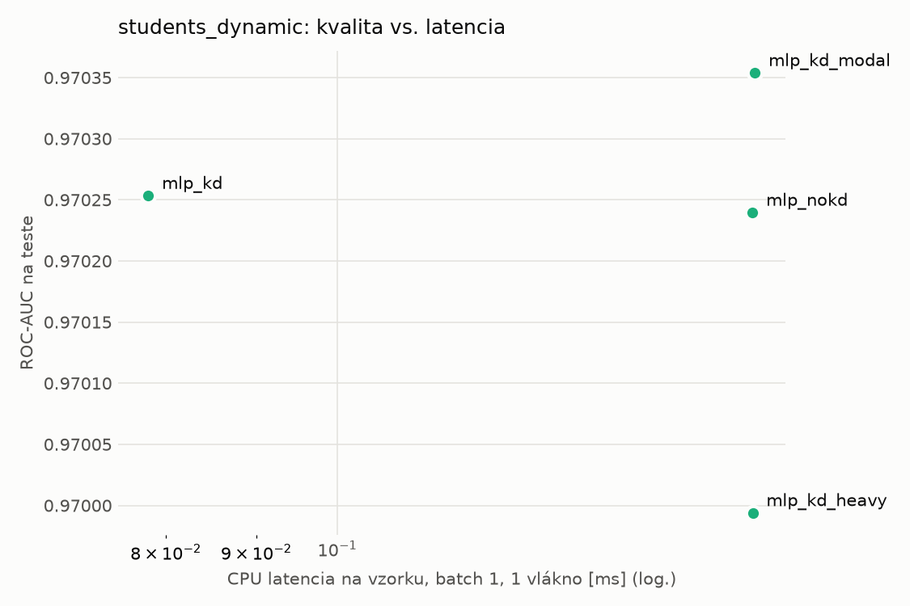
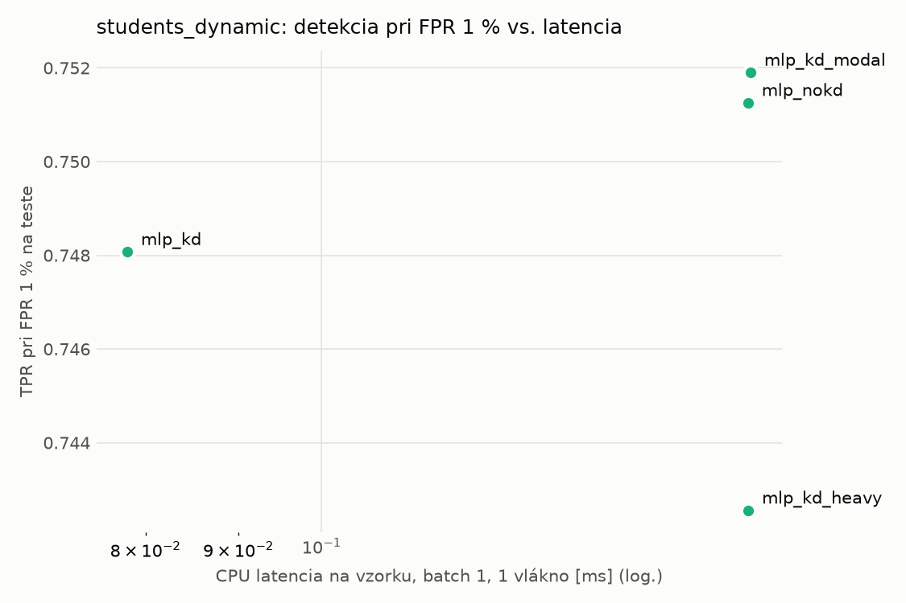
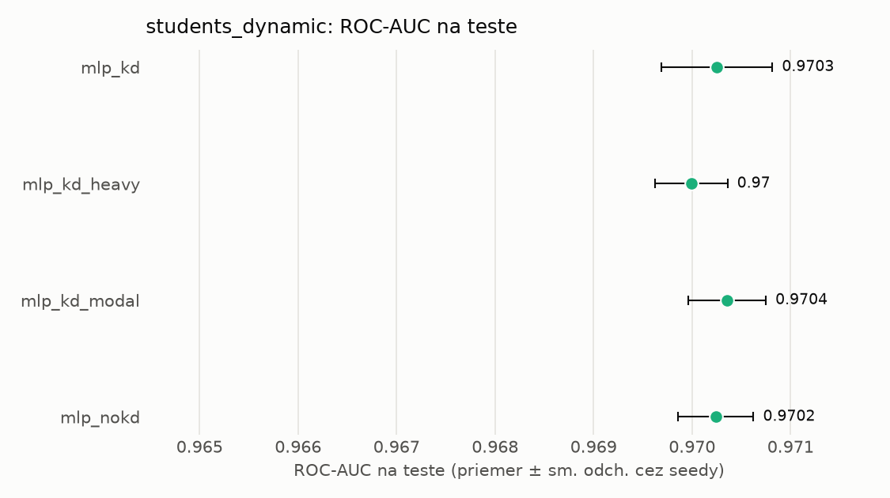
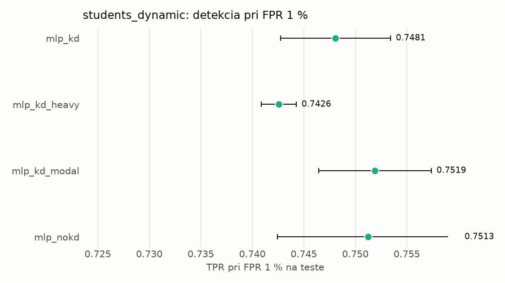

# Porovnanie modelov – students_dynamic

> Generované `src/evaluation/compare.py` (2026-11-22T22:27:56+01:00); použitý je posledný beh každého modelu.
> Metriky sú priemer cez seedy. \* = pri prahu určenom na validácii (FPR ≤ 1 %).
> CPU ms/vz. = medián latencie jednej vzorky na 1 vlákne vrátane transformácie vstupu (meranie hneď po tréningu,
> orientačné). Oficiálne merania spotreby sú v časti „Spotreba zdrojov pri inferencii“.

## Detekčná kvalita a orientačné časy
| model | ROC-AUC val | ROC-AUC test | TPR@FPR 1 % test | TPR@FPR 0,1 % test | F1 test* | FPR test* | gap train−val | CPU ms/vz. | CPU vz./s | GPU ms/vz. | parametre | MB | tréning s | ladenie min |
|---|---|---|---|---|---|---|---|---|---|---|---|---|---|---|
| [mlp_kd](../../students_dynamic/mlp_kd/20261122-222429/README.md) | 0.9712 | 0.9703 ± 0.0006 | 0.7481 | 0.5662 | 0.8496 | 0.0097 | 0.0090 | 0.078 | 7 206 438 | 0.284 | 8 641 | 0.04 | 15.5 | 0.0 |
| [mlp_kd_heavy](../../students_dynamic/mlp_kd_heavy/20261122-222652/README.md) | 0.9710 | 0.9700 ± 0.0004 | 0.7426 | 0.5767 | 0.8450 | 0.0093 | 0.0102 | 0.172 | 5 163 241 | 0.451 | 8 641 | 0.04 | 20.5 | 0.0 |
| [mlp_kd_modal](../../students_dynamic/mlp_kd_modal/20261122-222607/README.md) | 0.9715 | 0.9704 ± 0.0004 | 0.7519 | 0.5807 | 0.8449 | 0.0082 | 0.0086 | 0.172 | 5 634 285 | 0.452 | 8 641 | 0.04 | 14.5 | 0.0 |
| [mlp_nokd](../../students_dynamic/mlp_nokd/20261122-222518/README.md) | 0.9715 | 0.9702 ± 0.0004 | 0.7513 | 0.5646 | 0.8500 | 0.0099 | 0.0101 | 0.172 | 6 256 006 | 0.451 | 8 641 | 0.04 | 15.9 | 0.0 |

## Nízka prevalencia malvéru (test, prah z validácie)
| model | TPR | FPR | precision @ 1 % | falošné na 1 skutočný poplach @ 1 % | precision @ 0.1 % | falošné na 1 skutočný poplach @ 0.1 % |
|---|---|---|---|---|---|---|
| mlp_kd | 0.7449 | 0.0097 | 0.437 | 1.29 | 0.071 | 13.02 |
| mlp_kd_heavy | 0.7377 | 0.0093 | 0.445 | 1.25 | 0.074 | 12.59 |
| mlp_kd_modal | 0.7369 | 0.0082 | 0.476 | 1.10 | 0.082 | 11.13 |
| mlp_nokd | 0.7456 | 0.0099 | 0.431 | 1.32 | 0.070 | 13.31 |

Prepočet: TPR a FPR nezávisia od podielu malvéru, preto sa dajú preniesť na nízku prevalenciu (v reálnej prevádzke je malvéru ~1 % alebo menej; v teste 54 %). „Falošné na 1 skutočný poplach“ = koľko neškodných súborov je označených na každý zachytený malvér.

## Spotreba zdrojov pri inferencii (benchmark, testovacia množina)
_Benchmark zatiaľ nebol spustený (`python -m src.evaluation.benchmark --approach students_dynamic`)._

## Grafy

