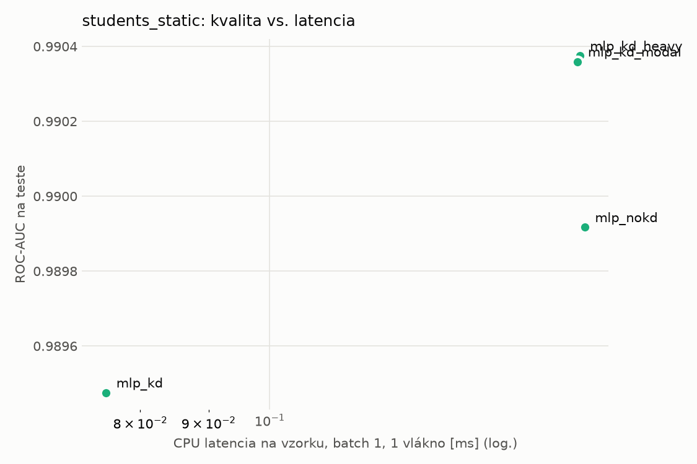
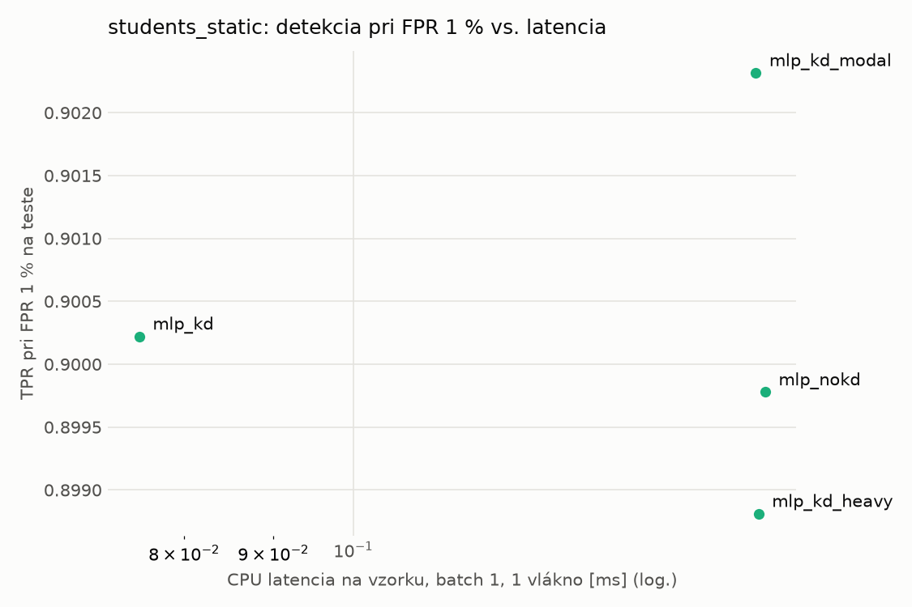
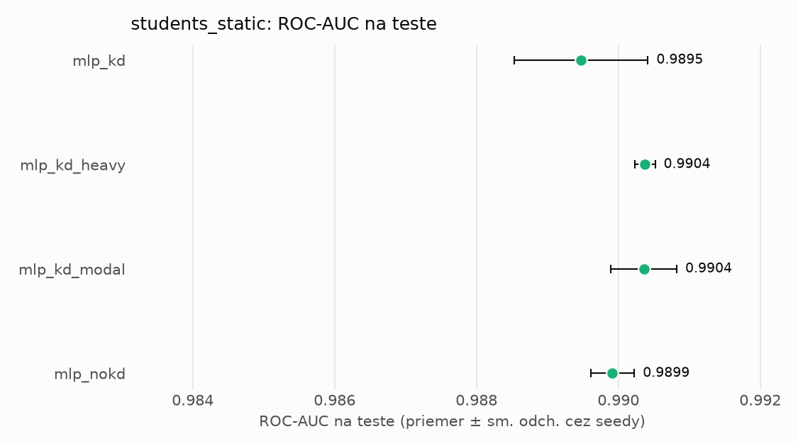
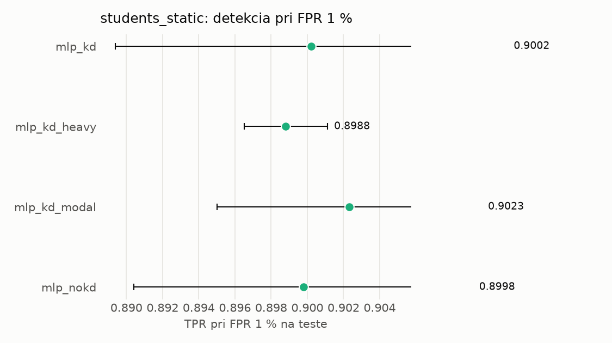

# Porovnanie modelov – students_static

> Generované `src/evaluation/compare.py` (2026-11-22T22:24:26+01:00); použitý je posledný beh každého modelu.
> Metriky sú priemer cez seedy. \* = pri prahu určenom na validácii (FPR ≤ 1 %).
> CPU ms/vz. = medián latencie jednej vzorky na 1 vlákne vrátane transformácie vstupu (meranie hneď po tréningu,
> orientačné). Oficiálne merania spotreby sú v časti „Spotreba zdrojov pri inferencii“.

## Detekčná kvalita a orientačné časy
| model | ROC-AUC val | ROC-AUC test | TPR@FPR 1 % test | TPR@FPR 0,1 % test | F1 test* | FPR test* | gap train−val | CPU ms/vz. | CPU vz./s | GPU ms/vz. | parametre | MB | tréning s | ladenie min |
|---|---|---|---|---|---|---|---|---|---|---|---|---|---|---|
| [mlp_kd](../../students_static/mlp_kd/20261122-222255/README.md) | 0.9893 | 0.9895 ± 0.0009 | 0.9002 | 0.6937 | 0.9300 | 0.0073 | 0.0049 | 0.075 | 2 293 645 | 0.452 | 10 753 | 0.05 | 6.1 | 0.0 |
| [mlp_kd_heavy](../../students_static/mlp_kd_heavy/20261122-222409/README.md) | 0.9891 | 0.9904 ± 0.0001 | 0.8988 | 0.7841 | 0.9269 | 0.0057 | 0.0050 | 0.171 | 2 527 336 | 0.289 | 10 753 | 0.05 | 5.1 | 0.0 |
| [mlp_kd_modal](../../students_static/mlp_kd_modal/20261122-222345/README.md) | 0.9896 | 0.9904 ± 0.0005 | 0.9023 | 0.7339 | 0.9314 | 0.0069 | 0.0043 | 0.170 | 3 183 383 | 0.276 | 10 753 | 0.05 | 7.2 | 0.0 |
| [mlp_nokd](../../students_static/mlp_nokd/20261122-222316/README.md) | 0.9888 | 0.9899 ± 0.0003 | 0.8998 | 0.6612 | 0.9312 | 0.0072 | 0.0060 | 0.172 | 2 579 064 | 0.276 | 10 753 | 0.05 | 9.3 | 0.0 |

## Nízka prevalencia malvéru (test, prah z validácie)
| model | TPR | FPR | precision @ 1 % | falošné na 1 skutočný poplach @ 1 % | precision @ 0.1 % | falošné na 1 skutočný poplach @ 0.1 % |
|---|---|---|---|---|---|---|
| mlp_kd | 0.8747 | 0.0073 | 0.549 | 0.82 | 0.108 | 8.29 |
| mlp_kd_heavy | 0.8681 | 0.0057 | 0.607 | 0.65 | 0.133 | 6.52 |
| mlp_kd_modal | 0.8770 | 0.0069 | 0.562 | 0.78 | 0.113 | 7.85 |
| mlp_nokd | 0.8769 | 0.0072 | 0.553 | 0.81 | 0.109 | 8.16 |

Prepočet: TPR a FPR nezávisia od podielu malvéru, preto sa dajú preniesť na nízku prevalenciu (v reálnej prevádzke je malvéru ~1 % alebo menej; v teste 54 %). „Falošné na 1 skutočný poplach“ = koľko neškodných súborov je označených na každý zachytený malvér.

## Spotreba zdrojov pri inferencii (benchmark, testovacia množina)
_Benchmark zatiaľ nebol spustený (`python -m src.evaluation.benchmark --approach students_static`)._

## Grafy

