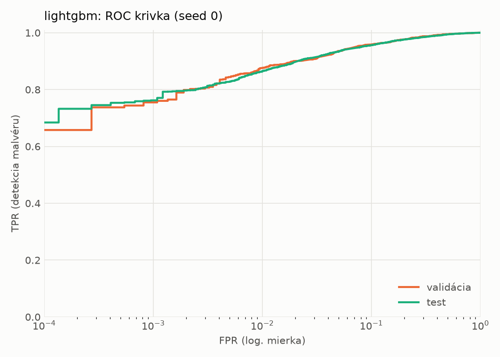
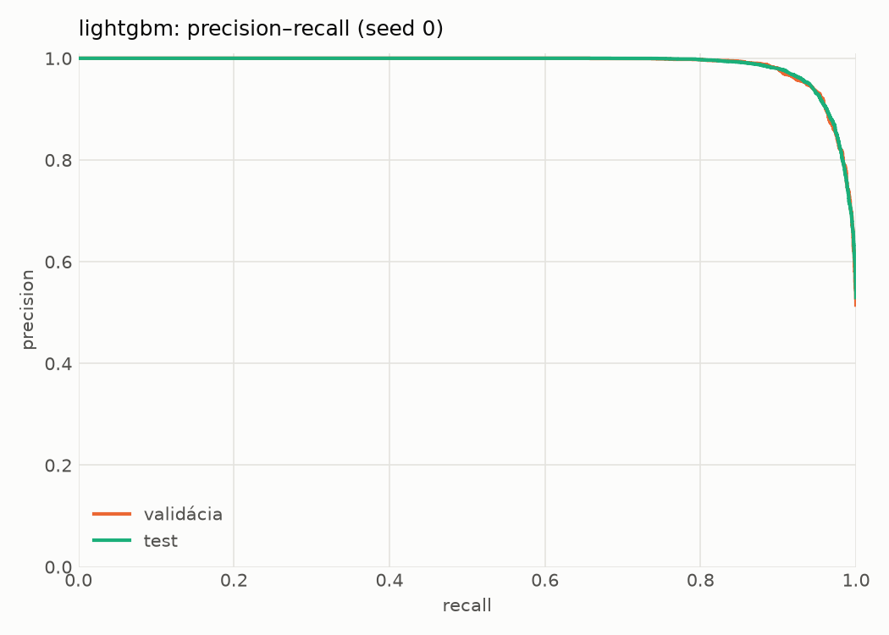
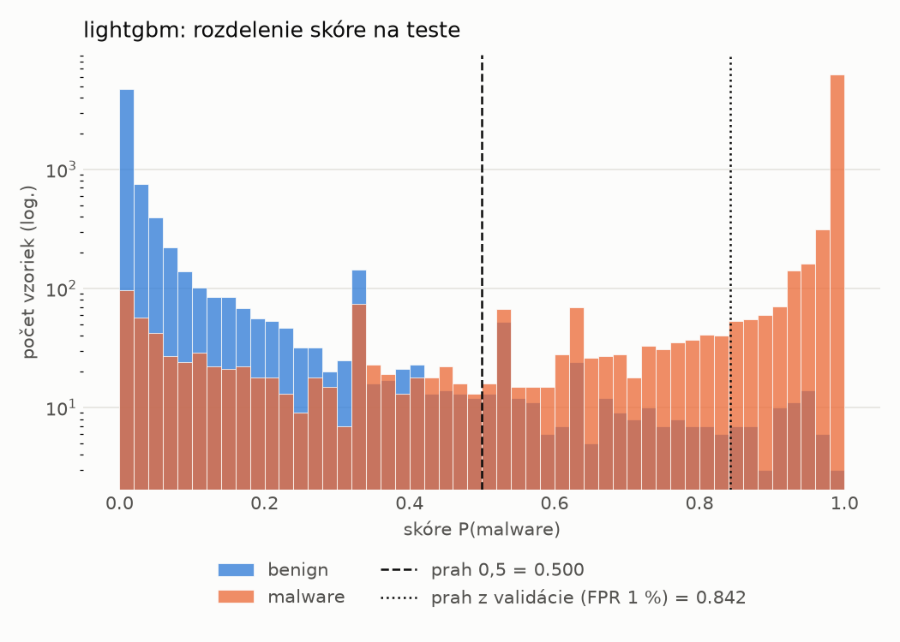
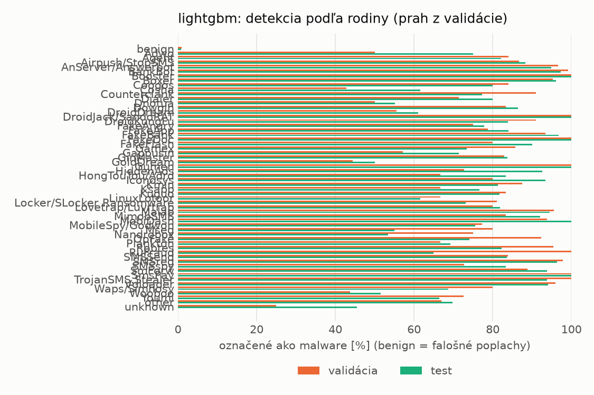
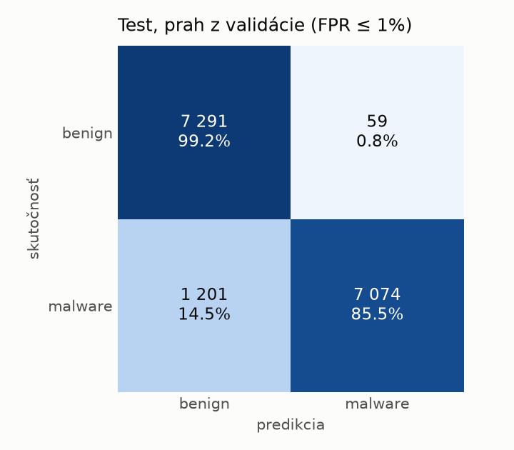
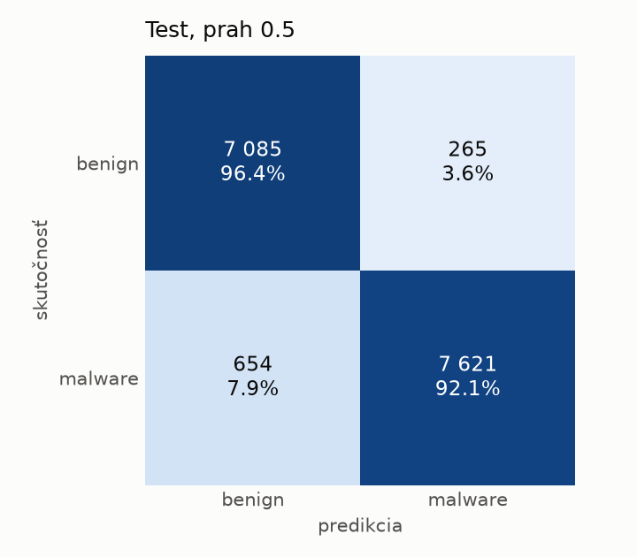
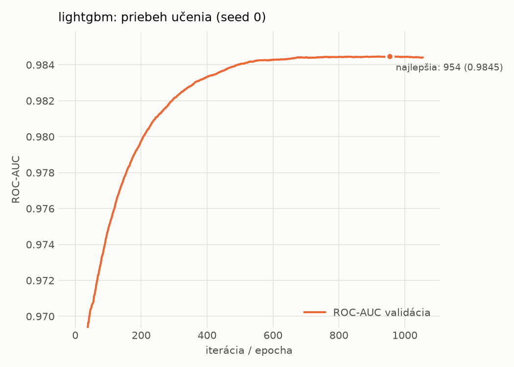

# dynamic/lightgbm – beh `20261122-221211`

> Automaticky generované (`src/training/run_tabular.py`). Konfigurácia: `config.yaml`, protokol: `protocol.yaml`.

- **Model:** `lightgbm` – LightGBM, gradient boosting stromov s early stopping na validácii (pôvodné hodnoty príznakov)
- **Ladenie:** bez ladenia – hyperparametre prevzaté z `runs_v4/real_full/full/dynamic/lightgbm/20261122-191914`
- **Finálne modely:** seedy [0, 1, 2]; hodnoty sú priemer ± smerodajná odchýlka cez seedy
- **Najlepšie hyperparametre:** `{"num_boost_round": 5000, "early_stopping_rounds": 100, "learning_rate": 0.017901592505193763, "num_leaves": 251, "min_child_samples": 52, "feature_fraction": 0.9358255991772038, "bagging_fraction": 0.8815171244905227, "lambda_l1": 0.02987319702672823, "lambda_l2": 0.017348460156736675}`

## Detekčná kvalita (bez prahu)
| metrika | train (podvzorka) | validácia | test |
|---|---|---|---|
| ROC-AUC | 0.9995 ± 0.0001 | 0.9845 ± 0.0001 | 0.9837 ± 0.0001 |
| PR-AUC | 0.9995 ± 0.0001 | 0.9880 ± 0.0000 | 0.9880 ± 0.0001 |
| TPR pri FPR 1 % | 0.9795 ± 0.0013 | 0.8746 ± 0.0020 | 0.8609 ± 0.0033 |
| TPR pri FPR 0,1 % | 0.9721 ± 0.0018 | 0.7462 ± 0.0076 | 0.7690 ± 0.0076 |
| log loss | 0.0362 ± 0.0039 | 0.1537 ± 0.0019 | 0.1598 ± 0.0016 |
| Brier skóre | 0.0087 ± 0.0008 | 0.0435 ± 0.0000 | 0.0450 ± 0.0002 |

Rozdiel ROC-AUC train − validácia: **0.0150** (veľký rozdiel = preučenie).

## Pri prahu z validácie (FPR ≤ 1% na validácii)
| metrika | train (podvzorka) | validácia | test |
|---|---|---|---|
| accuracy | 0.9797 ± 0.0025 | 0.9307 ± 0.0010 | 0.9190 ± 0.0015 |
| balanced accuracy | 0.9800 ± 0.0025 | 0.9324 ± 0.0010 | 0.9230 ± 0.0014 |
| precision | 0.9998 ± 0.0000 | 0.9896 ± 0.0000 | 0.9909 ± 0.0007 |
| recall (TPR) | 0.9601 ± 0.0050 | 0.8746 ± 0.0020 | 0.8548 ± 0.0027 |
| FPR | 0.0002 ± 0.0000 | 0.0098 ± 0.0000 | 0.0088 ± 0.0007 |
| F1 | 0.9795 ± 0.0026 | 0.9286 ± 0.0011 | 0.9178 ± 0.0016 |
| MCC | 0.9602 ± 0.0048 | 0.8680 ± 0.0018 | 0.8477 ± 0.0026 |

## Pri pevnom prahu 0.5
| metrika | train (podvzorka) | validácia | test |
|---|---|---|---|
| accuracy | 0.9881 ± 0.0008 | 0.9411 ± 0.0003 | 0.9416 ± 0.0006 |
| balanced accuracy | 0.9881 ± 0.0008 | 0.9416 ± 0.0004 | 0.9429 ± 0.0006 |
| precision | 0.9894 ± 0.0001 | 0.9572 ± 0.0019 | 0.9662 ± 0.0005 |
| recall (TPR) | 0.9871 ± 0.0015 | 0.9271 ± 0.0017 | 0.9221 ± 0.0011 |
| FPR | 0.0108 ± 0.0001 | 0.0440 ± 0.0021 | 0.0364 ± 0.0005 |
| F1 | 0.9883 ± 0.0008 | 0.9419 ± 0.0003 | 0.9436 ± 0.0006 |
| MCC | 0.9763 ± 0.0016 | 0.8827 ± 0.0008 | 0.8842 ± 0.0012 |

## Výpočtové nároky (seed 0, testovacia množina)
| meranie | hodnota |
|---|---|
| tréning finálneho modelu | 19.1 s (priemer cez seedy) |
| ladenie spolu | 0 s |
| počet parametrov / uzlov | 477 954 |
| veľkosť modelu na disku | 26.27 MB |
| CPU latencia modelu (batch 1, 1 vlákno) | 0.178 ms (p95 0.207) |
| CPU priepustnosť (24 vlákien) | 73 682 vzoriek/s |

## Grafy
| | |
|---|---|
|  |  |
|  |  |
|  |  |
|  |  |

## Súbory
`metrics.json` (všetky metriky po seedoch vrátane rodín), `timing.json`, `hpo_trials.csv`,
`predictions/<časť>_seed<N>.parquet` (sha256, family, label, score), `model/seed_<N>/`, `log.txt`.
