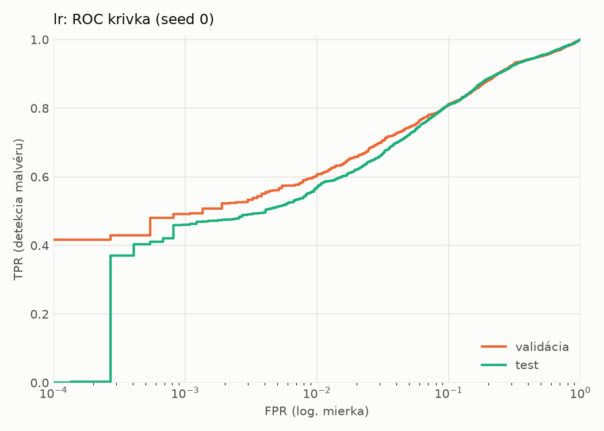
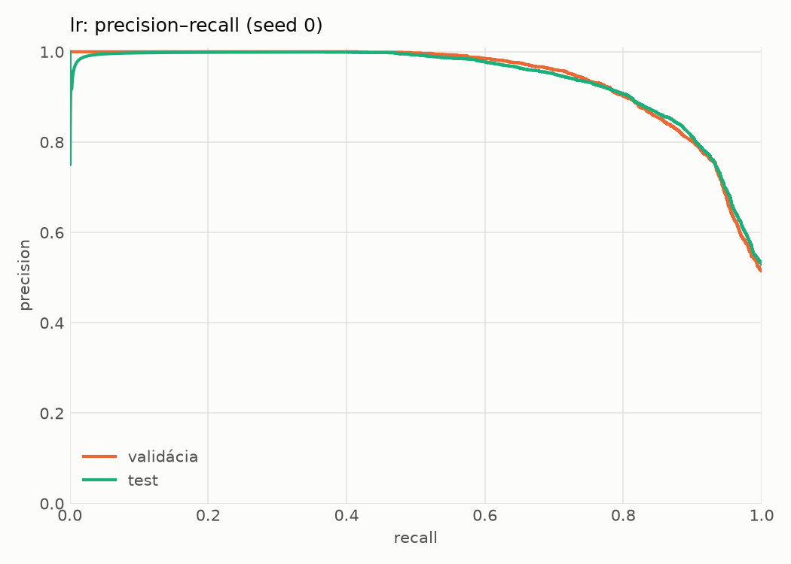
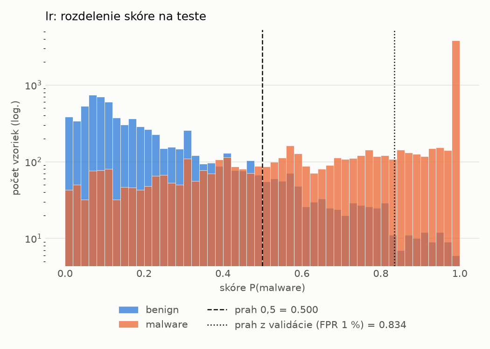
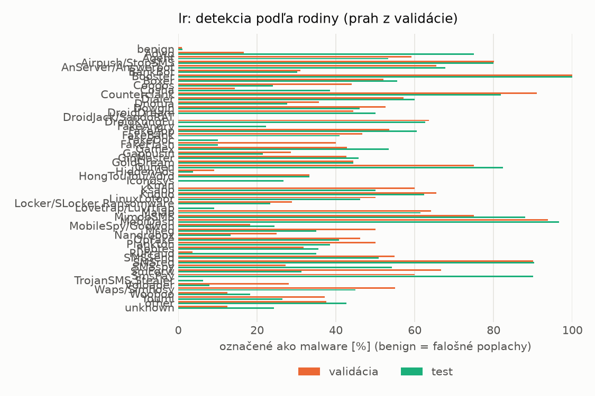
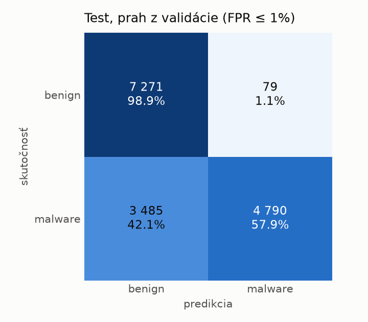
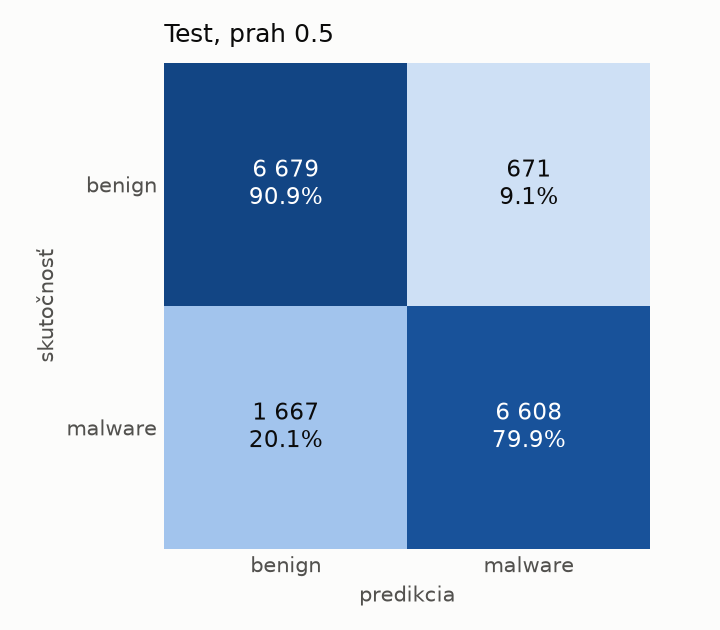

# dynamic/lr – beh `20261122-221148`

> Automaticky generované (`src/training/run_tabular.py`). Konfigurácia: `config.yaml`, protokol: `protocol.yaml`.

- **Model:** `logreg` – logistická regresia s L2 regularizáciou (vstup signed log1p + štandardizácia)
- **Ladenie:** bez ladenia – hyperparametre prevzaté z `runs_v4/real_full/full/dynamic/lr/20261122-191725`
- **Finálne modely:** seedy [0, 1, 2]; hodnoty sú priemer ± smerodajná odchýlka cez seedy
- **Najlepšie hyperparametre:** `{"max_iter": 2000, "C": 3.784688828069828}`

## Detekčná kvalita (bez prahu)
| metrika | train (podvzorka) | validácia | test |
|---|---|---|---|
| ROC-AUC | 0.9335 ± 0.0000 | 0.9230 ± 0.0000 | 0.9215 ± 0.0000 |
| PR-AUC | 0.9473 ± 0.0000 | 0.9425 ± 0.0000 | 0.9415 ± 0.0000 |
| TPR pri FPR 1 % | 0.5937 ± 0.0000 | 0.6024 ± 0.0000 | 0.5683 ± 0.0000 |
| TPR pri FPR 0,1 % | 0.4420 ± 0.0000 | 0.4914 ± 0.0000 | 0.4603 ± 0.0000 |
| log loss | 0.3209 ± 0.0000 | 0.3417 ± 0.0000 | 0.3538 ± 0.0000 |
| Brier skóre | 0.0984 ± 0.0000 | 0.1056 ± 0.0000 | 0.1094 ± 0.0000 |

Rozdiel ROC-AUC train − validácia: **0.0104** (veľký rozdiel = preučenie).

## Pri prahu z validácie (FPR ≤ 1% na validácii)
| metrika | train (podvzorka) | validácia | test |
|---|---|---|---|
| accuracy | 0.8039 ± 0.0000 | 0.7905 ± 0.0000 | 0.7719 ± 0.0000 |
| balanced accuracy | 0.8062 ± 0.0000 | 0.7963 ± 0.0000 | 0.7841 ± 0.0000 |
| precision | 0.9793 ± 0.0000 | 0.9849 ± 0.0000 | 0.9838 ± 0.0000 |
| recall (TPR) | 0.6259 ± 0.0000 | 0.6024 ± 0.0000 | 0.5789 ± 0.0000 |
| FPR | 0.0136 ± 0.0000 | 0.0098 ± 0.0000 | 0.0107 ± 0.0000 |
| F1 | 0.7637 ± 0.0000 | 0.7476 ± 0.0000 | 0.7288 ± 0.0000 |
| MCC | 0.6544 ± 0.0000 | 0.6376 ± 0.0000 | 0.6122 ± 0.0000 |

## Pri pevnom prahu 0.5
| metrika | train (podvzorka) | validácia | test |
|---|---|---|---|
| accuracy | 0.8683 ± 0.0000 | 0.8537 ± 0.0000 | 0.8504 ± 0.0000 |
| balanced accuracy | 0.8689 ± 0.0000 | 0.8551 ± 0.0000 | 0.8536 ± 0.0000 |
| precision | 0.9079 ± 0.0000 | 0.8964 ± 0.0000 | 0.9078 ± 0.0000 |
| recall (TPR) | 0.8234 ± 0.0000 | 0.8095 ± 0.0000 | 0.7985 ± 0.0000 |
| FPR | 0.0857 ± 0.0000 | 0.0993 ± 0.0000 | 0.0913 ± 0.0000 |
| F1 | 0.8636 ± 0.0000 | 0.8508 ± 0.0000 | 0.8497 ± 0.0000 |
| MCC | 0.7402 ± 0.0000 | 0.7116 ± 0.0000 | 0.7077 ± 0.0000 |

## Výpočtové nároky (seed 0, testovacia množina)
| meranie | hodnota |
|---|---|
| tréning finálneho modelu | 0.3 s (priemer cez seedy) |
| ladenie spolu | 0 s |
| počet parametrov / uzlov | 132 |
| veľkosť modelu na disku | 0.01 MB |
| transformácia vstupu – latencia (1 vlákno) | 0.005 ms |
| transformácia vstupu – priepustnosť | 1 274 262 vzoriek/s |
| CPU latencia modelu (batch 1, 1 vlákno) | 0.004 ms (p95 0.004) |
| CPU priepustnosť (24 vlákien) | 4 251 122 vzoriek/s |

## Grafy
| | |
|---|---|
|  |  |
|  |  |
|  |  |
|  |  |

## Súbory
`metrics.json` (všetky metriky po seedoch vrátane rodín), `timing.json`, `hpo_trials.csv`,
`predictions/<časť>_seed<N>.parquet` (sha256, family, label, score), `model/seed_<N>/`, `log.txt`.
