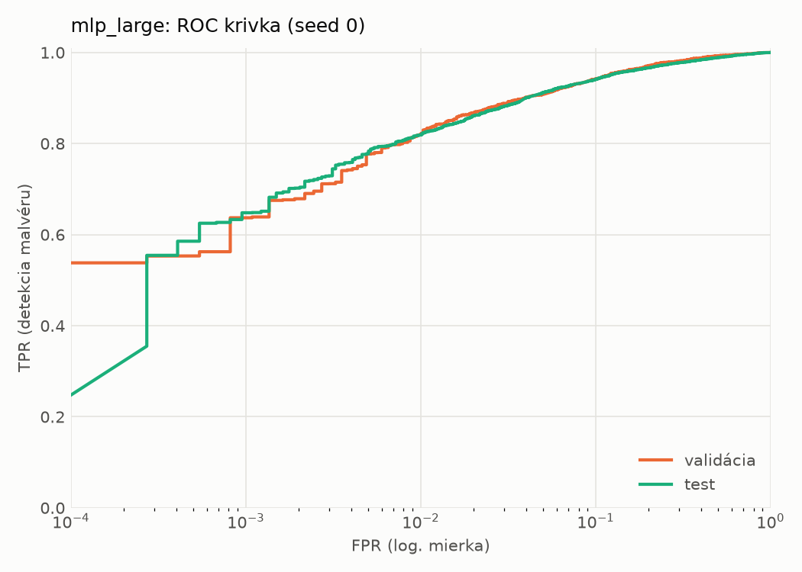
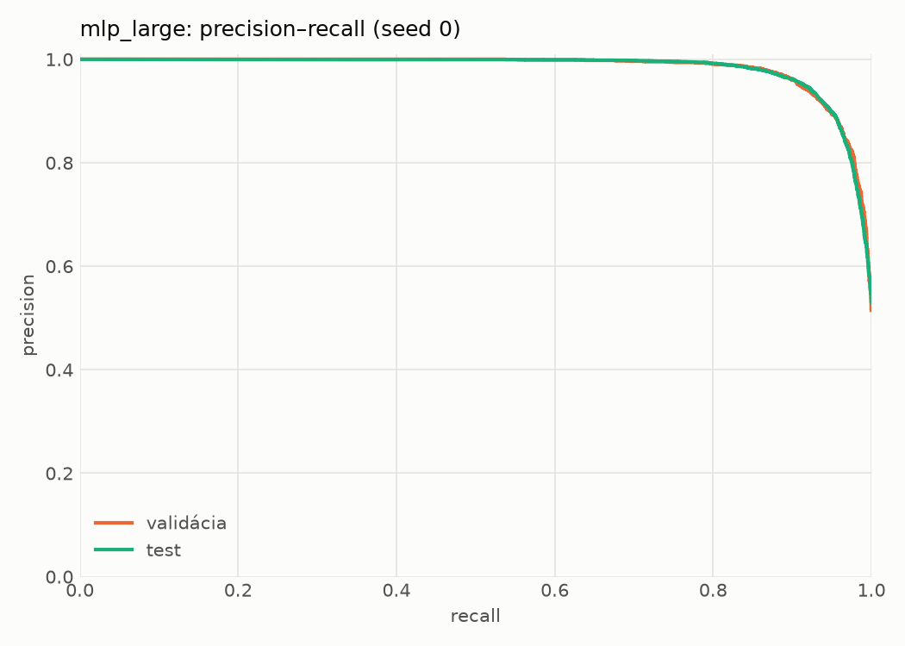
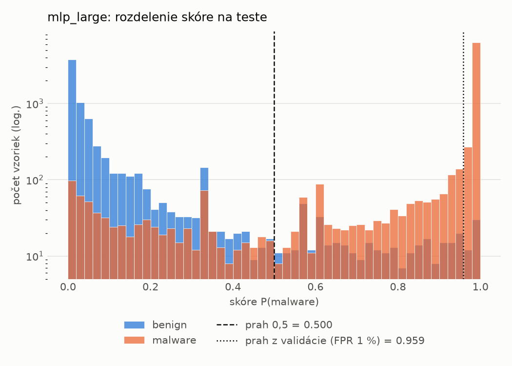
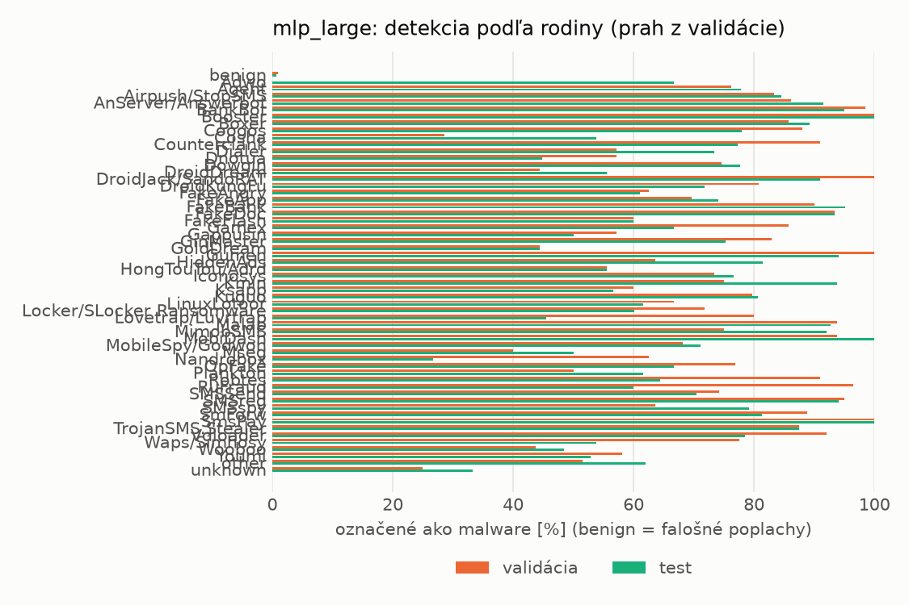
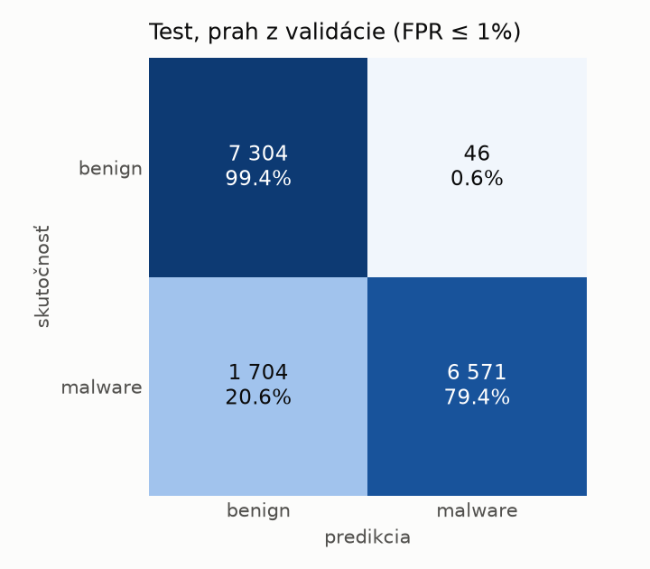
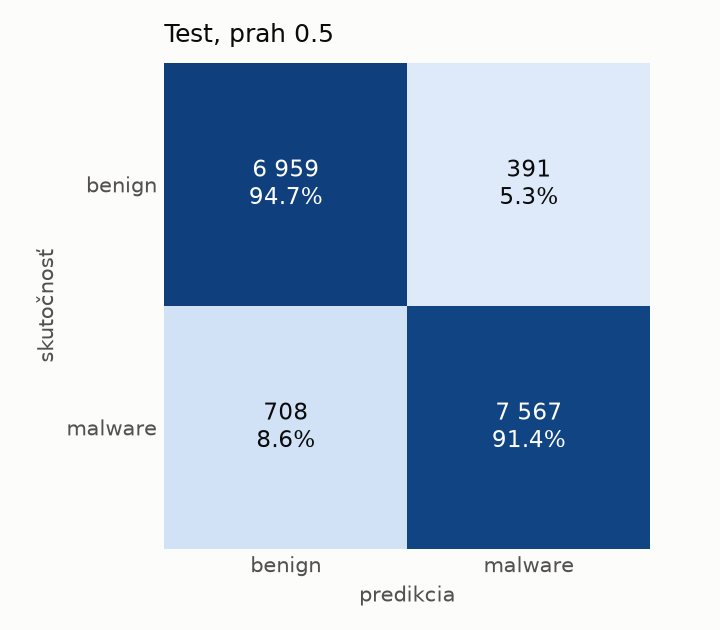
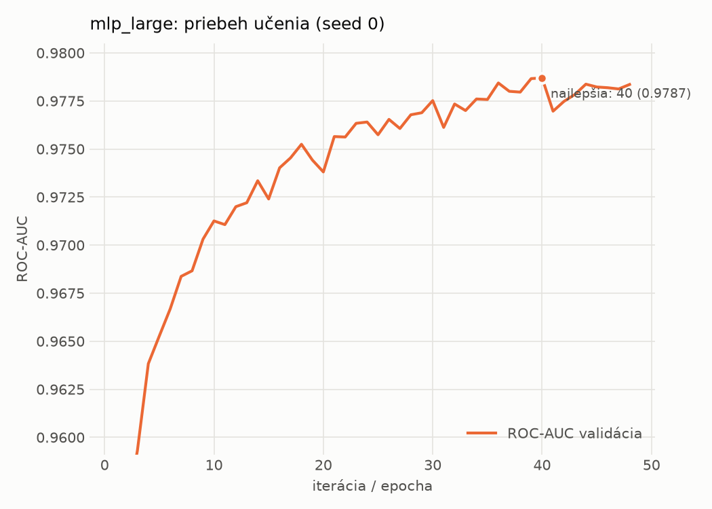

# dynamic/mlp_large – beh `20261122-221437`

> Automaticky generované (`src/training/run_tabular.py`). Konfigurácia: `config.yaml`, protokol: `protocol.yaml`.

- **Model:** `mlp` – veľká neurónová sieť (3–5 skrytých vrstiev, 512–2048 neurónov), kandidát na učiteľa
- **Ladenie:** bez ladenia – hyperparametre prevzaté z `runs_v4/real_full/full/dynamic/mlp_large/20261122-194320`
- **Finálne modely:** seedy [0, 1, 2]; hodnoty sú priemer ± smerodajná odchýlka cez seedy
- **Najlepšie hyperparametre:** `{"max_epochs": 100, "patience": 8, "hidden_layers": 3, "hidden_width": 512, "width_decay": 1.0, "dropout": 0.16077310300541978, "lr": 0.0005048635567863703, "weight_decay": 0.004783411439856203, "batch_size": 1024}`

## Detekčná kvalita (bez prahu)
| metrika | train (podvzorka) | validácia | test |
|---|---|---|---|
| ROC-AUC | 0.9933 ± 0.0007 | 0.9789 ± 0.0003 | 0.9762 ± 0.0003 |
| PR-AUC | 0.9944 ± 0.0005 | 0.9835 ± 0.0003 | 0.9827 ± 0.0003 |
| TPR pri FPR 1 % | 0.9280 ± 0.0052 | 0.8224 ± 0.0031 | 0.8199 ± 0.0032 |
| TPR pri FPR 0,1 % | 0.8869 ± 0.0075 | 0.6255 ± 0.0146 | 0.6465 ± 0.0275 |
| log loss | 0.0972 ± 0.0044 | 0.1879 ± 0.0024 | 0.1973 ± 0.0023 |
| Brier skóre | 0.0279 ± 0.0013 | 0.0522 ± 0.0011 | 0.0538 ± 0.0003 |

Rozdiel ROC-AUC train − validácia: **0.0144** (veľký rozdiel = preučenie).

## Pri prahu z validácie (FPR ≤ 1% na validácii)
| metrika | train (podvzorka) | validácia | test |
|---|---|---|---|
| accuracy | 0.9254 ± 0.0020 | 0.9038 ± 0.0016 | 0.8886 ± 0.0012 |
| balanced accuracy | 0.9263 ± 0.0020 | 0.9063 ± 0.0015 | 0.8944 ± 0.0011 |
| precision | 0.9997 ± 0.0001 | 0.9889 ± 0.0000 | 0.9926 ± 0.0006 |
| recall (TPR) | 0.8529 ± 0.0041 | 0.8224 ± 0.0031 | 0.7956 ± 0.0021 |
| FPR | 0.0003 ± 0.0001 | 0.0098 ± 0.0000 | 0.0067 ± 0.0006 |
| F1 | 0.9204 ± 0.0023 | 0.8980 ± 0.0019 | 0.8832 ± 0.0013 |
| MCC | 0.8605 ± 0.0035 | 0.8207 ± 0.0027 | 0.7966 ± 0.0020 |

## Pri pevnom prahu 0.5
| metrika | train (podvzorka) | validácia | test |
|---|---|---|---|
| accuracy | 0.9624 ± 0.0017 | 0.9304 ± 0.0016 | 0.9300 ± 0.0003 |
| balanced accuracy | 0.9626 ± 0.0017 | 0.9307 ± 0.0016 | 0.9313 ± 0.0005 |
| precision | 0.9734 ± 0.0020 | 0.9433 ± 0.0032 | 0.9549 ± 0.0036 |
| recall (TPR) | 0.9518 ± 0.0014 | 0.9200 ± 0.0018 | 0.9109 ± 0.0032 |
| FPR | 0.0267 ± 0.0021 | 0.0587 ± 0.0036 | 0.0484 ± 0.0043 |
| F1 | 0.9625 ± 0.0016 | 0.9315 ± 0.0015 | 0.9324 ± 0.0001 |
| MCC | 0.9251 ± 0.0033 | 0.8610 ± 0.0032 | 0.8611 ± 0.0010 |

## Výpočtové nároky (seed 0, testovacia množina)
| meranie | hodnota |
|---|---|
| tréning finálneho modelu | 6.3 s (priemer cez seedy) |
| ladenie spolu | 0 s |
| počet parametrov / uzlov | 596 481 |
| veľkosť modelu na disku | 2.41 MB |
| transformácia vstupu – latencia (1 vlákno) | 0.015 ms |
| transformácia vstupu – priepustnosť | 732 214 vzoriek/s |
| CPU latencia modelu (batch 1, 1 vlákno) | 0.175 ms (p95 0.362) |
| CPU priepustnosť (24 vlákien) | 618 249 vzoriek/s |
| GPU latencia (batch 1) | 0.441 ms (p95 0.932) |
| GPU priepustnosť | 2 196 713 vzoriek/s |
| GPU špičková pamäť | 127 MB |

## Grafy
| | |
|---|---|
|  |  |
|  |  |
|  |  |
|  |  |

## Súbory
`metrics.json` (všetky metriky po seedoch vrátane rodín), `timing.json`, `hpo_trials.csv`,
`predictions/<časť>_seed<N>.parquet` (sha256, family, label, score), `model/seed_<N>/`, `log.txt`.
