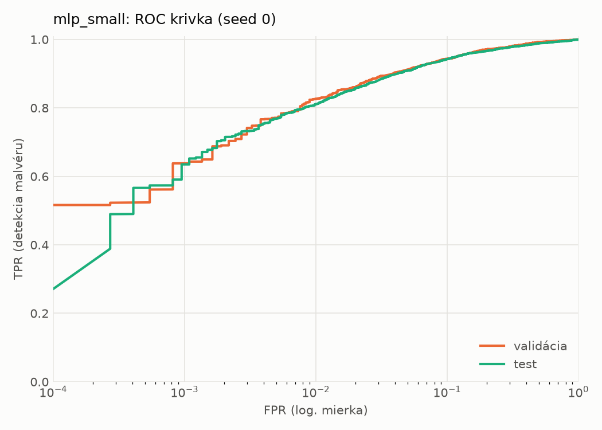
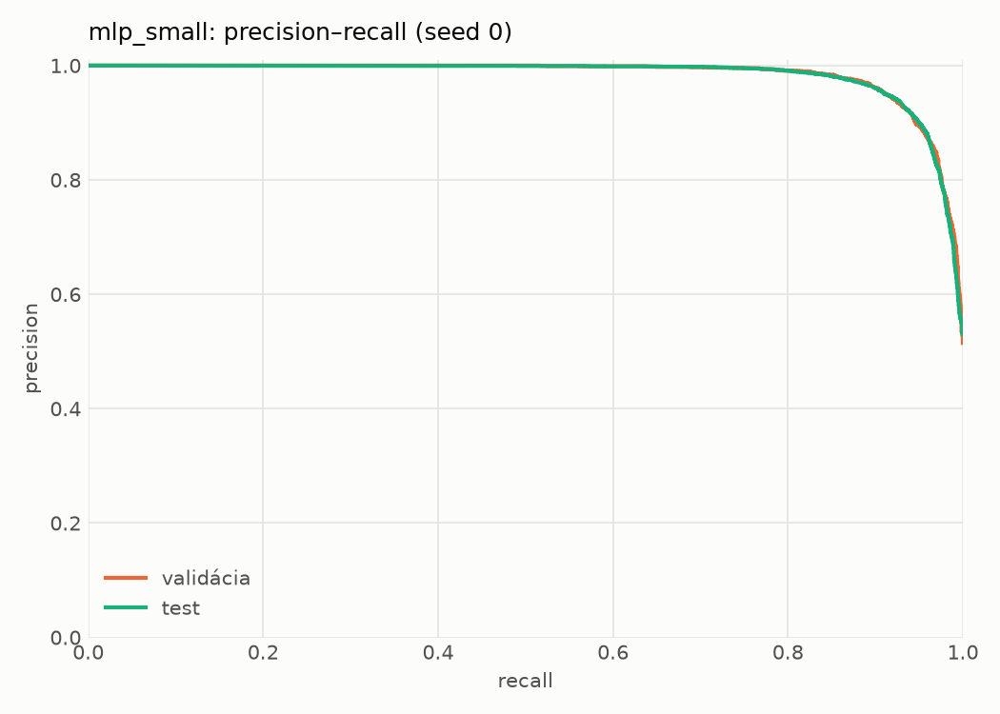
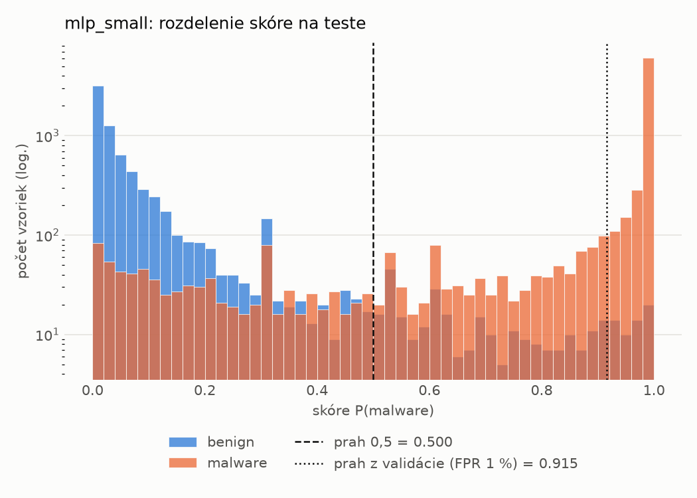
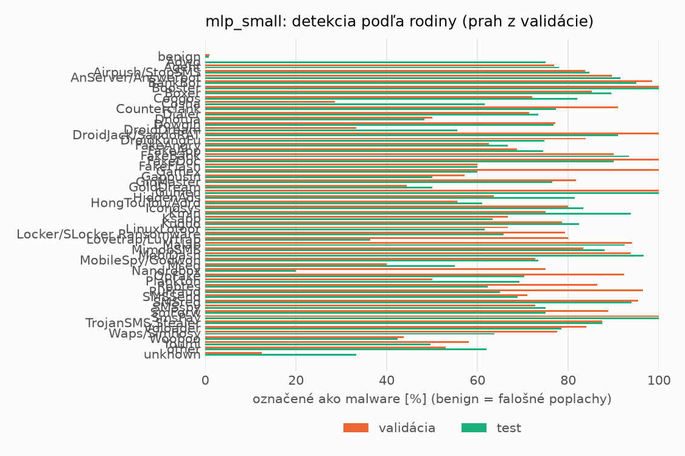
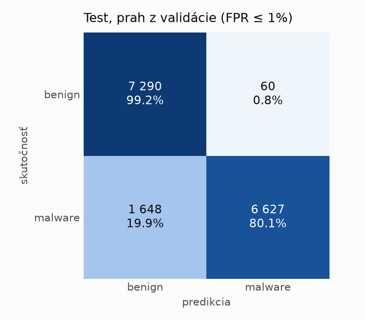
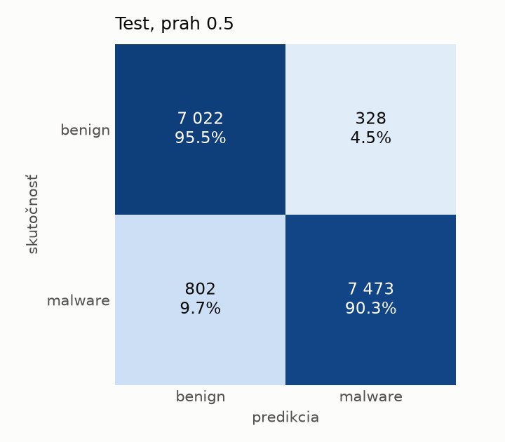
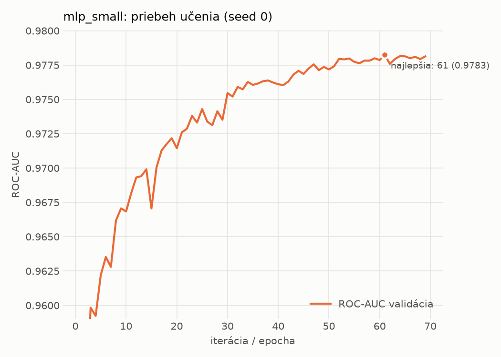

# dynamic/mlp_small – beh `20261122-221324`

> Automaticky generované (`src/training/run_tabular.py`). Konfigurácia: `config.yaml`, protokol: `protocol.yaml`.

- **Model:** `mlp` – malá neurónová sieť (1–2 skryté vrstvy), kandidát na ľahkého študenta
- **Ladenie:** bez ladenia – hyperparametre prevzaté z `runs_v4/real_full/full/dynamic/mlp_small/20261122-193213`
- **Finálne modely:** seedy [0, 1, 2]; hodnoty sú priemer ± smerodajná odchýlka cez seedy
- **Najlepšie hyperparametre:** `{"width_decay": 0.5, "max_epochs": 100, "patience": 8, "hidden_layers": 2, "hidden_width": 256, "dropout": 0.2449160262890371, "lr": 0.002872548733508973, "weight_decay": 4.509331245708397e-06, "batch_size": 256}`

## Detekčná kvalita (bez prahu)
| metrika | train (podvzorka) | validácia | test |
|---|---|---|---|
| ROC-AUC | 0.9901 ± 0.0007 | 0.9778 ± 0.0006 | 0.9760 ± 0.0004 |
| PR-AUC | 0.9919 ± 0.0005 | 0.9827 ± 0.0005 | 0.9824 ± 0.0002 |
| TPR pri FPR 1 % | 0.9099 ± 0.0066 | 0.8228 ± 0.0038 | 0.8099 ± 0.0042 |
| TPR pri FPR 0,1 % | 0.8353 ± 0.0036 | 0.6557 ± 0.0327 | 0.6343 ± 0.0031 |
| log loss | 0.1177 ± 0.0028 | 0.1896 ± 0.0040 | 0.1968 ± 0.0010 |
| Brier skóre | 0.0339 ± 0.0008 | 0.0535 ± 0.0011 | 0.0547 ± 0.0001 |

Rozdiel ROC-AUC train − validácia: **0.0123** (veľký rozdiel = preučenie).

## Pri prahu z validácie (FPR ≤ 1% na validácii)
| metrika | train (podvzorka) | validácia | test |
|---|---|---|---|
| accuracy | 0.9205 ± 0.0021 | 0.9040 ± 0.0020 | 0.8884 ± 0.0023 |
| balanced accuracy | 0.9215 ± 0.0021 | 0.9065 ± 0.0019 | 0.8942 ± 0.0022 |
| precision | 0.9986 ± 0.0002 | 0.9889 ± 0.0001 | 0.9912 ± 0.0002 |
| recall (TPR) | 0.8442 ± 0.0044 | 0.8228 ± 0.0038 | 0.7964 ± 0.0045 |
| FPR | 0.0012 ± 0.0002 | 0.0098 ± 0.0000 | 0.0079 ± 0.0002 |
| F1 | 0.9149 ± 0.0025 | 0.8982 ± 0.0023 | 0.8832 ± 0.0027 |
| MCC | 0.8518 ± 0.0037 | 0.8211 ± 0.0034 | 0.7960 ± 0.0038 |

## Pri pevnom prahu 0.5
| metrika | train (podvzorka) | validácia | test |
|---|---|---|---|
| accuracy | 0.9552 ± 0.0002 | 0.9289 ± 0.0020 | 0.9280 ± 0.0003 |
| balanced accuracy | 0.9554 ± 0.0002 | 0.9293 ± 0.0020 | 0.9294 ± 0.0002 |
| precision | 0.9702 ± 0.0012 | 0.9453 ± 0.0031 | 0.9571 ± 0.0009 |
| recall (TPR) | 0.9404 ± 0.0014 | 0.9148 ± 0.0010 | 0.9045 ± 0.0015 |
| FPR | 0.0296 ± 0.0013 | 0.0562 ± 0.0034 | 0.0456 ± 0.0011 |
| F1 | 0.9551 ± 0.0002 | 0.9298 ± 0.0019 | 0.9301 ± 0.0004 |
| MCC | 0.9109 ± 0.0004 | 0.8582 ± 0.0041 | 0.8574 ± 0.0004 |

## Výpočtové nároky (seed 0, testovacia množina)
| meranie | hodnota |
|---|---|
| tréning finálneho modelu | 23.5 s (priemer cez seedy) |
| ladenie spolu | 0 s |
| počet parametrov / uzlov | 67 585 |
| veľkosť modelu na disku | 0.28 MB |
| transformácia vstupu – latencia (1 vlákno) | 0.007 ms |
| transformácia vstupu – priepustnosť | 950 154 vzoriek/s |
| CPU latencia modelu (batch 1, 1 vlákno) | 0.128 ms (p95 0.138) |
| CPU priepustnosť (24 vlákien) | 2 438 092 vzoriek/s |
| GPU latencia (batch 1) | 0.643 ms (p95 0.673) |
| GPU priepustnosť | 1 967 091 vzoriek/s |
| GPU špičková pamäť | 75 MB |

## Grafy
| | |
|---|---|
|  |  |
|  |  |
|  |  |
|  |  |

## Súbory
`metrics.json` (všetky metriky po seedoch vrátane rodín), `timing.json`, `hpo_trials.csv`,
`predictions/<časť>_seed<N>.parquet` (sha256, family, label, score), `model/seed_<N>/`, `log.txt`.
