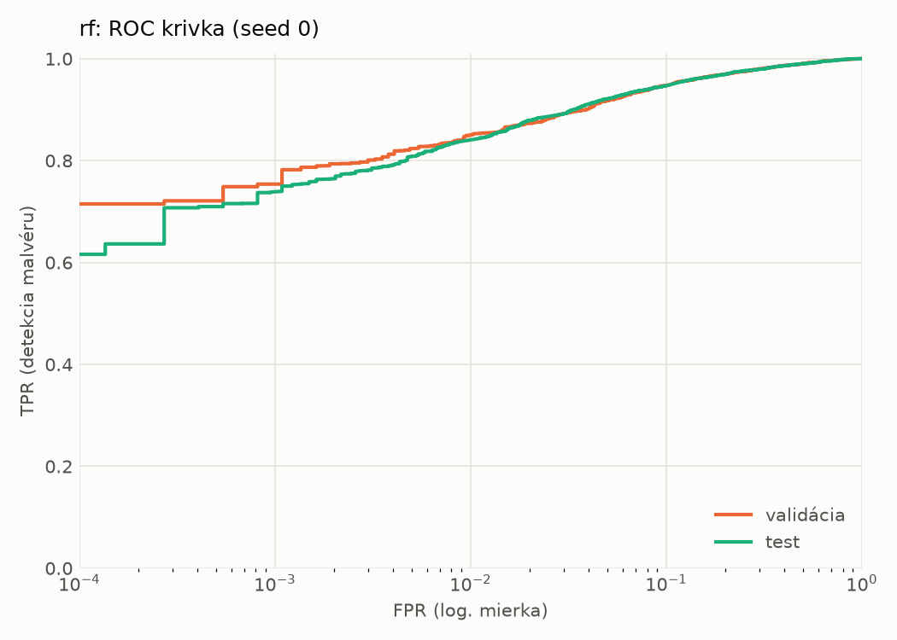
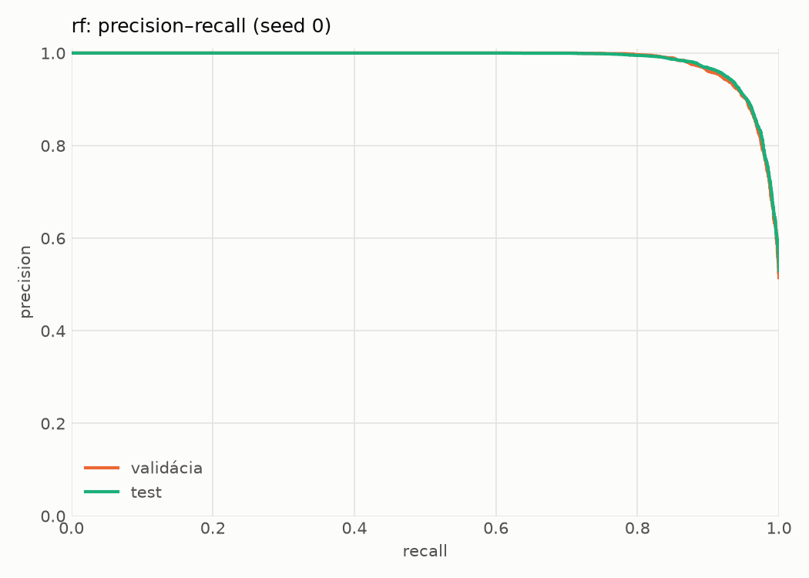
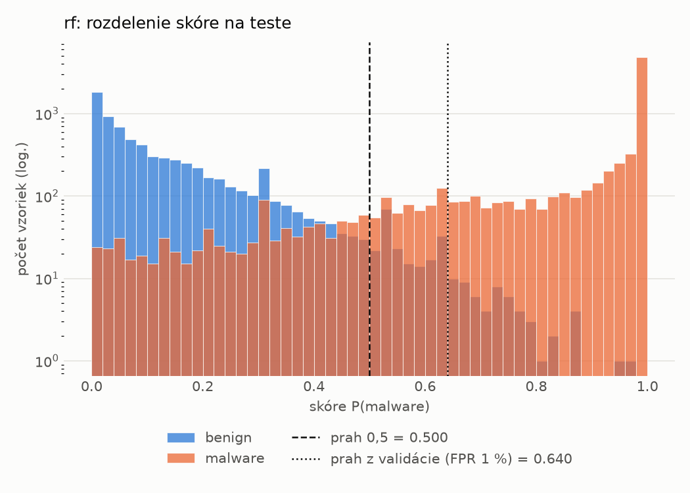
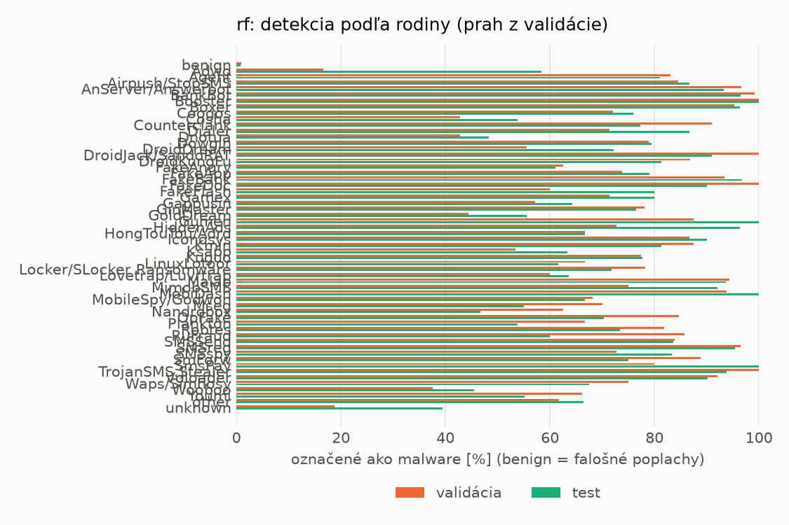
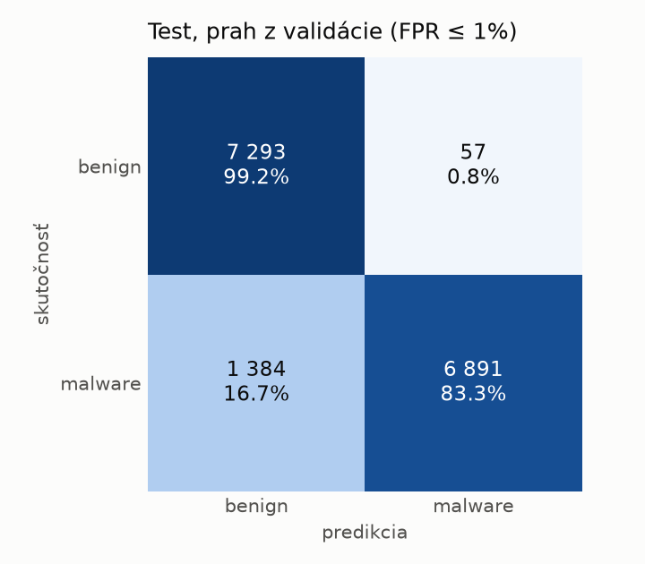
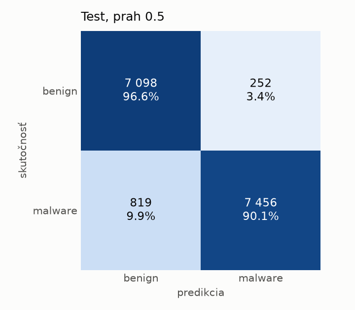

# dynamic/rf – beh `20261122-221151`

> Automaticky generované (`src/training/run_tabular.py`). Konfigurácia: `config.yaml`, protokol: `protocol.yaml`.

- **Model:** `random_forest` – Random Forest (pôvodné hodnoty príznakov)
- **Ladenie:** bez ladenia – hyperparametre prevzaté z `runs_v4/real_full/full/dynamic/rf/20261122-191738`
- **Finálne modely:** seedy [0, 1, 2]; hodnoty sú priemer ± smerodajná odchýlka cez seedy
- **Najlepšie hyperparametre:** `{"n_estimators": 500, "max_depth": 32, "min_samples_leaf": 1, "max_features": "sqrt"}`

## Detekčná kvalita (bez prahu)
| metrika | train (podvzorka) | validácia | test |
|---|---|---|---|
| ROC-AUC | 0.9994 ± 0.0000 | 0.9795 ± 0.0001 | 0.9795 ± 0.0001 |
| PR-AUC | 0.9994 ± 0.0000 | 0.9845 ± 0.0001 | 0.9852 ± 0.0001 |
| TPR pri FPR 1 % | 0.9807 ± 0.0009 | 0.8488 ± 0.0034 | 0.8348 ± 0.0015 |
| TPR pri FPR 0,1 % | 0.9683 ± 0.0006 | 0.7609 ± 0.0086 | 0.7314 ± 0.0074 |
| log loss | 0.0630 ± 0.0001 | 0.1852 ± 0.0007 | 0.1913 ± 0.0002 |
| Brier skóre | 0.0124 ± 0.0000 | 0.0533 ± 0.0001 | 0.0553 ± 0.0001 |

Rozdiel ROC-AUC train − validácia: **0.0199** (veľký rozdiel = preučenie).

## Pri prahu z validácie (FPR ≤ 1% na validácii)
| metrika | train (podvzorka) | validácia | test |
|---|---|---|---|
| accuracy | 0.9827 ± 0.0004 | 0.9174 ± 0.0017 | 0.9060 ± 0.0017 |
| balanced accuracy | 0.9829 ± 0.0004 | 0.9195 ± 0.0016 | 0.9109 ± 0.0016 |
| precision | 0.9998 ± 0.0000 | 0.9893 ± 0.0001 | 0.9919 ± 0.0001 |
| recall (TPR) | 0.9661 ± 0.0008 | 0.8488 ± 0.0034 | 0.8293 ± 0.0034 |
| FPR | 0.0002 ± 0.0000 | 0.0097 ± 0.0002 | 0.0076 ± 0.0001 |
| F1 | 0.9827 ± 0.0004 | 0.9137 ± 0.0019 | 0.9034 ± 0.0020 |
| MCC | 0.9660 ± 0.0008 | 0.8444 ± 0.0029 | 0.8257 ± 0.0029 |

## Pri pevnom prahu 0.5
| metrika | train (podvzorka) | validácia | test |
|---|---|---|---|
| accuracy | 0.9895 ± 0.0002 | 0.9321 ± 0.0007 | 0.9316 ± 0.0007 |
| balanced accuracy | 0.9895 ± 0.0002 | 0.9329 ± 0.0006 | 0.9335 ± 0.0007 |
| precision | 0.9901 ± 0.0000 | 0.9585 ± 0.0010 | 0.9674 ± 0.0005 |
| recall (TPR) | 0.9891 ± 0.0004 | 0.9075 ± 0.0018 | 0.9011 ± 0.0009 |
| FPR | 0.0101 ± 0.0000 | 0.0417 ± 0.0011 | 0.0342 ± 0.0005 |
| F1 | 0.9896 ± 0.0002 | 0.9323 ± 0.0007 | 0.9331 ± 0.0007 |
| MCC | 0.9789 ± 0.0004 | 0.8656 ± 0.0013 | 0.8655 ± 0.0015 |

## Výpočtové nároky (seed 0, testovacia množina)
| meranie | hodnota |
|---|---|
| tréning finálneho modelu | 3.1 s (priemer cez seedy) |
| ladenie spolu | 0 s |
| počet parametrov / uzlov | 4 405 874 |
| veľkosť modelu na disku | 352.88 MB |
| CPU latencia modelu (batch 1, 1 vlákno) | 15.143 ms (p95 15.488) |
| CPU priepustnosť (24 vlákien) | 114 582 vzoriek/s |

## Grafy
| | |
|---|---|
|  |  |
|  |  |
|  |  |
|  |  |

## Súbory
`metrics.json` (všetky metriky po seedoch vrátane rodín), `timing.json`, `hpo_trials.csv`,
`predictions/<časť>_seed<N>.parquet` (sha256, family, label, score), `model/seed_<N>/`, `log.txt`.
